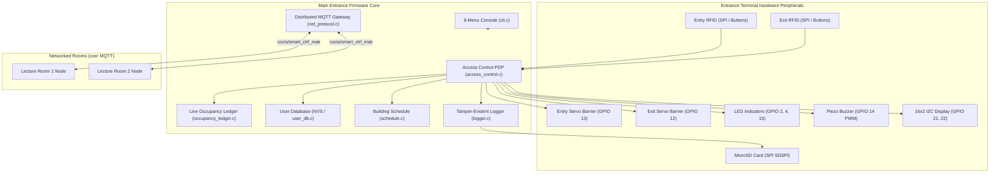

# Application Documentation: Main Entrance Central Coordinator (`apps/entrance_node`)

**Node ID:** `0` (`NODE_ENTRANCE`)  
**Firmware Binary:** `apps/entrance_node/build/entrance_node.bin`  
**Wokwi Configuration:** `apps/entrance_node/wokwi.toml` & `apps/entrance_node/diagram.json`  
**Target Chip:** ESP32-WROOM-32 (Dual-core Xtensa LX6 @ 160MHz)

---

## 1. Executive Summary & Architectural Role

The **Main Entrance Central Coordinator** is the security anchor, policy enforcement point, and audit repository of the CoCIS smart facility:
1. **Access Control & Anti-Passback**: Controls motorized Entry and Exit barrier gates (`servo_entry`, `servo_exit`), enforces user credentials, operational schedules, visitor TTL expiration, and strict anti-passback.
2. **Authoritative Occupancy Ledger**: Maintains in-memory real-time state of every person inside the building with entry timestamps and duration calculations.
3. **SPI MicroSD Logging & SHA-256 Tamper Evident Integrity**: Records all access attempts, system state changes, and remote telemetry to FAT32 storage (`/sdcard`) with append-only SHA-256 hash chains.
4. **Distributed Network Hub (MQTT)**: Listens for incoming telemetry from Lecture Room 1 and Room 2 over `Wokwi-GUEST` Wi-Fi via `broker.hivemq.com`, dispatches ACKs, issues remote overrides, and broadcasts emergency evacuation alarms.
5. **Interactive 8-Menu UART Console & LCD**: Provides administrators with live monitoring, configuration, audit inspection, and self-testing.

---

## 2. Hardware Pinout & Wiring Specifications (`diagram.json`)

| Peripheral / Signal | ESP32 GPIO | Electrical Protocol | Function / Behavior |
| :--- | :--- | :--- | :--- |
| **Entry Servo Barrier** | `GPIO 13` | LEDC PWM (50 Hz, 1-2 ms pulse) | Turnstile barrier: 0° (Closed/Locked) to 90° (Open) |
| **Exit Servo Barrier** | `GPIO 12` | LEDC PWM (50 Hz, 1-2 ms pulse) | Turnstile barrier: 0° (Closed/Locked) to 90° (Open) |
| **System Status LED (Blue)**| `GPIO 2` | Active-High GPIO | Solid = Online / Heartbeat pulse |
| **Access Granted LED (Green)**| `GPIO 4` | Active-High GPIO | 2.5s pulse on valid credential scan |
| **Access Denied LED (Red)**| `GPIO 15` | Active-High GPIO | 2.5s pulse on invalid credential scan / violation |
| **Piezo Buzzer** | `GPIO 14` | LEDC PWM (Frequency-modulated) | Multi-tone acoustic feedback (grant, deny, alarm) |
| **I2C LCD 1602 SDA** | `GPIO 21` | I2C Data (100 kHz) | Address `0x27`, 2x16 character display |
| **I2C LCD 1602 SCL** | `GPIO 22` | I2C Clock (100 kHz) | SCL line with internal pull-up |
| **MicroSD SPI CS** | `GPIO 5` | SPI Chip Select | SDSPI Mode |
| **MicroSD SPI SCK** | `GPIO 18` | SPI Clock | SDSPI Clock |
| **MicroSD SPI MOSI** | `GPIO 23` | SPI Master-Out Slave-In | SDSPI Data In |
| **MicroSD SPI MISO** | `GPIO 19` | SPI Master-In Slave-Out | SDSPI Data Out |
| **Entry Scan Button** | `GPIO 32` | Active-Low Pushbutton (Internal Pull-Up, connected to GND) | Simulates Student Card scan at Entry |
| **Exit Scan Button** | `GPIO 33` | Active-Low Pushbutton (Internal Pull-Up, connected to GND) | Simulates Student Card scan at Exit |
| **Deny Scan Button** | `GPIO 27` | Active-Low Pushbutton (Internal Pull-Up, connected to GND) | Simulates Unregistered Card scan at Entry |
| **Evacuation Button** | `GPIO 26` | Active-Low Pushbutton (Internal Pull-Up, connected to GND) | Hardware emergency trigger |

---

## 3. FreeRTOS Task Architecture

The Entrance Node firmware partitions duties across prioritized FreeRTOS tasks:

| Task Name | Priority | Core | Stack | Description |
| :--- | :--- | :--- | :--- | :--- |
| `main` | 1 | 0 | 4 KB | Initial boot orchestrator; spawns subsystems and deletes self. |
| `access_task` | 5 | 0 | 4 KB | Consumes RFID scan events, evaluates APB & schedule, actuates door servos. |
| `cocis_mqtt` | 5 | 0 | 10 KB | lwIP socket listener processing incoming MQTT packets, HMAC verification, and ACK dispatch. |
| `logger_task` | 3 | 1 | 4 KB | Consumes log queue and appends CSV rows to MicroSD card with SHA-256 hash chaining. |
| `display_task` | 2 | 1 | 3 KB | Refreshes LCD 1602 status banner and renders 2.5-second high-priority alert banners. |
| `cli_task` | 1 | 0 | 4 KB | UART console reader with non-blocking readline and 8-menu command dispatch. |
| `time_sync_task` | 1 | 0 | 3 KB | Periodic SNTP time synchronizer maintaining East Africa Time (`UTC+3`). |

---

## 4. Operational Instructions & Wokwi Simulation

### 4.1 Running in Wokwi
1. Open the project root in VS Code.
2. Navigate to `apps/entrance_node`.
3. Press `F1` and select **Wokwi: Start Simulator** (or click the play button in `diagram.json`).
4. The terminal console will display the boot banner and the 8-menu interactive CLI.

### 4.2 Interactive CLI Commands
Type `help` in the serial console to see all commands:
- `1` or `status`: Display system overview (Wi-Fi, MQTT, doors, room states, SD card).
- `2` or `inside`: Display live list of all occupants currently inside the building.
- `3` or `users`: Display enrolled users and their authorization status.
- `4` or `schedule`: View and adjust weekly building open/close hours in EAT.
- `5` or `rooms`: View live lighting states, vacancy timers, and power metrics.
- `6` or `override`: Remotely control room lighting or issue safe-exit passes.
- `7` or `logs`: Tail the recent access and audit logs from SD storage.
- `8` or `sim selftest`: Execute the automated 10-scenario coursework verification suite.

---

## 5. Security Architecture & Anti-Passback Logic

The Entrance Node implements strict **Directional Anti-Passback**:
- When card $C$ scans at **ENTRY**:
  - `occupancy_ledger_is_inside(C)` is checked.
  - If $C$ is already inside: `DENIED_ANTIPASSBACK_ENTRY`. The gate stays locked, buzzer sounds 3 short beeps, red LED flashes, and violation is logged.
  - If $C$ is outside: `GRANTED_NORMAL`. $C$ is checked into the ledger, Entry servo rotates to 90°, green LED lights, buzzer emits chime.
- When card $C$ scans at **EXIT**:
  - If $C$ is NOT in the ledger: `DENIED_ANTIPASSBACK_EXIT`. The gate stays locked.
  - If $C$ is in the ledger: `GRANTED_NORMAL`. $C$ is checked out, Exit servo rotates to 90°.
