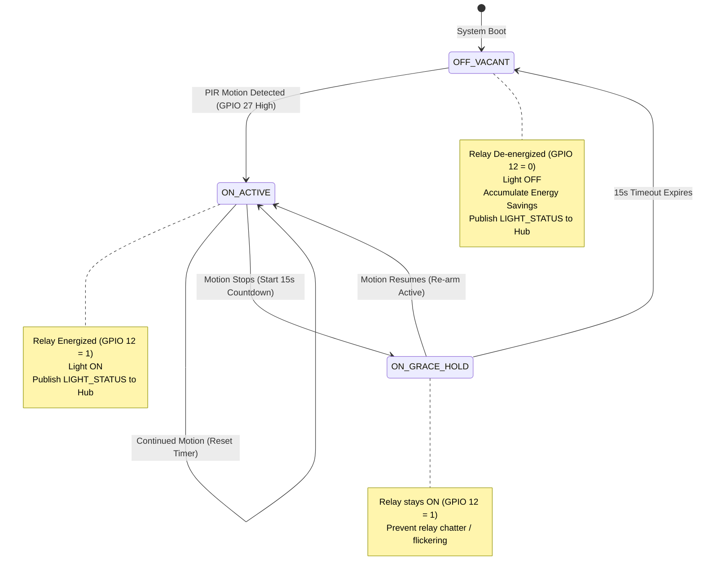

# Application Documentation: Lecture Room 1 Terminal (`apps/room1_node`)

**Node ID:** `1` (`NODE_ROOM_1`)  
**Firmware Binary:** `apps/room1_node/build/room1_node.bin`  
**Wokwi Configuration:** `apps/room1_node/wokwi.toml` & `apps/room1_node/diagram.json`  
**Target Chip:** ESP32-WROOM-32 (Dual-core Xtensa LX6 @ 160MHz)

---

## 1. Executive Summary & Architectural Role

The **Lecture Room 1 Terminal** is an autonomous microcontroller responsible for automating lighting and monitoring room occupancy in Lecture Room 1 of CoCIS:
1. **Autonomous Edge Operation**: Senses motion via an interrupt-driven PIR sensor (`GPIO 27`), executing a 3-state lighting finite state machine (`OFF_VACANT`, `ON_ACTIVE`, `ON_GRACE_HOLD`) completely independently of the central hub or network status.
2. **Energy Conservation Engine**: Immediately powers off the room lighting relay (`GPIO 12`) upon expiration of the 15-second vacancy countdown and computes energy savings in milliwatt-hours (`mWh`) and Ugandan Shillings (`UGX`).
3. **Offline Store-and-Forward Buffer**: Incorporates a 32-entry circular FIFO ring buffer (`room_buffer.c`). If the Wi-Fi or MQTT link drops, all occupancy events are buffered in RAM and flushed in chronological order upon reconnect.
4. **Cryptographic Telemetry**: Packages all motion triggers, lighting state changes, and heartbeats into HMAC-SHA256 authenticated JSON frames and publishes them to the MQTT broker for ingestion by the Main Entrance Coordinator.
5. **Interactive Diagnostic Console**: Provides a local UART CLI for viewing room metrics, checking buffer depth, and injecting simulated PIR triggers.



---

## 2. Hardware Pinout & Wiring Specifications (`diagram.json`)

| Peripheral / Signal | ESP32 GPIO | Electrical Protocol | Function / Behavior |
| :--- | :--- | :--- | :--- |
| **PIR Motion Sensor** | `GPIO 27` | Active-High GPIO Input | Detects human presence with 100 ms hardware debounce |
| **Light Actuator Relay** | `GPIO 12` | Active-High GPIO Output | Drives yellow indicator LED simulating 240V lighting relay |
| **System Status LED (Blue)**| `GPIO 2` | Active-High GPIO Output | Pulses during Wi-Fi / MQTT communication; solid when online |
| **Console UART0 TX** | `GPIO 1` | UART Serial (115200 bps) | Diagnostic serial monitor output |
| **Console UART0 RX** | `GPIO 3` | UART Serial (115200 bps) | Diagnostic serial console input |

---

## 3. FreeRTOS Tasks & Concurrency

The firmware divides processing across dedicated FreeRTOS tasks:

| Task Name | Priority | Core | Stack | Description |
| :--- | :--- | :--- | :--- | :--- |
| `pir_task` | 5 | 0 | 4 KB | Queue worker receiving GPIO 27 edges from `pir_isr_handler` via `s_pir_queue`, debounces, and drives lighting FSM. |
| `cocis_mqtt` | 5 | 0 | 10 KB | Manages lwIP TCP socket, MQTT publication/subscription, and store-and-forward flushing. |
| `light_task` | 4 | 0 | 3 KB | Background timer daemon driving the 15-second vacancy countdown and grace hold. |
| `room_buf_task`| 3 | 1 | 4 KB | Drains the 32-entry circular FIFO store-and-forward buffer upon reconnecting to Hub. |
| `room_cli_task`| 1 | 0 | 3 KB | Interactive diagnostic UART console processing local user commands (`motion`, `clear`, `status`). |

---

## 4. Store-and-Forward Offline Resilience

When the Main Entrance Hub is offline or the network link drops:
1. Local lighting automation **never stops**; room occupants always have working lights.
2. The network client detects disconnection (`mqtt_is_connected() == false`).
3. Outgoing events are placed into `room_buffer_push()`:
   ```c
   typedef struct {
       uint32_t seq_id;
       uint32_t timestamp;
       light_state_t state;
       uint32_t power_mw;
   } room_event_record_t;
   ```
4. A 32-slot circular ring buffer retains the latest events without allocating dynamic heap memory.
5. When the MQTT connection is re-established:
   - The task calls `room_buffer_pop()` in a loop.
   - Each buffered record is retransmitted as `PROTO_MSG_STORE_FORWARD_BATCH`.
   - The coordinator suppresses duplicates and acknowledges each packet.

---

## 5. Local CLI Commands
Run these commands in the terminal connected to Room 1:
- `status`: Show current lighting state, relay status, motion sensor level, and network link state.
- `motion on`: Manually trigger simulated PIR motion.
- `motion off`: Stop simulated PIR motion (starts 15s vacancy countdown).
- `buffer`: Inspect store-and-forward queue depth and replayed count.
- `clear`: Clear console screen.
- `help`: Print command menu.
