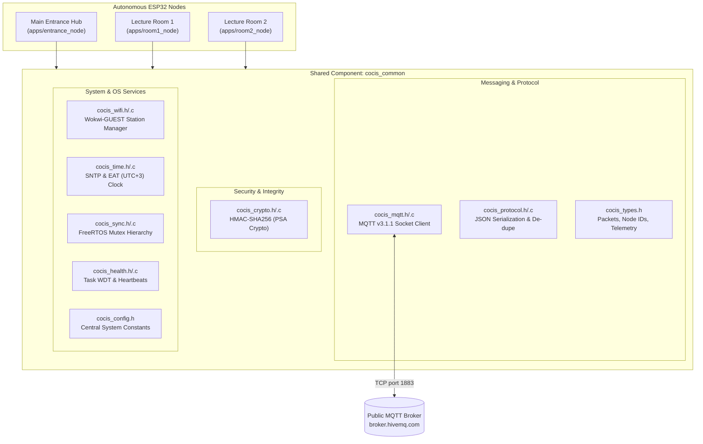

# Component Documentation: Shared Distributed Network & Security Framework (`cocis_common`)

**Component Path:** `components/cocis_common`  
**Target Architecture:** ESP-IDF v6.0.2 / FreeRTOS / lwIP / PSA Crypto (mbedTLS)  
**Consumer Applications:** `apps/entrance_node`, `apps/room1_node`, `apps/room2_node`

---

## 1. Purpose & Architectural Role

In the distributed architecture of the **CoCIS Smart Control and Monitoring System** (Makerere University, 2026/2027), the `cocis_common` ESP-IDF component provides the foundational shared infrastructure linked by all three autonomous microcontrollers:
- **Node 0 (`NODE_ENTRANCE`)**: Main Entrance Coordinator.
- **Node 1 (`NODE_ROOM_1`)**: Lecture Room 1 Terminal.
- **Node 2 (`NODE_ROOM_2`)**: Lecture Room 2 Terminal.

Rather than duplicate network drivers, serialization formats, cryptographic routines, and synchronization primitives across each application directory, `cocis_common` encapsulates all cross-cutting concerns into a modular, high-cohesion library.



---

## 2. Public API Reference & Header Overview

### 2.1 Core Types (`include/cocis_types.h`)
- **`node_id_t`**:
  ```c
  typedef enum {
      NODE_ENTRANCE = 0,
      NODE_ROOM_1   = 1,
      NODE_ROOM_2   = 2,
      NODE_BROADCAST = 0xFF
  } node_id_t;
  ```
- **`proto_msg_type_t`**:
  Message categories: `PROTO_MSG_HEARTBEAT`, `PROTO_MSG_MOTION_EVENT`, `PROTO_MSG_LIGHT_STATUS`, `PROTO_MSG_LIGHT_OVERRIDE`, `PROTO_MSG_SCHEDULE_UPDATE`, `PROTO_MSG_EMERGENCY_BROADCAST`, `PROTO_MSG_ACK`, `PROTO_MSG_STORE_FORWARD_BATCH`.
- **`proto_packet_t`**:
  Universal wire representation:
  ```c
  typedef struct {
      uint32_t seq_id;              /* Monotonically increasing sequence number */
      uint32_t timestamp;           /* East Africa Time (EAT) epoch timestamp */
      node_id_t sender_id;          /* Origin node: 0, 1, or 2 */
      node_id_t target_id;          /* Recipient node or 0xFF (broadcast) */
      proto_msg_type_t msg_type;    /* Message category */
      char payload[256];            /* Structured JSON content */
      char hmac_hex[65];            /* 64-char HMAC-SHA256 hex signature + null terminator */
  } proto_packet_t;
  ```
- **`node_net_status_t`**:
  Real-time telemetry tracked per node:
  ```c
  typedef struct {
      node_id_t id;
      char name[32];
      bool link_simulated_online;
      bool mqtt_online;
      uint32_t last_seen_epoch;
      uint32_t last_tx_seq;
      uint32_t last_rx_seq;
      uint32_t tx_packets;
      uint32_t rx_packets;
      uint32_t dropped_duplicates;
      uint32_t buffered_offline_count;
      uint32_t replayed_count;
      float rtt_avg_ms;
  } node_net_status_t;
  ```

---

### 2.2 Security: HMAC-SHA256 (`include/cocis_crypto.h`)
- `esp_err_t cocis_crypto_init(void)`:
  Initializes the PSA Crypto subsystem via `psa_crypto_init()`.
- `esp_err_t cocis_crypto_generate_hmac(const char *key, const uint8_t *data, size_t data_len, char *out_hex_65)`:
  Generates a 32-byte HMAC-SHA256 digest over `data` using `key`, formatted into a 64-character lowercase hexadecimal string + null terminator.
- `bool cocis_crypto_verify_hmac(const char *key, const uint8_t *data, size_t data_len, const char *expected_hex)`:
  Verifies the packet signature in strictly **constant time** using `mbedtls_ct_memcmp()` to protect against timing attacks.

---

### 2.3 Wire Protocol & Serialization (`include/cocis_protocol.h`)
- `esp_err_t cocis_proto_serialize(const proto_packet_t *pkt, const char *key, char *out_buf, size_t max_len)`:
  Formats the packet into a standardized JSON string, generates the HMAC signature over the JSON content (excluding the HMAC field itself), and writes the final envelope.
- `esp_err_t cocis_proto_deserialize(const char *json_str, const char *key, proto_packet_t *out_pkt)`:
  Parses the incoming JSON wire string, extracts all fields, verifies the HMAC-SHA256 signature, and rejects forged or tampered messages.
- `bool cocis_proto_is_duplicate(node_id_t sender, uint32_t seq)`:
  Evaluates the 32-bit sliding-window duplicate suppression bitmask for the given node. Returns `true` if `seq` was already delivered.
- `void cocis_proto_mark_received(node_id_t sender, uint32_t seq)`:
  Updates the high watermark sequence number and sliding-window bitmask.

---

### 2.4 Lightweight Zero-Dependency MQTT v3.1.1 Client (`include/cocis_mqtt.h`)
- `esp_err_t cocis_mqtt_init(const char *broker_host, uint16_t port, const char *client_id)`:
  Creates internal FreeRTOS mutexes and spawns the background TCP socket listener task (`cocis_mqtt`, 10 KB stack budget). Utilizes static BSS buffers (`s_rx_buf[1024]` and `s_rx_payload[512]`) to eliminate heap fragmentation and prevent stack exhaustion during synchronous cryptographic ingress processing.
- `esp_err_t cocis_mqtt_connect(void)`:
  Establishes a raw TCP stream over lwIP sockets to the broker and sends the binary MQTT `CONNECT` packet (flags: CleanSession=1, KeepAlive=60s).
- `esp_err_t cocis_mqtt_subscribe(const char *topic, uint8_t qos, cocis_mqtt_msg_cb_t cb)`:
  Encodes and transmits an MQTT `SUBSCRIBE` packet and registers an in-memory topic callback supporting exact, single-level (`+`), and multi-level (`#`) wildcard topic patterns.
- `esp_err_t cocis_mqtt_publish(const char *topic, const char *payload, uint8_t qos)`:
  Formats and transmits an MQTT `PUBLISH` packet over the TCP socket. Thread-safe (protected by `g_mqtt_tx_mutex`).
- **Variable-Length Frame Decoder**:
  Decodes standard MQTT v3.1.1 variable-length remaining length headers (1 to 4 bytes), dynamically locating topic and payload offsets for packets $>128$ bytes (such as HMAC-SHA256 authenticated JSON frames).
- `bool cocis_mqtt_is_connected(void)`:
  Thread-safe state query.
- `void cocis_mqtt_disconnect(void)`:
  Sends MQTT `DISCONNECT` and closes the TCP socket.

---

### 2.5 Wi-Fi Station Manager (`include/cocis_wifi.h`)
- `esp_err_t cocis_wifi_init_sta(const char *ssid, const char *pass)`:
  Configures the ESP-IDF default event loop, initializes netif, sets Wi-Fi storage to RAM, and issues non-blocking connection requests to `Wokwi-GUEST`.
- `bool cocis_wifi_is_connected(void)`:
  Checks whether the `WIFI_CONNECTED_BIT` is set in the internal FreeRTOS Event Group.
- `esp_err_t cocis_wifi_wait_connected(uint32_t timeout_ms)`:
  Blocks the calling task until Wi-Fi connection and DHCP IP lease acquisition succeed.

---

### 2.6 East Africa Time (EAT) Clock Synchronization (`include/cocis_time.h`)
- `esp_err_t cocis_time_init_sntp(void)`:
  Initializes lwIP SNTP pointing to `pool.ntp.org` and sets POSIX environment variable `TZ = "EAT-3"` (East Africa Time, UTC+3).
- `time_t cocis_time_now_epoch(void)`:
  Returns current Unix epoch seconds.
- `void cocis_time_get_str(char *buf, size_t max_len)`:
  Formats the current time into `YYYY-MM-DD HH:MM:SS`.

---

## 3. Communication Protocols & Wire Envelopes

### 3.1 MQTT Topic Topology
All messages transit through the public HiveMQ broker (`broker.hivemq.com:1883`) using an isolated topic prefix defined in `cocis_config.h`:
`cocis/smart_ctrl_mak/<category>/...`

| Topic Pattern | Direction | Content / Purpose |
| :--- | :--- | :--- |
| `cocis/smart_ctrl_mak/hub/ingress` | Rooms -> Hub | Upstream telemetry: motion events, lighting state transitions, heartbeats, store-and-forward replayed batches. |
| `cocis/smart_ctrl_mak/hub/egress` | Hub -> Rooms | Downstream acknowledgements (`PROTO_MSG_ACK`), remote overrides, and emergency evacuation orders. |
| `cocis/smart_ctrl_mak/room1/command` | Hub -> Room 1 | Unicast manual lighting overrides and schedule sync targeted specifically to Lecture Room 1. |
| `cocis/smart_ctrl_mak/room2/command` | Hub -> Room 2 | Unicast manual lighting overrides and schedule sync targeted specifically to Lecture Room 2. |
| `cocis/smart_ctrl_mak/broadcast` | Hub -> All | Campus-wide broadcast (e.g. fire alarm, general emergency evacuation). |

---

### 3.2 Wire Packet JSON Schema & HMAC Signing
Every packet traveling across the MQTT broker is serialized as a JSON object:

```json
{
  "seq": 42,
  "ts": 1792944015,
  "src": 1,
  "dst": 0,
  "type": 1,
  "payload": "{\"event\":\"MOTION_DETECTED\",\"state\":\"ON_ACTIVE\",\"power_mw\":60000}",
  "hmac": "9f86d081884c7d659a2feaa0c55ad015a3bf4f1b2b0b822cd15d6c15b0f00a08"
}
```

#### Cryptographic Authentication Procedure:
1. When sending: The sender formats the fields (`seq`, `ts`, `src`, `dst`, `type`, `payload`), computes `HMAC-SHA256(key, payload_and_headers)`, appends the 64-char hex string as `"hmac"`, and publishes.
2. When receiving: The receiver extracts the `"hmac"` field, computes the expected digest over the received data using the pre-shared secret (`CFG_SECRET_KEY = "cocis_secure_key_2026"`), and executes `cocis_crypto_verify_hmac()`.
3. If the digest mismatches, the packet is instantly discarded and an audit violation is recorded.

---

## 4. Sequence Tracking & Sliding-Window Duplicate Suppression

In an unreliable IP network or simulated mesh, retransmissions, broker reconnections, or store-and-forward replaying can deliver identical packets multiple times.

`cocis_common` implements an **RFC 2401-style sliding window** per node:
- **`last_rx_seq`**: Highest sequence number seen so far from that node.
- **`seq_mask` (uint32_t)**: 32-bit bitmask where bit $k$ represents whether packet `(last_rx_seq - k)` has already been processed.

```
       [last_rx_seq - 31] ................... [last_rx_seq - 1] [last_rx_seq]
Bit:           31        ...................          1              0
```

1. If `seq > last_rx_seq`:
   - Shift bitmask left by `(seq - last_rx_seq)`.
   - Set bit 0 to `1`.
   - Update `last_rx_seq = seq`.
   - **Accept packet**.
2. If `seq <= last_rx_seq`:
   - Calculate offset: `diff = last_rx_seq - seq`.
   - If `diff >= 32`: Packet is too old (> 32 packets behind window) -> **Discard as duplicate/stale**.
   - If `diff < 32`: Check if bit `diff` is set:
     - If `(seq_mask & (1U << diff)) != 0`: Already seen -> **Discard duplicate**.
     - If `(seq_mask & (1U << diff)) == 0`: Out-of-order in-window packet -> Set bit `diff` and **Accept packet**.

---

## 5. FreeRTOS Synchronization & Mutex Hierarchy

To prevent priority inversion and deadlocks in multi-threaded ESP32 environments, `cocis_common` defines a strict mutex hierarchy:

```
Level 1 (Highest): g_crypto_mutex  - Protects hardware/software PSA Crypto engine
Level 2:           g_mqtt_tx_mutex - Protects socket write buffer & TCP transmission
Level 3:           g_table_mutex   - Protects sequence tracking and routing tables
Level 4 (Lowest):  g_log_mutex     - Protects console output / UART formatting
```

**Rule:** A task holding a Level $N$ mutex may only acquire mutexes at Level $< N$. It must NEVER acquire a higher-level mutex while holding a lower-level one.

---

## 6. Examiner Q&A Guide for Students

### Q1: Why did you build a custom lightweight MQTT client instead of using `esp-mqtt`?
**Answer:** `esp-mqtt` is a feature-rich, high-overhead component designed for enterprise cloud clouds (AWS IoT, Azure). In our resource-constrained academic scenario, our custom lwIP socket implementation:
1. Has a RAM footprint under 4 KB compared to ~25 KB for `esp-mqtt`.
2. Has zero external dependencies outside core ESP-IDF lwIP.
3. Allows students to explain every single byte of the MQTT v3.1.1 frame layout (Fixed Header, Remaining Length, Variable Header, Payload) directly from first principles.

### Q2: How does the system prevent a compromised or forged node from sending fake motion events?
**Answer:** Every packet carries an HMAC-SHA256 signature calculated over the entire packet content using a 256-bit pre-shared key. The receiving coordinator verifies this signature before acting on any payload. Furthermore, the sliding-window duplicate suppression bitmask blocks replay attacks by discarding any packets with previously-used or out-of-window sequence numbers.

### Q3: What happens to lighting events if the Wi-Fi or MQTT broker goes down?
**Answer:** The lecture room terminals operate completely autonomously for local PIR sensing and light control. When the link drops, events are stored in a local 32-entry FIFO ring buffer (`room_buffer.c`). Once Wi-Fi and MQTT connectivity are restored, the terminal automatically bursts the buffered events in strict sequence (`PROTO_MSG_STORE_FORWARD_BATCH`), which the hub acknowledges and records into the SD card log without duplicates.
