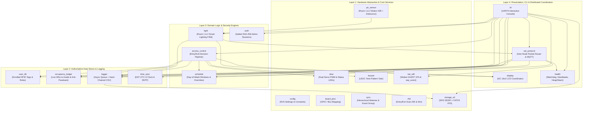
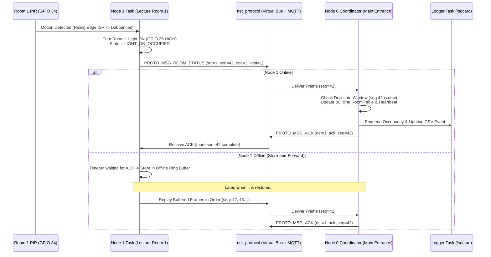

# System Architecture

**Project:** CoCIS Smart Control and Monitoring System (Makerere University)  
**Target:** ESP32 / ESP-IDF v6.0.2 / FreeRTOS / Wokwi

---

## 1. High-Level Layered Architecture

The firmware is structured into **four strict architectural layers** across **21 single-responsibility C modules**, orchestrated by a minimal `main/main.c`.

---

## 2. Distributed Terminal Topology

Even when running on a single ESP32 in Wokwi (`NODE_MODE_ALL_IN_ONE`), the three physical terminals operate as independent state machines communicating exclusively through `net_protocol`:

---

## 3. FreeRTOS Task Map

Every FreeRTOS task has a well-defined responsibility, stack size, priority, and blocking primitive (zero busy-wait loops):

| Task Name | Module | Priority | Stack (Bytes) | Blocking Primitive | Primary Responsibility |
| :--- | :--- | :---: | :---: | :--- | :--- |
| `rfid_task` | `rfid` | **7** (High) | `4096` | `xQueueReceive(s_rfid_isr_queue)` | Debounces physical button/reader interrupts and dispatches `rfid_scan_event_t` to `access_control`. |
| `access_task` | `access_control` | **6** | `6144` | `xQueueReceive(s_scan_queue)` | Evaluates RFID scans against `user_db`, `schedule`, and `occupancy_ledger`; triggers `door`, `buzzer`, `display`, and `logger`. |
| `pir_light_task` | `pir_sensor` / `light` | **5** | `4096` | `xQueueReceive(s_pir_queue, 200ms)` | Processes Room 1 & Room 2 PIR edges, runs the smart-lighting grace/vacancy FSM, updates energy metrics, and emits room packets. |
| `proto_task` | `net_protocol` | **5** | `6144` | `xQueueReceive(s_proto_rx_queue, 250ms)` | Routes inter-terminal frames, handles ACK timeouts, replays store-and-forward buffers, and services MQTT TCP socket I/O. |
| `buzzer_task` | `buzzer` | **5** | `3072` | `xQueueReceive(s_buzzer_queue)` | Plays multi-step LEDC PWM acoustic patterns without blocking caller tasks. |
| `display_task` | `display` | **4** | `4096` | `vTaskDelay(250ms)` / Override Event | Renders rotating telemetry screens and instant access/alarm alert banners on the 16x2 I2C LCD (`0x27`). |
| `cli_task` | `cli` | **4** | `8192` | `uart_read_bytes(..., 100ms)` | Reads UART0 input, parses monitoring/admin/simulation commands, enforces session auto-logout, and prints formatted tables. |
| `logger_task` | `logger` | **3** | `6144` | `xQueueReceive(s_log_queue, 1000ms)` | Computes SHA-256 hash chain and writes CSV records to `/sdcard/*.csv` (or RAM fallback). |
| `health_task` | `health` | **2** (Low) | `4096` | `vTaskDelay(1000ms)` | Feeds Task Watchdog (`esp_task_wdt`), checks remote node heartbeat age, and tracks free heap / stack high-water marks. |

*(Note: Door auto-close timing uses lightweight FreeRTOS Software Timers via the `Tmr Svc` daemon task rather than dedicating a separate task per door.)*

---

## 4. Deterministic System Initialization Order (`main/main.c`)

To prevent any task from accessing an uninitialized queue or mutex at boot, `app_main()` initializes modules strictly bottom-up before starting task loops:

1. **Core Infrastructure**: `sync_init()` (creates all hierarchical mutexes and the system event group) -> `config_init()` (initializes NVS flash and loads persistent settings) -> `board_pins_init()` (configures baseline safe GPIO states).
2. **Storage & Time**: `time_sync_init()` (sets `EAT-3` timezone and seeds RTC) -> `storage_sd_init()` (mounts `/sdcard` over SPI2) -> `logger_init()` (starts background hash-chained CSV logger).
3. **Authoritative Databases**: `user_db_init()` (loads enrolled users or seeds 8 default CoCIS tags) -> `schedule_init()` (loads weekly schedule windows) -> `occupancy_ledger_init()` (recovers "who is inside" from `/sdcard/access.csv` if rebooted mid-day) -> `auth_init()` (initializes salted SHA-256 admin credentials).
4. **Peripherals & Domain Controllers**: `buzzer_init()` -> `display_init()` -> `door_init()` -> `access_control_init()` -> `rfid_init()` -> `light_init()` -> `pir_sensor_init()`.
5. **Networking, Health & Console**: `net_wifi_init()` -> `net_protocol_init()` -> `health_init()` -> `cli_init()`.

---

## 5. Module Ownership Matrix (5-Student Group Division)

The 21 modules are partitioned into **5 balanced bundles** so each student in a 5-member group owns ~4 cohesive modules and can explain every line of their subsystem:

| Student | Bundle Title | Assigned Modules (`include/`, `src/`, `modules/<m>/README.md`) |
| :---: | :--- | :--- |
| **Student 1** | **Config, Pins, SD Storage & Hash-Chained Logger** | `config`, `board_pins`, `storage_sd`, `logger` |
| **Student 2** | **Entrance RFID, Motorized Doors, Buzzer & Access Engine** | `rfid`, `door`, `buzzer`, `access_control` |
| **Student 3** | **User DB, Schedule, Occupancy Ledger & Admin Auth** | `user_db`, `schedule`, `occupancy_ledger`, `auth` |
| **Student 4** | **Lecture Room PIR, Smart Lighting, I2C LCD & Time Sync** | `pir_sensor`, `light`, `display`, `time_sync` |
| **Student 5** | **Synchronization, Wi-Fi, Distributed Protocol, Health & CLI** | `sync`, `net_wifi`, `net_protocol`, `health`, `cli` |
