# System Architecture: Distributed 3-Node CoCIS System

**Project:** Smart Control and Monitoring System for the College of Computing and Information Sciences (CoCIS), Makerere University  
**Target:** 3x ESP32 Microcontrollers / ESP-IDF v6.0.2 / FreeRTOS / Wokwi Simulator  
**Topology:** Distributed Multi-Terminal Architecture over Simulated Wi-Fi (`Wokwi-GUEST`) via MQTT v3.1.1 Broker

---

## 1. Physical Node Separation & Distributed Topology

The system comprises **three physically separate microcontroller nodes** deployed across CoCIS facilities:

```mermaid
flowchart TB
    subgraph EntranceApp["Node 0: Main Entrance Coordinator (apps/entrance_node)"]
        direction TB
        E_ESP["ESP32 DevKit v1\n(Ground Floor Entrance)"]
        E_SERVO["Dual Door Servos\n(ENTRY & EXIT)"]
        E_RFID["Dual RFID Points\n(ENTRY & EXIT)"]
        E_LCD["I2C 16x2 / 20x4 LCD\n(Live Headcount & Status)"]
        E_SD["MicroSD SPI Storage\n(SHA-256 Hash Chained Logs)"]
        E_CLI["UART0 Admin Console\n(8-Option Management Menu)"]
        E_ESP --- E_SERVO & E_RFID & E_LCD & E_SD & E_CLI
    end

    subgraph Room1App["Node 1: Lecture Room 1 Terminal (apps/room1_node)"]
        direction TB
        R1_ESP["ESP32 DevKit v1\n(Lecture Room 1)"]
        R1_PIR["PIR Motion Sensor\n(GPIO 27)"]
        R1_RELAY["Lighting Relay / Fixture\n(GPIO 12)"]
        R1_BUF["Store & Forward Buffer\n(32-Entry Circular FIFO)"]
        R1_CLI["UART0 Status Console"]
        R1_ESP --- R1_PIR & R1_RELAY & R1_BUF & R1_CLI
    end

    subgraph Room2App["Node 2: Lecture Room 2 Terminal (apps/room2_node)"]
        direction TB
        R2_ESP["ESP32 DevKit v1\n(Lecture Room 2)"]
        R2_PIR["PIR Motion Sensor\n(GPIO 26)"]
        R2_RELAY["Lighting Relay / Fixture\n(GPIO 25)"]
        R2_BUF["Store & Forward Buffer\n(32-Entry Circular FIFO)"]
        R2_CLI["UART0 Status Console"]
        R2_ESP --- R2_PIR & R2_RELAY & R2_BUF & R2_CLI
    end

    subgraph Transport["Network Layer: Virtual Wi-Fi & MQTT Transport"]
        WIFI["Wokwi-GUEST Virtual Wi-Fi\n(WASM Gateway)"]
        BROKER[("MQTT Broker: broker.hivemq.com:1883\nTopic: cocis/smart_ctrl_mak/#")]
        WIFI --- BROKER
    end

    R1_ESP <==>|"HMAC-SHA256 Signed JSON\nRoom 1 Telemetry & Overrides"| BROKER
    R2_ESP <==>|"HMAC-SHA256 Signed JSON\nRoom 2 Telemetry & Overrides"| BROKER
    E_ESP <==>|"Telemetry Subscriptions,\nACKs & Emergency Broadcast"| BROKER
```

---

## 2. Component Organization

### 2.1 Shared Library Component: `components/cocis_common`
Shared across all three applications to eliminate duplicate code while guaranteeing wire compatibility:
- **`cocis_types.h`**: Core types (`node_id_t`, `proto_msg_type_t`, `proto_packet_t`, `node_net_status_t`).
- **`cocis_config.h`**: Centralized broker IP, credentials, topic templates, and timing constants.
- **`cocis_crypto.h / .c`**: Cryptographic HMAC-SHA256 signature generator and constant-time verifier.
- **`cocis_protocol.h / .c`**: JSON serialization, deserialization, monotonic sequence numbering, and deduplication.
- **`cocis_mqtt.h / .c`**: Lightweight zero-dependency MQTT v3.1.1 client over lwIP TCP sockets.
- **`cocis_wifi.h / .c`**: Station manager connecting to `Wokwi-GUEST` with exponential backoff reconnect.
- **`cocis_sync.h / .c`**: FreeRTOS mutexes and system event groups.
- **`cocis_time.h / .c`**: SNTP client and East Africa Time (`EAT-3`, UTC+3) POSIX clock management.
- **`cocis_health.h / .c`**: Watchdog and node heartbeat monitor.

### 2.2 Hub Application: `apps/entrance_node`
The central authoritative controller of the CoCIS building:
- **`access_control`**: Dual-portal entry/exit validation pipeline with anti-passback and schedule enforcement.
- **`user_db`**: In-memory database of 8 enrolled campus personas with role-based access privileges.
- **`schedule`**: Day-of-week building access windows with supervisor emergency overrides.
- **`occupancy_ledger`**: Authoritative headcount and "who is inside" list tracking durations.
- **`storage_sd`**: Hardware SDSPI FATFS driver mounting `/sdcard`.
- **`logger`**: Asynchronous queue-driven CSV logger maintaining a tamper-evident SHA-256 hash chain.
- **`auth`**: Salted SHA-256 administrator login engine for privileged operations.
- **`door`**: Dual LEDC PWM servo actuator driver (0° closed, 90° open) with audio-visual indicators.
- **`display`**: I2C 16x2 LCD updating building headcount, system time, and network status.
- **`cli`**: UART0 interactive administration console with 8 structured menus.
- **`net_protocol`**: Subscribes to room telemetry, validates HMAC signatures, logs lighting energy to SD card, and sends ACKs.

### 2.3 Room Applications: `apps/room1_node` & `apps/room2_node`
Autonomous lecture room terminals prioritizing local occupant safety and energy reduction:
- **`pir_sensor`**: Interrupt-driven PIR motion detection with 100 ms debouncing.
- **`light`**: Autonomous lighting FSM (`OFF_VACANT` $\rightarrow$ `ON_ACTIVE` $\rightarrow$ `ON_GRACE_HOLD`).
- **`room_buffer`**: 32-entry circular FIFO store-and-forward ring buffer retaining telemetry when Hub is offline.
- **`room_cli`**: Lightweight diagnostic serial console for testing motion and viewing local metrics.

---

## 3. Data Flow Architecture

### 3.1 Normal Occupancy & Telemetry Cycle
1. Student walks into Lecture Room 1: PIR sensor (`GPIO 27`) triggers an edge interrupt.
2. `pir_sensor` notifies `light`, which immediately turns ON the lighting fixture (`GPIO 12`).
3. Room 1 constructs a `proto_packet_t` (`PROTO_MSG_ROOM_EVENT`), assigns monotonic sequence number `seq_id`, timestamps the event in EAT, and calculates HMAC-SHA256.
4. Room 1 publishes the signed JSON payload to `cocis/smart_ctrl_mak/room/1/telemetry`.
5. Entrance Hub receives the packet, validates the HMAC-SHA256 signature, and checks `seq_id > last_rx_seq`.
6. Hub appends the lighting event to `/sdcard/lighting.csv` and publishes `PROTO_MSG_ACK` to `cocis/smart_ctrl_mak/room/1/control`.
7. Room 1 receives the ACK and marks the packet successfully delivered.

### 3.2 Hub Offline & Store-and-Forward Replay
1. Entrance Hub goes offline or Wi-Fi drops.
2. Occupants in Lecture Room 1 continue their lecture. The local light FSM operates autonomously with **zero latency and zero network dependency**.
3. Every state change is queued into the 32-entry `room_buffer`.
4. When Entrance Hub reconnects, Room 1 detects the MQTT session and flushes buffered events in strict chronological order.
5. Hub processes every replayed event and logs them with their original occurrence timestamps preserved.
