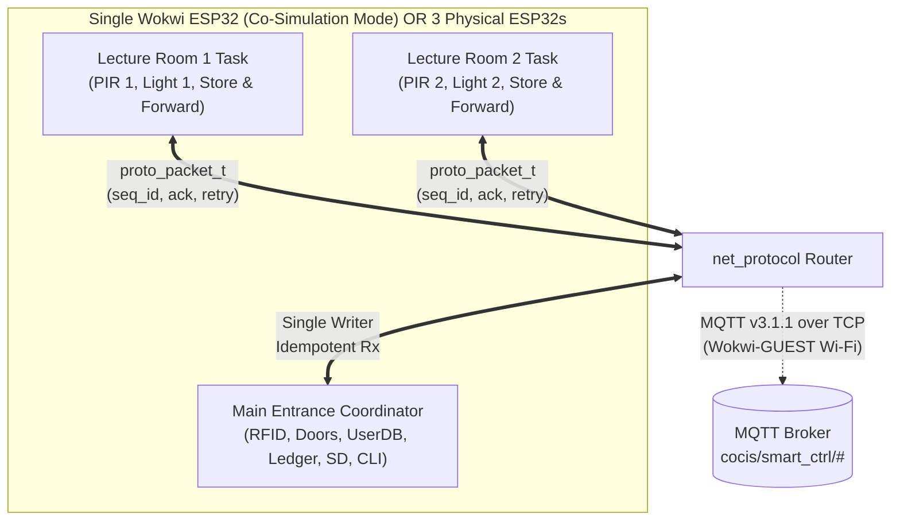

# Design Decisions & Simulation Reality Check

**Project:** CoCIS Smart Control and Monitoring System (Makerere University, BSE III & CS II, 2026/2027)  
**Target Platform:** ESP32 (`xtensa-esp32-elf`) | **Framework:** ESP-IDF v6.0.2 | **Simulator:** Wokwi for VS Code (`v4.1.0`)

---

## 1. Executive Summary of Simulation Investigation

Before writing any firmware, we audited the local workspace, sibling projects (`keypad_assign`, `DS18B20_Temp`, `fridge`, `LCD`, `ADC_DAC`, `increment_counter`), the installed ESP-IDF v6.0.2 toolchain, and the installed Wokwi VS Code extension (`~/.vscode/extensions/wokwi.wokwi-vscode-4.1.0`).

| Subsystem / Requirement | Wokwi Simulation Reality | Chosen Engineering Solution |
| :--- | :--- | :--- |
| **A. Three Distributed ESP32 Terminals** (Main Entrance, Lecture Room 1, Lecture Room 2) | Wokwi for VS Code (`WokwiSession.ts`) uses a singleton session (`createSingleton()`) and loads a single `firmware = 'build/flasher_args.json'` onto one ESP32 in `diagram.json`. | **Co-Simulated Isolated Node Tasks + Dual Swappable Transport (`net_protocol`)**: All three terminals run concurrently as isolated FreeRTOS tasks on one ESP32 in Wokwi (`NODE_MODE_ALL_IN_ONE`) so the entire building can be operated on one canvas, while communicating **strictly** via serialized `net_protocol` frames (never shared globals). Simultaneously supports real **MQTT v3.1.1 over lwIP TCP sockets** via `Wokwi-GUEST` Wi-Fi and single-node hardware builds (`NODE_ROLE_*`). |
| **B. RFID Readers (Entry & Exit)** | Standard Wokwi catalog does not include a built-in MFRC522 SPI reader without external custom chip binaries. | **Hardware-Agnostic `rfid` Driver Abstraction**: Clean event-queue interface (`rfid_event_t`) driven by (1) **physical pushbuttons on the Wokwi canvas** (`btn_entry`, `btn_exit`, `btn_deny`) with GPIO interrupts and 50 ms debounce, and (2) **Serial CLI injection** (`sim scan <entry\|exit> <uid>`) supporting all 8 enrolled personas and arbitrary UIDs. |
| **C. Doors, Lights, PIR, LCD, Buzzer** | Native Wokwi parts exist and are fully simulated: `wokwi-servo`, `wokwi-led`, `wokwi-pir-motion-sensor`, `wokwi-lcd1602` (I2C `0x27`), `wokwi-buzzer`, `wokwi-pushbutton`. | **100% Native Hardware Simulation**: Dual 50 Hz LEDC PWM servos (`GPIO 13`, `GPIO 12`), Entry/Exit/Alarm LEDs (`GPIO 2`, `4`, `15`), Room 1 & 2 PIR sensors (`GPIO 34`, `35`), Room 1 & 2 Light LEDs (`GPIO 25`, `26`), I2C 16x2 LCD (`GPIO 21`, `22`), and LEDC PWM piezo buzzer (`GPIO 14`). |
| **D. SD Card Storage** | `wokwi-microsd-card` is natively supported over SPI (`SDSPI` + `FATFS`). | **SPI2 (`SPI2_HOST`) + FATFS VFS (`/sdcard`)**: Wired to `CS=GPIO 5`, `SCK=GPIO 18`, `MOSI(DI)=GPIO 23`, `MISO(DO)=GPIO 19`. Includes graceful fallback to an in-RAM circular log + NVS if the card is absent or unformatted, plus boot-time occupancy recovery from `/sdcard/access.csv`. |
| **E. Real-Time Clock & Schedule (`EAT` UTC+3)** | Wokwi provides internet access via `Wokwi-GUEST` Wi-Fi gateway (`engine.wasm`), which may take several seconds to connect or be offline in air-gapped lab grading. | **Hybrid SNTP + Deterministic RTC Seed (`EAT-3`)**: Initializes POSIX timezone `EAT-3` (UTC+3), seeds the ESP32 internal RTC to `2026-10-24 08:30:00 EAT` at boot so schedule checks work immediately, synchronizes automatically via `esp_netif_sntp` when `Wokwi-GUEST` connects, and allows runtime setting via `time set <YYYY-MM-DD> <HH:MM:SS>`. |

---

## 2. Detailed Analysis of Key Design Choices

### 2.1 Multi-ESP32 Architecture: Why Co-Simulated Node Tasks + Swappable Transport?

#### The Trade-off
In a physical deployment at CoCIS Makerere University, three separate ESP32 boards are mounted in three different locations:
1. **Main Entrance Terminal (`NODE_ENTRANCE`, ID `0`)** at the ground-floor turnstiles.
2. **Lecture Room 1 Terminal (`NODE_ROOM_1`, ID `1`)** in Block A.
3. **Lecture Room 2 Terminal (`NODE_ROOM_2`, ID `2`)** in Block B.

However, in Wokwi for VS Code, a single `diagram.json` can only execute firmware on one ESP32 (`wokwi.toml` binds one `.elf` and `flasher_args.json`). If we created three separate folders with three separate Wokwi diagrams, an examiner or student could only run **one** node at a time in VS Code—meaning toggling the PIR sensor in Lecture Room 1 would never visibly update the Main Entrance LCD or SD card log during a live demo unless an external MQTT broker and three separate IDE instances were orchestrated.

#### Our Solution
We designed `net_protocol` around a strict **Transport Abstraction Layer**:
- **Application Isolation**: Lecture Room 1 and Lecture Room 2 run in their own FreeRTOS task contexts (`room_node_task`) with their own private state structures (`room_node_ctx_t`), sequence counters, outbound store-and-forward ring buffers, and retry timers. They **never** call `logger_log_*` or `occupancy_ledger_*` directly; instead, they construct a `proto_packet_t` and call `net_protocol_send()`.
- **Backend 1 — Local Virtual Inter-Node Bus (FreeRTOS Queue Router)**: Delivers serialized `proto_packet_t` frames between `NODE_ROOM_1`, `NODE_ROOM_2`, and `NODE_ENTRANCE` inside the single ESP32. Crucially, it includes per-node link state flags (`sim node <1|2> offline|online`) so students can disconnect Lecture Room 1 mid-simulation, trigger PIR motion events while it is offline, watch the events queue up in Room 1's store-and-forward buffer, reconnect Room 1, and watch the buffered events replay in exact sequence order with duplicate suppression!
- **Backend 2 — Wi-Fi (`Wokwi-GUEST`) + MQTT v3.1.1 over lwIP TCP Sockets**: When Wi-Fi connects to `Wokwi-GUEST`, `net_protocol` opens a non-blocking TCP socket to the configured MQTT broker (`broker.hivemq.com:1883`) and publishes/subscribes to `cocis/smart_ctrl/node/<id>/tx` and `cocis/smart_ctrl/entrance/rx`. If compiled for single-node hardware deployment, each ESP32 uses Backend 2 exclusively.

---

### 2.2 Configurable Access Schedule & The "Exit Outside Authorized Hours" Safety Dilemma

#### The Requirement
Section 1.6 of the coursework specification states:
> *"The schedule must be enforced consistently across the system, including ensuring that individuals are not allowed to leave the building outside the authorized time period while still inside."*

Section 4.5 adds:
> *"For exit, the requirement says people must not leave outside the authorized period while inside: implement exactly that restriction for normal users, and then add a safety-compliant design (an authorized-supervisor/security override and an emergency/fire evacuation mode that unlocks the exit and records that it happened). Document this reasoning clearly because it is a safety issue."*

#### Engineering & Life-Safety Analysis
In physical security engineering, doors are classified as:
- **Fail-Secure (Fail-Closed)**: On power loss or outside schedule hours, the lock remains engaged to protect high-value assets (such as CoCIS server rooms and computer labs).
- **Fail-Safe (Safe Egress)**: Life-safety codes (e.g., NFPA 101 / building fire codes) mandate that human occupants must never be trapped inside a burning or hazardous building without a means of egress.

To satisfy **both** the strict coursework anti-theft requirement (preventing someone who hid inside CoCIS until after closing time from walking out unchallenged with lab equipment) **and** real-world human safety engineering, `access_control` implements a **Three-Tier Exit Policy**:

1. **Normal Operating Mode (Outside Schedule Window)**:
   - Standard users (`ROLE_STUDENT`, `ROLE_STAFF`, `ROLE_VISITOR`) scanning at **EXIT** after closing time are **DENIED** (`ACCESS_DENY_OUTSIDE_SCHEDULE_EXIT`).
   - The system sounds the denial/alert pattern, keeps the exit door locked, displays `"DENY: AFTER HRS"` on the LCD, and writes a high-visibility security alert to `/sdcard/access.csv` so campus security knows someone is attempting to leave after lockup.
2. **Tier 1 Safety Exception — Authorized Supervisor / Security Escort Override**:
   - An **Admin / Security Officer** (`ROLE_ADMIN`) badge can always unlock the exit door, OR an authenticated admin on the Serial CLI can issue `override_exit <uid>` (grants a one-time, 5-minute safe-exit pass for that specific person) after verifying they are not carrying unauthorized equipment. Every override is recorded in `audit.csv`.
3. **Tier 2 Life-Safety Exception — Emergency / Fire Evacuation Mode**:
   - Pressing the physical yellow **Emergency Button (`GPIO 16 / RX2`)** on the Wokwi canvas OR running `emergency on` in the CLI immediately transitions the system into `EMERGENCY_EVACUATION_ACTIVE`:
     - Both Entry and Exit servos rotate to `90°` (unlocked) and latch open.
     - The buzzer sounds a continuous evacuation cadence and the red alarm LED flashes.
     - Any person scanning at the Exit reader is immediately recorded as **SAFELY EVACUATED** and removed from the live `occupancy_ledger`, while the CLI automatically prints the **Emergency Roll-Call List** of who is still inside the building!

---

### 2.3 Password Hashing &ESP-IDF v6.0.2 Cryptography (`psa/crypto.h`)

ESP-IDF v6.0.2 upgrades the cryptography subsystem to **mbedTLS 4.0 / TF-PSA-Crypto**, replacing legacy `mbedtls/sha256.h` calls with the standardized ARM **PSA Crypto API (`psa/crypto.h`)**.
- In `auth.c` and `logger.c`, we initialize PSA Crypto via `psa_crypto_init()` and compute SHA-256 digests using `psa_hash_compute(PSA_ALG_SHA_256, input, len, hash_out, sizeof(hash_out), &hash_len)`.
- Admin passwords are never stored in plaintext in source code or NVS: each admin account stores a **16-byte random/unique salt** and the **32-byte SHA-256(`salt || password`) digest**.
- Password verification uses a **constant-time byte comparison loop** (`diff |= (a[i] ^ b[i])`) so timing side-channel attacks cannot deduce how many bytes matched.

---

### 2.4 Non-Blocking SD Card Logging & Tamper-Evident Hash Chain

Writing to a FAT32 file on an SPI microSD card can take `5 ms` to `80 ms` (or longer during FAT sector allocation). If `access_control` wrote directly to `/sdcard/access.csv` while holding the occupancy mutex, the door servo actuation and LCD feedback would stutter, and other tasks waiting on the mutex would suffer unbounded latency.

Instead:
1. Time-critical tasks call `logger_enqueue_access()` / `logger_enqueue_audit()`, which copies a compact `log_record_t` into a 32-deep FreeRTOS queue (`xQueueSend` with `0` tick wait) in **under 5 microseconds**.
2. A dedicated low-priority background task (`logger_task`, Priority 3) drains the queue, computes a **running SHA-256 hash chain** (`H_n = SHA256(H_{n-1} || CSV_row)` truncated to 8 hex chars for compact student inspection), acquires `LOCK_LEVEL_SD`, writes the CSV line to `/sdcard/*.csv`, and flushes safely.
3. If someone edits or deletes a line in `/sdcard/access.csv` or `/sdcard/audit.csv` on a PC, the CLI command `sd verify` recomputes the hash chain from genesis (`00000000`) and pinpoints the exact line number where tampering occurred!
