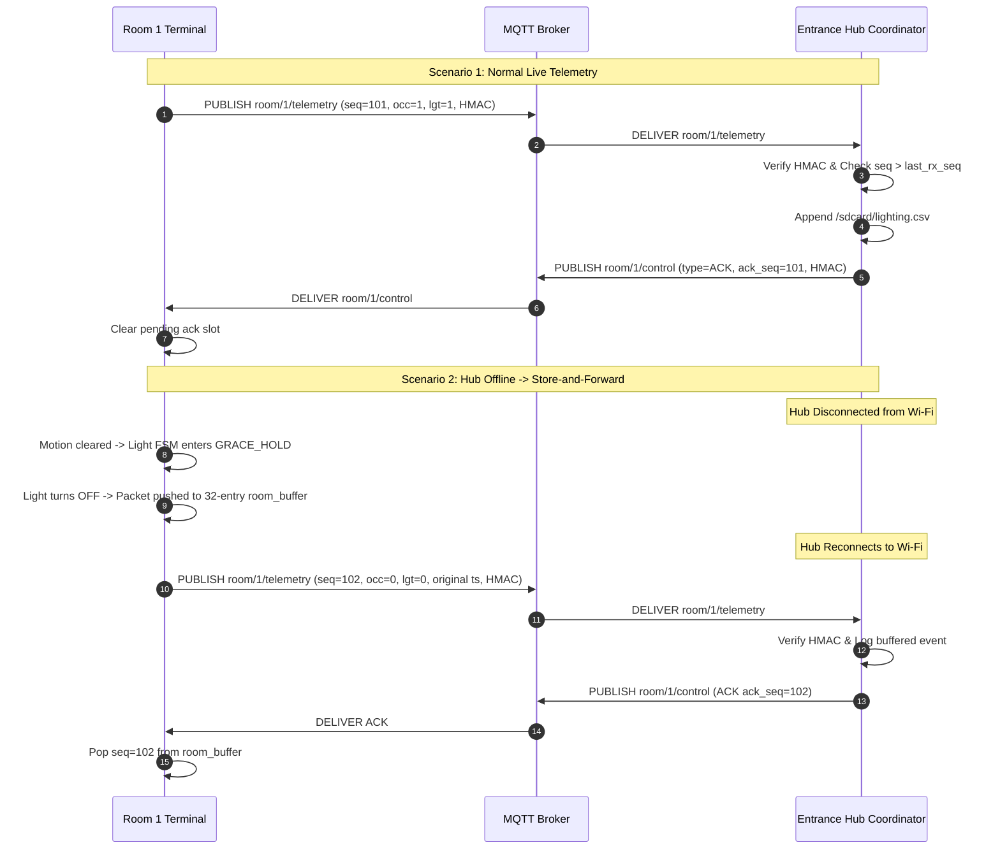

# Inter-Terminal Communication & Wire Protocol (`cocis_protocol`)

**Project:** CoCIS Smart Control and Monitoring System (Makerere University, BSE III & CS II 2026/2027)  
**Terminals:** `NODE_ID_ENTRANCE` (0 — Hub Coordinator), `NODE_ID_ROOM_1` (1 — Lecture Room 1), `NODE_ID_ROOM_2` (2 — Lecture Room 2)  
**Transport:** MQTT v3.1.1 over lwIP TCP sockets (`broker.hivemq.com:1883`) via `Wokwi-GUEST` Virtual Wi-Fi

---

## 1. Protocol Overview & Security Principles

The inter-terminal protocol (`components/cocis_common/include/cocis_protocol.h`) guarantees:
1. **Effectively-Once Delivery Semantics**: Monotonically increasing 32-bit sequence numbers (`seq_id`) per source node paired with coordinator acknowledgments (`PROTO_MSG_ACK`) and sliding-window duplicate suppression.
2. **Cryptographic Authentication & Integrity (HMAC-SHA256)**: Every packet transmitted across the network carries an HMAC-SHA256 signature calculated over the JSON body using a pre-shared secret key (`CFG_SECRET_KEY`). Packets with missing, altered, or forged signatures are discarded with security alerts.
3. **Replay Attack Defense**: Packets with `seq_id <= last_rx_seq` are detected as duplicate/replayed and ignored at the domain layer (with duplicate ACKs sent to clear sender buffers).
4. **Offline Store-and-Forward Replay**: If the Entrance Hub goes offline, room nodes buffer up to 32 events locally in a circular FIFO ring buffer and replay them in strict chronological sequence upon reconnection.

---

## 2. Topic Taxonomy

All MQTT communication uses the project prefix `cocis/smart_ctrl_mak/`:

| Topic | Direction | Content / Purpose |
| :--- | :--- | :--- |
| `cocis/smart_ctrl_mak/room/1/telemetry` | Room 1 $\rightarrow$ Hub | Motion events, lighting transitions, and 5s heartbeats |
| `cocis/smart_ctrl_mak/room/2/telemetry` | Room 2 $\rightarrow$ Hub | Motion events, lighting transitions, and 5s heartbeats |
| `cocis/smart_ctrl_mak/room/1/control` | Hub $\rightarrow$ Room 1 | `PROTO_MSG_ACK`, lighting overrides (`PROTO_MSG_LIGHT_OVERRIDE`), time sync |
| `cocis/smart_ctrl_mak/room/2/control` | Hub $\rightarrow$ Room 2 | `PROTO_MSG_ACK`, lighting overrides, time sync |
| `cocis/smart_ctrl_mak/broadcast` | Hub $\rightarrow$ All | Building-wide emergency evacuation or schedule updates |

---

## 3. Message Types (`proto_msg_type_t`)

| Type Symbol | Hex ID | Direction | Requires ACK? | Description |
| :--- | :---: | :--- | :---: | :--- |
| `PROTO_MSG_HEARTBEAT` | `0x01` | Room $\rightarrow$ Hub | No | Periodic liveness ping with uptime, light state, and energy saved |
| `PROTO_MSG_ROOM_EVENT` | `0x02` | Room $\rightarrow$ Hub | **Yes** | Motion detected/cleared or light FSM state change |
| `PROTO_MSG_SCHEDULE_SYNC` | `0x03` | Hub $\rightarrow$ Room | **Yes** | Synchronizes access hours and vacancy timeouts |
| `PROTO_MSG_EMERGENCY` | `0x04` | Hub $\rightarrow$ Broadcast | **Yes** | Activates or clears building-wide emergency evacuation mode |
| `PROTO_MSG_LIGHT_OVERRIDE` | `0x05` | Hub $\rightarrow$ Room | **Yes** | Admin CLI force ON (1), force OFF (0), or release to AUTO (2) |
| `PROTO_MSG_ACK` | `0xF0` | Receiver $\rightarrow$ Sender | No | Acknowledges receipt of packet with matching `ack_seq_id` |

---

## 4. Wire Format & Cryptographic Signature

### 4.1 JSON Wire Representation
Packets are formatted as compact, human-readable JSON carrying the 64-character hex HMAC signature:

```json
{"v":1,"t":2,"src":1,"dst":0,"seq":104,"ack":0,"ts":1792904520,"rm":1,"occ":1,"lgt":1,"emg":0,"on_s":45,"sav":120,"up":310,"hmac":"7c8e9b42a1f056d8e2..."}
```

### 4.2 Field Definitions
| Field | Name | Type | Description |
| :---: | :--- | :---: | :--- |
| `v` | Version | `uint8` | Protocol version (always `1`) |
| `t` | Message Type | `uint8` | `proto_msg_type_t` enum code |
| `src` | Source Node | `uint8` | Node ID of sender (`0` = Hub, `1` = Room 1, `2` = Room 2) |
| `dst` | Destination Node | `uint8` | Target Node ID or `255` for Broadcast |
| `seq` | Sequence ID | `uint32` | Monotonically increasing sequence number |
| `ack` | Ack Sequence ID | `uint32` | Sequence number being acknowledged (for `PROTO_MSG_ACK`) |
| `ts` | Timestamp | `int64` | UNIX epoch in East Africa Time when event occurred |
| `rm` | Room ID | `uint8` | `1` or `2` for lecture room telemetry |
| `occ` | Occupied | `uint8` | `1` = motion detected, `0` = room vacant |
| `lgt` | Light State | `uint8` | `0` = OFF_VACANT, `1` = ON_ACTIVE, `2` = ON_GRACE_HOLD |
| `emg` | Emergency Active | `uint8` | `1` = evacuation active, `0` = normal operation |
| `on_s`| Total Light On | `uint32` | Cumulative seconds lighting fixture was energized |
| `sav` | Energy Saved | `uint32` | Cumulative energy saved in milliwatt-hours (`mWh`) |
| `up` | Uptime | `uint32` | Sender node uptime in seconds |
| `hmac`| HMAC Signature | `string` | 64-hex HMAC-SHA256 computed over the JSON body |

### 4.3 HMAC-SHA256 Signing & Verification Algorithm
1. Senders serialize all packet fields into JSON without the `"hmac"` field:
   `{"v":1,"t":2,"src":1,"dst":0,"seq":104,"ack":0,"ts":1792904520,"rm":1,"occ":1,"lgt":1,"emg":0,"on_s":45,"sav":120,"up":310}`
2. Senders compute:
   $$\text{HMAC} = \text{HMAC-SHA256}(K, \text{body})$$
   where $K$ is the pre-shared secret key (`CFG_SECRET_KEY`).
3. Senders append `,"hmac":"<64 hex characters>"}` to produce the final wire payload.
4. Receivers isolate the received `hmac` hex string, reconstruct the payload body, compute the expected HMAC, and verify equality using constant-time string comparison (`cocis_crypto_verify_hmac`).
5. If verification fails, the packet is discarded and an audit security log is generated.

---

## 5. Sequence Tracking, Deduplication & Store-and-Forward



---

## 6. MQTT Transport Wire Mechanics & Frame Decoding

The system incorporates a custom, zero-dependency MQTT v3.1.1 client (`components/cocis_common/src/cocis_mqtt.c`) engineered to operate over raw lwIP BSD sockets with minimal memory overhead.

### 6.1 MQTT Fixed Header & Variable-Length Remaining Length
An MQTT v3.1.1 packet begins with a 2-to-5 byte header:
1. **Byte 0: Packet Type & Flags**: For `PUBLISH` (QoS 0), byte 0 is `0x30` (`0011 0000`).
2. **Bytes 1–4: Remaining Length**: Encoded using a variable-length integer scheme:
   - The lower 7 bits (`0x7F`) of each byte represent digits in base 128.
   - The most significant bit (`0x80`) is a continuation flag indicating that further length bytes follow.

```
       +-------------------------------+
Byte 0 |  Packet Type (4) | Flags (4)  |  e.g., 0x30 for PUBLISH
       +-------------------------------+
Byte 1 | 1 |       Remaining Length    |  Continuation bit set (0x80) if >= 128
       +-------------------------------+
Byte 2 | 0 |       Remaining Length    |  Final length byte (MSB = 0)
       +-------------------------------+
Byte 3 |       Topic Length (MSB)      |  Variable Header begins here (at rem_offset)
       +-------------------------------+
Byte 4 |       Topic Length (LSB)      |
       +-------------------------------+
Byte 5 |       Topic UTF-8 String...   |
       +-------------------------------+
       |       Application Payload     |  Raw HMAC-signed JSON string
       +-------------------------------+
```

### 6.2 Decoding Algorithm
Because HMAC-SHA256 signed JSON payloads expand to ~195 bytes (total MQTT frame ~234 bytes), the Remaining Length requires 2 bytes. The parser dynamically calculates the byte offset where the variable header begins:

```c
uint32_t rem_len = 0;
uint32_t multiplier = 1;
int rem_offset = 1;
uint8_t encoded_byte = 0;

do {
    if (rem_offset >= len) return;
    encoded_byte = (uint8_t)buf[rem_offset++];
    rem_len += (encoded_byte & 0x7F) * multiplier;
    multiplier *= 128;
} while ((encoded_byte & 0x80) != 0 && rem_offset < 5);

/* Topic length is read dynamically at rem_offset */
uint16_t topic_len = ((uint8_t)buf[rem_offset] << 8) | (uint8_t)buf[rem_offset + 1];
const char *topic_str = &buf[rem_offset + 2];
int payload_offset = rem_offset + 2 + topic_len;
```

### 6.3 Topic Wildcard Matching Rules
The Entrance Hub subscribes to room telemetry using the single-level wildcard topic:
`cocis/smart_ctrl_mak/room/+/telemetry`

The topic matching engine in `cocis_mqtt.c` evaluates incoming topics using token-based matching:
- **Exact Match**: Direct equality check (`strcmp(sub, topic) == 0`).
- **Single-Level Wildcard (`+`)**: Matches exactly one hierarchical level between slashes. For example, `room/+/telemetry` matches both `room/1/telemetry` and `room/2/telemetry`, but does not match `room/1/2/telemetry`.
- **Multi-Level Wildcard (`#`)**: Matches any number of remaining hierarchical levels at the end of a topic path.
