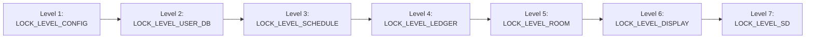

# Resource Synchronization, Lock Hierarchy & Distributed Consistency

**Project:** CoCIS Smart Control and Monitoring System (Makerere University)  
**Target:** ESP32 Dual-Core Xtensa LX6 / FreeRTOS / ESP-IDF v6.0.2

---

## 1. Why Synchronization Is Critical in This System

The CoCIS Smart Control System executes **9 concurrent FreeRTOS tasks** plus hardware GPIO ISRs and FreeRTOS software timer callbacks across two Xtensa LX6 CPU cores (`PRO_CPU` Core 0 and `APP_CPU` Core 1). Without strict synchronization:
- An RFID scan at the **Entry** door and a simultaneous RFID scan at the **Exit** door (or a CLI query `inside`) could read/modify the `occupancy_ledger` simultaneously, corrupting the live headcount or bypassing anti-passback.
- A lecture room task (`pir_light_task`) updating energy statistics while `proto_task` or `cli_task` reads them could observe torn structs.
- Two tasks writing to the SPI microSD card (`/sdcard/*.csv`) or the I2C 16x2 LCD (`0x27`) at the same instant would interleave SPI frames / I2C nibbles and crash the peripheral state machine.
- An admin updating the building schedule via UART (`schedule set`) while `access_task` checks `schedule_is_access_allowed()` could evaluate a half-updated schedule window.

---

## 2. Inventory of Shared Resources & Protecting Primitives

Every shared data structure or hardware bus in the firmware is protected by an explicit FreeRTOS synchronization primitive managed through the `sync` module (`include/sync.h`, `src/sync.c`):

| Shared Resource | Owner Module | Accessing Tasks | Primitive Type | Lock Level | Max Hold Time |
| :--- | :--- | :--- | :--- | :---: | :---: |
| **Runtime System Config** (`s_sys_config`) | `config` | `cli_task`, `access_task`, `pir_light_task`, `proto_task` | FreeRTOS Mutex (`LOCK_LEVEL_CONFIG`) | **1** (Highest) | `< 2 ms` |
| **Enrolled User Table** (`s_users[]`) | `user_db` | `access_task`, `cli_task`, `auth_task` | FreeRTOS Mutex (`LOCK_LEVEL_USER_DB`) | **2** | `< 5 ms` |
| **Access Schedule & Overrides** (`s_schedule`) | `schedule` | `access_task`, `cli_task`, `proto_task` | FreeRTOS Mutex (`LOCK_LEVEL_SCHEDULE`) | **3** | `< 2 ms` |
| **Live Occupancy Ledger** (`s_entries[]`) | `occupancy_ledger` | `access_task`, `cli_task`, `proto_task`, `display_task` | FreeRTOS Mutex (`LOCK_LEVEL_LEDGER`) | **4** | `< 5 ms` |
| **Room Lighting & Node Table** (`s_rooms[]`) | `light` / `net_protocol` | `pir_light_task`, `proto_task`, `cli_task`, `display_task` | FreeRTOS Mutex (`LOCK_LEVEL_ROOM`) | **5** | `< 2 ms` |
| **I2C 16x2 LCD Bus (`0x27`)** | `display` | `display_task`, `access_task` (via banner buffer) | FreeRTOS Mutex (`LOCK_LEVEL_DISPLAY`) | **6** | `< 15 ms` |
| **SPI2 MicroSD / FATFS (`/sdcard`)** | `storage_sd` | `logger_task`, `cli_task` (`sd verify`/`format`) | FreeRTOS Mutex (`LOCK_LEVEL_SD`) | **7** (Lowest) | `< 150 ms` |
| **RFID Scan Event Stream** | `rfid` -> `access_control` | `rfid_task` (Producer), `access_task` (Consumer) | FreeRTOS Queue (`s_scan_queue`, depth 16) | Lock-Free Queue | `0 ms` |
| **Async CSV Log Stream** | `logger` | All tasks (Producers), `logger_task` (Single Consumer) | FreeRTOS Queue (`s_log_queue`, depth 32) | Lock-Free Queue | `0 ms` |
| **Buzzer Tone Stream** | `buzzer` | `access_task`, `door`, `cli_task` -> `buzzer_task` | FreeRTOS Queue (`s_buzzer_queue`, depth 8) | Lock-Free Queue | `0 ms` |
| **System State Flags** (Wi-Fi, Time, SD, Emergency, Auth) | `sync` | All tasks | FreeRTOS Event Group (`s_sys_event_group`) | Atomic Bitmask | `0 ms` |

---

## 3. Strict Lock-Ordering Hierarchy (Deadlock Prevention)

A **deadlock** occurs when Task A holds Lock 1 and waits for Lock 2 while Task B holds Lock 2 and waits for Lock 1 (Coffman's *Circular Wait* condition).

We eliminate circular wait by enforcing a **strict global lock hierarchy** (`sync_lock_level_t` in `include/sync.h`):

### Golden Rules Enforced Across All Modules:
1. **Acquire Strictly in Ascending Numerical Order**: If a task already holds a lock at Level $i$, it may only acquire a second lock at Level $j > i$. Practically, every module API acquires its own internal lock, copies the result into a caller-supplied stack struct (`user_record_t`, `ledger_snapshot_t`, `room_status_t`), and **releases the lock before returning**—so tasks almost never hold two locks simultaneously!
2. **Never Hold a Lock Across Blocking I/O or Network Calls**: No mutex is ever held across `vTaskDelay()`, socket `send()`/`recv()`, or SD card writes. When `access_control` finishes updating `occupancy_ledger`, it releases `LOCK_LEVEL_LEDGER` **before** pushing the log record to `logger`'s non-blocking queue.
3. **Priority Inheritance via FreeRTOS Mutexes**: All locks are created with `xSemaphoreCreateMutex()` (not binary semaphores), enabling FreeRTOS **Priority Inheritance**. If low-priority `cli_task` (Priority 4) holds `LOCK_LEVEL_LEDGER` when high-priority `access_task` (Priority 6) tries to acquire it, `cli_task` is temporarily boosted to Priority 6 so medium-priority `pir_light_task` (Priority 5) cannot cause unbounded **Priority Inversion**.

---

## 4. Concrete Race Scenarios Prevented (With Step-by-Step Timelines)

### Scenario 1: Anti-Passback & Headcount Corruption on Simultaneous Scans

**What could happen WITHOUT `LOCK_LEVEL_LEDGER`:**
Suppose Student `"04A1B2C3"` (Alice) is outside (`inside_count = 10`). Two readers or a button + CLI command trigger near-simultaneously on Core 0 and Core 1:

| Time | Task A (`access_task`) — Core 0 | Task B (`cli_task` or 2nd Reader) — Core 1 | Unprotected State |
| :--- | :--- | :--- | :--- |
| `t = 0 µs` | Reads `s_entries[]`: Alice is NOT inside | Reads `s_entries[]`: Alice is NOT inside | `count = 10` |
| `t = 5 µs` | Writes Alice into `s_entries[4]` | Writes Alice into `s_entries[4]` (overwrites!) | Duplicate / Torn slot |
| `t = 8 µs` | Loads `count` (10) into register `a2` | Loads `count` (10) into register `a2` | Both registers = `10` |
| `t = 12 µs` | Stores `count = 11` | Stores `count = 11` | **Lost update / Anti-passback bypassed!** |

**How Our Design Prevents It:**
1. All RFID sources (`rfid_task` ISR buttons and `cli_task` `sim scan`) enqueue events into a single serialized FreeRTOS queue (`s_scan_queue`).
2. Inside `occupancy_ledger_record_entry(uid, now)`, the function acquires `sync_lock(LOCK_LEVEL_LEDGER, pdMS_TO_TICKS(200))`.
3. While locked, it atomically checks if `uid` is already marked `is_inside == true`. If so, it immediately returns `ESP_ERR_INVALID_STATE` (`ACCESS_DENY_ANTI_PASSBACK_ENTRY`) without modifying `count`. Otherwise, it marks `is_inside = true`, records `entry_time = now`, increments `s_inside_count`, and releases `LOCK_LEVEL_LEDGER`.

---

### Scenario 2: I2C 16x2 LCD Nibble Interleaving (Garbage Characters on Screen)

**What could happen WITHOUT `LOCK_LEVEL_DISPLAY`:**
The HD44780 LCD controller operates in **4-bit mode** over I2C (`0x27`). Every single ASCII character requires **two I2C transactions** (Upper Nibble `byte >> 4`, followed by Lower Nibble `byte & 0x0F`).
- If `display_task` is halfway through printing `'O'` (`0x4F`: sends upper nibble `0x4`) and gets preempted by `access_task` printing `'G'` (`0x47`: sends upper nibble `0x4`, lower nibble `0x7`), the LCD controller latches `0x44` (`'D'`), shifts nibble alignment by 4 bits for the rest of uptime, and fills the screen with garbled symbols!

**How Our Design Prevents It:**
1. External modules (`access_control`, `schedule`) **never** write directly to I2C. They call `display_show_alert(line0, line1, duration_ms)`, which acquires `LOCK_LEVEL_DISPLAY`, copies the two 16-char strings into `s_alert_line0`/`s_alert_line1`, sets `s_alert_expiry_tick`, and releases `LOCK_LEVEL_DISPLAY`.
2. Only `display_task` performs actual `i2c_master_transmit()` calls, holding `LOCK_LEVEL_DISPLAY` for the complete two-line frame redraw (`~12 ms`).

---

### Scenario 3: Torn Schedule Read During Admin Update

**What could happen WITHOUT `LOCK_LEVEL_SCHEDULE`:**
An Admin runs `schedule set mon 09:00 17:00` to change Monday's hours from `07:00–21:00` to `09:00–17:00` (`open_min = 540`, `close_min = 1020`).
- If `cli_task` updates `open_min = 540` (`09:00`) and before it updates `close_min` (or `enabled`), `access_task` preempts it while `close_min` is temporarily inconsistent during a multi-field update, an access decision could be evaluated against a partially written rule.

**How Our Design Prevents It:**
`schedule_set_day()` and `schedule_is_access_allowed()` both acquire `LOCK_LEVEL_SCHEDULE`. The entire day configuration (`enabled`, `open_hour`, `open_min`, `close_hour`, `close_min`) is updated atomically under the mutex before releasing it and persisting to NVS.

---

### Scenario 4: Distributed Race & Duplicate Replay Between Lecture Room 1 and Main Entrance

**What could happen WITHOUT Sequence Numbers & Single-Writer Deduplication:**
1. Lecture Room 1 detects motion at `t = 100s` and sends `PROTO_MSG_ROOM_EVENT (seq=15, occupied=1, light=1, energy_saved_delta=50 mWh)`.
2. Main Entrance receives `seq=15`, logs it to `/sdcard/lighting.csv`, adds `50 mWh` to building savings, and transmits `PROTO_MSG_ACK(seq=15)`.
3. Due to Wi-Fi packet loss, `PROTO_MSG_ACK(15)` is dropped.
4. Lecture Room 1's retry timer expires after `1000 ms` and retransmits `seq=15`.
5. Without deduplication, Main Entrance would write a second identical row to `/sdcard/lighting.csv` and double-count the `50 mWh` energy savings!

**How Our Design Prevents It:**
1. **Single Authoritative Writer**: Only `NODE_ENTRANCE` modifies building aggregates and writes to `/sdcard/*.csv`.
2. **Idempotent Sliding Window**: `net_protocol` at `NODE_ENTRANCE` records `s_last_ack_seq[src_node]`. When the retransmitted `seq=15` arrives from `NODE_ROOM_1`, `net_protocol` sees `pkt.seq_id <= s_last_ack_seq[1]`, suppresses the duplicate application callback, increments `s_dup_suppressed_count`, and immediately re-transmits `PROTO_MSG_ACK(15)`.
