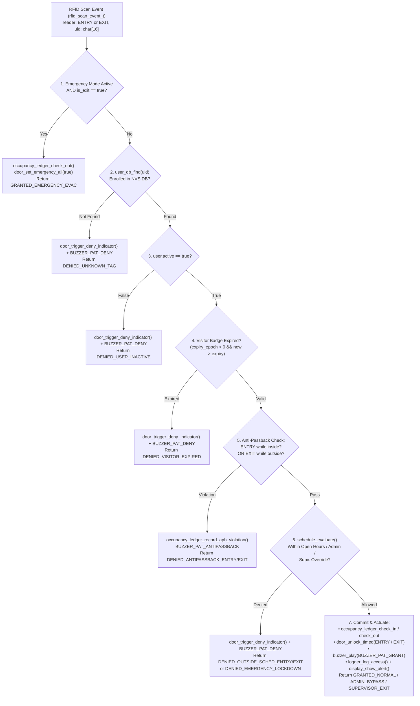

# Module Documentation: Main Entrance Access Control Decision Engine (`access_control`)

**Files Documented:**
- Header: `main/include/access_control.h` (Lines 1–43)
- Implementation: `main/src/access_control.c` (Lines 1–260)
- Related Subsystems: `rfid.h`, `user_db.h`, `occupancy_ledger.h`, `schedule.h`, `door.h`, `buzzer.h`, `logger.h`, `display.h`, `net_protocol.h`, `time_sync.h`

---

## 1. Purpose & Architectural Role

In the **CoCIS Smart Control and Monitoring System**, `access_control` is the **Central Security Policy Decision Point (PDP) and Policy Enforcement Coordinator** for the Main Entrance of the College of Computing and Information Sciences (CoCIS).

Whenever an RFID card is tapped at the **Entry** or **Exit** reader (or injected via the CLI), `access_control` orchestrates **10 collaborating modules** through a strict, deterministic **7-stage security evaluation pipeline**:
1. **Stage 1 — Emergency Evacuation Egress Check (`schedule_is_emergency_mode()`):** Guarantees that during a fire/emergency evacuation, anyone scanning out at the **Exit** reader is immediately checked out of the occupancy ledger and granted egress (`ACCESS_RESULT_GRANTED_EMERGENCY_EVAC`), even before checking user enrollment or schedules.
2. **Stage 2 — Enrolled User Database Lookup (`user_db_find()`):** Rejects unknown/unenrolled tags (`ACCESS_RESULT_DENIED_UNKNOWN_TAG`, e.g., intruder tag `DEADBEEF`).
3. **Stage 3 — Account Active Status Check (`user.active`):** Rejects suspended/disabled cards (`ACCESS_RESULT_DENIED_USER_INACTIVE`, e.g., `0499DEAD`).
4. **Stage 4 — Visitor Badge TTL Expiry Check (`user.expiry_epoch`):** Rejects visitor badges whose Unix epoch expiration timestamp has passed (`ACCESS_RESULT_DENIED_VISITOR_EXPIRED`).
5. **Stage 5 — Directional Anti-Passback Verification (`occupancy_ledger_is_inside()`):**
   - Blocks **Entry** if the user is **already recorded inside** (`ACCESS_RESULT_DENIED_ANTIPASSBACK_ENTRY` — prevents handing a card back through a window to a friend).
   - Blocks **Exit** if the user is **not recorded inside** (`ACCESS_RESULT_DENIED_ANTIPASSBACK_EXIT` — catches tailgaters who slipped in without scanning).
6. **Stage 6 — Building Schedule, Lockdown & Supervisor Override Check (`schedule_evaluate()`):** Enforces CoCIS opening/closing hours (both Entry and Exit!), allows `ADMIN` 24/7 bypass (`ACCESS_RESULT_GRANTED_ADMIN_BYPASS`), and honors 5-minute supervisor safe-exit passes (`ACCESS_RESULT_GRANTED_SUPERVISOR_EXIT`) when students work late in labs after hours.
7. **Stage 7 — Atomic Ledger Commit, Door Actuation, Audio/LCD Feedback & SHA-256 Logging:** Updates live building occupancy (`occupancy_ledger_check_in` / `check_out`), unlocks the Entry or Exit servo barrier (`door_unlock_timed`), triggers the piezo buzzer (`buzzer_play`), displays a 2.5-second alert banner on the 16×2 I2C LCD (`display_show_alert`), and appends a tamper-evident SHA-256 hash-chained record to the MicroSD CSV log (`logger_log_access`).

### Architectural 7-Stage Pipeline Diagram (Mermaid)



---

## 2. Public API Reference (`main/include/access_control.h`)

### 2.1 Enumerations

#### `access_result_t` (Lines 9–22)
```c
typedef enum {
    ACCESS_RESULT_GRANTED_NORMAL = 0,
    ACCESS_RESULT_GRANTED_ADMIN_BYPASS,
    ACCESS_RESULT_GRANTED_SUPERVISOR_EXIT,
    ACCESS_RESULT_GRANTED_EMERGENCY_EVAC,
    ACCESS_RESULT_DENIED_UNKNOWN_TAG,
    ACCESS_RESULT_DENIED_USER_INACTIVE,
    ACCESS_RESULT_DENIED_VISITOR_EXPIRED,
    ACCESS_RESULT_DENIED_OUTSIDE_SCHED_ENTRY,
    ACCESS_RESULT_DENIED_OUTSIDE_SCHED_EXIT,
    ACCESS_RESULT_DENIED_EMERGENCY_LOCKDOWN,
    ACCESS_RESULT_DENIED_ANTIPASSBACK_ENTRY,
    ACCESS_RESULT_DENIED_ANTIPASSBACK_EXIT
} access_result_t;
```
- **Purpose:** Exhaustive 12-value outcome enumeration classifying every possible grant or denial reason in the CoCIS building security model. Used both for live telemetry and for deterministic assertions in the 10-scenario automated verification suite (`sim selftest` in `cli.c`).

---

### 2.2 Structures

#### `access_stats_t` (Lines 24–34)
```c
typedef struct {
    uint32_t granted_entry;
    uint32_t granted_exit;
    uint32_t denied_unknown;
    uint32_t denied_inactive;
    uint32_t denied_expired;
    uint32_t denied_schedule_entry;
    uint32_t denied_schedule_exit;
    uint32_t denied_antipassback;
    access_result_t last_result;
} access_stats_t;
```
- **Purpose:** Cumulative counters for all access control decisions since boot, displayed by the CLI `stats` and `daily_report` commands.

---

### 2.3 Public Functions

| Function Prototype | Parameters & Return Value | Side Effects | Caller & Task Context | Blocking? |
| :--- | :--- | :--- | :--- | :--- |
| **`esp_err_t access_control_init(void)`** (Line 36) | **Params:** None.<br/>**Returns:** `ESP_OK` or `ESP_ERR_NO_MEM`. | Creates `s_scan_queue` (depth `16`, item `sizeof(rfid_scan_event_t)`) and spawns `"access_task"` (stack `6144` B, priority `6`). | Called once by `app_main()` (`main.c:51`) in `main` task context. | Non-blocking. |
| **`void access_control_handle_scan(const rfid_scan_event_t *evt)`** (Line 37) | **Params:** Pointer to `rfid_scan_event_t`.<br/>**Returns:** `void`. | Copies `*evt` into `s_scan_queue` with a `50 ms` max timeout so `access_task` processes it asynchronously. | Registered as `scan_cb` in `rfid_init()` (`main.c:52`); called by `rfid_task` (Priority 7) or `rfid_inject_scan` (`cli_task`, Priority 4). | Non-blocking (up to `50 ms` max if queue full). |
| **`void access_control_handle_emergency_btn(void)`** (Line 38) | **Params:** None.<br/>**Returns:** `void`. | Toggles `schedule_is_emergency_mode()`, locks/unlocks all doors via `door_set_emergency_all()`, broadcasts emergency packet over network (`net_protocol_broadcast_emergency`), logs audit record. | Registered as `emerg_cb` in `rfid_init()` (`main.c:52`); called by `rfid_task` (Priority 7) when GPIO 16 button is pressed. | Non-blocking. |
| **`access_result_t access_control_evaluate_sync(rfid_reader_t reader, const char *uid)`** (Line 39) | **Params:** `reader` (`ENTRY`/`EXIT`), `uid` string.<br/>**Returns:** `access_result_t` decision enum. | Runs `process_scan_event()` synchronously on the caller's thread and returns the exact `access_result_t` immediately. | Called by `run_selftest_suite()` in `cli.c:582-632` (`cli_task`, Priority 4). | Runs synchronously (~1–5 ms). |
| **`esp_err_t access_control_get_stats(access_stats_t *out_stats)`** (Line 40) | **Params:** Non-null `out_stats`.<br/>**Returns:** `ESP_OK` or `ESP_ERR_INVALID_ARG`. | Copies `s_stats` into `*out_stats`. | Called by `cmd_stats()` in `cli.c:266`. | Non-blocking. |
| **`const char *access_control_result_to_str(access_result_t res)`** (Line 41) | **Params:** `res` enum.<br/>**Returns:** Static string literal name. | None (pure function). | Utility for diagnostics/logging. | Non-blocking. |

---

## 3. Line-by-Line / Block-by-Block Code Walkthrough (`main/src/access_control.c`)

### 3.1 Includes & Static Module State (Lines 1–23)
```c
#include "access_control.h"
#include <stdio.h>
#include <string.h>
#include "buzzer.h"
#include "config.h"
#include "display.h"
#include "door.h"
#include "esp_log.h"
#include "freertos/FreeRTOS.h"
#include "freertos/queue.h"
#include "freertos/task.h"
#include "logger.h"
#include "net_protocol.h"
#include "occupancy_ledger.h"
#include "schedule.h"
#include "time_sync.h"
#include "user_db.h"

static const char *TAG = "ACCESS_CTRL";

static QueueHandle_t  s_scan_queue = NULL;
static access_stats_t s_stats = { 0 };
```
- **Lines 1–17:** Includes the headers of all subsystems coordinated by the access control engine.
- **Line 21 (`s_scan_queue`):** Queue holding `rfid_scan_event_t` structs waiting to be evaluated by `access_task`.
- **Line 22 (`s_stats`):** Zero-initialized `access_stats_t` struct tracking cumulative grants and denials across all categories.

---

### 3.2 Core 7-Stage Policy Engine: `process_scan_event()` (Lines 24–173)

#### Stage 1: Setup & Emergency Evacuation Egress Check (Lines 24–42)
```c
static access_result_t process_scan_event(const rfid_scan_event_t *evt)
{
    bool is_exit = (evt->reader == RFID_READER_EXIT);
    const char *dir_str = is_exit ? "EXIT" : "ENTRY";
    time_snapshot_t now;
    time_sync_get_now(&now);

    /* 1. Emergency Evacuation Mode Egress Check */
    if (schedule_is_emergency_mode() && is_exit) {
        uint32_t new_cnt = occupancy_ledger_get_count();
        occupancy_ledger_check_out(evt->uid, now.epoch, &new_cnt);
        door_set_emergency_all(true);
        buzzer_play(BUZZER_PAT_GRANT);
        s_stats.granted_exit++;
        s_stats.last_result = ACCESS_RESULT_GRANTED_EMERGENCY_EVAC;
        logger_log_access(evt->uid, dir_str, "GRANT_EMERGENCY_EVAC", (int32_t)new_cnt);
        display_show_alert("EVAC EXIT OK", evt->uid, 2000);
        return ACCESS_RESULT_GRANTED_EMERGENCY_EVAC;
    }
```
- **Lines 26–29:** Determines scan direction (`is_exit`, `dir_str`) and captures the current East Africa Time (EAT, UTC+3) Unix epoch timestamp via `time_sync_get_now(&now)`.
- **Lines 32–42 (Life-Safety Priority Rule):** If the building is in **Emergency Evacuation Mode** (`schedule_is_emergency_mode() == true`) and the scan is at the **Exit** reader (`is_exit == true`), the person is **unconditionally allowed to exit** and checked out of the occupancy roll call (`occupancy_ledger_check_out`)—even if it is after closing hours, even if their visitor badge expired 5 minutes ago, or even if they had tailgated in! Why? Because in a real fire evacuation, life safety and accurate roll-call headcount (knowing the person has left the burning building) take absolute precedence over administrative rules. Note that **Entry** during an emergency is NOT allowed here—it proceeds through the pipeline and is blocked at Stage 6 with `ACCESS_RESULT_DENIED_EMERGENCY_LOCKDOWN`.

#### Stage 2: Lookup User in Enrolled Database (Lines 44–55)
```c
    /* 2. Lookup User in Enrolled Database */
    user_record_t user;
    if (user_db_find(evt->uid, &user) != ESP_OK) {
        s_stats.denied_unknown++;
        s_stats.last_result = ACCESS_RESULT_DENIED_UNKNOWN_TAG;
        door_trigger_deny_indicator();
        buzzer_play(BUZZER_PAT_DENY);
        logger_log_access(evt->uid, dir_str, "DENY_UNKNOWN_TAG", (int32_t)occupancy_ledger_get_count());
        display_show_alert("DENY: UNKNOWN ID", evt->uid, 2500);
        ESP_LOGW(TAG, "[%s] DENIED unknown tag %s", dir_str, evt->uid);
        return ACCESS_RESULT_DENIED_UNKNOWN_TAG;
    }
```
- Queries the NVS-backed `user_db` (`user_db_find`). If the UID is not enrolled (e.g., `"DEADBEEF"`), increments `denied_unknown`, flashes the red alarm LED for 1.2 s (`door_trigger_deny_indicator()`), plays `BUZZER_PAT_DENY`, logs `"DENY_UNKNOWN_TAG"` to the hash-chained access log, shows `"DENY: UNKNOWN ID"` on the 16×2 LCD, and returns `ACCESS_RESULT_DENIED_UNKNOWN_TAG`.

#### Stage 3 & Stage 4: Account Active Status & Visitor Expiry (Lines 57–79)
```c
    /* 3. Verify Account Active Status */
    if (!user.active) {
        s_stats.denied_inactive++;
        s_stats.last_result = ACCESS_RESULT_DENIED_USER_INACTIVE;
        door_trigger_deny_indicator();
        buzzer_play(BUZZER_PAT_DENY);
        logger_log_access(user.uid, dir_str, "DENY_USER_INACTIVE", (int32_t)occupancy_ledger_get_count());
        display_show_alert("DENY: INACTIVE", user.name, 2500);
        ESP_LOGW(TAG, "[%s] DENIED inactive user %s (%s)", dir_str, user.uid, user.name);
        return ACCESS_RESULT_DENIED_USER_INACTIVE;
    }

    /* 4. Verify Visitor Expiry */
    if (user.expiry_epoch > 0 && now.epoch > user.expiry_epoch) {
        s_stats.denied_expired++;
        s_stats.last_result = ACCESS_RESULT_DENIED_VISITOR_EXPIRED;
        door_trigger_deny_indicator();
        buzzer_play(BUZZER_PAT_DENY);
        logger_log_access(user.uid, dir_str, "DENY_VISITOR_EXPIRED", (int32_t)occupancy_ledger_get_count());
        display_show_alert("DENY: EXPIRED", user.name, 2500);
        ESP_LOGW(TAG, "[%s] DENIED expired visitor %s (%s)", dir_str, user.uid, user.name);
        return ACCESS_RESULT_DENIED_VISITOR_EXPIRED;
    }
```
- **Lines 58–67 (Stage 3):** If an administrator has suspended the account (`user disable <uid>`, or default suspended user `0499DEAD`), denies access with `ACCESS_RESULT_DENIED_USER_INACTIVE`.
- **Lines 70–79 (Stage 4):** Permanent staff/students have `user.expiry_epoch == 0` (never expires). Temporary `VISITOR` badges (such as `04V10008`) have `user.expiry_epoch > 0` (24-hour TTL by default). If `now.epoch > user.expiry_epoch`, denies access with `ACCESS_RESULT_DENIED_VISITOR_EXPIRED`.

#### Stage 5: Directional Anti-Passback Enforcement (Lines 81–104)
```c
    /* 5. Verify Anti-Passback FIRST so passback violations are always caught */
    bool currently_inside = occupancy_ledger_is_inside(user.uid);
    if (!is_exit && currently_inside) {
        s_stats.denied_antipassback++;
        s_stats.last_result = ACCESS_RESULT_DENIED_ANTIPASSBACK_ENTRY;
        occupancy_ledger_record_apb_violation();
        door_trigger_deny_indicator();
        buzzer_play(BUZZER_PAT_ANTIPASSBACK);
        logger_log_access(user.uid, dir_str, "DENY_ANTIPASSBACK_IN", (int32_t)occupancy_ledger_get_count());
        display_show_alert("DENY: PASSBACK", "Already Inside!", 2500);
        ESP_LOGW(TAG, "[ENTRY] DENIED anti-passback: %s (%s) is already inside", user.uid, user.name);
        return ACCESS_RESULT_DENIED_ANTIPASSBACK_ENTRY;
    }
    if (is_exit && !currently_inside) {
        s_stats.denied_antipassback++;
        s_stats.last_result = ACCESS_RESULT_DENIED_ANTIPASSBACK_EXIT;
        occupancy_ledger_record_apb_violation();
        door_trigger_deny_indicator();
        buzzer_play(BUZZER_PAT_ANTIPASSBACK);
        logger_log_access(user.uid, dir_str, "DENY_ANTIPASSBACK_OUT", (int32_t)occupancy_ledger_get_count());
        display_show_alert("DENY: PASSBACK", "Not Inside!", 2500);
        ESP_LOGW(TAG, "[EXIT] DENIED anti-passback: %s (%s) is not recorded inside", user.uid, user.name);
        return ACCESS_RESULT_DENIED_ANTIPASSBACK_EXIT;
    }
```
- Queries `occupancy_ledger_is_inside(user.uid)` and enforces strict state-machine alternation (`OUTSIDE` $\xrightarrow{\text{ENTRY}}$ `INSIDE` $\xrightarrow{\text{EXIT}}$ `OUTSIDE`):
  - **Entry while already inside (`!is_exit && currently_inside`):** Denies with `ACCESS_RESULT_DENIED_ANTIPASSBACK_ENTRY`, increments both `s_stats.denied_antipassback` and the ledger's `antipassback_blocks` counter (`occupancy_ledger_record_apb_violation()`), and sounds the distinct triple-staccato `BUZZER_PAT_ANTIPASSBACK`.
  - **Exit while not recorded inside (`is_exit && !currently_inside`):** Denies with `ACCESS_RESULT_DENIED_ANTIPASSBACK_EXIT`.
- **Crucial Ordering Detail:** Notice that Stage 5 (Anti-Passback) runs **before** Stage 6 (Schedule Check) so that passback violations are always caught and logged as passback violations even after hours or for Admin users!

#### Stage 6: Building Access Schedule & Supervisor Override Evaluation (Lines 106–134)
```c
    /* 6. Evaluate Building Access Schedule (both Entry & Exit enforced) */
    schedule_decision_t sdec = schedule_evaluate(is_exit, user.role, user.uid);
    if (sdec != SCHED_ALLOW_NORMAL &&
        sdec != SCHED_ALLOW_ADMIN_BYPASS &&
        sdec != SCHED_ALLOW_SUPERVISOR_OVERRIDE &&
        sdec != SCHED_ALLOW_EMERGENCY_EXIT) {

        door_trigger_deny_indicator();
        buzzer_play(BUZZER_PAT_DENY);

        if (is_exit) {
            s_stats.denied_schedule_exit++;
            s_stats.last_result = ACCESS_RESULT_DENIED_OUTSIDE_SCHED_EXIT;
            logger_log_access(user.uid, dir_str, schedule_decision_to_str(sdec), (int32_t)occupancy_ledger_get_count());
            display_show_alert("DENY EXIT: SCHED", "Need Supv. Pass", 2500);
            ESP_LOGW(TAG, "[EXIT] DENIED after-hours exit for %s (%s) - supervisor override required",
                     user.uid, user.name);
            return ACCESS_RESULT_DENIED_OUTSIDE_SCHED_EXIT;
        } else {
            s_stats.denied_schedule_entry++;
            s_stats.last_result = (sdec == SCHED_DENY_EMERGENCY_LOCKDOWN_ENTRY)
                                  ? ACCESS_RESULT_DENIED_EMERGENCY_LOCKDOWN
                                  : ACCESS_RESULT_DENIED_OUTSIDE_SCHED_ENTRY;
            logger_log_access(user.uid, dir_str, schedule_decision_to_str(sdec), (int32_t)occupancy_ledger_get_count());
            display_show_alert("DENY: CLOSED HRS", user.name, 2500);
            ESP_LOGW(TAG, "[ENTRY] DENIED outside schedule for %s (%s)", user.uid, user.name);
            return s_stats.last_result;
        }
    }
```
- Calls `schedule_evaluate(is_exit, user.role, user.uid)`:
  - During normal open hours (e.g., Mon–Fri 07:00–21:00 EAT, Sat 08:00–17:00 EAT), returns `SCHED_ALLOW_NORMAL`.
  - Outside open hours, `USER_ROLE_ADMIN` (e.g., `04A00001` Prof. Tonny Oyana) receives `SCHED_ALLOW_ADMIN_BYPASS`.
  - Outside open hours on **Exit**, if a student/staff member remained in the building past closing time, normal exit is **blocked** (`ACCESS_RESULT_DENIED_OUTSIDE_SCHED_EXIT`, LCD displays `"DENY EXIT: SCHED / Need Supv. Pass"`) until a security supervisor issues `override_exit <uid>` in the admin CLI (which grants a 5-minute one-time exit pass returning `SCHED_ALLOW_SUPERVISOR_OVERRIDE`).
  - During Emergency Mode on **Entry**, returns `SCHED_DENY_EMERGENCY_LOCKDOWN_ENTRY` $\rightarrow$ `ACCESS_RESULT_DENIED_EMERGENCY_LOCKDOWN` (preventing people from entering a burning building!).

#### Stage 7: Commit Occupancy Ledger, Unlock Door, Audio/LCD & Audit Log (Lines 136–173)
```c
    /* 7. Commit Occupancy Ledger Update & Actuate Door */
    uint32_t new_count = 0;
    if (!is_exit) {
        occupancy_ledger_check_in(&user, now.epoch, &new_count);
        door_unlock_timed(DOOR_ID_ENTRY);
        s_stats.granted_entry++;
    } else {
        occupancy_ledger_check_out(user.uid, now.epoch, &new_count);
        door_unlock_timed(DOOR_ID_EXIT);
        s_stats.granted_exit++;
    }

    buzzer_play(BUZZER_PAT_GRANT);

    access_result_t final_res = ACCESS_RESULT_GRANTED_NORMAL;
    const char *log_reason = "GRANT_NORMAL";
    if (sdec == SCHED_ALLOW_ADMIN_BYPASS) {
        final_res = ACCESS_RESULT_GRANTED_ADMIN_BYPASS;
        log_reason = "GRANT_ADMIN_BYPASS";
    } else if (sdec == SCHED_ALLOW_SUPERVISOR_OVERRIDE) {
        final_res = ACCESS_RESULT_GRANTED_SUPERVISOR_EXIT;
        log_reason = "GRANT_SUPERVISOR_EXIT";
        logger_log_audit("SUPERVISOR", "OVERRIDE_EXIT_USED", user.uid);
    }
    s_stats.last_result = final_res;

    logger_log_access(user.uid, dir_str, log_reason, (int32_t)new_count);

    char line0[17];
    char line1[17];
    snprintf(line0, sizeof(line0), "GRANTED: %-6s", dir_str);
    snprintf(line1, sizeof(line1), "%-10.10s IN:%2lu", user.name, (unsigned long)new_count);
    display_show_alert(line0, line1, 2500);

    ESP_LOGI(TAG, "[%s] %s for %s (%s) -> Building Occupancy: %lu",
             dir_str, log_reason, user.uid, user.name, (unsigned long)new_count);
    return final_res;
}
```
- **Lines 137–146:** Commits the state change to `occupancy_ledger` (receiving the updated building headcount in `new_count`), unlocks the appropriate servo barrier (`DOOR_ID_ENTRY` or `DOOR_ID_EXIT`), and increments `granted_entry` or `granted_exit`.
- **Lines 150–160:** Determines whether the grant was `GRANT_NORMAL`, `GRANT_ADMIN_BYPASS`, or `GRANT_SUPERVISOR_EXIT` (recording an extra supervisor audit log entry when a supervisor exit pass is consumed).
- **Lines 164–168:** Formats two exact 16-character lines for the 16×2 HD44780 LCD using `snprintf()` (e.g., `"GRANTED: ENTRY  "` and `"Matthew Mu IN: 1"`) and displays them for `2500 ms`.

---

### 3.3 Background Task, Callbacks & Synchronous Evaluator (Lines 175–260)
```c
static void access_task(void *arg)
{
    (void)arg;
    rfid_scan_event_t evt;
    while (1) {
        if (xQueueReceive(s_scan_queue, &evt, portMAX_DELAY) == pdTRUE) {
            process_scan_event(&evt);
        }
    }
}

esp_err_t access_control_init(void)
{
    if (s_scan_queue == NULL) {
        s_scan_queue = xQueueCreate(CFG_RFID_QUEUE_DEPTH, sizeof(rfid_scan_event_t));
        if (s_scan_queue == NULL) {
            return ESP_ERR_NO_MEM;
        }
    }

    if (xTaskCreate(access_task, "access_task", 6144, NULL, 6, NULL) != pdPASS) {
        return ESP_ERR_NO_MEM;
    }

    ESP_LOGI(TAG, "Main Entrance access control decision engine initialized");
    return ESP_OK;
}

void access_control_handle_scan(const rfid_scan_event_t *evt)
{
    if (evt != NULL && s_scan_queue != NULL) {
        xQueueSend(s_scan_queue, evt, pdMS_TO_TICKS(50));
    }
}

void access_control_handle_emergency_btn(void)
{
    bool new_mode = !schedule_is_emergency_mode();
    schedule_set_emergency_mode(new_mode);
    door_set_emergency_all(new_mode);
    net_protocol_broadcast_emergency(new_mode);

    logger_log_audit("HW_BUTTON", new_mode ? "EMERGENCY_ON" : "EMERGENCY_OFF",
                     new_mode ? "Emergency evacuation unlocked doors" : "Emergency mode cleared");
    ESP_LOGW(TAG, "Emergency Evacuation Mode toggled via hardware button -> %s",
             new_mode ? "ACTIVE (ALL DOORS UNLOCKED)" : "NORMAL");
}

access_result_t access_control_evaluate_sync(rfid_reader_t reader, const char *uid)
{
    rfid_scan_event_t evt = { 0 };
    evt.reader = reader;
    evt.from_hardware_btn = false;
    if (uid != NULL) {
        strncpy(evt.uid, uid, sizeof(evt.uid) - 1);
    }
    return process_scan_event(&evt);
}
```
- **`access_task()` & `access_control_init()` (Lines 175–201):** Creates `s_scan_queue` (depth 16) and spawns `"access_task"` with a `6144`-byte stack at Priority `6`. Why `6144` bytes? Because `process_scan_event()` calls deep into `user_db`, `occupancy_ledger`, `logger`, `display`, and `ESP_LOGI` (`vprintf`), which require substantial stack space.
- **`access_control_handle_scan()` (Lines 203–208):** Callback registered with `rfid_init()`. Copies `*evt` by value into `s_scan_queue`.
- **`access_control_handle_emergency_btn()` (Lines 210–221):** Callback registered with `rfid_init()` for GPIO 16. Toggles emergency mode in `schedule.c`, unlocks/relocks all doors in `door.c`, broadcasts the emergency state to all distributed lecture room nodes (`net_protocol_broadcast_emergency(new_mode)`), and records a tamper-evident audit log entry.
- **`access_control_evaluate_sync()` (Lines 223–232):** Synchronous wrapper around `process_scan_event()` used by `run_selftest_suite()` in `cli.c` so automated tests can immediately inspect the returned `access_result_t` without race conditions or `vTaskDelay` polling.

---

## 4. C Language Constructs Explained

| C Construct | Where Used in `access_control` | Detailed Explanation for Examiners |
| :--- | :--- | :--- |
| **`snprintf(line1, sizeof(line1), "%-10.10s IN:%2lu", user.name, (unsigned long)new_count)`** | `access_control.c:164-167` | **Bounded Formatted String Construction:**<br/>• `sizeof(line1)` is `17` bytes (16 visible LCD characters + 1 null terminator `'\0'`). `snprintf` guarantees it will never write more than 17 bytes, preventing stack buffer overflow.<br/>• `%-10.10s`: Left-aligns (`-`) the user's name in a minimum field width of `10` characters and truncates (`.10`) names longer than 10 characters so `"Matthew Mumbere"` becomes `"Matthew Mu"`, leaving exactly 6 characters for `" IN: 1"` (`10 + 6 = 16` chars!). |
| **Pass-by-Pointer Output Parameter (`&user`, `&new_count`, `out_stats`)** | `access_control.c:34, 45, 139, 143, 234` | Because C functions have only a single return value (commonly used for `esp_err_t` status codes), functions like `user_db_find(evt->uid, &user)` and `occupancy_ledger_check_in(&user, now.epoch, &new_count)` write their output data into caller-allocated variables via pointers. |
| **Short-Circuit Logical Operators (`&&` and `!=`)** | `access_control.c:32, 70, 83, 94, 108-111, 205` | In `if (user.expiry_epoch > 0 && now.epoch > user.expiry_epoch)`, if `user.expiry_epoch > 0` is `false` (permanent user), C short-circuit evaluation skips evaluating the right-hand side. In `if (evt != NULL && s_scan_queue != NULL)`, it prevents dereferencing `NULL`. |
| **Boolean Toggle Idiom (`bool new_mode = !schedule_is_emergency_mode();`)** | `access_control.c:212` | Logical negation `!` flips `false` $\rightarrow$ `true` and `true` $\rightarrow$ `false`, turning the momentary pushbutton on GPIO 16 into a latching push-on / push-off toggle switch. |

---

## 5. ESP-IDF & FreeRTOS Constructs Explained

| Construct / API | Role in `access_control.c` | Detailed Technical Explanation |
| :--- | :--- | :--- |
| **Message Queue Struct Serialization (`xQueueCreate(16, sizeof(rfid_scan_event_t))`)** | `access_control.c:189, 206` | FreeRTOS queues copy items **by value** (`memcpy`), not by pointer! When `access_control_handle_scan(const rfid_scan_event_t *evt)` calls `xQueueSend(s_scan_queue, evt, ...)`, FreeRTOS copies all 24 bytes of the `rfid_scan_event_t` struct into internal queue storage. This means `rfid_task` and `rfid_inject_scan()` can safely allocate `evt` on their own local stack and let it go out of scope immediately after `s_scan_cb(&evt)` returns! |
| **Stack Sizing (`6144` bytes for `access_task`)** | `access_control.c:195` | Unlike `buzzer_task` (`3072` B) or `rfid_task` (`4096` B), `access_task` executes `process_scan_event()`, which allocates stack structs (`user_record_t`, `time_snapshot_t`, LCD buffers) and calls `user_db_find` (NVS/mutex), `occupancy_ledger_check_in` (SD recovery/mutex), `snprintf`, and `ESP_LOGI`. Allocating `6144` bytes prevents FreeRTOS stack overflow panics (`configCHECK_FOR_STACK_OVERFLOW`). |
| **Structured Logging Levels (`ESP_LOGI` vs `ESP_LOGW`)** | `access_control.c:53, 65, 77, 91, 102, 170, 219` | Normal grants log at Info level (`ESP_LOGI`, printed in green on serial terminals), whereas security denials and emergency mode toggles log at Warning level (`ESP_LOGW`, printed in yellow) so security operators can visually spot anomalies in the log stream. |

---

## 6. Alternatives & "What If You Change This?"

### 6.1 What If You Check Schedule (Stage 6) BEFORE Anti-Passback (Stage 5)?
Suppose we swapped Stage 5 (Anti-Passback) and Stage 6 (Schedule Evaluation). What breaks?
1. **Admin Passback Bypass Bug:** In `schedule_evaluate()`, `USER_ROLE_ADMIN` (`04A00001`) always returns `SCHED_ALLOW_ADMIN_BYPASS`. That's fine if Anti-Passback is still checked, **unless** someone short-circuits on `SCHED_ALLOW_ADMIN_BYPASS`.
2. **Masked Tailgating / Passback Attempt After Hours:** Suppose Student A is **not** inside the building at 22:00 (after hours), and someone inside tries to scan Student A's card at the Exit reader, or Student B (already inside) scans their card again at Entry at 22:00. If Schedule Check ran first, the system would log a mundane `DENY_OUTSIDE_SCHED` instead of flagging and incrementing the high-priority security metric **`DENY_ANTIPASSBACK`** (`occupancy_ledger_record_apb_violation()`). Checking Anti-Passback in Stage 5 before Schedule Check in Stage 6 ensures every passback anomaly is caught and counted accurately.

### 6.2 What If Emergency Evacuation Mode Only Unlocked Doors in `door.c` Without Stage 1 in `access_control.c`?
If `door_set_emergency_all(true)` unlocked the physical barriers during an evacuation, but `process_scan_event()` did **not** have Stage 1 (`if (schedule_is_emergency_mode() && is_exit)`):
- If a fire broke out at 22:30 (after closing time) and evacuating students tapped their cards at the Exit reader as they left so the fire marshal would know the building was empty, Stage 6 would **reject** their exit scan (`DENIED_OUTSIDE_SCHED_EXIT`) unless they had a supervisor override, leaving them listed as still trapped inside the building on the `inside` roll-call table! Stage 1 guarantees that during an evacuation, every Exit tap checks the person out of `occupancy_ledger` and returns `ACCESS_RESULT_GRANTED_EMERGENCY_EVAC` (verified by **Test 07** in `sim selftest`).

---

## 7. Design Rationale

1. **Fail-Closed Security Pipeline with Life-Safety Egress Exception:**
   Every stage in `process_scan_event()` follows a **early-return guard clause** pattern: a tag must pass Enrollment $\rightarrow$ Active Status $\rightarrow$ Expiry $\rightarrow$ Anti-Passback $\rightarrow$ Schedule before reaching Stage 7 (Ledger Commit & Door Unlock). The single deliberate exception is Stage 1 (Emergency Evacuation Egress), which prioritizes human life and accurate evacuation checkout while still blocking new entries (`DENIED_EMERGENCY_LOCKDOWN`).
2. **Dual Asynchronous + Synchronous Execution Modes:**
   - **Asynchronous (`access_control_handle_scan` $\rightarrow$ `s_scan_queue` $\rightarrow$ `access_task`):** Used in live operation so GPIO button debounce (`rfid_task`) is never blocked by NVS/LCD/logger operations.
   - **Synchronous (`access_control_evaluate_sync`):** Used by `sim selftest` (`cli.c`) so all 10 coursework verification scenarios can run deterministically and assert exact `access_result_t` return codes.
3. **Complete Observability Across 4 Output Channels:**
   Every single decision in `process_scan_event()` updates:
   1. In-RAM telemetry counters (`s_stats`),
   2. Physical LEDs & Piezo Buzzer (`door.c` + `buzzer.c`),
   3. 16×2 I2C LCD banner (`display_show_alert`), and
   4. SHA-256 hash-chained CSV log on MicroSD (`logger_log_access`).

---

## 8. Failure Modes, Edge Cases & Recovery

1. **Duplicate Entry Scan (Card Passed Back to Friend — Anti-Passback Entry):**
   - *Scenario:* User `04A1B2C3` scans at `ENTRY` (granted, occupancy = 1), then scans at `ENTRY` again without having exited.
   - *Recovery:* Stage 5 sees `!is_exit && currently_inside == true`, blocks the scan with `ACCESS_RESULT_DENIED_ANTIPASSBACK_ENTRY`, plays `BUZZER_PAT_ANTIPASSBACK`, keeps occupancy at `1`, and logs `"DENY_ANTIPASSBACK_IN"`.
2. **Exit Scan by Tailgater (User Never Scanned In — Anti-Passback Exit):**
   - *Scenario:* User `04A1B2C3` is outside (`currently_inside == false`) and scans at `EXIT`.
   - *Recovery:* Stage 5 sees `is_exit && !currently_inside`, blocks the scan with `ACCESS_RESULT_DENIED_ANTIPASSBACK_EXIT`, prevents occupancy from underflowing below `0`, and logs `"DENY_ANTIPASSBACK_OUT"`.
3. **Student Trapped Inside After Closing Hours (After-Hours Exit Block + Supervisor Override):**
   - *Scenario:* Student `04C3D4E5` (Sarah Namukasa) enters at 09:00 EAT and tries to exit at 22:00 EAT (after 17:00 Saturday close).
   - *Recovery:* Stage 6 blocks the unapproved late exit (`ACCESS_RESULT_DENIED_OUTSIDE_SCHED_EXIT`, LCD: `"DENY EXIT: SCHED / Need Supv. Pass"`). Once an admin logs in (`login admin Cocis@2026`) and runs `override_exit 04C3D4E5`, Sarah's next exit scan within 5 minutes succeeds with `ACCESS_RESULT_GRANTED_SUPERVISOR_EXIT`, decrements occupancy, and logs `"OVERRIDE_EXIT_USED"` to the audit trail.
4. **Attempted Entry During Active Fire Evacuation:**
   - *Scenario:* Emergency mode is active (`schedule_is_emergency_mode() == true`), and a student attempts to scan **in** at the `ENTRY` reader.
   - *Recovery:* Stage 1 only allows `is_exit == true`. The entry scan proceeds to Stage 6, where `schedule_evaluate()` returns `SCHED_DENY_EMERGENCY_LOCKDOWN_ENTRY`, and `process_scan_event()` denies entry with `ACCESS_RESULT_DENIED_EMERGENCY_LOCKDOWN`.

---

## 9. How to Test This Module in Isolation

Run the following step-by-step commands in the serial console to exercise every branch of `access_control.c`:

```text
# 1. Valid Student Entry (Stage 7 -> GRANTED_NORMAL, Occupancy = 1)
cocis> sim scan entry 04A1B2C3
I (xxx) ACCESS_CTRL: [ENTRY] GRANT_NORMAL for 04A1B2C3 (Matthew Mumbere) -> Building Occupancy: 1

# 2. Anti-Passback Entry Violation (Stage 5 -> DENIED_ANTIPASSBACK_ENTRY)
cocis> sim scan entry 04A1B2C3
W (xxx) ACCESS_CTRL: [ENTRY] DENIED anti-passback: 04A1B2C3 (Matthew Mumbere) is already inside

# 3. Valid Student Exit (Stage 7 -> GRANTED_NORMAL, Occupancy = 0)
cocis> sim scan exit 04A1B2C3
I (xxx) ACCESS_CTRL: [EXIT] GRANT_NORMAL for 04A1B2C3 (Matthew Mumbere) -> Building Occupancy: 0

# 4. Anti-Passback Exit Violation (Stage 5 -> DENIED_ANTIPASSBACK_EXIT)
cocis> sim scan exit 04A1B2C3
W (xxx) ACCESS_CTRL: [EXIT] DENIED anti-passback: 04A1B2C3 (Matthew Mumbere) is not recorded inside

# 5. Unknown Intruder Tag (Stage 2 -> DENIED_UNKNOWN_TAG)
cocis> sim scan entry DEADBEEF
W (xxx) ACCESS_CTRL: [ENTRY] DENIED unknown tag DEADBEEF

# 6. Inactive / Suspended User (Stage 3 -> DENIED_USER_INACTIVE)
cocis> sim scan entry 0499DEAD
W (xxx) ACCESS_CTRL: [ENTRY] DENIED inactive user 0499DEAD (Suspended Account)

# 7. Inspect Cumulative Access Control Metrics
cocis> stats
+----------------------------------------+------------+
| Security & Performance Metric          |      Value |
+----------------------------------------+------------+
| Granted Entries                        |          1 |
| Granted Exits                          |          1 |
| Denied: Unknown RFID Tag               |          1 |
| Denied: Inactive / Suspended User      |          1 |
| Denied: Expired Visitor Badge          |          0 |
| Denied: Outside Schedule (Entry)       |          0 |
| Denied: Outside Schedule (Exit)        |          0 |
| Denied: Anti-Passback Violations       |          2 |
...
```

You can also run `sim selftest` to execute the automated 10-scenario coursework verification suite, where Scenarios 1 through 7 directly assert the return values of `access_control_evaluate_sync()`.

---

## 10. Likely Examiner Questions & Model Answers

### Q1: Walk me through all 7 stages of `process_scan_event()` in exact order and explain why that order matters.
**Model Answer:**
1. **Emergency Evacuation Egress (`schedule_is_emergency_mode() && is_exit`):** Must be first so anyone exiting during an emergency is checked out of the building roll call regardless of schedule or badge expiration.
2. **User Lookup (`user_db_find`):** Rejects unknown tags (`DENIED_UNKNOWN_TAG`) before checking user fields (`user.active`, `user.expiry_epoch`, `user.role`), which don't exist for unknown tags.
3. **Account Active Check (`!user.active`):** Rejects suspended accounts (`DENIED_USER_INACTIVE`).
4. **Visitor Expiry Check (`user.expiry_epoch > 0 && now.epoch > user.expiry_epoch`):** Rejects expired visitor passes (`DENIED_VISITOR_EXPIRED`).
5. **Anti-Passback Check (`occupancy_ledger_is_inside`):** Rejects duplicate entries (`DENIED_ANTIPASSBACK_ENTRY`) or exits when not inside (`DENIED_ANTIPASSBACK_EXIT`). This runs *before* the schedule check so passback attempts are always caught and counted even after hours or by Admin cards.
6. **Building Schedule Evaluation (`schedule_evaluate`):** Enforces daily open/close windows on both Entry and Exit, while allowing Admin 24/7 bypass (`SCHED_ALLOW_ADMIN_BYPASS`) and 5-minute Supervisor Exit Overrides (`SCHED_ALLOW_SUPERVISOR_OVERRIDE`).
7. **Commit & Actuation:** Updates `occupancy_ledger`, unlocks the Entry or Exit door via `door_unlock_timed()`, plays `BUZZER_PAT_GRANT`, logs to the SHA-256 CSV chain, and updates the 16×2 LCD.

### Q2: How does Anti-Passback work in both directions (Entry and Exit), and what real-world attacks does it prevent?
**Model Answer:**
In `process_scan_event()` (lines 82–104), we query `bool currently_inside = occupancy_ledger_is_inside(user.uid);`.
- **On Entry (`!is_exit && currently_inside`):** If the user is already marked `INSIDE`, they cannot enter again (`ACCESS_RESULT_DENIED_ANTIPASSBACK_ENTRY`). This prevents the **"passback" attack** where an authorized student scans in and passes their RFID card back through the turnstile or window to an unauthorized friend.
- **On Exit (`is_exit && !currently_inside`):** If the user is marked `OUTSIDE`, they cannot scan out (`ACCESS_RESULT_DENIED_ANTIPASSBACK_EXIT`). This catches **tailgaters** who slipped into the building behind someone else without scanning at Entry, and also prevents a bug where an unrecorded exit would corrupt or underflow the live building occupancy count.

### Q3: What happens if a student is studying inside a CoCIS lab and stays past the 17:00 (Saturday) or 21:00 (Weekday) closing time? How do they get out?
**Model Answer:**
Unlike simple systems that only check schedules on Entry, our system enforces schedules on **both Entry and Exit** (`schedule_evaluate(is_exit, user.role, user.uid)` on line 107) to deter unauthorized overnight stays. When the student scans at Exit after closing hours:
1. `schedule_evaluate()` returns `SCHED_DENY_OUTSIDE_HOURS_EXIT`, and `process_scan_event()` denies exit (`ACCESS_RESULT_DENIED_OUTSIDE_SCHED_EXIT`), displaying `"DENY EXIT: SCHED / Need Supv. Pass"` on the LCD.
2. Two safe-exit mechanisms exist:
   - **Supervisor Override:** A security supervisor logs into the CLI (`login admin Cocis@2026`) and runs `override_exit <uid>`, which grants a 5-minute temporary exit pass for that UID (`schedule_grant_exit_override`). When the student re-scans at Exit, `schedule_evaluate()` returns `SCHED_ALLOW_SUPERVISOR_OVERRIDE`, unlocking the Exit door (`ACCESS_RESULT_GRANTED_SUPERVISOR_EXIT`) and logging `"OVERRIDE_EXIT_USED"` in the audit log.
   - **Emergency Evacuation:** Pressing the physical Emergency button unlocks all doors and allows immediate egress (`ACCESS_RESULT_GRANTED_EMERGENCY_EVAC`).

### Q4: Why do you have both `access_control_handle_scan()` (asynchronous) AND `access_control_evaluate_sync()` (synchronous)?
**Model Answer:**
- **`access_control_handle_scan()`** is the callback invoked by `rfid_task` during live operation. It simply enqueues the `rfid_scan_event_t` into `s_scan_queue` and returns immediately so `rfid_task` can continue monitoring GPIO button interrupts without waiting for NVS lookups, I2C LCD transactions, or SD card logging.
- **`access_control_evaluate_sync()`** executes `process_scan_event()` directly on the caller's thread and returns the `access_result_t` enum immediately. This makes our 10-scenario automated test suite (`run_selftest_suite()` in `cli.c`) fast, deterministic, and completely free of race conditions when asserting outcomes like `r2 == ACCESS_RESULT_DENIED_ANTIPASSBACK_ENTRY`.

### Q5: In `access_control_handle_scan(const rfid_scan_event_t *evt)`, `evt` points to a local variable on `rfid_task`'s stack. Why doesn't `evt` become a dangling pointer by the time `access_task` reads `s_scan_queue`?
**Model Answer:**
Because in `access_control_init()` (line 189), `s_scan_queue` was created with item size `sizeof(rfid_scan_event_t)` (not `sizeof(rfid_scan_event_t *)`). When `xQueueSend(s_scan_queue, evt, ...)` is called on line 206, FreeRTOS copies the **entire 24-byte `rfid_scan_event_t` structure by value** into the queue's internal ring buffer before `xQueueSend()` returns. When `access_task` later calls `xQueueReceive(s_scan_queue, &evt, ...)`, it copies those 24 bytes out of the queue into its own local `evt` variable.

### Q6: Explain the format specifier `"%-10.10s IN:%2lu"` in `snprintf(line1, sizeof(line1), "%-10.10s IN:%2lu", user.name, (unsigned long)new_count)` on line 167.
**Model Answer:**
The HD44780 I2C LCD has **16 columns per row**, so `line1` is declared as `char line1[17]` (16 characters + `'\0'`).
- `%-10.10s` formats `user.name`: the `-` left-aligns the string, the first `10` pads short names with spaces to at least 10 characters, and the `.10` truncates names longer than 10 characters to 10 characters. Thus, `user.name` always occupies **exactly 10 columns**.
- `" IN:%2lu"` occupies `4` characters for `" IN:"` plus `2` characters for the right-aligned occupancy count (`%2lu`), totaling **6 columns**.
- Together, `10 + 6 = 16` columns—fitting the 16×2 LCD width to the exact character without wrapping or overflowing!

### Q7: What happens across the entire system when the physical Emergency Evacuation button (`PIN_BTN_EMERGENCY`, GPIO 16) is pressed?
**Model Answer:**
1. The falling edge on GPIO 16 triggers `button_isr_handler()` in `rfid.c`, which wakes `rfid_task`.
2. After the 20 ms debounce verification, `rfid_task` invokes `s_emerg_cb()`, which is registered to `access_control_handle_emergency_btn()` (lines 210–221).
3. `access_control_handle_emergency_btn()` flips the emergency state (`bool new_mode = !schedule_is_emergency_mode()`) and performs four coordinated actions:
   - Calls `schedule_set_emergency_mode(new_mode)` so subsequent scans know emergency mode is active.
   - Calls `door_set_emergency_all(new_mode)`, which stops all relock timers, swings both Entry and Exit servos to 90°, lights the green and red LEDs, and plays `BUZZER_PAT_EMERGENCY`.
   - Calls `net_protocol_broadcast_emergency(new_mode)` to notify distributed lecture room nodes over the network.
   - Calls `logger_log_audit("HW_BUTTON", "EMERGENCY_ON", ...)` to record a tamper-evident SHA-256 audit log entry.

### Q8: How are Visitor badges (`USER_ROLE_VISITOR`) differentiated from Student and Staff cards in `process_scan_event()`?
**Model Answer:**
When a `VISITOR` is enrolled via the CLI (`user add <uid> visitor <name>` in `cli.c:453` or default visitor `04V10008` in `user_db.c:51`), their `user.expiry_epoch` field is set to `now.epoch + CFG_VISITOR_DEFAULT_TTL_SEC` (`24 * 3600` = 86,400 seconds = 24 hours), whereas `ADMIN`, `STAFF`, and `STUDENT` records have `user.expiry_epoch = 0`. In Stage 4 of `process_scan_event()` (line 70), `if (user.expiry_epoch > 0 && now.epoch > user.expiry_epoch)` checks whether the card has a non-zero expiration time and whether the current system clock (`now.epoch`) has passed it. If so, the visitor badge is automatically rejected with `ACCESS_RESULT_DENIED_VISITOR_EXPIRED` without requiring manual deletion by an admin.
