# Module Documentation: `auth` — Salted SHA-256 Admin Authentication, Constant-Time Comparison, Optional RFID 2FA & Exponential Brute-Force Lockout

**Coursework:** Embedded Systems (CoCIS Smart Control and Monitoring System, Makerere University)  
**Bundle / Student Assignment:** Bundle 3 (Student 3 — Security, Identity, Schedule & Occupancy Authority)  
**Header File:** `main/include/auth.h`  
**Implementation File:** `main/src/auth.c`  
**Synchronization:** `SYS_EVT_ADMIN_AUTH` (FreeRTOS Event Group bit)  
**Cryptographic Engine:** ARM PSA Crypto API (`psa_crypto_init`, `psa_hash_compute` with `PSA_ALG_SHA_256`) + Hardware True RNG (`esp_fill_random`)  
**Persistent Backing Store:** ESP32 NVS Flash (`namespace = "cocis_cfg"`, `key = "auth_cred_v1"`)

---

## 1. Purpose & Architectural Role

The **`auth`** module is the **Administrative Authentication & Session Security Gatekeeper** for the CoCIS Smart Control and Monitoring System. Because the interactive UART0 CLI (`cli_task`) exposes privileged administrative operations — such as enrolling/deleting RFID cards (`user add`/`user del`), altering building open hours (`schedule set`), granting after-hours exit passes (`override_exit`), activating emergency evacuation mode (`emergency on`), changing the system clock (`time set`), and formatting SD logs (`sd format`) — an unauthenticated serial port would allow anyone with physical USB/UART access to subvert building security.

To protect administrative access to industry cryptographic standards on ESP-IDF v6.0, `auth` implements five layered defenses:

1. **Zero Plaintext Password Storage (Salted SHA-256 in NVS):** The admin password (default `"Cocis@2026"`) is **never** stored in plaintext in RAM or NVS flash. Instead, `auth_init()` generates a 16-byte cryptographically random salt using the ESP32 hardware True Random Number Generator (`esp_fill_random()`) and computes a 32-byte `SHA-256(salt || password)` digest using the ARM PSA Crypto API (`psa_hash_compute`). Only `{ username, salt[16], sha256_hash[32] }` (`stored_cred_t`) is saved to NVS (`"auth_cred_v1"`).
2. **Constant-Time Hash Comparison (`constant_time_equal`):** Evaluates `SHA-256` digests using a `volatile uint8_t diff` bitwise-XOR accumulator that always inspects all 32 bytes in fixed time, defeating timing side-channel attacks that exploit `memcmp()` early-exit behavior.
3. **Sensitive Buffer Zeroization (`memset`):** Immediately wipes stack buffers containing concatenated `salt || password` and candidate hashes after hashing so secrets do not linger on the FreeRTOS task stack.
4. **Exponential Brute-Force Lockout Backoff:** After `CFG_AUTH_MAX_FAILED_ATTEMPTS` (`3`) consecutive failed login attempts, locks out authentication for `30 s`, then `60 s`, `120 s`, `240 s`, up to `480 s` (`30 * (1U << shift)` capped at `shift = 4`), logging every failure and lockout to the tamper-evident audit log (`audit.csv`).
5. **Inactivity Auto-Logout & Optional RFID 2FA:** Automatically expires idle admin sessions after `cfg.auth_timeout_sec` (`300 s` = 5 minutes) measured via monotonic hardware uptime (`esp_timer_get_time()`), and supports optional Second-Factor Authentication (`cfg.require_admin_2fa`) requiring an active `USER_ROLE_ADMIN` RFID UID (`"04A00001"`).

```mermaid
flowchart TD
    subgraph Init ["Boot Provisioning (auth_init)"]
        BOOT["auth_init()"] --> PSA["psa_crypto_init()"]
        PSA --> NVS_LOAD{"nvs_get_blob('auth_cred_v1')\nsucceeded?"}
        NVS_LOAD -- "No (First Boot)" --> RNG["esp_fill_random(s_cred.salt, 16)"]
        RNG --> HASH1["compute_salted_sha256(salt, 'Cocis@2026')\n-> s_cred.sha256_hash[32]"]
        HASH1 --> NVS_SAVE["save_cred_nvs() -> NVS Flash"]
        NVS_LOAD -- "Yes" --> READY["s_logged_in = false\nsync_event_clear(SYS_EVT_ADMIN_AUTH)"]
        NVS_SAVE --> READY
    end

    subgraph Login ["Runtime Login Flow (auth_login)"]
        CLI["cli_task: login <user> <pass> [uid]"] --> LOCK_CHK{"uptime_sec() <\ns_lockout_until_sec?"}
        LOCK_CHK -- "Yes (Locked Out)" --> RET_LOCK["Log LOGIN_LOCKED\nReturn ESP_ERR_INVALID_STATE"]
        LOCK_CHK -- "No" --> TFA_CHK{"cfg.require_admin_2fa\nenabled?"}
        TFA_CHK -- "Yes" --> UDB["user_db_find(opt_admin_uid)\nActive & Role == ADMIN?"]
        UDB -- "No" --> RET_2FA["Log LOGIN_2FA_FAIL\nReturn ESP_ERR_NOT_ALLOWED"]
        TFA_CHK -- "No" --> CAND
        UDB -- "Yes" --> CAND["compute_salted_sha256(s_cred.salt, pass)\n+ constant_time_equal(candidate, stored)"]
        CAND --> MATCH{"user_ok &&\npass_ok?"}
        MATCH -- "No" --> FAIL["s_failed_attempts++\nIf >= 3: lock_sec = 30 * (1 << shift)\nLog LOGIN_FAIL / AUTH_LOCKOUT\nReturn ESP_ERR_AUTH_FAIL"]
        MATCH -- "Yes" --> OK["s_failed_attempts = 0\ns_logged_in = true\nsync_event_set(SYS_EVT_ADMIN_AUTH)\nLog LOGIN_SUCCESS -> Return ESP_OK"]
    end
```



---

## 2. Public API Reference (`main/include/auth.h`)

### 2.1 Configuration Constants Used (from `main/include/config.h`)

| Macro | Value | Purpose in `auth` |
| :--- | :--- | :--- |
| `CFG_AUTH_USER_MAX_LEN` | `16` | Max buffer size for admin username string (`"admin"`). |
| `CFG_AUTH_PASS_MAX_LEN` | `32` | Max password length accepted by `compute_salted_sha256()`. |
| `CFG_AUTH_SALT_LEN` | `16` | Cryptographic salt length in bytes (`128 bits`). |
| `CFG_AUTH_HASH_LEN` | `32` | SHA-256 digest length in bytes (`256 bits`). |
| `CFG_AUTH_MAX_FAILED_ATTEMPTS` | `3` | Number of wrong passwords allowed before lockout engages. |
| `CFG_AUTH_LOCKOUT_BASE_SEC` | `30` | Base lockout duration (`30 s`) on the 3rd failed attempt. |
| `CFG_AUTH_SESSION_TIMEOUT_SEC` | `300` | Default inactivity timeout (`5 minutes`) before auto-logout. |
| `CFG_AUTH_DEFAULT_USER` | `"admin"` | Default username provisioned on first boot. |
| `CFG_AUTH_DEFAULT_PASS` | `"Cocis@2026"` | Default password hashed with random salt on first boot. |

---

### 2.2 Data Type: `auth_status_t`

```c
typedef struct {
    bool     logged_in;
    char     username[16];
    uint32_t remaining_session_sec;
    uint32_t failed_attempts;
    uint32_t lockout_remaining_sec;
} auth_status_t;
```

* **`logged_in`**: `true` if the admin session is currently authenticated and has not timed out.
* **`username`**: Null-terminated admin username (`"admin"`).
* **`remaining_session_sec`**: Seconds remaining before inactivity auto-logout (`0` if logged out).
* **`failed_attempts`**: Consecutive failed login attempts since last successful login or reset.
* **`lockout_remaining_sec`**: Seconds remaining on active brute-force lockout timer (`0` if not locked out).

---

### 2.3 Function Reference Table

| Function Signature | Parameters | Return Value | Side Effects | Who Calls It & Task Context | Blocking Behavior |
| :--- | :--- | :--- | :--- | :--- | :--- |
| `esp_err_t auth_init(void)` | `void` | `ESP_OK`. | Initializes PSA Crypto subsystem (`psa_crypto_init()`), loads `s_cred` from NVS (`"auth_cred_v1"`), or generates a 16-byte random salt via `esp_fill_random()`, hashes `"Cocis@2026"`, and saves to NVS. Clears `SYS_EVT_ADMIN_AUTH`. | Called once by `app_main()` in `main/main.c` (`main` task). | Blocks briefly during NVS read/write (~2–15 ms). |
| `esp_err_t auth_login(const char *username, const char *password, const char *opt_admin_uid)` | `username`: Candidate username.<br>`password`: Candidate plaintext password.<br>`opt_admin_uid`: Optional Admin RFID UID (required only if `cfg.require_admin_2fa` is true). | `ESP_OK` on success;<br>`ESP_ERR_INVALID_ARG` (`NULL` inputs);<br>`ESP_ERR_INVALID_STATE` (currently locked out);<br>`ESP_ERR_NOT_ALLOWED` (2FA failed);<br>`ESP_ERR_AUTH_FAIL` (wrong user/pass). | Updates `s_failed_attempts`, `s_lockout_until_sec`, `s_logged_in`, `s_last_activity_sec`, sets `SYS_EVT_ADMIN_AUTH` bit on success, and writes an audit record via `logger_log_audit()`. | Called by `cli_execute_line()` (`login`) and `run_selftest_suite()` (`Test 10`) in `cli.c` (`cli_task`, Prio 4). | Non-blocking (except brief `LOCK_LEVEL_CONFIG` / `LOCK_LEVEL_USER_DB` if 2FA is active, and non-blocking queue send to `logger`). |
| `void auth_logout(void)` | `void` | `void` | Sets `s_logged_in = false`, clears `SYS_EVT_ADMIN_AUTH`, and logs `"LOGOUT"` to audit trail. | Called by `cli_execute_line()` (`logout`) and `run_selftest_suite()` in `cli.c` (`cli_task`, Prio 4). | **Non-blocking**. |
| `bool auth_is_logged_in(void)` | `void` | `true` if logged in and `(now_s - s_last_activity_sec) < cfg.auth_timeout_sec`; `false` otherwise. | If inactivity timeout has elapsed while `s_logged_in == true`, automatically logs out, clears `SYS_EVT_ADMIN_AUTH`, and logs `"AUTO_LOGOUT"`. | Called by `print_prompt()`, `require_admin()`, `auth_change_password()`, and `auth_get_status()` in `cli.c` / `auth.c` (`cli_task`, Prio 4). | **Non-blocking**. |
| `void auth_touch_activity(void)` | `void` | `void` | Resets inactivity timer (`s_last_activity_sec = uptime_sec()`) if currently logged in. | Called by `require_admin()` in `cli.c` on every privileged CLI command and by `auth_change_password()`. | **Non-blocking**. |
| `esp_err_t auth_change_password(const char *old_password, const char *new_password)` | `old_password`: Current password.<br>`new_password`: New password (must be `>= 6` chars). | `ESP_OK` on success;<br>`ESP_ERR_INVALID_STATE` (not logged in);<br>`ESP_ERR_INVALID_ARG` (`NULL` or `< 6` chars);<br>`ESP_ERR_AUTH_FAIL` (`old_password` wrong). | Verifies `old_password`, generates a **brand-new 16-byte random salt** via `esp_fill_random()`, computes new `SHA-256(new_salt || new_password)`, commits `s_cred` to NVS, refreshes session activity, and logs `"PASSWD_CHANGED"`. | Called by `cli_execute_line()` (`passwd`) in `cli.c` (`cli_task`, Prio 4). | Blocks briefly during NVS flash commit. |
| `esp_err_t auth_get_status(auth_status_t *out_status)` | `out_status`: Output struct pointer. | `ESP_OK` or `ESP_ERR_INVALID_ARG`. | Populates `*out_status` with current session and lockout timers. | Called by `cmd_status()` and `cli_execute_line()` (`login` lockout message) in `cli.c` (`cli_task`, Prio 4). | **Non-blocking**. |
| `esp_err_t auth_reset_lockout(void)` | `void` | `ESP_OK`. | Resets `s_failed_attempts = 0` and `s_lockout_until_sec = 0`. | Called by `run_selftest_suite()` (`Test 10`) in `cli.c` (`cli_task`, Prio 4). | **Non-blocking**. |

---

## 3. Line-by-Line / Block-by-Block Code Walkthrough (`main/src/auth.c`)

### 3.1 Includes, Internal Credential Struct, and Static State (Lines 1–28)

```c
#include "auth.h"
#include <stdio.h>
#include <string.h>
#include "config.h"
#include "esp_log.h"
#include "esp_random.h"
#include "esp_timer.h"
#include "logger.h"
#include "nvs.h"
#include "psa/crypto.h"
#include "sync.h"
#include "user_db.h"

static const char *TAG = "AUTH";
static const char *NVS_KEY_CRED = "auth_cred_v1";

typedef struct {
    char    username[CFG_AUTH_USER_MAX_LEN];
    uint8_t salt[CFG_AUTH_SALT_LEN];
    uint8_t sha256_hash[CFG_AUTH_HASH_LEN];
} stored_cred_t;

static stored_cred_t s_cred;
static bool          s_logged_in = false;
static int64_t       s_last_activity_sec = 0;
static uint32_t      s_failed_attempts = 0;
static int64_t       s_lockout_until_sec = 0;
```

* **Private `stored_cred_t` definition**: Notice that `stored_cred_t` is defined inside `auth.c`, **not** in `auth.h`. No external module can ever read `s_cred.salt` or `s_cred.sha256_hash`.
* **Layout of `stored_cred_t`**: `16 bytes` (`username`) + `16 bytes` (`salt`) + `32 bytes` (`sha256_hash`) = `64 bytes` total in NVS flash.

---

### 3.2 Helper: `uptime_sec()` (Lines 29–32)

```c
static int64_t uptime_sec(void)
{
    return esp_timer_get_time() / 1000000LL;
}
```

* **Why use `esp_timer_get_time()` instead of wall-clock epoch (`time_sync_get_now`) for session timeout and lockout timers?**
  * `esp_timer_get_time()` returns microseconds since boot from a **monotonic 64-bit hardware timer** that can never be jumped backward or forward by SNTP sync or by an admin running `time set YYYY-MM-DD HH:MM:SS`!
  * If lockout or session timeout used wall-clock time, changing the system clock with `time set` would immediately expire a session or bypass a lockout. Dividing by `1000000LL` converts microseconds to monotonic seconds.

---

### 3.3 Helper: `compute_salted_sha256()` (Lines 34–49)

```c
static bool compute_salted_sha256(const uint8_t *salt, size_t salt_len, const char *password, uint8_t *out_hash32)
{
    uint8_t buf[CFG_AUTH_SALT_LEN + CFG_AUTH_PASS_MAX_LEN + 1];
    size_t pass_len = strlen(password);
    if (salt_len > CFG_AUTH_SALT_LEN || pass_len > CFG_AUTH_PASS_MAX_LEN) {
        return false;
    }

    memcpy(buf, salt, salt_len);
    memcpy(buf + salt_len, password, pass_len);

    size_t out_len = 0;
    psa_status_t st = psa_hash_compute(PSA_ALG_SHA_256, buf, salt_len + pass_len, out_hash32, 32, &out_len);
    memset(buf, 0, sizeof(buf));
    return (st == PSA_SUCCESS && out_len == 32);
}
```

* **Step 1 — Bounds Check**: Rejects `salt_len > 16` or `pass_len > 32` to prevent overflowing the `49`-byte local buffer `buf`.
* **Step 2 — Concatenation (`salt || password`)**: Copies the 16-byte binary `salt` into `buf[0 .. 15]`, and immediately appends the ASCII bytes of `password` into `buf[16 .. 16 + pass_len - 1]`.
* **Step 3 — One-Shot PSA SHA-256 Digest**: Calls `psa_hash_compute(PSA_ALG_SHA_256, buf, salt_len + pass_len, out_hash32, 32, &out_len)`. In ESP-IDF v6.0 (MbedTLS 3.x / PSA Crypto), `psa_hash_compute()` is the modern standardized one-shot hashing API replacing legacy `mbedtls_sha256()`.
* **Step 4 — Stack Zeroization (`memset(buf, 0, sizeof(buf))`)**: Before returning, wipes `buf` so the plaintext password bytes do not remain on the stack where a subsequent function call or memory dump could read them.

---

### 3.4 Helper: `constant_time_equal()` (Lines 51–58)

```c
static bool constant_time_equal(const uint8_t *a, const uint8_t *b, size_t len)
{
    volatile uint8_t diff = 0;
    for (size_t i = 0; i < len; i++) {
        diff |= (uint8_t)(a[i] ^ b[i]);
    }
    return (diff == 0);
}
```

* **How Bitwise XOR (`^`) and OR (`|=`) Work Here**:
  * For any two bytes `a[i]` and `b[i]`, `a[i] ^ b[i]` is `0x00` if and only if every bit of `a[i]` equals `b[i]`. If any bit differs, `a[i] ^ b[i]` is non-zero.
  * Accumulating `diff |= (uint8_t)(a[i] ^ b[i])` across all `i = 0 .. 31` means `diff` remains `0` if and only if **all 32 bytes are identical**.Once any bit in `diff` becomes `1`, it stays `1` for the rest of the loop (`1 | x == 1`).
* **Why `volatile uint8_t diff`?**:
  * Without `volatile`, an aggressive C compiler optimizer (`-O2` / `-Os`) could recognize that once `diff != 0`, the return value `(diff == 0)` is already known to be `false`, and rewrite the loop to `break` early (turning it back into a timing-vulnerable `memcmp()`)!
  * Declaring `diff` as `volatile` forces the compiler to emit every single read/write of `diff` across all 32 iterations without short-circuiting.

---

### 3.5 `save_cred_nvs()` and `auth_init()` (Lines 60–99)

```c
esp_err_t auth_init(void)
{
    psa_crypto_init();

    bool loaded = false;
    nvs_handle_t h;
    if (nvs_open(CFG_NVS_NAMESPACE, NVS_READONLY, &h) == ESP_OK) {
        size_t sz = sizeof(s_cred);
        if (nvs_get_blob(h, NVS_KEY_CRED, &s_cred, &sz) == ESP_OK && sz == sizeof(s_cred)) {
            loaded = true;
        }
        nvs_close(h);
    }

    if (!loaded) {
        memset(&s_cred, 0, sizeof(s_cred));
        strncpy(s_cred.username, CFG_AUTH_DEFAULT_USER, sizeof(s_cred.username) - 1);
        esp_fill_random(s_cred.salt, sizeof(s_cred.salt));
        compute_salted_sha256(s_cred.salt, sizeof(s_cred.salt), CFG_AUTH_DEFAULT_PASS, s_cred.sha256_hash);
        save_cred_nvs();
        ESP_LOGI(TAG, "Provisioned salted SHA-256 admin credentials for '%s'", s_cred.username);
    } else {
        ESP_LOGI(TAG, "Loaded salted SHA-256 admin credentials from NVS");
    }

    s_logged_in = false;
    sync_event_clear(SYS_EVT_ADMIN_AUTH);
    return ESP_OK;
}
```

* **`psa_crypto_init()`**: Mandatory initialization call for the ARM PSA Crypto subsystem in ESP-IDF v6.0 before calling any `psa_hash_*` function.
* **First-Boot Provisioning**: If `"auth_cred_v1"` is not in NVS yet, `auth_init()` fills `s_cred.salt` with 16 random bytes from the ESP32 hardware RNG (`esp_fill_random`), computes `s_cred.sha256_hash = SHA-256(salt || "Cocis@2026")`, and saves `s_cred` to NVS. Notice that **even two identical ESP32 boards running the same firmware will have completely different `salt` and `sha256_hash` bytes in NVS**!

---

### 3.6 `auth_login()` (Lines 101–158)

```c
esp_err_t auth_login(const char *username, const char *password, const char *opt_admin_uid)
{
    if (username == NULL || password == NULL) {
        return ESP_ERR_INVALID_ARG;
    }

    int64_t now_s = uptime_sec();
    if (now_s < s_lockout_until_sec) {
        logger_log_audit(username, "LOGIN_LOCKED", "Attempt during active lockout");
        return ESP_ERR_INVALID_STATE;
    }

    sys_config_t cfg;
    config_get(&cfg);
    if (cfg.require_admin_2fa) {
        user_record_t u;
        if (opt_admin_uid == NULL || user_db_find(opt_admin_uid, &u) != ESP_OK ||
            !u.active || u.role != USER_ROLE_ADMIN) {
            logger_log_audit(username, "LOGIN_2FA_FAIL", "Missing or invalid Admin 2FA RFID UID");
            return ESP_ERR_NOT_ALLOWED;
        }
    }

    uint8_t candidate_hash[CFG_AUTH_HASH_LEN] = { 0 };
    bool hash_ok = compute_salted_sha256(s_cred.salt, sizeof(s_cred.salt), password, candidate_hash);
    bool user_ok = (strcmp(username, s_cred.username) == 0);
    bool pass_ok = hash_ok && constant_time_equal(candidate_hash, s_cred.sha256_hash, CFG_AUTH_HASH_LEN);
    memset(candidate_hash, 0, sizeof(candidate_hash));

    if (!user_ok || !pass_ok) {
        s_failed_attempts++;
        if (s_failed_attempts >= CFG_AUTH_MAX_FAILED_ATTEMPTS) {
            uint32_t shift = s_failed_attempts - CFG_AUTH_MAX_FAILED_ATTEMPTS;
            if (shift > 4) {
                shift = 4;
            }
            uint32_t lock_sec = CFG_AUTH_LOCKOUT_BASE_SEC * (1U << shift);
            s_lockout_until_sec = now_s + lock_sec;
            char detail[48];
            snprintf(detail, sizeof(detail), "Locked out for %lu s (fails=%lu)",
                     (unsigned long)lock_sec, (unsigned long)s_failed_attempts);
            logger_log_audit(username, "AUTH_LOCKOUT", detail);
            ESP_LOGW(TAG, "%s", detail);
        } else {
            logger_log_audit(username, "LOGIN_FAIL", "Invalid username or password");
        }
        return ESP_ERR_AUTH_FAIL;
    }

    s_failed_attempts = 0;
    s_lockout_until_sec = 0;
    s_logged_in = true;
    s_last_activity_sec = now_s;
    sync_event_set(SYS_EVT_ADMIN_AUTH);

    logger_log_audit(username, "LOGIN_SUCCESS", "Admin CLI session opened");
    return ESP_OK;
}
```

Let's highlight three subtle security engineering details in `auth_login()`:
1. **No Username Enumeration via Timing**: Notice lines 125–127: `compute_salted_sha256()` and `constant_time_equal()` are executed **even if `username` does not match `s_cred.username`**! If the code checked `if (strcmp(username, s_cred.username) != 0) return ESP_ERR_AUTH_FAIL;` *before* hashing the password, an attacker could tell whether `"admin"` was a valid username just by measuring that wrong usernames return faster than wrong passwords.
2. **Exponential Lockout Math (`CFG_AUTH_LOCKOUT_BASE_SEC * (1U << shift)`)**:
   * Fails 1 & 2 (`s_failed_attempts < 3`): Logs `LOGIN_FAIL`, no lockout yet.
   * Fail 3 (`shift = 3 - 3 = 0`): `30 * (1 << 0) = 30 seconds` lockout.
   * Fail 4 (`shift = 4 - 3 = 1`): `30 * (1 << 1) = 60 seconds` lockout.
   * Fail 5 (`shift = 5 - 3 = 2`): `30 * (1 << 2) = 120 seconds` lockout.
   * Fail 6 (`shift = 6 - 3 = 3`): `30 * (1 << 3) = 240 seconds` lockout.
   * Fail 7+ (`shift` clamped at `4`): `30 * (1 << 4) = 480 seconds` (8 minutes) lockout.
3. **Resetting Counters on Success**: Once a valid login succeeds (after any previous lockout expires), `s_failed_attempts` and `s_lockout_until_sec` are reset to `0`, `s_logged_in` is set to `true`, `s_last_activity_sec` is set to `now_s`, and `SYS_EVT_ADMIN_AUTH` is set in the FreeRTOS event group.

---

### 3.7 Session Management: `auth_logout()`, `auth_is_logged_in()`, `auth_touch_activity()` (Lines 160–192)

```c
bool auth_is_logged_in(void)
{
    if (!s_logged_in) {
        return false;
    }

    sys_config_t cfg;
    config_get(&cfg);
    int64_t now_s = uptime_sec();
    if ((now_s - s_last_activity_sec) >= (int64_t)cfg.auth_timeout_sec) {
        s_logged_in = false;
        sync_event_clear(SYS_EVT_ADMIN_AUTH);
        logger_log_audit(s_cred.username, "AUTO_LOGOUT", "Session expired due to inactivity");
        return false;
    }
    return true;
}
```

* **Lazy Expiration Check**: Whenever the CLI prints a prompt (`print_prompt()`) or checks `require_admin()` before running a command, `auth_is_logged_in()` compares `(now_s - s_last_activity_sec)` against `cfg.auth_timeout_sec` (`300 s`). If `>= 300 s` have elapsed since the last admin command, it automatically transitions `s_logged_in = false`, clears `SYS_EVT_ADMIN_AUTH`, logs `"AUTO_LOGOUT"`, and returns `false`.
* Whenever a valid admin command is executed, `require_admin()` calls `auth_touch_activity()`, sliding the 5-minute window forward (`s_last_activity_sec = uptime_sec()`).

---

### 3.8 `auth_change_password()`, `auth_get_status()`, `auth_reset_lockout()` (Lines 194–253)

```c
esp_err_t auth_change_password(const char *old_password, const char *new_password)
{
    if (!auth_is_logged_in()) {
        return ESP_ERR_INVALID_STATE;
    }
    if (old_password == NULL || new_password == NULL || strlen(new_password) < 6) {
        return ESP_ERR_INVALID_ARG;
    }

    uint8_t old_hash[CFG_AUTH_HASH_LEN] = { 0 };
    if (!compute_salted_sha256(s_cred.salt, sizeof(s_cred.salt), old_password, old_hash) ||
        !constant_time_equal(old_hash, s_cred.sha256_hash, CFG_AUTH_HASH_LEN)) {
        logger_log_audit(s_cred.username, "PASSWD_FAIL", "Old password mismatch");
        return ESP_ERR_AUTH_FAIL;
    }

    esp_fill_random(s_cred.salt, sizeof(s_cred.salt));
    compute_salted_sha256(s_cred.salt, sizeof(s_cred.salt), new_password, s_cred.sha256_hash);
    save_cred_nvs();
    auth_touch_activity();

    logger_log_audit(s_cred.username, "PASSWD_CHANGED", "Salted SHA-256 credentials updated");
    return ESP_OK;
}
```

* **Re-Salting on Password Change**: Notice line 210: `esp_fill_random(s_cred.salt, sizeof(s_cred.salt));`. Whenever the admin changes their password, `auth_change_password()` generates a **brand-new 16-byte random salt** before hashing `new_password` and committing to NVS.

---

## 4. C Language Constructs Explained

1. **`volatile` Type Qualifier (`volatile uint8_t diff = 0;` in `constant_time_equal`)**:
   * Tells the compiler that accesses to `diff` have observable side effects and must not be optimized away, reordered, or short-circuited with an early loop exit.
2. **Bitwise XOR (`^`), Bitwise OR-Assignment (`|=`), and Left Shift (`1U << shift`)**:
   * `a[i] ^ b[i]`: Bitwise exclusive-OR produces `0` where bits match and `1` where bits differ.
   * `diff |= ...`: Latches any `1` bit permanently into `diff`.
   * `1U << shift`: Computes powers of two ($2^0 = 1, 2^1 = 2, 2^2 = 4, 2^3 = 8, 2^4 = 16$) in a single CPU instruction for exponential backoff without needing `<math.h>` floating-point `pow()`. Notice `1U` (unsigned literal) avoids signed left-shift undefined behavior.
3. **Pointer Arithmetic (`memcpy(buf + salt_len, password, pass_len)`)**:
   * `buf + salt_len` points to `&buf[salt_len]`, concatenating `password` immediately after the `salt_len` bytes of `salt`.
4. **Defensive Memory Scrubbing (`memset(buf, 0, sizeof(buf))` and `memset(candidate_hash, 0, sizeof(candidate_hash))`)**:
   * Zeroes temporary cryptographic buffers on the stack before function return.

---

## 5. ESP-IDF & FreeRTOS Constructs Explained

1. **ARM PSA Crypto API in ESP-IDF v6.0 (`#include "psa/crypto.h"`, `psa_crypto_init()`, `psa_hash_compute()`)**:
   * ESP-IDF v6.0 upgraded to MbedTLS 3.x/4.x where the Platform Security Architecture (PSA) Crypto API is the standard interface for hardware-accelerated hashing.
   * `psa_hash_compute(PSA_ALG_SHA_256, input, input_length, hash, hash_size, &hash_length)` computes a 32-byte SHA-256 digest in a single call and returns `PSA_SUCCESS` (`0`) when `out_len == 32`.
2. **Hardware True Random Number Generator (`#include "esp_random.h"`, `esp_fill_random()`)**:
   * `esp_fill_random(void *buf, size_t len)` fills `s_cred.salt` with high-entropy random bytes derived from thermal noise in the ESP32 RF/SAR ADC subsystem and internal high-speed oscillator jitter.
3. **Monotonic High-Resolution Timer (`#include "esp_timer.h"`, `esp_timer_get_time()`)**:
   * Returns 64-bit microseconds since boot from the ESP32 LAC / SYSTIMER hardware peripheral.
4. **System Event Group Bit (`SYS_EVT_ADMIN_AUTH`)**:
   * Broadcasts whether an admin session is currently active (`(1 << 4)` in `sync.h`).

---

## 6. Alternatives & "What If You Change This?"

| Design Aspect | Current Implementation in `auth` | Alternative Approach | What Happens If You Change It? (Trade-offs) |
| :--- | :--- | :--- | :--- |
| **Password Storage in NVS** | **Salted SHA-256:** `16-byte random salt` + `SHA-256(salt \|\| password)`. | **Option A:** Plaintext password in NVS.<br>**Option B:** Unsalted `SHA-256(password)`. | **Option A:** Anyone who dumps the ESP32 SPI flash (`esptool.py read_flash`) immediately reads the admin password in plain ASCII.<br>**Option B:** An attacker who dumps the flash can look up the unsalted SHA-256 hash in a precomputed **Rainbow Table** in seconds. Adding a 16-byte random salt renders rainbow tables completely useless. |
| **Hash Comparison** | `constant_time_equal()` iterating over all 32 bytes with `volatile uint8_t diff`. | Standard `memcmp(candidate_hash, s_cred.sha256_hash, 32) == 0`. | `memcmp()` stops at the first mismatched byte (`i = 0`). While hashing already obscures the input, constant-time comparison is a mandatory defense-in-depth practice for all cryptographic tag/hash verifications. |
| **Brute-Force Protection** | Exponential backoff (`30s, 60s, 120s, 240s, 480s`) after 3 failures. | **Option A:** No lockout.<br>**Option B:** Permanent account lock after 3 failures. | **Option A:** A Python script over UART at 115200 baud can test thousands of passwords per minute.<br>**Option B:** An attacker can intentionally type 3 bad passwords to permanently lock the real administrator out of the system (**Denial of Service**). Exponential backoff stops brute-force scripts while allowing the legitimate admin to log in after the timer expires. |
| **Session Timer Clock Source** | `esp_timer_get_time() / 1000000LL` (monotonic uptime). | `time(NULL)` or `time_sync_get_now()` (wall-clock epoch). | If an admin logs in and then runs `time set 2026-10-25 09:00:00` to advance the clock by 1 day, a wall-clock session timer would immediately think 86,400 seconds of inactivity elapsed and kick the admin out! |

---

## 7. Design Rationale

1. **Why Use 128-Bit (16-Byte) Hardware-Generated Salts?**
   * A 16-byte (`128-bit`) salt space has $2^{128} \approx 3.4 \times 10^{38}$ possible salts. By generating a fresh salt via `esp_fill_random()` on first boot (`auth_init`) and on every password change (`auth_change_password`), precomputing a rainbow table for this device is computationally infeasible, and reusing the same password across two ESP32 nodes produces completely different hashes in flash.
2. **Why Combine Password Authentication with Optional RFID 2FA (`cfg.require_admin_2fa`)?**
   * If `require_admin_2fa` is enabled in `sys_config_t`, knowing the password (`"Cocis@2026"`) is not enough ("something you know"); the administrator must also present an active `USER_ROLE_ADMIN` RFID UID (`"04A00001"`, "something you have"). `auth_login()` queries `user_db_find(opt_admin_uid, &u)` and verifies `u.active && u.role == USER_ROLE_ADMIN`.

---

## 8. Failure Modes, Edge Cases & Recovery

1. **Brute-Force Password Attack Over UART CLI**:
   * **Scenario**: Attacker runs `login admin guess1`, `login admin guess2`, `login admin guess3`.
   * **Behavior**: On the 3rd failure, `s_failed_attempts == 3`. `auth_login()` sets `s_lockout_until_sec = now_s + 30`, logs `"AUTH_LOCKOUT: Locked out for 30 s (fails=3)"` to `/sdcard/audit.csv`, and returns `ESP_ERR_AUTH_FAIL`. Any subsequent login attempt during those 30 seconds — **even with the correct password** — immediately returns `ESP_ERR_INVALID_STATE` and logs `"LOGIN_LOCKED"`.
   * **Recovery**: Wait for the lockout timer to expire (`lockout_remaining_sec == 0`), then log in with the valid password (which resets `s_failed_attempts = 0`).
2. **Administrator Leaves Serial Terminal Unattended While Logged In**:
   * **Scenario**: Admin logs in (`cocis(admin)#`), runs a command, and walks away from their laptop for 6 minutes (`> 300 s`).
   * **Recovery**: The next time anyone presses Enter or attempts an admin command on the serial console, `auth_is_logged_in()` sees `(now_s - s_last_activity_sec) >= 300`, sets `s_logged_in = false`, clears `SYS_EVT_ADMIN_AUTH`, logs `"AUTO_LOGOUT"`, reverts the prompt to `cocis>`, and blocks the privileged command.
3. **Power Loss After Password Change**:
   * **Scenario**: Admin changes password via `passwd Cocis@2026 NewSecurePass1` and power is unplugged.
   * **Recovery**: Because `auth_change_password()` called `save_cred_nvs()` (`nvs_set_blob` + `nvs_commit`), `auth_init()` loads the updated salt and hash from NVS on reboot.

---

## 9. How to Test This Module in Isolation

Run the following commands in the serial CLI (`115200 8N1`):

### Test 1: Unauthenticated Command Rejection & Valid Login
```text
cocis> user add 04AABBCC student Test
ERROR: Admin authentication required. Run: login <user> <pass>

cocis> login admin Cocis@2026
OK: Authenticated as 'admin'. Admin commands unlocked.

cocis(admin)# status
...
 Admin CLI Session  : AUTHENTICATED (Free Heap: ... B, Uptime: ... s)
```

### Test 2: Change Password (`passwd`) and Verify Re-Salted Login
```text
cocis(admin)# passwd Cocis@2026 Makerere2026
OK: Admin password re-salted and updated in NVS.

cocis(admin)# logout
OK: Admin session logged out.

cocis> login admin Cocis@2026
DENIED: Invalid admin credentials.

cocis> login admin Makerere2026
OK: Authenticated as 'admin'. Admin commands unlocked.

cocis(admin)# passwd Makerere2026 Cocis@2026
OK: Admin password re-salted and updated in NVS.
```

### Test 3: Brute-Force Lockout Verification
```text
cocis(admin)# logout
OK: Admin session logged out.

cocis> login admin wrong1
DENIED: Invalid admin credentials.

cocis> login admin wrong2
DENIED: Invalid admin credentials.

cocis> login admin wrong3
W (...) AUTH: Locked out for 30 s (fails=3)
DENIED: Invalid admin credentials.

cocis> login admin Cocis@2026
LOCKED OUT: Too many failed attempts. Wait 28 seconds.
```

---

## 10. Likely Examiner Questions & Model Answers

### Q1: Why do you store a 16-byte random `salt` alongside the `sha256_hash` in `stored_cred_t` instead of just storing `SHA-256(password)`?
**Model Answer:**  
Because `SHA-256` is a deterministic mathematical function: the same input string `"Cocis@2026"` always produces the exact same 32-byte SHA-256 hash. If we stored an unsalted hash in NVS, an attacker who extracts the NVS flash partition could look up the hash in precomputed **rainbow tables** or notice that two devices have the same password because their hashes are identical. By prepending a 16-byte cryptographically random `salt` (`esp_fill_random`) and computing `SHA-256(salt || password)`, the resulting hash is unique to this specific device and password change, defeating all precomputed lookup tables.

### Q2: Wait — isn't the `salt` stored right next to `sha256_hash` in NVS? If an attacker reads NVS, don't they get the salt too?
**Model Answer:**  
Yes! A cryptographic salt is **not** a secret key (unlike an HMAC key); its purpose is **uniqueness**, not secrecy. Even when the attacker knows the 16-byte salt from NVS, they cannot use any precomputed rainbow table because no table on Earth has been precomputed for that specific random 128-bit prefix. They are forced to run a slow dictionary/brute-force search from scratch specifically for this single salt.

### Q3: Explain `constant_time_equal()` line by line. Why not just use `memcmp(a, b, 32) == 0`?
**Model Answer:**  
Standard `memcmp(a, b, 32)` compares bytes left-to-right and returns as soon as it finds the first differing byte (`a[i] != b[i]`). That means comparing two buffers that differ at byte `0` takes fewer CPU clock cycles than comparing two buffers that match on bytes `0..15` and differ at byte `16` — a **timing side-channel**.  
In `constant_time_equal()`:
1. `volatile uint8_t diff = 0;` initializes an accumulator.
2. `for (size_t i = 0; i < len; i++) { diff |= (uint8_t)(a[i] ^ b[i]); }` always executes all `32` iterations. `a[i] ^ b[i]` is `0` if and only if the bytes are equal, and `diff |= ...` accumulates any differing bits across all 32 bytes.
3. The `volatile` keyword prevents the C compiler from optimizing the loop into an early exit once `diff != 0`.
4. Finally, `return (diff == 0);` returns `true` only if every single byte matched, in constant execution time.

### Q4: Why did you call `memset(buf, 0, sizeof(buf))` in `compute_salted_sha256()` and `memset(candidate_hash, 0, sizeof(candidate_hash))` in `auth_login()`?
**Model Answer:**  
In C, local stack variables (`buf` and `candidate_hash`) are allocated by decrementing the CPU stack pointer (`SP`) and freed by incrementing `SP` when the function returns. The actual bytes written to stack RAM are **not** cleared on function return unless explicitly overwritten. Zeroing `buf` (which contains `salt || plaintext_password`) and `candidate_hash` with `memset` ensures that sensitive credential data does not remain in unclaimed stack memory where a later function with uninitialized stack variables or a crash dump could leak it.

### Q5: Walk through the exponential backoff formula on lines 133–137: `uint32_t lock_sec = CFG_AUTH_LOCKOUT_BASE_SEC * (1U << shift);`. Why is `shift` capped at `4`?
**Model Answer:**  
When `s_failed_attempts` reaches `CFG_AUTH_MAX_FAILED_ATTEMPTS` (`3`), `shift = s_failed_attempts - 3`:
* At 3 fails (`shift = 0`): `30 * (1U << 0) = 30 * 1 = 30 s`
* At 4 fails (`shift = 1`): `30 * (1U << 1) = 30 * 2 = 60 s`
* At 5 fails (`shift = 2`): `30 * (1U << 2) = 30 * 4 = 120 s`
* At 6 fails (`shift = 3`): `30 * (1U << 3) = 30 * 8 = 240 s`
* At 7+ fails (`shift = 4`): `30 * (1U << 4) = 30 * 16 = 480 s` (8 minutes).
Capping `shift` at `4` prevents two bugs:
1. **C Undefined Behavior**: Shifting a 32-bit unsigned integer by `>= 32` bits (`1U << 32`) is undefined behavior in C and overflows `uint32_t`.
2. **Denial of Service**: Capping the maximum lockout at 8 minutes (`480 s`) prevents an attacker from locking out the legitimate administrator for years by spamming failed attempts.

### Q6: In `auth_login()`, why do you compute `compute_salted_sha256()` and `constant_time_equal()` BEFORE checking `if (!user_ok || !pass_ok)`? Wouldn't it be faster to check `if (strcmp(username, s_cred.username) != 0) return ESP_ERR_AUTH_FAIL;` first?
**Model Answer:**  
Checking `username` first and returning early without running `compute_salted_sha256()` would create a **username enumeration timing oracle**: an attacker could measure the serial response latency and immediately tell when they guessed the valid username (`"admin"`) because the ESP32 would take extra microseconds to run SHA-256 only when the username was right! Always hashing the candidate password and comparing hashes regardless of whether `user_ok` is true makes invalid-username and invalid-password responses indistinguishable in both timing and error messages (`"Invalid username or password"`).

### Q7: Why does `uptime_sec()` use `esp_timer_get_time()` instead of the RTC wall-clock epoch from `time_sync_get_now()`?
**Model Answer:**  
Because `time_sync_get_now()` returns the wall-clock calendar time, which can jump forward or backward when SNTP synchronizes or when an administrator runs `time set YYYY-MM-DD HH:MM:SS` in the CLI. By contrast, `esp_timer_get_time()` reads a strictly **monotonic** 64-bit hardware counter that starts at `0` at boot and ticks at 1 MHz regardless of wall-clock adjustments. Using monotonic uptime guarantees that a 30-second lockout always lasts exactly 30 real seconds and a 300-second inactivity timeout always lasts 300 real seconds.

### Q8: Why did you use `psa_hash_compute(PSA_ALG_SHA_256, ...)` instead of `mbedtls_sha256()`?
**Model Answer:**  
In ESP-IDF v6.0, Espressif updated the bundled MbedTLS library to version 3.x/4.x, which deprecates and removes legacy direct `mbedtls_sha256_*` headers in favor of the standardized ARM **PSA (Platform Security Architecture) Crypto API** (`#include "psa/crypto.h"`). Calling `psa_crypto_init()` once at boot and `psa_hash_compute(PSA_ALG_SHA_256, ...)` is the modern, portable, and forward-compatible way to perform SHA-256 hashing in ESP-IDF v6.0.
