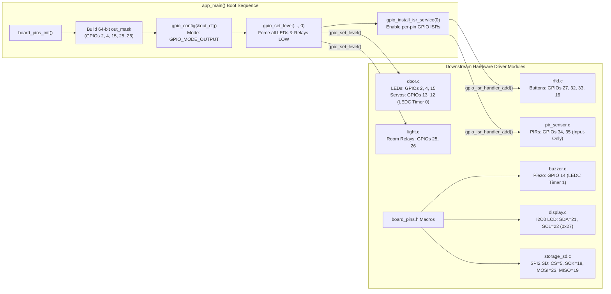

# Module Documentation: `board_pins` — Hardware Pinout Mapping & GPIO/ISR Initialization

**Coursework Bundle:** Bundle 1 (Student 1 — Core Infrastructure, Hardware Abstraction & Tamper-Evident Persistence)  
**Header File:** `main/include/board_pins.h` (55 lines)  
**Implementation File:** `main/src/board_pins.c` (41 lines)  

---

## 1. Purpose & Architectural Role

The `board_pins` module is the **Hardware Abstraction Layer (HAL) pinout map and baseline GPIO initializer** for the CoCIS Smart Control and Monitoring System on the 38-pin ESP32-WROOM-32 development board:

1. **Centralized Pin & Peripheral Allocation (`board_pins.h`):** Every physical GPIO pin number (`GPIO_NUM_*`), I2C bus/address (`I2C_NUM_0`, `0x27`), SPI host (`SPI2_HOST`), and LEDC PWM timer/channel assignment (`LEDC_TIMER_0`, `LEDC_TIMER_1`, `LEDC_CHANNEL_0..2`) is defined once in `board_pins.h`. This guarantees there are **zero GPIO pin collisions** or LEDC timer/channel conflicts across the 21 firmware modules, and allows hardware revisions (e.g., moving a relay from GPIO 25 to GPIO 26) by editing a single line.
2. **Fail-Safe Digital Output & Shared ISR Service Initialization (`board_pins.c`):** During boot (`app_main()`), `board_pins_init()` configures all 5 digital indicator/relay outputs (`PIN_LED_ENTRY`, `PIN_LED_EXIT`, `PIN_LED_ALARM`, `PIN_LIGHT_ROOM1`, `PIN_LIGHT_ROOM2`) in a single atomic 64-bit bitmask call (`gpio_config()`), drives them all to a known-safe `LOW` (`0`) state so no lights or alarms glitch ON during boot, and installs the system-wide per-pin GPIO Interrupt Service Routine (ISR) dispatcher (`gpio_install_isr_service(0)`) required by downstream interrupt-driven modules (`rfid.c` and `pir_sensor.c`).

### Architectural Hardware & Control Flow Diagram



---

## 2. Public API Reference (`main/include/board_pins.h`)

### 2.1 Pin & Peripheral Macros (`#define`)

#### A. I2C Bus for 16x2 HD44780 LCD (PCF8574 Backpack) — Consumed by `display.c`
| Macro | Value | Physical Pin / Hardware Resource & Notes |
| :--- | :--- | :--- |
| `PIN_I2C_SDA` | `GPIO_NUM_21` | ESP32 default hardware I2C Serial Data line (bidirectional, open-drain with pull-up). |
| `PIN_I2C_SCL` | `GPIO_NUM_22` | ESP32 default hardware I2C Serial Clock line. |
| `BOARD_I2C_PORT` | `I2C_NUM_0` | ESP32 hardware I2C controller 0 (`driver/i2c_master.h`). |
| `BOARD_LCD_I2C_ADDR` | `0x27` | 7-bit I2C slave address of the PCF8574 I/O expander backpack on the 16x2 LCD. |
| `BOARD_I2C_FREQ_HZ` | `100000` | Standard-mode I2C bus clock frequency (100 kHz). |

#### B. SPI2 (VSPI/HSPI) Bus for MicroSD Card — Consumed by `storage_sd.c`
| Macro | Value | Physical Pin / Hardware Resource & Notes |
| :--- | :--- | :--- |
| `PIN_SD_CS` | `GPIO_NUM_5` | SPI Chip Select (Active-LOW) for the MicroSD card slot. |
| `PIN_SD_SCK` | `GPIO_NUM_18` | SPI Serial Clock output from ESP32 master to MicroSD card. |
| `PIN_SD_MOSI` | `GPIO_NUM_23` | SPI Master-Out Slave-In (`DI` on SD card) data line. |
| `PIN_SD_MISO` | `GPIO_NUM_19` | SPI Master-In Slave-Out (`DO` on SD card) data line. |
| `BOARD_SD_SPI_HOST` | `SPI2_HOST` | ESP32 general-purpose SPI2 controller (`driver/spi_common.h`). Avoids `SPI1_HOST` (reserved for internal flash). |

#### C. Main Entrance Servo Actuators & Status LEDs — Consumed by `door.c` & `buzzer.c`
| Macro | Value | Direction | Hardware Resource & Notes |
| :--- | :--- | :--- | :--- |
| `PIN_SERVO_ENTRY` | `GPIO_NUM_13` | PWM Output | Entry gate servo signal (50 Hz PWM via `BOARD_LEDC_CH_ENTRY_SRV`). |
| `PIN_SERVO_EXIT` | `GPIO_NUM_12` | PWM Output | Exit gate servo signal (50 Hz PWM via `BOARD_LEDC_CH_EXIT_SRV`). |
| `PIN_LED_ENTRY` | `GPIO_NUM_2` | Digital Output | Green Entry Granted status LED (initialized in `board_pins_init()`). |
| `PIN_LED_EXIT` | `GPIO_NUM_4` | Digital Output | Blue/Green Exit Granted status LED (initialized in `board_pins_init()`). |
| `PIN_LED_ALARM` | `GPIO_NUM_15` | Digital Output | Red Denied / Tailgate / Emergency Alarm LED (initialized in `board_pins_init()`). |
| `PIN_BUZZER` | `GPIO_NUM_14` | PWM Output | Piezo buzzer acoustic transducer driven by `BOARD_LEDC_CH_BUZZER`. |

#### D. Lecture Room PIR Motion Sensors & Light Relays/LEDs — Consumed by `pir_sensor.c` & `light.c`
| Macro | Value | Direction | Hardware Resource & Notes |
| :--- | :--- | :--- | :--- |
| `PIN_PIR_ROOM1` | `GPIO_NUM_34` | Digital Input | Lecture Room 1 PIR motion sensor output. **Note:** GPIOs 34–39 on ESP32 are input-only pads! |
| `PIN_PIR_ROOM2` | `GPIO_NUM_35` | Digital Input | Lecture Room 2 PIR motion sensor output (input-only pad). |
| `PIN_LIGHT_ROOM1` | `GPIO_NUM_25` | Digital Output | Lecture Room 1 lighting relay / indicator LED (initialized in `board_pins_init()`). |
| `PIN_LIGHT_ROOM2` | `GPIO_NUM_26` | Digital Output | Lecture Room 2 lighting relay / indicator LED (initialized in `board_pins_init()`). |

#### E. Physical Interactive Pushbuttons (Active-LOW with Internal Pull-Up) — Consumed by `rfid.c`
| Macro | Value | Direction | Hardware Resource & Notes |
| :--- | :--- | :--- | :--- |
| `PIN_BTN_ENTRY_SCAN` | `GPIO_NUM_27` | Input + Pull-Up | Simulates scanning authorized card `04A1B2C3` at Entry reader (`FALLING` edge ISR). |
| `PIN_BTN_EXIT_SCAN` | `GPIO_NUM_32` | Input + Pull-Up | Simulates scanning authorized card `04A1B2C3` at Exit reader (`FALLING` edge ISR). |
| `PIN_BTN_INTRUDER_SCAN` | `GPIO_NUM_33` | Input + Pull-Up | Simulates scanning unauthorized card `DEADBEEF` at Entry reader (`FALLING` edge ISR). |
| `PIN_BTN_EMERGENCY` | `GPIO_NUM_16` | Input + Pull-Up | Toggles building-wide Fire Emergency Evacuation unlock mode (`FALLING` edge ISR). |

#### F. LEDC PWM Timer & Channel Allocation — Consumed by `door.c` & `buzzer.c`
| Macro | Value | Purpose |
| :--- | :--- | :--- |
| `BOARD_LEDC_SPEED_MODE` | `LEDC_LOW_SPEED_MODE` | ESP32 LEDC low-speed mode (supported across all ESP32 variants, driven by 80 MHz APB/RTC clock). |
| `BOARD_LEDC_SERVO_TIMER` | `LEDC_TIMER_0` | Dedicated 50 Hz, 13-bit PWM timer shared by both Entry and Exit servos (`door.c`). |
| `BOARD_LEDC_BUZZER_TIMER` | `LEDC_TIMER_1` | Separate variable-frequency PWM timer (800 Hz – 2600 Hz) for the piezo buzzer (`buzzer.c`). |
| `BOARD_LEDC_CH_ENTRY_SRV` | `LEDC_CHANNEL_0` | LEDC channel bound to `BOARD_LEDC_SERVO_TIMER` and `PIN_SERVO_ENTRY`. |
| `BOARD_LEDC_CH_EXIT_SRV` | `LEDC_CHANNEL_1` | LEDC channel bound to `BOARD_LEDC_SERVO_TIMER` and `PIN_SERVO_EXIT`. |
| `BOARD_LEDC_CH_BUZZER` | `LEDC_CHANNEL_2` | LEDC channel bound to `BOARD_LEDC_BUZZER_TIMER` and `PIN_BUZZER`. |

---

### 2.2 Public Functions

#### `esp_err_t board_pins_init(void)`
- **Parameters:** `void` (none).
- **Return Value:**
  - `ESP_OK` on successful GPIO output configuration and ISR service installation.
  - Any `esp_err_t` error returned by `gpio_config()` or `gpio_install_isr_service()` (note: `ESP_ERR_INVALID_STATE` from `gpio_install_isr_service` is treated as success so `board_pins_init()` is idempotent).
- **Side Effects:**
  1. Configures GPIOs `2`, `4`, `15`, `25`, and `26` as push-pull digital outputs with internal pull-ups/pull-downs and interrupts disabled.
  2. Drives GPIOs `2`, `4`, `15`, `25`, and `26` to logic `0` (`LOW`, 0 V).
  3. Installs the global ESP-IDF GPIO ISR dispatch service (`gpio_install_isr_service(0)`).
- **Who Calls It:** `app_main()` in `main/main.c` at step 1 of system boot (immediately after `sync_init()` and `config_init()`, and *before* `door_init()`, `light_init()`, `rfid_init()`, or `pir_sensor_init()`).
- **Task Context:** Runs in the FreeRTOS `main` task during startup.
- **Blocking Behavior:** Non-blocking (completes in microseconds via direct memory-mapped GPIO register writes and interrupt vector allocation).

---

## 3. Line-by-Line / Block-by-Block Code Walkthrough (`main/src/board_pins.c`)

### 3.1 Includes & Logging Tag (Lines 1–4)

```c
#include "board_pins.h"
#include "esp_log.h"

static const char *TAG = "BOARD_PINS";
```

- **Lines 1–2:** Includes `board_pins.h` (which brings in `driver/gpio.h`, `driver/i2c_master.h`, `driver/ledc.h`, `driver/spi_common.h`, and `esp_err.h`) and `esp_log.h` for console diagnostic output.
- **Line 4:** Declares the file-scope log tag `"BOARD_PINS"`.

---

### 3.2 Building the 64-Bit Output Pin Bitmask (Lines 6–13)

```c
esp_err_t board_pins_init(void)
{
    uint64_t out_mask = (1ULL << PIN_LED_ENTRY)   |
                        (1ULL << PIN_LED_EXIT)    |
                        (1ULL << PIN_LED_ALARM)   |
                        (1ULL << PIN_LIGHT_ROOM1) |
                        (1ULL << PIN_LIGHT_ROOM2);
```

- **Why `uint64_t` and `1ULL`?** The ESP32 has 40 GPIO pads (`GPIO_NUM_0` through `GPIO_NUM_39`), which requires a 64-bit integer (`uint64_t`) to represent one bit per GPIO pad.
- Each expression `(1ULL << PIN_*)` takes the 64-bit unsigned integer `1` (`0x0000000000000001`) and shifts it left by the GPIO number:
  - `1ULL << 2`  (`PIN_LED_ENTRY`)   = bit 2  (`0x00000004`)
  - `1ULL << 4`  (`PIN_LED_EXIT`)    = bit 4  (`0x00000010`)
  - `1ULL << 15` (`PIN_LED_ALARM`)   = bit 15 (`0x00008000`)
  - `1ULL << 25` (`PIN_LIGHT_ROOM1`) = bit 25 (`0x02000000`)
  - `1ULL << 26` (`PIN_LIGHT_ROOM2`) = bit 26 (`0x04000000`)
- Combining them with the bitwise OR operator (`|`) produces a single 64-bit mask (`0x06008014ULL`) with bits 2, 4, 15, 25, and 26 set to `1`.

---

### 3.3 Configuring the GPIO Matrix & IO MUX (Lines 14–25)

```c
    gpio_config_t out_cfg = {
        .pin_bit_mask = out_mask,
        .mode = GPIO_MODE_OUTPUT,
        .pull_up_en = GPIO_PULLUP_DISABLE,
        .pull_down_en = GPIO_PULLDOWN_DISABLE,
        .intr_type = GPIO_INTR_DISABLE,
    };
    esp_err_t err = gpio_config(&out_cfg);
    if (err != ESP_OK) {
        ESP_LOGE(TAG, "Failed to configure output pins: %s", esp_err_to_name(err));
        return err;
    }
```

- **Lines 14–20:** Initializes a `gpio_config_t` structure using C99 designated initializers:
  - `.pin_bit_mask = out_mask`: Applies this configuration simultaneously to all 5 pins.
  - `.mode = GPIO_MODE_OUTPUT`: Enables the CMOS push-pull output driver for each pad.
  - `.pull_up_en = GPIO_PULLUP_DISABLE` and `.pull_down_en = GPIO_PULLDOWN_DISABLE`: Because a push-pull output actively drives the line to 3.3 V (`HIGH`) or 0 V (`LOW`), internal weak pull resistors (~45 kΩ) are unnecessary and would only waste current.
  - `.intr_type = GPIO_INTR_DISABLE`: Output pins do not generate input edge/level interrupts.
- **Lines 21–25:** Calls `gpio_config(&out_cfg)`. If an invalid pin number (such as an input-only pin >= 34) had been accidentally included in `out_mask`, `gpio_config()` would return `ESP_ERR_INVALID_ARG`, which is logged and returned immediately.

---

### 3.4 Driving Outputs to a Safe Initial State (Lines 27–31)

```c
    gpio_set_level(PIN_LED_ENTRY, 0);
    gpio_set_level(PIN_LED_EXIT, 0);
    gpio_set_level(PIN_LED_ALARM, 0);
    gpio_set_level(PIN_LIGHT_ROOM1, 0);
    gpio_set_level(PIN_LIGHT_ROOM2, 0);
```

- Explicitly writes logic `0` (`LOW`) to the GPIO output latch registers (`GPIO_OUT_W1TC_REG`) for all 5 outputs. Without this step, whatever residual value was in theESP32's output data register could momentarily energize a room light relay or flash the alarm LED before `door_init()` and `light_init()` run.

---

### 3.5 Installing the Global GPIO ISR Dispatcher (Lines 33–41)

```c
    err = gpio_install_isr_service(0);
    if (err != ESP_OK && err != ESP_ERR_INVALID_STATE) {
        ESP_LOGE(TAG, "Failed to install GPIO ISR service: %s", esp_err_to_name(err));
        return err;
    }

    ESP_LOGI(TAG, "Board GPIO outputs and ISR service initialized");
    return ESP_OK;
}
```

- **Line 33:** Calls `gpio_install_isr_service(0)` to register the ESP-IDF central GPIO interrupt dispatcher on the CPU interrupt controller with default flags (`0`).
- **Why check `err != ESP_ERR_INVALID_STATE` on line 34?** `gpio_install_isr_service()` returns `ESP_ERR_INVALID_STATE` if the ISR service has *already* been installed earlier. Ignoring `ESP_ERR_INVALID_STATE` makes `board_pins_init()` **idempotent** (safe to call even if another driver already installed the service).
- **Why is this done in `board_pins_init()` instead of inside `rfid.c` or `pir_sensor.c`?** Both `rfid.c` (4 pushbuttons) and `pir_sensor.c` (2 PIR sensors) call `gpio_isr_handler_add()`. Centralizing `gpio_install_isr_service(0)` in `board_pins_init()` decouples the initialization order of `rfid_init()` and `pir_sensor_init()`.

---

## 4. C Language Constructs Explained

1. **Bitwise Left Shift with 64-Bit Unsigned Literal (`1ULL << PIN_LED_ENTRY`):**
   - In C, an unsuffixed literal `1` has type `int` (which is 32 bits wide on ESP32). Shifting a 32-bit `int` by 31 or more bits (`1 << 32`) invokes **Undefined Behavior (UB)** in C! Adding the `ULL` suffix (`unsigned long long`, guaranteed 64 bits wide) ensures `1ULL << n` is well-defined for all ESP32 GPIOs `0..39`.
2. **Bitwise OR Operator (`|` vs `||`):**
   - On lines 8–12, the single vertical bar `|` performs a **bitwise OR** across all 64 bit positions, merging the 5 individual single-bit masks into one composite `uint64_t` mask. (By contrast, the logical OR `||` would evaluate the whole expression to a boolean `1` (`0x01`), which would erroneously configure only `GPIO_NUM_0`!).
3. **C99 Designated Initializers (`.pin_bit_mask = out_mask`, `.mode = GPIO_MODE_OUTPUT`):**
   - Used in `gpio_config_t out_cfg = { ... };` (lines 14–20). Designated initializers explicitly name each struct member being initialized, making the code self-documenting, immune to field reordering in ESP-IDF headers, and automatically zero-initializing any omitted fields.
4. **Enumerated Constants from Driver Headers (`GPIO_NUM_21`, `SPI2_HOST`, `LEDC_TIMER_0`):**
   - Instead of raw integers like `#define PIN_I2C_SDA 21`, `board_pins.h` uses strongly typed enum constants (`GPIO_NUM_21` of type `gpio_num_t`). When passed to functions like `gpio_set_level(gpio_num_t gpio_num, uint32_t level)`, the compiler performs type checking and warns if an invalid enum type is passed.

---

## 5. ESP-IDF & FreeRTOS Constructs Explained

| API / Construct | Header | How It Works & Role in `board_pins` |
| :--- | :--- | :--- |
| `gpio_num_t` (`GPIO_NUM_0` .. `GPIO_NUM_39`) | `driver/gpio.h` | Enum representing physical ESP32 GPIO pad indices. |
| `gpio_config_t` | `driver/gpio.h` | Configuration structure specifying `pin_bit_mask` (`uint64_t`), `mode` (`gpio_mode_t`), `pull_up_en`, `pull_down_en`, and `intr_type`. |
| `gpio_config(&out_cfg)` | `driver/gpio.h` | Iterates through every set bit in `pin_bit_mask` and configures the ESP32 IO_MUX and GPIO Matrix registers for those pads. |
| `gpio_set_level(gpio_num, level)` | `driver/gpio.h` | Writes `0` (clear) or `1` (set) to the hardware `GPIO_OUT_W1TC` / `GPIO_OUT_W1TS` atomic bit-set/bit-clear registers. Safe to call concurrently across tasks and ISRs. |
| `gpio_install_isr_service(intr_alloc_flags)` | `driver/gpio.h` | Allocates a shared hardware GPIO interrupt vector on the Xtensa CPU and sets up a dispatch table so multiple modules (`rfid`, `pir_sensor`) can attach individual callbacks per pin via `gpio_isr_handler_add()`. Passing `0` uses default interrupt priority and flash-safe flags. |
| `LEDC_LOW_SPEED_MODE`, `LEDC_TIMER_0/1`, `LEDC_CHANNEL_0..2` | `driver/ledc.h` | Hardware PWM controller (LED Controller) timer and channel identifiers. Separating `BOARD_LEDC_SERVO_TIMER` (`LEDC_TIMER_0`) from `BOARD_LEDC_BUZZER_TIMER` (`LEDC_TIMER_1`) allows the servos to run at a steady 50 Hz while the buzzer sweeps frequencies from 800 Hz to 2600 Hz. |

---

## 6. Alternatives & "What If You Change This?"

1. **What if you wrote `(1 << PIN_*)` instead of `(1ULL << PIN_*)`?**
   - For GPIOs 0–30 (`PIN_LED_ENTRY=2`, `PIN_LIGHT_ROOM2=26`), `1 << n` happens to fit in a 32-bit signed `int`. However, for `PIN_BTN_EXIT_SCAN` (`GPIO_NUM_32`), `PIN_BTN_INTRUDER_SCAN` (`GPIO_NUM_33`), `PIN_PIR_ROOM1` (`GPIO_NUM_34`), and `PIN_PIR_ROOM2` (`GPIO_NUM_35`), `1 << 34` overflows a 32-bit integer (Undefined Behavior in C, and the compiler will reject or miscompile it). Using `1ULL` everywhere is mandatory on ESP32.
2. **What if you swapped `PIN_LIGHT_ROOM1` (`GPIO 25`) and `PIN_PIR_ROOM1` (`GPIO 34`)?**
   - **Hardware Failure!** On the ESP32 chip, **GPIOs 34, 35, 36, and 39 are input-only pads**—they physically lack output driver MOSFETs and internal pull-up/pull-down resistors inside the silicon. If you assigned `PIN_LIGHT_ROOM1` to `GPIO_NUM_34`, `gpio_config()` in `board_pins_init()` would fail with `ESP_ERR_INVALID_ARG` (`GPIO_34 can only be used as input mode`), halting boot! Conversely, `PIN_PIR_ROOM1` and `PIN_PIR_ROOM2` *only* need digital input mode, making GPIOs 34 and 35 the ideal choice for PIR sensors.
3. **What if you assigned `PIN_BTN_EXIT_SCAN` to `GPIO 34` instead of `GPIO 32`?**
   - The pushbuttons in `rfid.c` rely on the ESP32's **internal pull-up resistor** (`GPIO_PULLUP_ENABLE`) so they read `HIGH` when unpressed and `LOW` when pressed to GND. Because GPIOs 34–39 have no internal pull-up resistors, a button on GPIO 34 without an external physical pull-up resistor would float randomly and trigger false RFID scans continuously. GPIOs 27, 32, 33, and 16 all reside in the full-featured GPIO range (0–33) and have internal pull-up resistors.
4. **What if `BOARD_LEDC_SERVO_TIMER` and `BOARD_LEDC_BUZZER_TIMER` both used `LEDC_TIMER_0`?**
   - Every time the piezo buzzer played a tone (e.g., changing `LEDC_TIMER_0` frequency to 2,000 Hz in `buzzer.c`), the PWM frequency sent to the Entry and Exit door servos would jump from 50 Hz (20 ms period) to 2,000 Hz (0.5 ms period), causing the door servos to violently twitch or burn out their control electronics! Allocating `LEDC_TIMER_0` exclusively to the servos and `LEDC_TIMER_1` exclusively to the buzzer prevents timer frequency clobbering.
5. **What if we used `SPI1_HOST` instead of `SPI2_HOST` (`BOARD_SD_SPI_HOST`) for the MicroSD card?**
   - On ESP32, `SPI0` and `SPI1` are wired to the internal SPI flash chip that holds the firmware code and NVS partition. Attempting to mount an external SD card on `SPI1_HOST` conflicts with XIP (Execute-In-Place) flash fetches and crashes the MCU. `SPI2_HOST` (HSPI) and `SPI3_HOST` (VSPI) are dedicated general-purpose SPI controllers.

---

## 7. Design Rationale

- **19-Pin Conflict-Free Partitioning on a 38-Pin ESP32:** The CoCIS system interfaces with 7 distinct hardware subsystems (I2C LCD, SPI MicroSD, 2 PWM Servos, 3 Gate LEDs, 1 PWM Buzzer, 2 PIR Sensors, 2 Room Relays, and 4 Pushbuttons = **19 GPIOs**). Centralizing all 19 pin definitions in `board_pins.h` lets an engineer audit the entire pin table at a glance and verify that:
  - Internal SPI flash pins (GPIOs 6–11) are untouched.
  - UART0 serial console pins (GPIOs 1, 3) remain free for the interactive CLI.
  - Input-only pins (GPIOs 34, 35) are used strictly for driven digital inputs (PIR sensors).
  - Pins requiring internal pull-ups (GPIOs 16, 27, 32, 33) are placed on pads 0–33 that possess internal pull-up circuitry.
- **Single-Call Batch Output Configuration:** Grouping all 5 simple digital outputs into a single `out_mask` and calling `gpio_config(&out_cfg)` once is cleaner, smaller in code size, and faster than repeating 5 separate `gpio_config_t` blocks across `door.c` and `light.c`.

---

## 8. Failure Modes, Edge Cases & Recovery

| Failure Scenario | What Happens in `board_pins.c` | System Recovery Behavior |
| :--- | :--- | :--- |
| **Invalid output pin accidentally added to `out_mask` (e.g. GPIO >= 34)** | `gpio_config(&out_cfg)` detects that an input-only pad was requested with `GPIO_MODE_OUTPUT` and returns `ESP_ERR_INVALID_ARG`. | `board_pins_init()` logs `"Failed to configure output pins: ESP_ERR_INVALID_ARG"` and returns the error to `app_main()`, catching hardware misconfiguration immediately during testing. |
| **`gpio_install_isr_service(0)` called twice** | Returns `ESP_ERR_INVALID_STATE` on the second call. | Line 34 (`if (err != ESP_OK && err != ESP_ERR_INVALID_STATE)`) explicitly ignores `ESP_ERR_INVALID_STATE` and returns `ESP_OK`, preventing false fatal errors. |
| **Boot-time GPIO glitch / floating relay pins** | Before `board_pins_init()`, ESP32 GPIOs default to high-impedance inputs or boot strapping states. | `board_pins_init()` runs at step 1 of `app_main()` (within milliseconds of reset) and immediately drives all 5 LEDs and relays `LOW` (`0`). |

---

## 9. How to Test This Module in Isolation

You can verify `board_pins` initialization and pin state reflections via the serial boot log and interactive CLI commands:

### Test 1: Inspect Boot Log Output
Upon reset, `board_pins_init()` prints its confirmation before any actuator or sensor driver starts:
```text
I (312) MAIN: Booting CoCIS Smart Control System (1.0.0-COCIS-2026)
I (325) BOARD_PINS: Board GPIO outputs and ISR service initialized
```

### Test 2: Verify Room Relay Pin States (`PIN_LIGHT_ROOM1` = GPIO 25, `PIN_LIGHT_ROOM2` = GPIO 26)
Run `rooms` before and after simulating PIR motion to observe the hardware relay output states controlled through `PIN_LIGHT_ROOM1` and `PIN_LIGHT_ROOM2`:
```text
cocis> rooms
+--------+----------+------------+------------+-----------+------------+-------------+--------------+
| Room   | Node St. | PIR Sensor | Light FSM  | Relay Pin | Time Left  | Light On(s) | Energy Saved |
+--------+----------+------------+------------+-----------+------------+-------------+--------------+
| Room 1 | ONLINE   | VACANT     | OFF_VACANT | LOW (OFF) |        0 s |         0 s |       99 mWh |
| Room 2 | ONLINE   | VACANT     | OFF_VACANT | LOW (OFF) |        0 s |         0 s |       99 mWh |
+--------+----------+------------+------------+-----------+------------+-------------+--------------+

cocis> sim motion 1 on
OK: Simulated PIR motion ACTIVE in Lecture Room 1.

cocis> rooms
+--------+----------+------------+------------+-----------+------------+-------------+--------------+
| Room   | Node St. | PIR Sensor | Light FSM  | Relay Pin | Time Left  | Light On(s) | Energy Saved |
+--------+----------+------------+------------+-----------+------------+-------------+--------------+
| Room 1 | ONLINE   | MOTION     | ON_ACTIVE  | HIGH (ON) |       20 s |         1 s |       99 mWh |
| Room 2 | ONLINE   | VACANT     | OFF_VACANT | LOW (OFF) |        0 s |         0 s |      132 mWh |
+--------+----------+------------+------------+-----------+------------+-------------+--------------+
```

### Test 3: Verify GPIO Interrupt Service & Pushbutton/Door Pin Mapping
Pressing the physical buttons in Wokwi (or running `sim scan entry 04A1B2C3`) exercises the GPIO ISR service installed by `board_pins_init()` and toggles `PIN_LED_ENTRY` (`GPIO 2`) and `PIN_SERVO_ENTRY` (`GPIO 13`).

---

## 10. Likely Examiner Questions & Model Answers

### Q1: Why did you write `1ULL << PIN_LED_ENTRY` instead of `1 << PIN_LED_ENTRY` when constructing `out_mask`?
**Model Answer:**  
The ESP32 has 40 GPIO pins (`GPIO_NUM_0` through `GPIO_NUM_39`), so `gpio_config_t.pin_bit_mask` is a 64-bit unsigned integer (`uint64_t`). In C, the literal `1` without a suffix is a 32-bit signed `int`. If we shift a 32-bit `1` by 31 or more bits (for example, `1 << GPIO_NUM_32` or `1 << GPIO_NUM_34`), it overflows the 32-bit type, which is **Undefined Behavior** in C and zeros or corrupts the upper 32 bits of the mask. Using `1ULL` (`unsigned long long`, 64 bits) guarantees safe bit shifts across all 40 ESP32 GPIOs.

### Q2: Why are `PIN_PIR_ROOM1` (`GPIO 34`) and `PIN_PIR_ROOM2` (`GPIO 35`) NOT configured in `board_pins_init()`, and why can they never be used for the room light relays?
**Model Answer:**  
First, `board_pins_init()` only configures simple digital output pins (`out_mask`), whereas `PIN_PIR_ROOM1` and `PIN_PIR_ROOM2` are interrupt-driven digital inputs configured by `pir_sensor_init()` in `pir_sensor.c`. Second, on the ESP32 hardware architecture, **GPIOs 34 through 39 are input-only pads**: they do not have output stage transistors or internal pull-up/pull-down resistors. Therefore, they work well for PIR sensor modules (which actively drive a 3.3 V / 0 V push-pull output signal into the ESP32), but they physically cannot drive a relay or LED.

### Q3: Why does `board_pins_init()` call `gpio_install_isr_service(0)` even though `board_pins.c` doesn't attach any interrupt handlers itself?
**Model Answer:**  
Two separate modules in our firmware—`rfid.c` (which handles the 4 active-LOW pushbutton interrupts on GPIOs 27, 32, 33, and 16) and `pir_sensor.c` (which handles the 2 PIR edge interrupts on GPIOs 34 and 35)—register per-pin interrupt handlers using `gpio_isr_handler_add()`. ESP-IDF requires `gpio_install_isr_service()` to be called once before any `gpio_isr_handler_add()` call. By calling `gpio_install_isr_service(0)` once inside `board_pins_init()` at the very beginning of `app_main()`, neither `rfid.c` nor `pir_sensor.c` has to worry about which module initializes first.

### Q4: On line 34, why do you write `if (err != ESP_OK && err != ESP_ERR_INVALID_STATE)` after calling `gpio_install_isr_service(0)`?
**Model Answer:**  
`gpio_install_isr_service()` returns `ESP_ERR_INVALID_STATE` if the GPIO ISR service has already been installed. Treating `ESP_ERR_INVALID_STATE` as non-fatal makes `board_pins_init()` **idempotent**: if `board_pins_init()` is called again or if an ESP-IDF component already installed the ISR service, initialization still succeeds instead of aborting boot.

### Q5: Why are two different LEDC timers (`BOARD_LEDC_SERVO_TIMER = LEDC_TIMER_0` and `BOARD_LEDC_BUZZER_TIMER = LEDC_TIMER_1`) defined in `board_pins.h` when there are only 3 PWM outputs?
**Model Answer:**  
In the ESP32 LEDC peripheral, multiple **channels** can share a single **timer**, provided those channels operate at the exact same PWM frequency and bit resolution.
- Both the Entry servo (`LEDC_CHANNEL_0`, GPIO 13) and Exit servo (`LEDC_CHANNEL_1`, GPIO 12) require a fixed **50 Hz** PWM frequency (20 ms period), so they can share `LEDC_TIMER_0` while setting independent duty cycles.
- The piezo buzzer (`LEDC_CHANNEL_2`, GPIO 14) plays melodies by dynamically changing its PWM frequency between **800 Hz and 2,600 Hz**. Therefore, the buzzer must have its own independent timer (`LEDC_TIMER_1`) so changing buzzer pitch does not alter the 50 Hz servo signal.

### Q6: Why are `pull_up_en` and `pull_down_en` disabled (`GPIO_PULLUP_DISABLE`, `GPIO_PULLDOWN_DISABLE`) in `out_cfg`?
**Model Answer:**  
In `GPIO_MODE_OUTPUT`, the ESP32 GPIO pad's push-pull CMOS totem-pole driver is continuously active: it connects the pin through a low-impedance transistor either to `VDD3P3` (3.3 V when `1`) or `GND` (0 V when `0`). Enabling internal weak pull-up or pull-down resistors (~45 kΩ) on an actively driven push-pull output serves no purpose and would leak ~73 µA of current (`3.3 V / 45 kΩ`) whenever the pin is driven opposite to the pull resistor.

### Q7: Why are GPIOs 6 through 11 avoided in `board_pins.h`?
**Model Answer:**  
On the ESP32-WROOM-32 module, **GPIOs 6, 7, 8, 9, 10, and 11** (`SD_CLK`, `SD_DATA0..3`, `SD_CMD`) are internally wired to the quad-SPI NOR flash chip that stores the application binary and NVS partition. Reconfiguring any of GPIOs 6–11 as general-purpose I/O immediately severs CPU instruction fetches from flash and triggers a hardware crash (`Cache disabled but cached memory region accessed` / illegal instruction panic).

### Q8: What is the difference between `board_pins_init()` configuring a pin with `gpio_config()` versus `door_init()` or `storage_sd_init()` configuring their pins?
**Model Answer:**  
`board_pins_init()` configures the 5 **pure digital GPIO outputs** (3 LEDs + 2 room relays) that are toggled directly via `gpio_set_level()`. By contrast, peripheral-driven pins—such as the SPI2 bus (`GPIOs 5, 18, 19, 23`), the I2C0 bus (`GPIOs 21, 22`), and the LEDC PWM channels (`GPIOs 12, 13, 14`)—are routed through the ESP32 **GPIO Matrix / IO_MUX** to dedicated hardware peripherals inside `spi_bus_initialize()`, `i2c_new_master_bus()`, and `ledc_channel_config()`.
