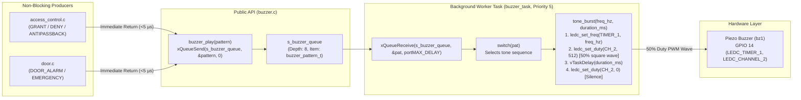

# Module Documentation: Asynchronous Piezo Buzzer Audio Pattern Engine (`buzzer`)

**Files Documented:**
- Header: `main/include/buzzer.h` (Lines 1–17)
- Implementation: `main/src/buzzer.c` (Lines 1–115)
- Related Pin/System Configuration: `main/include/board_pins.h`

---

## 1. Purpose & Architectural Role

In the **CoCIS Smart Control and Monitoring System**, the `buzzer` module is the **Asynchronous Acoustic Feedback & Alarm Synthesizer** driving the passive piezoelectric transducer on **GPIO 14 (`PIN_BUZZER`)**.

### Why Does This Module Exist?
In physical security and access control systems, security guards and students do not stare at a serial terminal or even an LCD screen when tapping an RFID card—they rely on **instant, distinct acoustic cues** to know whether a card was accepted, rejected, flagged for an anti-passback violation, or whether a door is in forced-open alarm or fire evacuation mode.

Furthermore, multi-tone acoustic patterns take between **90 ms** and **840 ms** to play out. If `access_control.c` or `door.c` played those tones synchronously using `vTaskDelay()` on the calling thread, the entire access control engine would stall for nearly a full second on every denied or emergency event! Instead, `buzzer.c` runs its own dedicated low-priority FreeRTOS worker task (`buzzer_task`, Priority 5) backed by an 8-slot FreeRTOS message queue (`s_buzzer_queue`). Callers simply invoke `buzzer_play(pattern)`, which enqueues the pattern ID and returns in **under 5 microseconds**.

### Acoustic Pattern Catalog
| Pattern Enum (`buzzer_pattern_t`) | Acoustic Profile (Frequencies & Timing) | Total Duration | Meaning to User / Security Guard |
| :--- | :--- | :--- | :--- |
| **`BUZZER_PAT_GRANT`** (`0`) | Single crisp high-pitched chirp: **2200 Hz** for `90 ms` | `90 ms` | **Access Granted:** Door unlocked; proceed through barrier. |
| **`BUZZER_PAT_DENY`** (`1`) | Descending low-pitched double-buzz: **450 Hz** (`120 ms`) $\rightarrow$ `60 ms` pause $\rightarrow$ **380 Hz** (`160 ms`) | `340 ms` | **Access Denied:** Unknown tag, inactive user, expired visitor, or outside schedule hours. |
| **`BUZZER_PAT_ANTIPASSBACK`** (`2`) | Triple rapid mid-tone staccato alert: 3× (**900 Hz** for `70 ms` + `40 ms` pause) | `330 ms` | **Anti-Passback Violation:** Card is already inside (on entry) or not recorded inside (on exit). |
| **`BUZZER_PAT_DOOR_ALARM`** (`3`) | Urgent 4-cycle two-tone police/security warble: 4× (**1800 Hz** for `100 ms` + **800 Hz** for `100 ms`) | `800 ms` | **Tailgate / Forced Door Alarm:** Door forced or held open without valid scan. |
| **`BUZZER_PAT_EMERGENCY`** (`4`) | Piercing 3-cycle high-urgency fire evacuation siren: 3× (**2600 Hz** for `140 ms` + **1200 Hz** for `140 ms`) | `840 ms` | **Emergency Evacuation Mode Activated:** All doors unlocked for egress. |

### Architectural Data & Control Flow (Mermaid Diagram)



---

## 2. Public API Reference (`main/include/buzzer.h`)

### 2.1 Enumerations

#### `buzzer_pattern_t` (Lines 6–12)
```c
typedef enum {
    BUZZER_PAT_GRANT = 0,
    BUZZER_PAT_DENY,
    BUZZER_PAT_ANTIPASSBACK,
    BUZZER_PAT_DOOR_ALARM,
    BUZZER_PAT_EMERGENCY
} buzzer_pattern_t;
```
- **Purpose:** Identifies which pre-programmed acoustic tone sequence the buzzer engine should synthesize.

---

### 2.2 Public Functions

#### `buzzer_init()` (Line 14)
```c
esp_err_t buzzer_init(void);
```
- **Parameters:** None.
- **Return Value:**
  - `ESP_OK` (`0`) on success.
  - `ESP_ERR_NO_MEM` if allocating `s_buzzer_queue` or spawning `buzzer_task` fails.
  - Any `esp_err_t` returned by `ledc_timer_config()` or `ledc_channel_config()`.
- **Side Effects:**
  - Configures `BOARD_LEDC_BUZZER_TIMER` (`LEDC_TIMER_1`) in `LEDC_LOW_SPEED_MODE` with 10-bit duty resolution (`1024` steps) and an initial frequency of `2000 Hz`.
  - Configures `BOARD_LEDC_CH_BUZZER` (`LEDC_CHANNEL_2`) on `PIN_BUZZER` (GPIO 14) with `duty = 0` (silent on boot).
  - Creates the 8-element FreeRTOS queue `s_buzzer_queue`.
  - Spawns `"buzzer_task"` (stack: `3072` bytes, priority: `5`).
- **Who Calls It & Task Context:** Called once during system boot by `app_main()` (`main/main.c:48`) in the `main` task context.
- **Blocking Behavior:** Non-blocking.

#### `buzzer_play()` (Line 15)
```c
esp_err_t buzzer_play(buzzer_pattern_t pattern);
```
- **Parameters:**
  - `pattern`: One of the five `buzzer_pattern_t` enum values.
- **Return Value:**
  - `ESP_OK` if `s_buzzer_queue` is initialized (note: if the 8-item queue is completely full, the new pattern is silently dropped rather than stalling the caller).
  - `ESP_ERR_INVALID_STATE` if called before `buzzer_init()`.
- **Side Effects:** Enqueues `pattern` into `s_buzzer_queue` with a timeout of `0` ticks (`xQueueSend(s_buzzer_queue, &pattern, 0)`), waking `buzzer_task` to synthesize the audio asynchronously.
- **Who Calls It & Task Context:**
  - Called by `process_scan_event()` in `access_control.c` (`access_task` at Priority 6, or `cli_task` at Priority 4 during `sim selftest`).
  - Called by `door_set_emergency_all()` and `door_simulate_forced_hold()` in `door.c` (`rfid_task` at Priority 7 or `cli_task` at Priority 4).
- **Blocking Behavior:** Strictly **non-blocking** (`xTicksToWait = 0`).

---

## 3. Line-by-Line / Block-by-Block Code Walkthrough (`main/src/buzzer.c`)

### 3.1 Includes & Static Queue Handle (Lines 1–11)
```c
#include "buzzer.h"
#include "board_pins.h"
#include "driver/ledc.h"
#include "esp_log.h"
#include "freertos/FreeRTOS.h"
#include "freertos/queue.h"
#include "freertos/task.h"

static const char *TAG = "BUZZER";

static QueueHandle_t s_buzzer_queue = NULL;
```
- **Lines 1–7:** Includes `buzzer.h`, hardware pin/LEDC definitions (`board_pins.h`), ESP-IDF LEDC PWM driver (`driver/ledc.h`), logging (`esp_log.h`), and FreeRTOS task/queue headers.
- **Line 11 (`s_buzzer_queue`):** File-scope (`static`) queue handle that decouples callers of `buzzer_play()` from the time-consuming audio playback inside `buzzer_task()`.

---

### 3.2 Low-Level Acoustic Synthesizer: `tone_burst()` (Lines 13–23)
```c
static void tone_burst(uint32_t freq_hz, uint32_t duration_ms)
{
    if (freq_hz > 0) {
        ledc_set_freq(BOARD_LEDC_SPEED_MODE, BOARD_LEDC_BUZZER_TIMER, freq_hz);
        ledc_set_duty(BOARD_LEDC_SPEED_MODE, BOARD_LEDC_CH_BUZZER, 512);
        ledc_update_duty(BOARD_LEDC_SPEED_MODE, BOARD_LEDC_CH_BUZZER);
    }
    vTaskDelay(pdMS_TO_TICKS(duration_ms));
    ledc_set_duty(BOARD_LEDC_SPEED_MODE, BOARD_LEDC_CH_BUZZER, 0);
    ledc_update_duty(BOARD_LEDC_SPEED_MODE, BOARD_LEDC_CH_BUZZER);
}
```
- **Line 15 (`if (freq_hz > 0)`):** Guards against setting a 0 Hz frequency in the LEDC timer divider.
- **Line 16 (`ledc_set_freq(...)`):** Dynamically reconfigures the hardware clock divider of `BOARD_LEDC_BUZZER_TIMER` (`LEDC_TIMER_1`) so the PWM wave oscillates at `freq_hz` cycles per second (determining the **musical pitch** of the passive piezo buzzer).
- **Lines 17–18 (`ledc_set_duty(..., 512)` & `ledc_update_duty(...)`):** Because `LEDC_TIMER_1` is configured with 10-bit resolution (`LEDC_TIMER_10_BIT` = $2^{10} = 1024$ steps), a duty value of `512` equals an exact **50% duty cycle square wave** ($\frac{512}{1024} = 50\%$). A 50% duty cycle delivers maximum symmetric membrane deflection and maximum acoustic volume from a passive piezo element.
- **Line 20 (`vTaskDelay(pdMS_TO_TICKS(duration_ms))`):** Puts `buzzer_task` to sleep for `duration_ms` milliseconds while the ESP32 LEDC hardware continues outputting the `freq_hz` square wave autonomously.
- **Lines 21–22 (`ledc_set_duty(..., 0)` & `ledc_update_duty(...)`):** Sets the PWM duty back to `0` (0% high time = flat `0V` DC on GPIO 14) to silence the buzzer at the end of the tone burst.

---

### 3.3 Background Pattern Sequencer Task: `buzzer_task()` (Lines 25–63)
```c
static void buzzer_task(void *arg)
{
    (void)arg;
    buzzer_pattern_t pat;
    while (1) {
        if (xQueueReceive(s_buzzer_queue, &pat, portMAX_DELAY) == pdTRUE) {
            switch (pat) {
                case BUZZER_PAT_GRANT:
                    tone_burst(2200, 90);
                    break;
                case BUZZER_PAT_DENY:
                    tone_burst(450, 120);
                    vTaskDelay(pdMS_TO_TICKS(60));
                    tone_burst(380, 160);
                    break;
                case BUZZER_PAT_ANTIPASSBACK:
                    for (int i = 0; i < 3; i++) {
                        tone_burst(900, 70);
                        vTaskDelay(pdMS_TO_TICKS(40));
                    }
                    break;
                case BUZZER_PAT_DOOR_ALARM:
                    for (int i = 0; i < 4; i++) {
                        tone_burst(1800, 100);
                        tone_burst(800, 100);
                    }
                    break;
                case BUZZER_PAT_EMERGENCY:
                    for (int i = 0; i < 3; i++) {
                        tone_burst(2600, 140);
                        tone_burst(1200, 140);
                    }
                    break;
                default:
                    break;
            }
        }
    }
}
```
- **Line 30 (`xQueueReceive(s_buzzer_queue, &pat, portMAX_DELAY)`):** Blocks `buzzer_task` indefinitely (consuming **0% CPU** when silent) until a `buzzer_pattern_t` item arrives in `s_buzzer_queue`.
- **Lines 31–60 (`switch (pat)`):** Decodes the pattern enum and executes the corresponding sequence of `tone_burst()` and inter-note silence (`vTaskDelay`) calls:
  - `BUZZER_PAT_GRANT`: Single `2200 Hz` chirp (`90 ms`).
  - `BUZZER_PAT_DENY`: Two low notes (`450 Hz` for `120 ms`, `60 ms` silence, `380 Hz` for `160 ms`)—a universally recognizable "error/reject" descending interval.
  - `BUZZER_PAT_ANTIPASSBACK`: Three rapid `900 Hz` beeps (`70 ms` on, `40 ms` off)—distinct from a normal `DENY` so security guards immediately hear when someone attempts a passback violation.
  - `BUZZER_PAT_DOOR_ALARM`: Four alternating `1800 Hz` / `800 Hz` tones (`100 ms` each, no gap between high/low notes) creating an urgent security warble.
  - `BUZZER_PAT_EMERGENCY`: Three alternating `2600 Hz` / `1200 Hz` high-pitched siren sweeps (`140 ms` each).

---

### 3.4 Initialization & Non-Blocking Enqueue: `buzzer_init()` & `buzzer_play()` (Lines 65–115)
```c
esp_err_t buzzer_init(void)
{
    ledc_timer_config_t tcfg = {
        .speed_mode = BOARD_LEDC_SPEED_MODE,
        .duty_resolution = LEDC_TIMER_10_BIT,
        .timer_num = BOARD_LEDC_BUZZER_TIMER,
        .freq_hz = 2000,
        .clk_cfg = LEDC_AUTO_CLK
    };
    esp_err_t err = ledc_timer_config(&tcfg);
    if (err != ESP_OK) {
        return err;
    }

    ledc_channel_config_t ccfg = {
        .gpio_num = PIN_BUZZER,
        .speed_mode = BOARD_LEDC_SPEED_MODE,
        .channel = BOARD_LEDC_CH_BUZZER,
        .intr_type = LEDC_INTR_DISABLE,
        .timer_sel = BOARD_LEDC_BUZZER_TIMER,
        .duty = 0,
        .hpoint = 0
    };
    err = ledc_channel_config(&ccfg);
    if (err != ESP_OK) {
        return err;
    }

    if (s_buzzer_queue == NULL) {
        s_buzzer_queue = xQueueCreate(8, sizeof(buzzer_pattern_t));
        if (s_buzzer_queue == NULL) {
            return ESP_ERR_NO_MEM;
        }
    }

    if (xTaskCreate(buzzer_task, "buzzer_task", 3072, NULL, 5, NULL) != pdPASS) {
        return ESP_ERR_NO_MEM;
    }

    ESP_LOGI(TAG, "LEDC piezo buzzer pattern engine initialized on GPIO %d", (int)PIN_BUZZER);
    return ESP_OK;
}

esp_err_t buzzer_play(buzzer_pattern_t pattern)
{
    if (s_buzzer_queue == NULL) {
        return ESP_ERR_INVALID_STATE;
    }
    xQueueSend(s_buzzer_queue, &pattern, 0);
    return ESP_OK;
}
```
- **Lines 67–91:** Initializes `BOARD_LEDC_BUZZER_TIMER` (`LEDC_TIMER_1`) with 10-bit resolution (`LEDC_TIMER_10_BIT`) and binds `BOARD_LEDC_CH_BUZZER` (`LEDC_CHANNEL_2` on GPIO 14) with `.duty = 0` so the buzzer starts silent.
- **Lines 93–102:** Creates `s_buzzer_queue` (depth 8) and spawns `buzzer_task` at priority `5` (intentionally lower than `rfid_task` at `7` and `access_task` at `6` so audio synthesis never delays access control decisions).
- **Lines 108–115 (`buzzer_play`):** Checks that `s_buzzer_queue != NULL` and posts `pattern` with `0` tick timeout (`xQueueSend(s_buzzer_queue, &pattern, 0)`), returning `ESP_OK` immediately.

---

## 4. C Language Constructs Explained

| C Construct | Where Used in `buzzer` | Detailed Explanation for Examiners |
| :--- | :--- | :--- |
| **`typedef enum { ... } buzzer_pattern_t;`** | `buzzer.h:6-12` | Assigns sequential integer values (`0` through `4`) to symbolic pattern names. Passed by value into `buzzer_play(buzzer_pattern_t pattern)` and copied (`sizeof(buzzer_pattern_t)` bytes) into `s_buzzer_queue`. |
| **`static` Functions (`tone_burst`, `buzzer_task`) & `static` Variable (`s_buzzer_queue`)** | `buzzer.c:11, 13, 25` | Encapsulates the internal FreeRTOS task, helper function, and queue handle inside `buzzer.c`. External modules can only trigger sound through the controlled public API `buzzer_play()`. |
| **`switch (pat)` with `case` and `break`** | `buzzer.c:31-60` | Dispatches execution to the matching acoustic pattern block in $O(1)$ time (via a compiler jump table) and uses `break` to prevent fall-through between cases. Includes a `default: break;` clause for defensive safety if an out-of-range enum value is ever queued. |
| **Bounded `for (int i = 0; i < N; i++)` Loops** | `buzzer.c:41, 47, 53` | Repeats multi-beep cadence patterns (`3` iterations for `ANTIPASSBACK` and `EMERGENCY`, `4` iterations for `DOOR_ALARM`) without duplicating `tone_burst()` lines. |
| **`(void)arg;` Unused Parameter Cast** | `buzzer.c:27` | FreeRTOS requires every task entry function to have signature `void task_fn(void *arg)`. Casting `(void)arg;` informs the C compiler that ignoring `arg` is intentional, keeping the build warning-free under `-Wall -Wextra`. |

---

## 5. ESP-IDF & FreeRTOS Constructs Explained

### 5.1 Passive vs. Active Piezo Buzzers & Why `ledc_set_freq()` Works
There are two types of piezo buzzers in embedded electronics:
1. **Active Buzzer:** Contains an internal fixed-frequency oscillator. Applying `3.3V` (`gpio_set_level(pin, 1)`) produces only a single fixed pitch (e.g., 2000 Hz)—it **cannot** play different musical pitches for Grant (`2200 Hz`), Deny (`450 Hz`/`380 Hz`), or Siren (`2600 Hz`/`1200 Hz`).
2. **Passive Piezo Transducer (Used Here & in Wokwi `wokwi-buzzer`):** Contains only a piezoelectric ceramic disc with no internal oscillator. To produce sound, the microcontroller must drive it with an alternating square wave at the desired audio frequency $f_{\text{Hz}}$.
   - **Pitch Control (`ledc_set_freq`):** Changing the PWM frequency changes how many times per second the piezo diaphragm flexes back and forth (e.g., `2200 Hz` = high treble chirp; `380 Hz` = low bass buzz).
   - **Volume / On-Off Control (`ledc_set_duty`):** With 10-bit resolution (`1024` steps), `duty = 512` ($\frac{512}{1024} = 50\%$) drives the pin HIGH for half the period and LOW for half the period (maximum acoustic energy). Setting `duty = 0` holds the pin continuously at `0V`, stopping diaphragm movement (silence).

### 5.2 Why `LEDC_TIMER_10_BIT` (`1024` Steps) Is Chosen for Audio
In `door.c`, we used `LEDC_TIMER_13_BIT` (`8192` steps) because the servo runs at a very low frequency (`50 Hz`) and needs fine pulse-width control (`410` vs `614`). For the buzzer, we only ever need a **50% duty cycle** (`512 / 1024`) or **0% duty cycle** (`0 / 1024`), while sweeping the frequency up to `2600 Hz` (and potentially `4000+ Hz`). Using a 10-bit timer resolution (`LEDC_TIMER_10_BIT`) guarantees that the ESP32's 80 MHz APB clock divider can easily synthesize high audio frequencies without running into `div_param` underflow errors (`80,000,000 / 1024 = 78.125 kHz` max carrier).

### 5.3 Producer-Consumer Queue Pattern (`xQueueCreate`, `xQueueSend`, `xQueueReceive`)
- **Producer (`buzzer_play`):** Calls `xQueueSend(s_buzzer_queue, &pattern, 0)` with a wait time of `0` ticks. Even if `sim selftest` executes 10 rapid access control tests in 50 milliseconds, `buzzer_play()` never slows down the test runner.
- **Consumer (`buzzer_task`):** Sleeps on `xQueueReceive(s_buzzer_queue, &pat, portMAX_DELAY)` and plays queued patterns sequentially one after another.

---

## 6. Alternatives & "What If You Change This?"

| What If You Change... | Alternative Option | What Happens / Why It Breaks or Changes Behavior |
| :--- | :--- | :--- |
| **Dedicated `buzzer_task` + Queue $\rightarrow$ Synchronous `tone_burst()` inside `buzzer_play()`** | Removing `buzzer_task` and calling `vTaskDelay()` directly inside `buzzer_play()` | **Blocks the Caller Task!** When an intruder tag is scanned or emergency mode is triggered, `access_task` or `rfid_task` would be frozen inside `buzzer_play()` for up to `840 ms` (`BUZZER_PAT_EMERGENCY`), delaying door actuation, network broadcast, LCD updates, and subsequent scans. |
| **`ledc_set_duty(..., 512)` $\rightarrow$ `ledc_set_duty(..., 1023)` (100% Duty Cycle)** | Setting duty to 100% instead of 50% during `tone_burst()` | **Complete Silence!** A passive piezo buzzer only produces sound when the voltage **changes** (AC square wave). At 100% duty cycle (`1023/1024`), GPIO 14 stays stuck at a constant `3.3V` DC with almost no oscillation, producing only a faint click when turned on and off! |
| **Using `gpio_set_level()` + `esp_rom_delay_us()` Bit-Banging Instead of Hardware LEDC** | Toggling GPIO 14 in a software busy-wait loop | Wastes **100% of a CPU core** during every beep and suffers from severe audio distortion/crackling whenever FreeRTOS switches tasks or services Wi-Fi/GPIO interrupts. Hardware LEDC generates a jitter-free square wave with 0% CPU load. |
| **`xQueueSend(..., 0)` $\rightarrow$ `xQueueSend(..., portMAX_DELAY)`** | Blocking indefinitely if `s_buzzer_queue` is full | During `sim selftest`, 10 scenarios fire back-to-back in less than 100 ms, while each buzzer pattern takes 90–840 ms to play. If `s_buzzer_queue` (depth 8) fills up, `portMAX_DELAY` would block `cli_task` waiting for audio playback to finish. Using `0` tick wait ensures audio is best-effort and never stalls critical logic. |

---

## 7. Design Rationale

1. **Dedicated Hardware Timer (`BOARD_LEDC_BUZZER_TIMER = LEDC_TIMER_1`):**
   Isolating the buzzer on `LEDC_TIMER_1` (`LEDC_CHANNEL_2`) while the two door servos share `LEDC_TIMER_0` (`LEDC_CHANNEL_0` and `LEDC_CHANNEL_1`) is essential because `tone_burst()` calls `ledc_set_freq()` dynamically (`380 Hz` to `2600 Hz`). Separate timers ensure audio pitch shifts never disturb the 50 Hz servo positioning signals.
2. **Task Priority Selection (Priority 5):**
   In the CoCIS firmware priority hierarchy:
   - `rfid_task` = Priority **7** (hardware button edge capture & debounce)
   - `access_task` = Priority **6** (security policy evaluation & door unlock)
   - `buzzer_task` = Priority **5** (acoustic pattern playback)
   - `cli_task` = Priority **4** (interactive serial console)
   Placing `buzzer_task` at Priority 5 guarantees that `access_task` always finishes unlocking the door servo and logging the event *before* `buzzer_task` even begins its first tone burst, while still preempting low-priority background tasks.
3. **Ergonomic Psychoacoustic Design:**
   Each of the 5 patterns differs in **both pitch and rhythm** (single high chirp vs. 2-note descending low buzz vs. 3-note mid staccato vs. 4-cycle warble vs. 3-cycle high siren), making them distinguishable even to a hearing-impaired or distracted operator.

---

## 8. Failure Modes, Edge Cases & Recovery

1. **Rapid Burst of Scans / `s_buzzer_queue` Full (8 Patterns Queued):**
   - *Scenario:* During automated self-testing (`sim selftest`) or rapid button presses, more than 8 buzzer requests arrive before `buzzer_task` finishes playing the first pattern.
   - *Recovery:* `xQueueSend(s_buzzer_queue, &pattern, 0)` returns `errQUEUE_FULL` immediately without blocking the caller; `buzzer_play()` still returns `ESP_OK` so the caller continues smoothly while `buzzer_task` drains the 8 queued patterns.
2. **`buzzer_play()` Called Before `buzzer_init()`:**
   - *Scenario:* A module calls `buzzer_play()` before `buzzer_init()` has created `s_buzzer_queue`.
   - *Recovery:* Guarded on Line 110 (`if (s_buzzer_queue == NULL) return ESP_ERR_INVALID_STATE;`), preventing a null-pointer dereference inside FreeRTOS `xQueueSend()`.
3. **Zero Frequency Passed to `tone_burst(0, duration_ms)`:**
   - *Scenario:* A pattern calls `tone_burst(0, 100)` as a silent rest.
   - *Recovery:* Line 15 (`if (freq_hz > 0)`) skips `ledc_set_freq()` (which would fail with `ESP_ERR_INVALID_ARG` on `0 Hz`) and simply delays for `duration_ms` with duty at `0`.

---

## 9. How to Test This Module in Isolation

You can trigger and verify all **5 distinct buzzer patterns** using either Wokwi buttons or Serial CLI commands:

1. **Pattern 1 — `BUZZER_PAT_GRANT` (`2200 Hz`, 90 ms single beep):**
   ```text
   cocis> sim scan entry 04A1B2C3
   ```
   *Listen/Observe:* Short high-pitched `2200 Hz` chirp as the Entry door opens.

2. **Pattern 2 — `BUZZER_PAT_ANTIPASSBACK` (3× `900 Hz`, 70 ms triple staccato beep):**
   Scan the same user at Entry a second time while they are already inside:
   ```text
   cocis> sim scan entry 04A1B2C3
   ```
   *Listen/Observe:* Three rapid `900 Hz` beeps and `"DENY: PASSBACK"` on the LCD.

3. **Pattern 3 — `BUZZER_PAT_DENY` (`450 Hz` $\rightarrow$ `380 Hz` descending double-buzz):**
   Click the red `SCAN INTRUDER TAG` button in Wokwi or run:
   ```text
   cocis> sim scan entry DEADBEEF
   ```
   *Listen/Observe:* Low two-tone descending buzz (`450 Hz` then `380 Hz`).

4. **Pattern 4 — `BUZZER_PAT_DOOR_ALARM` (4× `1800 Hz` / `800 Hz` security warble):**
   ```text
   cocis> sim door_hold entry
   ```
   *Listen/Observe:* Four alternating high/low security alarm cycles (`800 ms` total).

5. **Pattern 5 — `BUZZER_PAT_EMERGENCY` (3× `2600 Hz` / `1200 Hz` evacuation siren):**
   Click the yellow `EMERGENCY EVAC` button in Wokwi (or log in and run `emergency on`).
   *Listen/Observe:* Three piercing `2600 Hz` / `1200 Hz` siren sweeps (`840 ms` total).

---

## 10. Likely Examiner Questions & Model Answers

### Q1: Why does `buzzer.c` need its own FreeRTOS task (`buzzer_task`) and queue (`s_buzzer_queue`) instead of just playing the tones directly inside `buzzer_play()`?
**Model Answer:**
Playing multi-tone patterns requires sleeping between tone transitions using `vTaskDelay()`—for example, `BUZZER_PAT_DENY` takes `340 ms`, `BUZZER_PAT_DOOR_ALARM` takes `800 ms`, and `BUZZER_PAT_EMERGENCY` takes `840 ms`. If `buzzer_play()` executed those delays directly on the calling thread (`access_task` or `rfid_task`), the entire access control engine would freeze for up to 0.84 seconds on every alarm! By posting the `buzzer_pattern_t` enum into `s_buzzer_queue` with a `0` tick timeout, `buzzer_play()` returns in microseconds, and `buzzer_task` handles the timing delays in the background.

### Q2: Why did you pass `512` to `ledc_set_duty()` in `tone_burst()` (line 17), and why do we vary frequency (`ledc_set_freq`) instead of duty cycle to change the sound?
**Model Answer:**
In `buzzer_init()`, the LEDC timer is configured with 10-bit resolution (`LEDC_TIMER_10_BIT`), which has $2^{10} = 1024$ steps per period. Setting `duty = 512` gives a $\frac{512}{1024} = 50\%$ duty cycle square wave. For a passive piezoelectric buzzer, **frequency** (`ledc_set_freq`) determines the **pitch** (how fast the piezo disc vibrates, e.g., `2200 Hz` vs `450 Hz`), while a **50% duty cycle** provides symmetric positive/negative drive for maximum volume. When the tone ends, setting `duty = 0` stops the oscillation and silences the buzzer.

### Q3: Why can't the buzzer share `LEDC_TIMER_0` with the Entry and Exit door servos?
**Model Answer:**
In the ESP32 LEDC peripheral, the **Timer** dictates the PWM frequency for all channels attached to it. The Entry and Exit servos require a strict, constant **50 Hz** frequency (`20 ms` period) at all times to hold their angular position. The buzzer, however, calls `ledc_set_freq()` dynamically to sweep between `380 Hz`, `450 Hz`, `800 Hz`, `900 Hz`, `1200 Hz`, `1800 Hz`, `2200 Hz`, and `2600 Hz`. Therefore, the buzzer must use a separate hardware timer (`BOARD_LEDC_BUZZER_TIMER = LEDC_TIMER_1`) so changing audio pitches never corrupts the 50 Hz servo signal on `LEDC_TIMER_0`.

### Q4: In `buzzer_task()`, why did you need `vTaskDelay(pdMS_TO_TICKS(60))` between the two `tone_burst()` calls in `BUZZER_PAT_DENY`, whereas `BUZZER_PAT_DOOR_ALARM` has no `vTaskDelay()` between its two `tone_burst()` calls?
**Model Answer:**
In `BUZZER_PAT_ANTIPASSBACK` (`900 Hz` repeated 3 times), all three notes have the **exact same frequency** (`900 Hz`). Without a `40 ms` silent pause (`vTaskDelay`) between them, three back-to-back `900 Hz` bursts of `70 ms` would blend into a single continuous `210 ms` tone! Similarly, in `BUZZER_PAT_DENY`, the `60 ms` pause separates the `450 Hz` and `380 Hz` notes into two distinct "buzz-buzz" syllables. Conversely, in `BUZZER_PAT_DOOR_ALARM` (`1800 Hz` followed immediately by `800 Hz`), the sharp jump in pitch from `1800 Hz` to `800 Hz` is already audible without needing a silent gap, creating a continuous two-tone European-style siren warble.

### Q5: What happens if `buzzer_play()` is called while `buzzer_task` is in the middle of playing an 800 ms `BUZZER_PAT_DOOR_ALARM`?
**Model Answer:**
Because `s_buzzer_queue` is a FIFO queue of depth 8, `buzzer_play()` immediately places the new pattern into the next slot of `s_buzzer_queue` and returns `ESP_OK` without interrupting the currently playing alarm. As soon as `buzzer_task` finishes the 4th cycle of `BUZZER_PAT_DOOR_ALARM`, its `while (1)` loop calls `xQueueReceive()`, immediately pops the newly queued pattern, and plays it next.

### Q6: Why does `buzzer_play()` pass `0` as the third argument (`xTicksToWait`) to `xQueueSend(s_buzzer_queue, &pattern, 0)` on line 113?
**Model Answer:**
Passing `0` for `xTicksToWait` makes `xQueueSend()` **strictly non-blocking**. If 8 patterns are already backed up in `s_buzzer_queue` (for example, during the rapid automated `sim selftest` suite), `xQueueSend()` will immediately return `errQUEUE_FULL` rather than putting the caller (`access_task` or `cli_task`) to sleep waiting for a half-second audio pattern to finish playing. In a real-time control system, acoustic feedback must never stall security enforcement or door actuation.

### Q7: Explain how `vTaskDelay(pdMS_TO_TICKS(duration_ms))` inside `tone_burst()` (line 20) affects CPU usage while a tone is playing.
**Model Answer:**
Because the square wave is generated in hardware by the ESP32's LEDC peripheral (`LEDC_TIMER_1` and `LEDC_CHANNEL_2`), the CPU does **not** have to toggle GPIO 14 in software. Once `ledc_update_duty()` latches `duty = 512` on line 18, the hardware outputs the tone autonomously. Calling `vTaskDelay()` transitions `buzzer_task` into the FreeRTOS `Blocked` state for `duration_ms`, yielding **100% of the CPU** to other tasks (such as Wi-Fi, CLI, LCD display, or RFID scanning) while the note is sounding!

### Q8: Why is `buzzer_task` assigned FreeRTOS priority `5`, while `rfid_task` is priority `7` and `access_task` is priority `6`?
**Model Answer:**
In FreeRTOS preemptive scheduling, higher-priority ready tasks always preempt lower-priority tasks. By assigning `rfid_task` priority 7, `access_task` priority 6, and `buzzer_task` priority 5:
1. Hardware button interrupts and debounce timing (`rfid_task`, 7) are never delayed by anything else.
2. When `access_task` (6) calls `buzzer_play(BUZZER_PAT_GRANT)` inside `process_scan_event()`, putting an item in `s_buzzer_queue` moves `buzzer_task` (5) to the `Ready` state, but `buzzer_task` **does not preempt** `access_task` (6). This allows `access_task` to finish writing the SHA-256 access log and updating the LCD alert *before* `buzzer_task` wakes up to start the tone!
