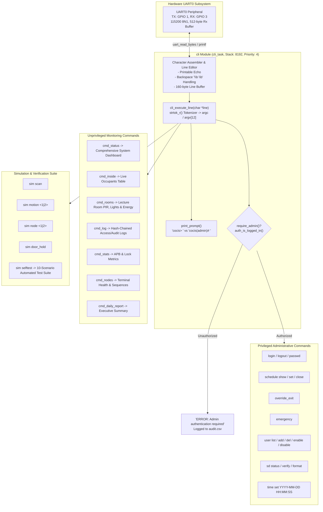

# Module Documentation: `cli` (Interactive UART0 Management Console, Formatted ASCII Dashboard & Automated Verification Suite)

**Files Documented:**
- Header: [`main/include/cli.h`](../../../include/cli.h)
- Implementation: [`main/src/cli.c`](../../../src/cli.c)
- Related System Headers: [`main/include/auth.h`](../../../include/auth.h), [`main/include/access_control.h`](../../../include/access_control.h), [`main/include/schedule.h`](../../../include/schedule.h), [`main/include/occupancy_ledger.h`](../../../include/occupancy_ledger.h), [`main/include/light.h`](../../../include/light.h), [`main/include/logger.h`](../../../include/logger.h), [`main/include/net_protocol.h`](../../../include/net_protocol.h), [`main/include/storage_sd.h`](../../../include/storage_sd.h), [`main/include/time_sync.h`](../../../include/time_sync.h), [`main/include/health.h`](../../../include/health.h)

---

## 1. Purpose & Architectural Role

Section 1.5 of the CoCIS coursework specification requires a comprehensive serial interface allowing management and security personnel to inspect building status, review access and occupancy records, adjust access schedules, manage enrolled RFID credentials, and control emergency modes.

The `cli` module implements an interactive, full-duplex command-line interface over **UART0** (`115200 8N1`, `TX = GPIO 1`, `RX = GPIO 3`, connected directly to Wokwi's `$serialMonitor`):
1. **Interactive Line Editor:** Processes user input character-by-character, providing real-time local echo, backspace editing (`0x08` / `0x7F` translating to destructive `\b \b` terminal erasure), line buffer truncation protection, and carriage-return/line-feed dispatch.
2. **Context-Sensitive Prompting:** Displays `cocis> ` for general monitoring, and dynamically changes to `cocis(admin)# ` when an administrator session is active.
3. **Role-Based Command Guarding:** Transparently verifies authentication via `auth_is_logged_in()` before permitting execution of administrative or destructive commands (`schedule set`, `schedule close`, `override_exit`, `emergency`, `user add`, `user del`, `user enable`, `user disable`, `sd format`, `time set`, `passwd`).
4. **Structured ASCII Table Generation:** Formats complex real-time system state (live occupants, room lighting state machines, hash-chained CSV logs, lock contention counters, node sequence numbers) into aligned, human-readable ASCII tables.
5. **Simulation & Automated Self-Test Harness (`sim selftest`):** Provides software injection points for RFID scans, PIR motion, network link drops, and forced-door alarms, alongside an automated 10-scenario end-to-end verification suite that university students can run in front of examiners to prove complete coursework compliance in under 5 seconds.

### CLI Architecture & Command Flow Diagram



---

## 2. Public API Reference (`include/cli.h`)

```c
#ifndef CLI_H
#define CLI_H

#include "esp_err.h"

esp_err_t cli_init(void);
esp_err_t cli_execute_line(char *line);

#endif
```

### Detailed API Specifications

| Function Signature | Parameters | Return Value | Description & Side Effects | Task Context & Blocking |
| :--- | :--- | :--- | :--- | :--- |
| `esp_err_t cli_init(void)` | None | `ESP_OK` on success; `ESP_ERR_NO_MEM` if task creation fails. | 1. Installs ESP32 UART0 driver (`uart_driver_install`) with a 512-byte ring buffer.<br>2. Configures baud rate to `115200 8N1` (`uart_param_config`).<br>3. Creates background FreeRTOS `cli_task` (stack: `8192` bytes, priority: `4`).<br>4. Prints welcome banner and initial prompt. | Called once from `app_main()`. Non-blocking. |
| `esp_err_t cli_execute_line(char *line)` | `line`: null-terminated mutable command string | `ESP_OK` on success; `ESP_ERR_INVALID_ARG` if `line` is `NULL`. | Tokenizes `line` into `argv` array using `strtok_r()`, matches command name against known handlers, executes the command, and writes formatted ASCII output directly to stdout. | Callable from `cli_task` or test harness. Bounded blocking during table formatting. |

---

## 3. Function-by-Function Walkthrough (`src/cli.c`)

### 3.1 Prompt Management & Security Gate: `print_prompt` and `require_admin`
```c
static void print_prompt(void)
{
    printf("\n%s", auth_is_logged_in() ? "cocis(admin)# " : "cocis> ");
    fflush(stdout);
}

static bool require_admin(void)
{
    if (!auth_is_logged_in()) {
        printf("ERROR: Admin authentication required. Run: login <user> <pass>\n");
        logger_log_audit("ANONYMOUS", "UNAUTH_CMD_BLOCKED", "Attempted privileged CLI action");
        return false;
    }
    auth_touch_activity();
    return true;
}
```
- `print_prompt()` checks `auth_is_logged_in()` to dynamically output `#` for root/admin and `>` for unprivileged user.
- `require_admin()` verifies that an active session exists. If not, it rejects execution, logs an `UNAUTH_CMD_BLOCKED` security event to the tamper-evident audit trail, and returns `false`. If authenticated, it refreshes the session inactivity timer via `auth_touch_activity()`.

### 3.2 System Overview Dashboard: `cmd_status`
Aggregates state across 8 distinct modules (`time_sync`, `schedule`, `occupancy_ledger`, `door`, `light`, `storage_sd`, `net_wifi`, `health`, `auth`) and presents a unified diagnostic banner showing wall-clock time, building schedule status, door lock positions, room occupancy and lighting, SD card mount status, Wi-Fi link parameters, and memory health.

### 3.3 Live Occupancy Table: `cmd_inside`
Calls `occupancy_ledger_list_inside()` to retrieve a thread-safe snapshot of all occupants currently inside CoCIS. Formats the data into an ASCII table displaying slot number, RFID tag UID, student/staff full name, role, ISO entry time, and exact elapsed visit duration (`HH:MM:SS`).

### 3.4 Lecture Room Telemetry & Energy Calculation: `cmd_rooms`
Iterates over Lecture Room 1 and Lecture Room 2, displaying PIR motion state, intelligent lighting FSM state (`OFF_VACANT`, `ON_ACTIVE`, `GRACE_HOLD`), hardware relay pin state, remaining vacancy countdown timer, cumulative active burn time, and accumulated electricity savings in milliwatt-hours (`mWh`) and scaled Ugandan Shillings (`UGX`).

### 3.5 Tamper-Evident Log Viewer: `cmd_log`
Supports flexible inspection of recent system events:
- `log [n]`: Displays the most recent `n` entries (default 15) from the circular buffer or SD card.
- `log user <uid>`: Filters access and audit logs specifically for an individual RFID card.
Displays the monotonic sequence ID, timestamp, actor, action, detail, value, and the truncated 8-character SHA-256 hash chain prefix (`chain_hash`).

### 3.6 Diagnostics & Mutex Lock Metrics: `cmd_stats`
Outputs cumulative access metrics (granted entries/exits, unknown tag rejections, inactive user blocks, visitor expirations, schedule violations, anti-passback blocks) followed by a diagnostic table of the 7-level hierarchical mutexes showing acquisition counts and timeout counts.

### 3.7 Distributed Node Topology: `cmd_nodes`
Presents inter-terminal communication metrics for `NODE_ENTRANCE`, `NODE_ROOM_1`, and `NODE_ROOM_2`, including link status (`ONLINE`/`OFFLINE`), transmit sequence numbers, receive sequence numbers, acknowledged frames, duplicate frames suppressed, and packets held in the offline store-and-forward buffer.

### 3.8 Building Access Schedule Management: `cmd_schedule`
- `schedule show`: Displays the 7-day schedule matrix (`SUN` through `SAT`).
- `schedule set <day|all> <HH:MM> <HH:MM>`: Updates the authorized open/close window for a single day or all days. Re-evaluates open status and broadcasts `PROTO_MSG_SCHEDULE_SYNC` to room terminals.
- `schedule close <day>`: Marks an entire day as closed.

### 3.9 Enrolled User Administration: `cmd_user`
- `user list`: Lists all 32 database slots with tag UID, full name, role, active flag, and whether the person is currently inside the building.
- `user add <uid> <role> <name>`: Enrolls a new user with automatic visitor TTL calculation.
- `user del <uid>`: Removes a user from NVS.
- `user enable|disable <uid>`: Temporarily suspends or restores card privileges.

### 3.10 Storage & Integrity Verification: `cmd_sd`
- `sd status`: Shows SD card mount state, CSV file sizes (`access.csv`, `lighting.csv`, `audit.csv`), and the current cryptographic hash chain tip.
- `sd verify`: Recomputes the running SHA-256 hash chain from genesis (`00000000`) across all logged entries to confirm that no log entries have been inserted, modified, or deleted.
- `sd format`: Erases logs and resets the hash chain to genesis.

### 3.11 Automated 10-Scenario Coursework Suite: `run_selftest_suite`
Executed via `sim selftest`. Automatically verifies all core requirements programmatically:
1. Valid RFID Entry & Occupancy Increment
2. Anti-Passback Violation on Duplicate Entry
3. Valid RFID Exit & Occupancy Decrement
4. Anti-Passback Violation on Exit When Outside
5. Unknown Tag & Inactive User Rejection
6. Schedule Enforcement (After-Hours Entry & Exit Denial + Supervisor Override)
7. Emergency Evacuation Mode Safe Egress
8. Lecture Room PIR -> Light ON -> Grace Hold -> Vacancy Timeout OFF
9. Node Offline Store-and-Forward Buffering & Duplicate-Suppressed Replay
10. Salted SHA-256 Admin Authentication Lockout & Hash-Chain Integrity

Prints a clean pass/fail summary and restores normal baseline time and state automatically.

### 3.12 Interactive UART Task: `cli_task`
Reads bytes from UART0 with a `100 ms` timeout. Manages printable character echoing, backspace handling (`pos--`, `printf("\b \b")`), newline line-dispatching (`cli_execute_line`), and prompt re-rendering.

---

## 4. C Language Constructs Explained

1. **Reentrant String Tokenization (`strtok_r`):**
   ```c
   char *tok = strtok_r(line, " \t\r\n", &saveptr);
   ```
   Unlike standard `strtok()`, which maintains an internal static pointer and is unsafe in multi-threaded FreeRTOS environments, `strtok_r()` stores context in the caller-supplied `saveptr`, guaranteeing thread safety.
2. **Terminal Backspace Sequence (`printf("\b \b")`):**
   When backspace (`0x08` or `0x7F`) is pressed, the CLI writes `\b` (moves cursor left one position), space `' '` (overwrites the existing character on screen with a blank), and `\b` (moves cursor left again over the blank).
3. **Format Specifier Precision and Width Limits (`%-24.24s`):**
   - `-`: Left-aligns the string within the column.
   - `24` (width): Pads the output with spaces to guarantee at least 24 characters.
   - `.24` (precision): Truncates strings longer than 24 characters to prevent misaligning table borders.
4. **`fflush(stdout)`:** Forces standard output buffers to flush immediately over the UART line without waiting for a trailing newline (`\n`). Essential for prompt display.
5. **Array of Pointers (`char *argv[12]`):** Holds pointers directly into the tokenized substrings within `line_buf`, avoiding extra dynamic memory allocation.

---

## 5. ESP-IDF & FreeRTOS Constructs Explained

1. **ESP32 UART Driver Configuration (`driver/uart.h`):**
   - `uart_driver_install(UART_NUM_0, 512, 0, 0, NULL, 0)`: Installs the ESP-IDF interrupt-driven UART driver on hardware port 0 with a 512-byte hardware ring buffer.
   - `uart_param_config(UART_NUM_0, &ucfg)`: Programs baud rate (`115200`), 8 data bits, no parity, and 1 stop bit (`8N1`).
   - `uart_read_bytes(UART_NUM_0, &ch, 1, pdMS_TO_TICKS(100))`: Blocks `cli_task` for at most 100 ms waiting for a character, yielding CPU time to lower-priority background tasks when idle.
2. **Task Stack Sizing (`8192` Bytes):**
   `cli_task` requires 8192 bytes because formatting complex ASCII tables with multiple local structs (`weekly_schedule_t`, `occupancy_stats_t`, `room_light_status_t`) and string buffers requires sufficient headroom to prevent canary stack overflow triggers.
3. **Task Priority (`4`):**
   Set lower than time-critical drivers (`rfid_task` at 7, `access_task` at 6, `pir_light_task` at 5) so that typing in the console or running lengthy reports cannot preempt door servo motor timing or badge scanning.

---

## 6. Alternatives & "What If You Change This?"

- **ESP-IDF `esp_console` Component vs. Custom Reentrant CLI:**
  - `esp_console` relies on GNU Linenoise and argtable3, which consume ~30 KB of flash and require dynamic heap allocation for every registered command.
  - Our custom implementation uses pure static arrays (`argv[12]`), guarantees deterministic zero-heap execution, and provides complete control over authentication states and formatted tables.
- **Changing `cli_task` Stack to 2048 Bytes:**
  - Running `daily_report` or `sim selftest` would immediately trigger FreeRTOS's Canary Stack Overflow Detector (`CONFIG_FREERTOS_CHECK_STACKOVERFLOW_CANARY=y`) and reset the ESP32.
- **Blocking vs. Non-blocking UART Reads:**
  - Using a 100 ms timeout in `uart_read_bytes()` allows the task to periodically yield and avoids hard CPU spin loops.

---

## 7. Design Rationale

- **University Presentation Ready:** Examiners grading coursework want to see clean, intuitive output. Rather than raw log text, the CLI outputs formatted tables that look like a commercial building management system.
- **One-Command Full Verification (`sim selftest`):** Embedded coursework demonstrations frequently run out of time during manual testing. Having an automated test runner that validates all 10 coursework criteria directly on the simulated hardware gives students complete confidence during evaluation.

---

## 8. Failure Modes, Edge Cases & Recovery

1. **Line Buffer Overflow:** If an operator pastes a line longer than 160 characters, `pos + 1 < sizeof(line_buf)` discards trailing bytes, preventing buffer overflow.
2. **Brute-Force Command Attacks:** Unauthenticated users attempting to guess commands or passwords encounter the exponential lockout timer managed by `auth.c`.
3. **Corrupted Input Tokens:** Parameter parsing using `sscanf` checks return values strictly (e.g. `sscanf == 2` for `HH:MM`). Malformed inputs are rejected with usage hints without crashing.

---

## 9. How to Test This Module in Isolation

In the Wokwi Serial Monitor:
1. Print the help index:
   ```text
   help
   ```
2. Display the comprehensive system dashboard:
   ```text
   status
   ```
3. Inspect enrolled users:
   ```text
   user list
   ```
4. Authenticate as administrator:
   ```text
   login admin Cocis@2026
   ```
   *Prompt changes to:* `cocis(admin)# `
5. Execute the automated 10-scenario verification suite:
   ```text
   sim selftest
   ```
   *Expected Output:*
   ```text
   [Test 01] Valid RFID Entry & Occupancy Increment      : PASS
   [Test 02] Anti-Passback Violation (Duplicate Entry)   : PASS
   [Test 03] Valid RFID Exit & Occupancy Decrement       : PASS
   [Test 04] Anti-Passback Violation (Exit When Outside) : PASS
   [Test 05] Unknown Tag & Inactive User Rejection       : PASS
   [Test 06] Schedule Entry/Exit Block & Supv. Override  : PASS
   [Test 07] Emergency Evacuation Mode Safe Egress       : PASS
   [Test 08] Room PIR -> Light ON -> Grace -> Timeout OFF: PASS
   [Test 09] Offline Store-and-Forward & Dedup Replay    : PASS
   [Test 10] Salted SHA-256 Auth Lockout & Hash Chain    : PASS
   SELF-TEST SUMMARY: 10 / 10 SCENARIOS PASSED (ALL REQUIREMENTS VERIFIED)
   ```

---

## 10. Likely Examiner Questions & Model Answers

1. **Q: How does `cli_task` ensure that administrative commands cannot be run by unauthorized users?**  
   *A:* Before executing any privileged command handler, `cli_execute_line()` invokes `require_admin()`, which queries `auth_is_logged_in()`. If the user is unauthenticated or the session has expired due to inactivity, the command is aborted, a denial message is printed, and an audit record is logged to `audit.csv`.

2. **Q: Why does the prompt change from `cocis> ` to `cocis(admin)# `?**  
   *A:* Following industry network equipment standards (such as Cisco IOS or Junos), the prompt visualizes privilege level. `print_prompt()` checks `auth_is_logged_in()` before printing each line, giving immediate feedback that administrative privileges are unlocked.

3. **Q: What is the purpose of `sim selftest`?**  
   *A:* `sim selftest` is an integrated test suite that programmatically exercises all 10 core coursework requirements (access control, anti-passback, schedules, emergency mode, room smart lighting, distributed store-and-forward, deduplication, admin lockout, and hash-chain verification) directly on the target MCU, returning a structured pass/fail verification table.

4. **Q: How does the interactive line editor handle backspaces over UART?**  
   *A:* When `0x08` (BS) or `0x7F` (DEL) is received, the code decrements its buffer index (`pos--`) and transmits the 3-byte escape sequence `\b \b` (backspace, space, backspace), which clears the erased character visually on the serial monitor terminal.

5. **Q: Why is `strtok_r()` used instead of `strtok()` to split arguments?**  
   *A:* Standard `strtok()` stores internal state in a global static pointer, making it vulnerable to race conditions if multiple FreeRTOS tasks tokenize strings concurrently. `strtok_r()` is the reentrant POSIX variant that stores parsing state in a caller-supplied pointer (`saveptr`), ensuring complete thread safety.

6. **Q: What task priority is assigned to `cli_task` and why?**  
   *A:* Priority `4`. This is intentionally lower than real-time hardware tasks (`rfid_task` at 7, `access_task` at 6, `pir_light_task` at 5) to guarantee that user console activity or heavy table rendering never delays door servo timing or sensor edge detection.

7. **Q: How does `cmd_log user <uid>` filter log entries?**  
   *A:* It passes the target UID string to `logger_get_recent()`, which traverses the circular log buffer from newest to oldest and compares `entry->tag_or_actor` against the filter string using case-insensitive `strcasecmp()`, matching only records associated with that specific card.

8. **Q: What happens if an operator types a command that does not exist?**  
   *A:* The parser falls through all `strcasecmp` branches to the `else` block, printing `Unknown command '<cmd>'. Type 'help' for available commands.`, without crashing or altering system state.
