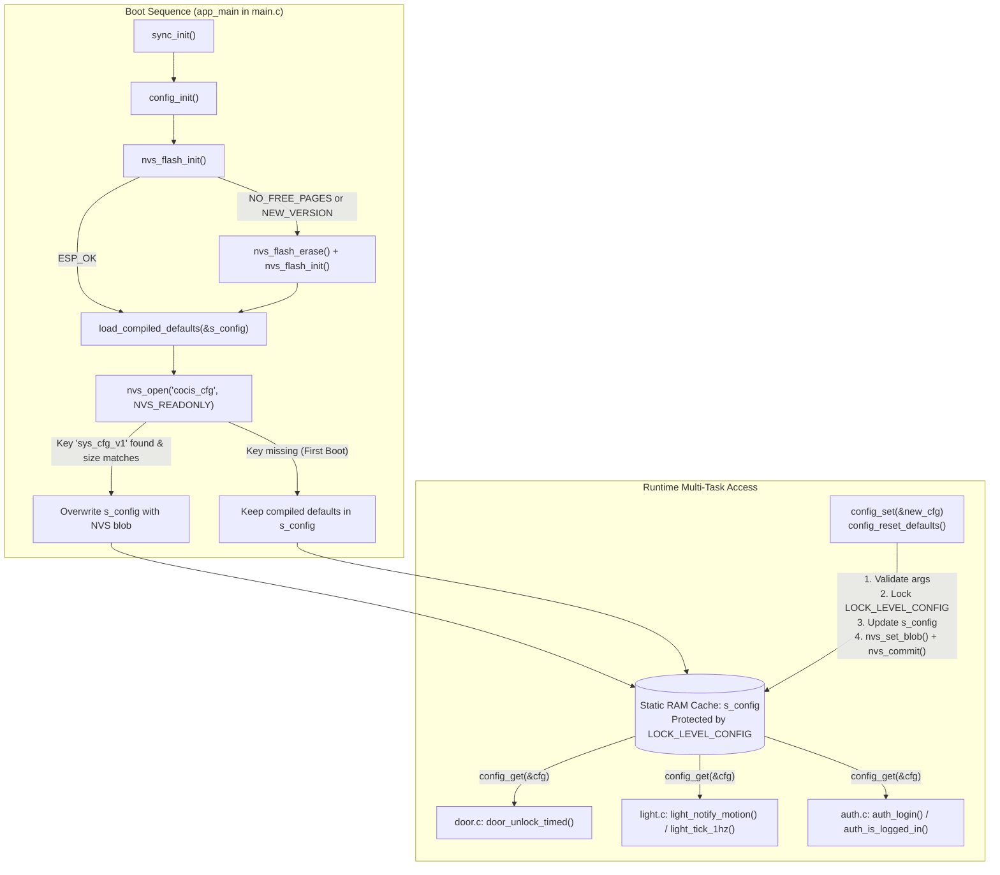

# Module Documentation: `config` — System-Wide Constants & NVS Runtime Configuration

**Coursework Bundle:** Bundle 1 (Student 1 — Core Infrastructure, Hardware Abstraction & Tamper-Evident Persistence)  
**Header File:** `main/include/config.h` (88 lines)  
**Implementation File:** `main/src/config.c` (104 lines)  

---

## 1. Purpose & Architectural Role

The `config` module serves two foundational roles in the **CoCIS Smart Control and Monitoring System**:

1. **Compile-Time Single Source of Truth (`config.h`):** It centralizes all system-wide `#define` constants—such as firmware version strings, East Africa Time (`EAT-3`) timezone rules, NVS namespace identifiers, MicroSD capacity limits, door unlock timings, PIR vacancy timeouts, energy tariff constants (`CFG_UGX_PER_KWH`), SHA-256 authentication parameters, Wi-Fi/MQTT broker endpoints, and FreeRTOS queue/buffer capacities. By placing every constant in `config.h`, none of the other 20 modules contain "magic numbers" scattered across `.c` files.
2. **Thread-Safe Non-Volatile Runtime Configuration (`config.c`):** It manages the mutable `sys_config_t` structure in RAM (`s_config`), backs it with ESP-IDF's **Non-Volatile Storage (NVS)** flash partition under namespace `"cocis_cfg"` and key `"sys_cfg_v1"`, and protects concurrent reads/writes using the hierarchical mutex `LOCK_LEVEL_CONFIG` (Level 1 in `sync.h`). Furthermore, `config_init()` initializes the underlying NVS flash driver for all other NVS-backed modules (`user_db`, `schedule`, and `auth`).

### Architectural Data & Control Flow Diagram



---

## 2. Public API Reference (`main/include/config.h`)

### 2.1 Compile-Time Macros (`#define`)

| Macro Name | Value | Purpose & Consumers |
| :--- | :--- | :--- |
| `CFG_SYSTEM_NAME` | `"CoCIS Smart Control System"` | Human-readable system banner printed in `app_main()` at boot (`main.c`). |
| `CFG_FIRMWARE_VERSION` | `"1.0.0-COCIS-2026"` | Firmware release tag logged at startup (`main.c`). |
| `CFG_TIMEZONE_POSIX` | `"EAT-3"` | POSIX TZ string for East Africa Time (UTC+3). Note that POSIX signs are inverted (`EAT-3` means UTC is 3 hours behind local time). Used in `time_sync.c`. |
| `CFG_DEFAULT_BOOT_EPOCH` | `1792819800LL` | Default Unix timestamp (`2026-10-24 08:30:00 EAT`, Saturday) loaded by `time_sync_init()` before SNTP or manual CLI clock setting. The `LL` suffix ensures a 64-bit `long long` literal to prevent 2038 32-bit epoch overflow. |
| `CFG_NVS_NAMESPACE` | `"cocis_cfg"` | NVS flash namespace shared by `config.c`, `auth.c`, `user_db.c`, and `schedule.c` (max 15 characters in ESP-IDF NVS). |
| `CFG_SD_MOUNT_POINT` | `"/sdcard"` | VFS mount prefix for the FAT32 MicroSD filesystem in `storage_sd.c`. |
| `CFG_SD_MAX_FILE_BYTES` | `(64 * 1024)` (65,536 B) | Maximum CSV log file size (64 KB) before `storage_sd_append_line()` rotates `<name>.csv` to `<name>.csv.old`. |
| `CFG_DOOR_OPEN_DURATION_MS` | `3000` | Default duration (3 seconds) the Entry/Exit servo remains unlocked at 90° (`door.c`, `config.c`). |
| `CFG_DOOR_HELD_ALARM_MS` | `10000` | Default threshold (10 seconds) before a held-open door triggers a forced/tailgate alarm (`config.c`). |
| `CFG_RFID_DEBOUNCE_MS` | `60` | Minimum interval (60 ms) between consecutive RFID scans/button interrupts in `rfid.c` to suppress mechanical switch bounce. |
| `CFG_RFID_QUEUE_DEPTH` | `16` | Depth of the FreeRTOS queue buffering raw RFID scan events in `rfid.c`. |
| `CFG_RFID_UID_MAX_LEN` | `16` | Maximum character buffer size (including NUL terminator `'\0'`) for an RFID hexadecimal UID string (e.g., `"04A1B2C3"`). |
| `CFG_USER_DB_MAX_USERS` | `32` | Maximum number of enrolled RFID users in `user_db.c` and occupant slots in `occupancy_ledger.c`. |
| `CFG_USER_NAME_MAX_LEN` | `28` | Maximum character buffer length for a user's full name in `user_db.c` and `cli.c`. |
| `CFG_VISITOR_DEFAULT_TTL_SEC` | `(24 * 3600)` (86,400 s) | Default time-to-live (24 hours) assigned to newly enrolled `USER_ROLE_VISITOR` badges in `cli.c`. |
| `CFG_ROOM_COUNT` | `2` | Number of monitored lecture rooms (Lecture Room 1 and Lecture Room 2) in `light.c`, `pir_sensor.c`, and `cli.c`. |
| `CFG_PIR_DEBOUNCE_MS` | `100` | Debounce window (100 ms) for PIR motion sensor GPIO transitions in `pir_sensor.c`. |
| `CFG_LIGHT_GRACE_PERIOD_SEC` | `5` | Additional grace seconds added when active motion is present in `light.c`. |
| `CFG_LIGHT_VACANCY_TIMEOUT_SEC` | `15` | Countdown seconds in `LIGHT_FSM_ON_GRACE_HOLD` after PIR motion ceases before lights turn OFF (`light.c`). |
| `CFG_ROOM_LIGHT_POWER_WATTS` | `120` | Power rating (120 W) of each lecture room's lighting load used to compute energy saved in milliwatt-hours (`mWh`) in `light.c`. |
| `CFG_UGX_PER_KWH` | `850` | Uganda Shillings electricity tariff per kWh used in `cli.c` (`cmd_rooms`) to estimate financial savings. |
| `CFG_AUTH_USER_MAX_LEN` | `16` | Maximum admin username buffer length in `auth.c`. |
| `CFG_AUTH_PASS_MAX_LEN` | `32` | Maximum plaintext password length accepted during salted SHA-256 hashing in `auth.c`. |
| `CFG_AUTH_SALT_LEN` | `16` | Length in bytes (128 bits) of the random cryptographic salt generated via `esp_fill_random()` in `auth.c`. |
| `CFG_AUTH_HASH_LEN` | `32` | Length in bytes (256 bits) of a raw SHA-256 digest in `auth.c`. |
| `CFG_AUTH_MAX_FAILED_ATTEMPTS` | `3` | Consecutive failed CLI login attempts before exponential lockout activates in `auth.c`. |
| `CFG_AUTH_LOCKOUT_BASE_SEC` | `30` | Initial lockout duration (30 s) upon reaching `CFG_AUTH_MAX_FAILED_ATTEMPTS` in `auth.c`. |
| `CFG_AUTH_SESSION_TIMEOUT_SEC` | `300` | Default admin CLI inactivity auto-logout timeout (5 minutes) in `auth.c` and `config.c`. |
| `CFG_AUTH_DEFAULT_USER` | `"admin"` | Factory-default administrator username provisioned on first boot in `auth.c`. |
| `CFG_AUTH_DEFAULT_PASS` | `"Cocis@2026"` | Factory-default administrator password provisioned on first boot in `auth.c`. |
| `CFG_AUTH_DEFAULT_ADMIN_UID` | `"04A00001"` | Default administrator RFID badge UID enrolled in `user_db.c`. |
| `CFG_SUPERVISOR_OVERRIDE_TTL_SEC` | `300` | Validity window (5 minutes) for an after-hours supervisor safe-exit pass (`override_exit <uid>`) in `schedule.c`. |
| `CFG_WIFI_SSID` | `"Wokwi-GUEST"` | Default Wi-Fi access point SSID for Wokwi simulation / ESP32 station mode in `net_wifi.c`. |
| `CFG_WIFI_PASSWORD` | `""` | Open network password for `"Wokwi-GUEST"` in `net_wifi.c`. |
| `CFG_WIFI_RECONNECT_BASE_MS` | `2000` | Initial Wi-Fi exponential backoff delay (2 s) in `net_wifi.c`. |
| `CFG_WIFI_RECONNECT_MAX_MS` | `30000` | Maximum Wi-Fi reconnect backoff cap (30 s) in `net_wifi.c`. |
| `CFG_SNTP_SERVER` | `"pool.ntp.org"` | Upstream NTP server queried by `time_sync.c` when Wi-Fi connects. |
| `CFG_MQTT_BROKER_HOST` | `"broker.hivemq.com"` | Public MQTT broker hostname for telemetry publishing in `net_protocol.c`. |
| `CFG_MQTT_BROKER_PORT` | `1883` | Standard unencrypted MQTT TCP port in `net_protocol.c`. |
| `CFG_MQTT_TOPIC_PREFIX` | `"cocis/smart_ctrl"` | Root MQTT topic namespace in `net_protocol.c`. |
| `CFG_PROTO_ACK_TIMEOUT_MS` | `1000` | Timeout (1 s) waiting for an acknowledgment frame from distributed room nodes in `net_protocol.c`. |
| `CFG_PROTO_MAX_RETRIES` | `3` | Maximum retransmission attempts before marking a message unacknowledged in `net_protocol.c`. |
| `CFG_PROTO_STORE_FWD_CAP` | `32` | Capacity of the per-node offline store-and-forward ring buffer in `net_protocol.c`. |
| `CFG_PROTO_HEARTBEAT_SEC` | `5` | Interval (5 s) between distributed node heartbeat checks in `net_protocol.c`. |
| `CFG_NODE_OFFLINE_THRESHOLD_SEC` | `15` | Seconds without heartbeat before a distributed node is flagged offline in `health.c` / `net_protocol.c`. |
| `CFG_LOG_QUEUE_DEPTH` | `32` | Number of `log_entry_t` items that `s_log_queue` can hold asynchronously in `logger.c`. |
| `CFG_LOG_RAM_RING_CAP` | `48` | Number of recent `log_entry_t` records retained in the in-memory circular buffer `s_ring` in `logger.c`. |
| `CFG_LOCK_TIMEOUT_MS` | `250` | Default mutex acquisition timeout (250 ms) passed to `sync_lock()` across most modules. |
| `CFG_BTN_ENTRY_VALID_UID` | `"04A1B2C3"` | RFID UID injected when the physical Entry Scan button (`GPIO 27`) is pressed in `rfid.c`. |
| `CFG_BTN_EXIT_VALID_UID` | `"04A1B2C3"` | RFID UID injected when the physical Exit Scan button (`GPIO 32`) is pressed in `rfid.c`. |
| `CFG_BTN_INTRUDER_UID` | `"DEADBEEF"` | Unauthorized RFID UID injected when the physical Intruder Test button (`GPIO 33`) is pressed in `rfid.c`. |

---

### 2.2 Data Structures (`sys_config_t`)

```c
typedef struct {
    uint32_t door_open_ms;       /* Duration (ms) servo stays open on valid access (default: 3000) */
    uint32_t door_alarm_ms;      /* Duration (ms) before held door triggers alarm (default: 10000) */
    uint32_t light_grace_sec;    /* Extra seconds added while motion is active (default: 5) */
    uint32_t light_vacancy_sec;  /* Seconds without motion before lights turn OFF (default: 15) */
    uint32_t room_watts;         /* Lecture room fixture power in Watts (default: 120) */
    uint32_t auth_timeout_sec;   /* Admin CLI session inactivity timeout in seconds (default: 300) */
    bool     require_admin_2fa;  /* Whether CLI login requires an Admin RFID UID second factor (default: false) */
    bool     mqtt_enabled;       /* Whether MQTT telemetry publishing is enabled (default: true) */
} sys_config_t;
```

- **Memory Footprint:** Six `uint32_t` fields ($6 \times 4 = 24$ bytes) + two `bool` fields ($2 \times 1 = 2$ bytes) + 2 bytes of trailing compiler struct alignment padding (to align the struct size to a 4-byte boundary) = **28 bytes** (`sizeof(sys_config_t) == 28`).

---

### 2.3 Public Functions

#### `esp_err_t config_init(void)`
- **Parameters:** `void` (none).
- **Return Value:**
  - `ESP_OK` on successful NVS initialization and configuration load (either from NVS or compiled defaults).
  - Any `esp_err_t` error code returned by `nvs_flash_init()` if flash initialization fails even after erasing.
- **Side Effects:**
  1. Initializes the default NVS flash partition (`nvs_flash_init()`). If the NVS partition is full (`ESP_ERR_NVS_NO_FREE_PAGES`) or formatted with a newer/incompatible layout (`ESP_ERR_NVS_NEW_VERSION_FOUND`), it erases the NVS partition (`nvs_flash_erase()`) and re-initializes it.
  2. Populates `s_config` with compile-time defaults via `load_compiled_defaults(&s_config)`.
  3. Opens NVS namespace `"cocis_cfg"` in read-only mode (`NVS_READONLY`) and attempts to read key `"sys_cfg_v1"` into `s_config`.
- **Who Calls It:** `app_main()` in `main/main.c` at step 1 of system boot (immediately after `sync_init()`).
- **Task Context:** Runs in the FreeRTOS `main` task context during single-threaded startup before worker tasks are spawned.
- **Blocking Behavior:** Blocks briefly (a few milliseconds; up to ~100 ms if NVS flash erase is required) while accessing SPI flash.

#### `esp_err_t config_get(sys_config_t *out_cfg)`
- **Parameters:** `out_cfg` — non-NULL pointer to a caller-allocated `sys_config_t` struct that will receive a copy of `s_config`.
- **Return Value:**
  - `ESP_OK` if `s_config` was copied into `*out_cfg`.
  - `ESP_ERR_INVALID_ARG` if `out_cfg == NULL`.
  - `ESP_ERR_TIMEOUT` (or error from `sync_lock`) if `LOCK_LEVEL_CONFIG` could not be acquired within `CFG_LOCK_TIMEOUT_MS` (250 ms).
- **Side Effects:** Acquires and releases `LOCK_LEVEL_CONFIG` (incrementing `acquire_count` in `sync.c`).
- **Who Calls It:**
  - `door_unlock_timed()` in `door.c` (reads `cfg.door_open_ms`).
  - `light_notify_motion()` and `light_tick_1hz()` in `light.c` (reads `cfg.light_vacancy_sec`, `cfg.light_grace_sec`, `cfg.room_watts`).
  - `auth_login()`, `auth_is_logged_in()`, and `auth_get_status()` in `auth.c` (reads `cfg.require_admin_2fa`, `cfg.auth_timeout_sec`).
- **Task Context:** Called from multiple FreeRTOS tasks (`rfid_task`, `pir_task`, `health_task`, `cli_task`).
- **Blocking Behavior:** May block up to `CFG_LOCK_TIMEOUT_MS` (250 ms) waiting for the `LOCK_LEVEL_CONFIG` mutex, though in practice the critical section is a single 28-byte struct assignment taking < 1 microsecond.

#### `esp_err_t config_set(const sys_config_t *new_cfg)`
- **Parameters:** `new_cfg` — pointer to a read-only `sys_config_t` struct containing the new configuration parameters.
- **Return Value:**
  - `ESP_OK` if updated in RAM and committed to NVS flash.
  - `ESP_ERR_INVALID_ARG` if `new_cfg == NULL`, `new_cfg->door_open_ms < 500`, or `new_cfg->light_vacancy_sec < 2`.
  - `ESP_ERR_TIMEOUT` if `LOCK_LEVEL_CONFIG` cannot be acquired within 250 ms.
  - Any NVS error code from `nvs_open()`, `nvs_set_blob()`, or `nvs_commit()`.
- **Side Effects:** Updates `s_config` in RAM under `LOCK_LEVEL_CONFIG`, then writes and commits the 28-byte binary blob `"sys_cfg_v1"` to the `"cocis_cfg"` NVS namespace in flash.
- **Who Calls It:** `config_reset_defaults()` in `config.c` (and available for administrative runtime tuning).
- **Task Context:** Typically called from `cli_task` or administrative control paths.
- **Blocking Behavior:** Acquires `LOCK_LEVEL_CONFIG` for < 1 µs, then performs synchronous NVS flash write/commit (typically 2–15 ms).

#### `esp_err_t config_reset_defaults(void)`
- **Parameters:** `void` (none).
- **Return Value:** Returns the `esp_err_t` result of `config_set(&def)`.
- **Side Effects:** Resets `s_config` in RAM to compiled default values and persists those defaults to NVS flash.
- **Who Calls It:** Administrative reset routines or self-test utilities.
- **Task Context:** Task context (never call from an ISR).
- **Blocking Behavior:** Blocks briefly during the NVS flash commit inside `config_set()`.

---

## 3. Line-by-Line / Block-by-Block Code Walkthrough (`main/src/config.c`)

### 3.1 Includes & Module-Static Variables (Lines 1–12)

```c
#include "config.h"
#include <string.h>
#include "esp_log.h"
#include "nvs.h"
#include "nvs_flash.h"
#include "sync.h"

static const char *TAG = "CONFIG";
static const char *NVS_KEY_BLOB = "sys_cfg_v1";

static sys_config_t s_config;
```

- **Lines 1–6:** Pulls in the module's own header (`config.h`), standard C string utilities (`<string.h>`), ESP-IDF logging macros (`esp_log.h`), the NVS key-value API (`nvs.h`) and partition initializer (`nvs_flash.h`), and the project's hierarchical lock manager (`sync.h`).
- **Line 8 (`TAG`):** Defines the module log prefix `"CONFIG"` used by `ESP_LOGI`, `ESP_LOGW`, and `ESP_LOGE`.
- **Line 9 (`NVS_KEY_BLOB`):** Defines the NVS key name `"sys_cfg_v1"`. Notice the `_v1` suffix: versioning the NVS key name is an embedded best practice so that if fields are added to `sys_config_t` in future firmware (`v2`), old firmware blobs won't be misinterpreted.
- **Line 11 (`s_config`):** File-scope (`static`) instance of `sys_config_t` residing in `.bss` (zero-initialized static RAM). Because it is `static`, no other `.c` file can read or modify `s_config` directly without going through `config_get()` or `config_set()`, enforcing mutex protection.

---

### 3.2 Helper Function: `load_compiled_defaults` (Lines 13–23)

```c
static void load_compiled_defaults(sys_config_t *cfg)
{
    cfg->door_open_ms = CFG_DOOR_OPEN_DURATION_MS;
    cfg->door_alarm_ms = CFG_DOOR_HELD_ALARM_MS;
    cfg->light_grace_sec = CFG_LIGHT_GRACE_PERIOD_SEC;
    cfg->light_vacancy_sec = CFG_LIGHT_VACANCY_TIMEOUT_SEC;
    cfg->room_watts = CFG_ROOM_LIGHT_POWER_WATTS;
    cfg->auth_timeout_sec = CFG_AUTH_SESSION_TIMEOUT_SEC;
    cfg->require_admin_2fa = false;
    cfg->mqtt_enabled = true;
}
```

- **Purpose:** Populates whatever `sys_config_t` struct is pointed to by `cfg` with known-good compile-time constants from `config.h`.
- **Why it is `static`:** It is an internal helper used by both `config_init()` (line 38) and `config_reset_defaults()` (line 102) to avoid code duplication (DRY principle).

---

### 3.3 Public Function: `config_init` (Lines 25–54)

```c
esp_err_t config_init(void)
{
    esp_err_t err = nvs_flash_init();
    if (err == ESP_ERR_NVS_NO_FREE_PAGES || err == ESP_ERR_NVS_NEW_VERSION_FOUND) {
        ESP_LOGW(TAG, "Erasing and re-initializing NVS partition");
        ESP_ERROR_CHECK(nvs_flash_erase());
        err = nvs_flash_init();
    }
    if (err != ESP_OK) {
        ESP_LOGE(TAG, "nvs_flash_init failed: %s", esp_err_to_name(err));
        return err;
    }

    load_compiled_defaults(&s_config);

    nvs_handle_t h;
    if (nvs_open(CFG_NVS_NAMESPACE, NVS_READONLY, &h) == ESP_OK) {
        size_t sz = sizeof(s_config);
        sys_config_t stored;
        if (nvs_get_blob(h, NVS_KEY_BLOB, &stored, &sz) == ESP_OK && sz == sizeof(s_config)) {
            s_config = stored;
            ESP_LOGI(TAG, "Loaded runtime configuration from NVS");
        }
        nvs_close(h);
    } else {
        ESP_LOGI(TAG, "Using default system configuration");
    }

    return ESP_OK;
}
```

- **Lines 27–32:** Calls `nvs_flash_init()` to mount the `"nvs"` partition in SPI flash. If all flash pages are consumed by uncompacted sectors (`ESP_ERR_NVS_NO_FREE_PAGES`) or the NVS partition format version changed across ESP-IDF upgrades (`ESP_ERR_NVS_NEW_VERSION_FOUND`), it logs a warning, erases the NVS partition cleanly with `nvs_flash_erase()`, and retries `nvs_flash_init()`.
- **Lines 33–36:** If `nvs_flash_init()` still failed (e.g., corrupted partition table), it logs the human-readable error string via `esp_err_to_name(err)` and returns the error code to `app_main()`.
- **Line 38:** Initializes `s_config` with the compiled defaults first. This guarantees `s_config` holds valid values even if NVS has never been written before (first boot after flashing).
- **Lines 40–51:** Attempts to open the `"cocis_cfg"` namespace in `NVS_READONLY` mode.
  - On first boot, the `"cocis_cfg"` namespace does not exist yet in flash, so `nvs_open()` returns `ESP_ERR_NVS_NOT_FOUND`, jumping to the `else` branch (line 49) and logging `"Using default system configuration"`.
  - On subsequent boots after `config_set()` has been called, `nvs_open()` succeeds. It initializes `sz = sizeof(s_config)` and reads the blob into a temporary stack variable `stored`.
  - **Crucial Validation (`sz == sizeof(s_config)` on line 44):** `nvs_get_blob()` updates `sz` with the actual byte length stored in flash. Checking `sz == sizeof(s_config)` ensures that a truncated or differently-sized struct from an older firmware version cannot corrupt `s_config`. Only if both the read succeeds and the size matches exactly is `s_config = stored` executed.
  - Line 48 closes the handle `h` via `nvs_close(h)` to prevent resource leaks.

---

### 3.4 Public Function: `config_get` (Lines 56–70)

```c
esp_err_t config_get(sys_config_t *out_cfg)
{
    if (out_cfg == NULL) {
        return ESP_ERR_INVALID_ARG;
    }

    esp_err_t err = sync_lock(LOCK_LEVEL_CONFIG, CFG_LOCK_TIMEOUT_MS);
    if (err != ESP_OK) {
        return err;
    }

    *out_cfg = s_config;
    sync_unlock(LOCK_LEVEL_CONFIG);
    return ESP_OK;
}
```

- **Lines 58–60:** Defensive NULL pointer check prevents a `LoadProhibited` / `StoreProhibited` CPU Guru Meditation panic if a caller passes `NULL`.
- **Lines 62–65:** Acquires the level-1 mutex `LOCK_LEVEL_CONFIG` with a 250 ms timeout. Why do we need a mutex to read a struct? Because `sys_config_t` is 28 bytes (seven 32-bit words). On a 32-bit Xtensa LX6 dual-core CPU, copying 28 bytes requires multiple `l32i`/`s32i` instructions. Without a mutex, if Task A called `config_set()` while Task B called `config_get()`, Task B could read a **torn struct** (half old fields, half new fields).
- **Lines 67–69:** Performs a whole-struct value copy (`*out_cfg = s_config`), immediately unlocks `LOCK_LEVEL_CONFIG`, and returns `ESP_OK`.

---

### 3.5 Public Function: `config_set` (Lines 72–97)

```c
esp_err_t config_set(const sys_config_t *new_cfg)
{
    if (new_cfg == NULL || new_cfg->door_open_ms < 500 || new_cfg->light_vacancy_sec < 2) {
        return ESP_ERR_INVALID_ARG;
    }

    esp_err_t err = sync_lock(LOCK_LEVEL_CONFIG, CFG_LOCK_TIMEOUT_MS);
    if (err != ESP_OK) {
        return err;
    }

    s_config = *new_cfg;
    sync_unlock(LOCK_LEVEL_CONFIG);

    nvs_handle_t h;
    err = nvs_open(CFG_NVS_NAMESPACE, NVS_READWRITE, &h);
    if (err == ESP_OK) {
        err = nvs_set_blob(h, NVS_KEY_BLOB, new_cfg, sizeof(*new_cfg));
        if (err == ESP_OK) {
            err = nvs_commit(h);
        }
        nvs_close(h);
    }

    return err;
}
```

- **Lines 74–76:** Input sanity validation. Rejects `NULL` pointers, door open durations under `500 ms` (which would relock the servo before it physically reaches 90°), or vacancy timeouts under `2 s` (which would cause rapid relay chatter in lecture rooms).
- **Lines 78–84:** Locks `LOCK_LEVEL_CONFIG`, copies `*new_cfg` into `s_config`, and **immediately unlocks `LOCK_LEVEL_CONFIG` before touching NVS flash**.
  - *Why unlock before NVS write?* Flash writes take milliseconds. Holding `LOCK_LEVEL_CONFIG` during slow flash I/O would block real-time tasks (`door`, `light`, `auth`) that call `config_get()`. Releasing the lock right after the RAM update keeps the critical section sub-microsecond.
- **Lines 86–95:** Opens `"cocis_cfg"` in `NVS_READWRITE` mode, writes the binary struct via `nvs_set_blob()`, flushes pending changes to flash via `nvs_commit(h)`, and always closes the handle `h`.

---

### 3.6 Public Function: `config_reset_defaults` (Lines 99–104)

```c
esp_err_t config_reset_defaults(void)
{
    sys_config_t def;
    load_compiled_defaults(&def);
    return config_set(&def);
}
```

- Allocates a local `sys_config_t def` on the stack, populates it using `load_compiled_defaults(&def)`, and delegates both the mutex-protected RAM update and NVS persistence to `config_set(&def)`.

---

## 4. C Language Constructs Explained

1. **Header Guards (`#ifndef CONFIG_H` / `#define CONFIG_H` / `#endif`):**
   - Found on lines 1, 2, and 88 of `config.h`. Because `config.h` is `#include`d by almost every header and source file in the project, header guards prevent the C preprocessor from pasting `typedef struct { ... } sys_config_t;` twice into the same translation unit, which would cause a `redefinition of 'sys_config_t'` compiler error.
2. **64-Bit Integer Literal Suffix (`1792819800LL`):**
   - On line 11 of `config.h`, `CFG_DEFAULT_BOOT_EPOCH` uses the `LL` (`long long`) suffix. This ensures the constant is treated as at least a 64-bit signed integer (`int64_t`), avoiding the Year 2038 problem where signed 32-bit Unix timestamps overflow at `2147483647`.
3. **Parenthesized Macro Expressions (`#define CFG_SD_MAX_FILE_BYTES (64 * 1024)`):**
   - Wrapping arithmetic macros in parentheses `( ... )` prevents operator precedence bugs when the macro is expanded inside a larger expression (e.g., `CFG_SD_MAX_FILE_BYTES / 2`).
4. **`typedef struct { ... } sys_config_t;`:**
   - Defines an anonymous structure and aliases it to the type name `sys_config_t`, allowing code to declare variables as `sys_config_t cfg;` instead of `struct sys_config_struct cfg;`.
5. **Fixed-Width Integer Types (`uint32_t`, `bool` from `<stdint.h>` and `<stdbool.h>`):**
   - Using `uint32_t` guarantees that every numeric field in `sys_config_t` is an exact 32-bit unsigned integer (0 to 4,294,967,295) regardless of compiler architecture, which is critical when serializing structs directly to NVS flash blobs.
6. **`static` Global Variables & Functions (`s_config`, `TAG`, `load_compiled_defaults`):**
   - At file scope in `config.c`, `static` gives symbols **internal linkage**—they are invisible to the linker outside `config.c`. This encapsulates `s_config` so external modules cannot bypass `sync_lock(LOCK_LEVEL_CONFIG, ...)`.
7. **Pass-by-Pointer (`sys_config_t *out_cfg` and `const sys_config_t *new_cfg`) & Struct Assignment:**
   - In C, arguments are passed by value. To return a 28-byte struct from `config_get()`, the caller passes the memory address of its own struct (`&cfg`), and `config_get()` dereferences the pointer (`*out_cfg = s_config;`) to copy all 28 bytes in one C statement.
   - In `config_set(const sys_config_t *new_cfg)`, the `const` qualifier promises the compiler and caller that `config_set()` will not modify the caller's struct through `new_cfg`, while avoiding pushing 28 bytes onto the call stack by value.
8. **`sizeof` Operator (`sizeof(s_config)` and `sizeof(*new_cfg)`):**
   - Evaluated at compile time to `28`. Using `sizeof(*new_cfg)` on line 89 rather than hardcoding `28` ensures that if fields are added to `sys_config_t`, the NVS blob size automatically updates without manual edits.

---

## 5. ESP-IDF & FreeRTOS Constructs Explained

| API / Construct | Header | How It Works & Role in `config.c` |
| :--- | :--- | :--- |
| `esp_err_t`, `ESP_OK`, `ESP_ERR_INVALID_ARG` | `esp_err.h` | Standard 32-bit signed integer error return type in ESP-IDF (`0` is `ESP_OK`; negative/hex values indicate specific errors). |
| `ESP_ERROR_CHECK(x)` | `esp_err.h` | Macro that evaluates `x`; if the result is not `ESP_OK`, it prints the error code, file, line, and function name to UART and aborts (reboots) the ESP32. Used on line 30 for `nvs_flash_erase()`. |
| `esp_err_to_name(err)` | `esp_err.h` | Converts an `esp_err_t` integer code into a human-readable string like `"ESP_ERR_NVS_NOT_FOUND"` for logging. |
| `nvs_flash_init()` | `nvs_flash.h` | Initializes the default NVS partition (`"nvs"`) in external SPI flash and sets up wear-leveling page tables in RAM. |
| `nvs_flash_erase()` | `nvs_flash.h` | Erases all sectors in the default NVS flash partition when no free pages remain or a partition version mismatch occurs. |
| `nvs_open(name, mode, &h)` | `nvs.h` | Opens an NVS namespace (`"cocis_cfg"`) in either `NVS_READONLY` (cannot modify flash) or `NVS_READWRITE` mode, outputting an opaque session handle `nvs_handle_t h`. |
| `nvs_get_blob(h, key, buf, &sz)` | `nvs.h` | Reads arbitrary binary data (`sys_config_t`) associated with `key` (`"sys_cfg_v1"`). `sz` is an **in-out parameter**: on input it specifies the buffer capacity; on output it holds the actual number of bytes read. |
| `nvs_set_blob(h, key, buf, sz)` | `nvs.h` | Stages a binary buffer (`sizeof(*new_cfg)` bytes) to be written under `key` (`"sys_cfg_v1"`). |
| `nvs_commit(h)` | `nvs.h` | Flushes any staged writes (`nvs_set_blob`) to physical SPI flash and updates NVS page CRCs. |
| `nvs_close(h)` | `nvs.h` | Releases the internal RAM structures allocated by `nvs_open()`. |
| `sync_lock(LOCK_LEVEL_CONFIG, timeout)` / `sync_unlock(...)` | `sync.h` | Project wrapper around FreeRTOS mutexes (`xSemaphoreTake` / `xSemaphoreGive`) that enforces strict lock ordering (`LOCK_LEVEL_CONFIG == 1`) so deadlocks cannot occur. |

---

## 6. Alternatives & "What If You Change This?"

1. **What if we stored individual NVS keys (`nvs_set_u32` for each field) instead of a single binary blob (`nvs_set_blob`)?**
   - *Individual Keys (`nvs_set_u32` / `nvs_set_u8`):* Updating 8 configuration fields would require 8 separate NVS entries (each consuming a 32-byte NVS entry slot in flash = 256 bytes per save) and 8 API calls. If power failed mid-update, half the settings would be updated and half would remain old.
   - *Single Struct Blob (`nvs_set_blob`):* Uses only 1 header + 1 data span in NVS (~96 bytes total) and NVS guarantees **atomic blob replacement**—if power fails during `nvs_set_blob`, the old blob remains intact.
   - *Tradeoff:* If you change the layout of `sys_config_t` in future firmware without changing `NVS_KEY_BLOB` (`"sys_cfg_v1"`), `sizeof(s_config)` changes and line 44 (`sz == sizeof(s_config)`) safely falls back to defaults instead of loading misaligned fields.
2. **What if we stored configuration on the MicroSD card (`storage_sd`) or SPIFFS instead of NVS?**
   - MicroSD cards are removable and initialized *after* `config_init()`. If config lived on the SD card and the card was removed, the system would lose its configuration on reboot. NVS lives in internal SPI flash on the ESP32 module, has built-in wear-leveling and CRC32 hardware integrity checks, and is always present.
3. **What if you change `CFG_TIMEZONE_POSIX` from `"EAT-3"` to `"EAT+3"`?**
   - In POSIX timezone syntax, the sign specifies the offset required to *add to local time to get UTC* (`UTC = Local + Offset`). Therefore, UTC+3 (East Africa Time) is written `"EAT-3"`. If you change it to `"EAT+3"`, all timestamps on the LCD, CLI, and CSV logs will be shifted 6 hours backward to UTC-3 (South America time)!
4. **What if you remove `if (err == ESP_ERR_NVS_NO_FREE_PAGES ...)` from `config_init()`?**
   - If the ESP32 flash previously held an incompatible NVS partition or ran out of erase pages, `nvs_flash_init()` would return an error, `ESP_ERROR_CHECK(config_init())` in `app_main()` would abort, and the ESP32 would enter an infinite boot loop.

---

## 7. Design Rationale

- **Write-Through RAM Cache Pattern:** Reading directly from SPI flash (`nvs_get_blob`) every time `light_tick_1hz()` or `door_unlock_timed()` runs would take several milliseconds per call, wear out flash memory mechanisms, and contend on the SPI0/1 flash bus. By caching the 28-byte struct in `s_config` in SRAM and only touching NVS when `config_set()` is called, reads take less than 1 microsecond and cause zero flash wear.
- **Lowest Lock Level (`LOCK_LEVEL_CONFIG = 1`):** `config_get()` is a leaf helper called by higher-level modules (`door`, `light`, `auth`). Assigning `LOCK_LEVEL_CONFIG` to level 1 in `sync.h` allows callers to query configuration cleanly, and because `config_get()` immediately releases the lock before returning, it never holds a lock while calling into another module.
- **Unlocking Before Flash I/O in `config_set()`:** Updating `s_config` inside the mutex and releasing the mutex *before* `nvs_open()` / `nvs_set_blob()` / `nvs_commit()` prevents slow flash erase/write operations (up to 15 ms) from stalling time-sensitive door or lighting tasks.

---

## 8. Failure Modes, Edge Cases & Recovery

| Failure Scenario | What Happens in `config.c` | System Recovery Behavior |
| :--- | :--- | :--- |
| **First boot on a factory-fresh ESP32 (no `"cocis_cfg"` namespace in flash)** | `nvs_open(CFG_NVS_NAMESPACE, NVS_READONLY, &h)` returns `ESP_ERR_NVS_NOT_FOUND`. | `s_config` retains the values already populated by `load_compiled_defaults(&s_config)` on line 38; logs `"Using default system configuration"` and returns `ESP_OK`. |
| **NVS partition full or version mismatch (`ESP_ERR_NVS_NO_FREE_PAGES` / `ESP_ERR_NVS_NEW_VERSION_FOUND`)** | Detected on line 28 of `config_init()`. | Automatically calls `nvs_flash_erase()` and re-runs `nvs_flash_init()`, recovering cleanly without crashing. |
| **Power loss mid-write during `config_set()`** | NVS uses log-structured CRC-verified entries in flash. An incomplete blob write is discarded by NVS on next mount. | On reboot, `nvs_get_blob()` automatically returns the previous intact `"sys_cfg_v1"` blob. |
| **Firmware upgrade changes `sizeof(sys_config_t)`** | `nvs_get_blob()` succeeds or returns `ESP_ERR_NVS_INVALID_LENGTH`, and `sz == sizeof(s_config)` evaluates to `false`. | The mismatched blob in `stored` is ignored; `s_config` keeps the new firmware's compiled defaults until the next `config_set()`. |
| **Invalid parameters passed to `config_set()` (e.g., `door_open_ms = 100`)** | Guard on line 74 (`new_cfg->door_open_ms < 500 || new_cfg->light_vacancy_sec < 2`) triggers immediately. | Returns `ESP_ERR_INVALID_ARG` without modifying `s_config` or writing to NVS. |

---

## 9. How to Test This Module in Isolation

Because `config` underpins the boot sequence, lock hierarchy, door timings, lighting FSM, and admin session timeout, you can verify it directly from the interactive serial CLI (`115200 8N1`):

### Test 1: Verify Boot Initialization & Default Parameters via `status`
```text
cocis> status

==============================================================================
             CoCIS SMART CONTROL & MONITORING SYSTEM - STATUS
==============================================================================
 System Clock (EAT) : 2026-10-24 08:30:05 (Sat) [VALID RTC]
 Building Schedule  : OPEN (Today's Window: 08:00 - 17:00 EAT)
 Emergency Mode     : NORMAL OPERATION
 Live Occupancy     : 0 person(s) inside (Peak: 0 | Entries: 0 | Exits: 0)
 Main Entrance Doors: Entry=LOCKED (Closed) | Exit=LOCKED (Closed)
 Lecture Room 1     : PIR=IDLE   | Light=OFF_VACANT | Saved=132 mWh
 Lecture Room 2     : PIR=IDLE   | Light=OFF_VACANT | Saved=132 mWh
 SD Card Storage    : MOUNTED (/sdcard) | Chain Tip=7F3A9C12 | Writes=1
 Distributed Nodes  : 3/3 Nodes ONLINE | Wi-Fi=CONNECTED (10.13.37.2) | MQTT=ONLINE
 Admin CLI Session  : LOCKED (Guest) (Free Heap: 214520 B, Uptime: 5 s)
==============================================================================
```

### Test 2: Verify `LOCK_LEVEL_CONFIG` Mutex Acquisitions via `stats`
Every time `light_tick_1hz()` (1 Hz), `door_unlock_timed()`, or `auth_login()` executes, `config_get()` acquires `LOCK_LEVEL_CONFIG` (Level 1). Run `stats` to inspect the lock counter and confirm `0` timeouts:
```text
cocis> stats
...
[Hierarchical Mutex Lock Diagnostics]
+----+---------------+--------------+--------------+
| Lv | Lock Name     | Acquires     | Timeouts     |
+----+---------------+--------------+--------------+
|  1 | CONFIG        |           42 |            0 |
|  2 | USER_DB       |           12 |            0 |
|  3 | SCHEDULE      |           18 |            0 |
|  4 | LEDGER        |           25 |            0 |
|  5 | ROOM          |           64 |            0 |
|  6 | DISPLAY       |           30 |            0 |
|  7 | SD            |            8 |            0 |
+----+---------------+--------------+--------------+
```

### Test 3: Verify Vacancy Timeout (`CFG_LIGHT_VACANCY_TIMEOUT_SEC` + `CFG_LIGHT_GRACE_PERIOD_SEC` = 20 s) via `sim motion` & `rooms`
```text
cocis> sim motion 1 on
OK: Simulated PIR motion ACTIVE in Lecture Room 1.

cocis> rooms
+--------+----------+------------+------------+-----------+------------+-------------+--------------+
| Room   | Node St. | PIR Sensor | Light FSM  | Relay Pin | Time Left  | Light On(s) | Energy Saved |
+--------+----------+------------+------------+-----------+------------+-------------+--------------+
| Room 1 | ONLINE   | MOTION     | ON_ACTIVE  | HIGH (ON) |       20 s |         1 s |      330 mWh |
| Room 2 | ONLINE   | VACANT     | OFF_VACANT | LOW (OFF) |        0 s |         0 s |      363 mWh |
+--------+----------+------------+------------+-----------+------------+-------------+--------------+
```
Notice `Time Left` is `20 s` (`cfg.light_vacancy_sec` (15) + `cfg.light_grace_sec` (5)), proving `light.c` retrieved the active parameters from `config_get()`.

---

## 10. Likely Examiner Questions & Model Answers

### Q1: Why is `s_config` declared `static` inside `config.c` instead of `extern sys_config_t g_config;` in `config.h`?
**Model Answer:**  
If `s_config` were exposed as a global `extern` variable in `config.h`, any FreeRTOS task could read or write its fields directly without acquiring `LOCK_LEVEL_CONFIG`. Because `sys_config_t` is 28 bytes (7 machine words on our 32-bit Xtensa LX6 CPU), reading it is not atomic—a reader task could be preempted mid-copy by a writer task and observe a corrupted ("torn") mix of old and new fields. Making `s_config` `static` enforces **encapsulation**: all access must go through `config_get()` and `config_set()`, which enforce mutex locking and input validation.

### Q2: In `config_init()`, why do you call `load_compiled_defaults(&s_config)` *before* calling `nvs_open()`?
**Model Answer:**  
On a newly flashed ESP32 (or right after `nvs_flash_erase()`), the `"cocis_cfg"` namespace and `"sys_cfg_v1"` blob do not exist in NVS yet, so `nvs_open(..., NVS_READONLY, &h)` will return `ESP_ERR_NVS_NOT_FOUND`. By loading the compiled defaults into `s_config` first (line 38), `s_config` is guaranteed to contain safe, valid operational parameters whether or not NVS contains a saved override. If a valid NVS blob *does* exist, lines 44–45 cleanly overwrite `s_config` with the stored blob.

### Q3: Explain line 44: `if (nvs_get_blob(h, NVS_KEY_BLOB, &stored, &sz) == ESP_OK && sz == sizeof(s_config))`. Why do you pass `&sz` as a pointer and why check `sz == sizeof(s_config)` afterwards?
**Model Answer:**  
In ESP-IDF's `nvs_get_blob()`, the `length` parameter (`size_t *length`) is an **in-out parameter**. Before the call, we initialize `sz = sizeof(s_config)` (28 bytes) to tell `nvs_get_blob()` the maximum size of our destination buffer `&stored` so it cannot cause a stack buffer overflow. When `nvs_get_blob()` returns, it overwrites `sz` with the actual number of bytes read from flash. Checking `sz == sizeof(s_config)` afterwards verifies that the blob stored in flash is not a smaller struct from an older firmware version, preventing partially uninitialized fields from being copied into `s_config`.

### Q4: In `config_set()`, why do you call `sync_unlock(LOCK_LEVEL_CONFIG)` on line 84 *before* calling `nvs_open()`, `nvs_set_blob()`, and `nvs_commit()`?
**Model Answer:**  
`LOCK_LEVEL_CONFIG` protects the in-RAM variable `s_config`, which is read frequently by real-time tasks like `door_unlock_timed()` and `light_tick_1hz()`. Copying `*new_cfg` into `s_config` in RAM takes less than 1 microsecond, whereas writing and committing to SPI flash (`nvs_set_blob` + `nvs_commit`) can take 5 to 15 milliseconds (or longer if a flash sector erase is triggered). By unlocking `LOCK_LEVEL_CONFIG` immediately after updating `s_config` in RAM, we prevent slow flash I/O from blocking other tasks that call `config_get()`.

### Q5: What is the difference between `nvs_set_blob()` and `nvs_commit()`? What happens if you call `nvs_set_blob()` without `nvs_commit()`?
**Model Answer:**  
`nvs_set_blob()` stages the write in the NVS driver's internal state/cache, whereas `nvs_commit()` ensures all pending changes are physically flushed and committed to non-volatile SPI flash memory before returning. While ESP-IDF's NVS implementation writes data pages during `nvs_set_*`, calling `nvs_commit(h)` explicitly verifies and finalizes the flash transaction and returns any flash write error before `nvs_close(h)` is called.

### Q6: Why does `CFG_DEFAULT_BOOT_EPOCH` end with `LL` (`1792819800LL`)?
**Model Answer:**  
On a 32-bit microcontroller like the ESP32, a plain integer literal defaults to a 32-bit `int` or `long` if it fits, which overflows on January 19, 2038 (`2,147,483,647`). Appending `LL` forces the literal to have type `long long` (at least 64 bits wide, matching `int64_t` and 64-bit `time_t` in modern ESP-IDF/newlib), ensuring timestamp arithmetic in `time_sync.c` and `schedule.c` never suffers 32-bit signed overflow.

### Q7: Why does `config_init()` check for `ESP_ERR_NVS_NO_FREE_PAGES` and `ESP_ERR_NVS_NEW_VERSION_FOUND`?
**Model Answer:**  
NVS divides its flash partition into 4 KB pages. If a partition was previously used by another firmware image that filled all pages without leaving a spare erase page for garbage collection (`ESP_ERR_NVS_NO_FREE_PAGES`), or if the flash contains an NVS format version from a different ESP-IDF release (`ESP_ERR_NVS_NEW_VERSION_FOUND`), `nvs_flash_init()` refuses to mount it. Catching those two specific error codes, calling `nvs_flash_erase()`, and calling `nvs_flash_init()` again allows the device to self-heal automatically on boot.

### Q8: Why does `config_set()` reject `door_open_ms < 500` and `light_vacancy_sec < 2`?
**Model Answer:**  
Those are physical actuator safety bounds:
1. A standard SG90/MG996R PWM servo requires roughly 200–300 ms just to sweep from 0° to 90°. If `door_open_ms` were set below 500 ms (or `0`), the auto-relock timer in `door.c` would fire before a person could walk through or before the servo horn even finished moving.
2. If `light_vacancy_sec` were `< 2` seconds (or `0`), the lecture room relays/LEDs would rapidly toggle ON and OFF every time a student sat still for a single second between PIR pulses, causing relay contact wear and disruptive flickering.
