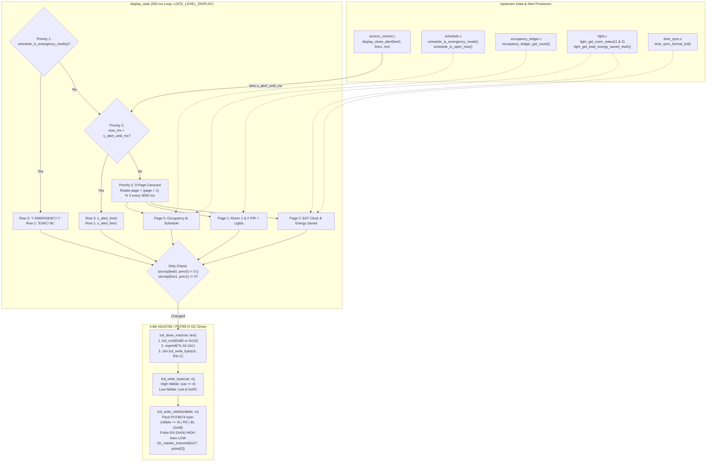

# Module Documentation: `display` (16x2 I2C HD44780 LCD Driver, PCF8574 Nibble Protocol & Priority Carousel)

**Files Documented:**
- Header: [`main/include/display.h`](../../../include/display.h)
- Implementation: [`main/src/display.c`](../../../src/display.c)
- Related Pin/Config/Sync Headers: [`main/include/board_pins.h`](../../../include/board_pins.h), [`main/include/config.h`](../../../include/config.h), [`main/include/sync.h`](../../../include/sync.h)

---

## 1. Purpose & Architectural Role

The `display` module drives the **16x2 Character Liquid Crystal Display (HD44780 controller with PCF8574 I2C backpack at address `0x27`)** mounted at the CoCIS Main Entrance (`SDA = GPIO 21`, `SCL = GPIO 22`, `100 kHz` standard-mode I2C).

Rather than requiring an external library or tying up 6–11 ESP32 GPIO pins for parallel HD44780 wiring, `display.c` implements a self-contained, bare-metal **4-bit nibble-multiplexed HD44780 driver** directly atop the **ESP-IDF v6.0 `driver/i2c_master.h`** API.

Architecturally, `display_task()` (running every `250 ms` at FreeRTOS priority `4`) arbitrates what appears on the two 16-character rows using a strict **3-tier priority hierarchy**:
1. **Priority 1 (Highest) — Emergency Evacuation Banner:** Whenever `schedule_is_emergency_mode()` is active (`SYS_EVT_EMERGENCY_MODE` bit set), the LCD overrides all normal pages and displays:
   - Row 0: `"!! EMERGENCY !! "`
   - Row 1: `"EVAC! IN:<count>"` (live count of people still inside the building).
2. **Priority 2 — Transient Access Control Alert Overlay (`display_show_alert`):** Whenever an RFID badge is scanned at the Entry or Exit reader, `access_control.c` posts a high-visibility 2-line alert (e.g., `"GRANTED: ENTRY  "` / `"Sarah      IN: 1"`, or `"DENY: PASSBACK  "` / `"Already Inside! "`) with a `2000–2500 ms` hold timer (`s_alert_until_ms`).
3. **Priority 3 (Normal Operation) — 3-Page Auto-Rotating Status Carousel (`3000 ms` per page):**
   - **Page 0 (Building Access Overview):** Row 0: `"CoCIS Smart Ctrl"`, Row 1: `"IN:<n>  SCHED:<OPN|CLS>"`
   - **Page 1 (Lecture Rooms 1 & 2 PIR & Lights):** Row 0: `"R1:<OCC|VAC> L1:<ON |OFF>"`, Row 1: `"R2:<OCC|VAC> L2:<ON |OFF>"`
   - **Page 2 (Real-Time EAT Clock & Energy Saved):** Row 0: `"<DAY> HH:MM:SS EAT"`, Row 1: `"Saved:<mWh>mWh  "`

To prevent I2C bus saturation and LCD character flicker, `display_task()` caches the last transmitted strings (`prev0[17]` and `prev1[17]`) and only writes to the I2C bus when the text on either row actually changes (`strcmp(line0, prev0) != 0 || strcmp(line1, prev1) != 0`).

### Display Priority & I2C Nibble Pipeline Diagram



---

## 2. Public API Reference (`include/display.h`)

Below is the complete contents of [`main/include/display.h`](../../../include/display.h):

```c
#ifndef DISPLAY_H
#define DISPLAY_H

#include <stdint.h>
#include "esp_err.h"

esp_err_t display_init(void);
esp_err_t display_show_alert(const char *line0, const char *line1, uint32_t duration_ms);

#endif
```

### Detailed Function Specifications

| Function Signature | Parameters | Return Value | Side Effects | Who Calls It & Task Context | Blocking Behavior |
| :--- | :--- | :--- | :--- | :--- | :--- |
| `esp_err_t display_init(void)` | `void` (none) | `ESP_OK` on success;<br>`ESP_ERR_NO_MEM` if task creation fails;<br>ESP-IDF I2C error if bus/device setup fails (gracefully logged as warning in `app_main`). | 1. Initializes I2C Master Bus 0 (`SDA=21`, `SCL=22`, `100 kHz`).<br>2. Adds PCF8574 device (`0x27`).<br>3. Executes HD44780 4-bit reset sequence (`0x03`, `0x03`, `0x03`, `0x02`) and configures 2-line 5x8 mode (`0x28`, `0x08`, `0x01`, `0x06`, `0x0C`).<br>4. Draws boot splash screen (`"CoCIS Smart Ctrl"` / `"Booting System.."`).<br>5. Spawns `display_task` (stack `4096`, priority `4`). | Called once by `app_main()` in [`main/main.c`](../../../main.c#L49) during Phase 4 of boot (`main` task context). Return value cast to `(void)` so system continues booting even if LCD hardware is absent. | **Blocks for ~`60 ms`** during power-on reset and HD44780 initialization delays (`vTaskDelay(50 ms)` + `5 ms` + `2 ms`). |
| `esp_err_t display_show_alert(const char *line0, const char *line1, uint32_t duration_ms)` | `line0`: Top-row string (up to 16 chars; `NULL`-safe).<br>`line1`: Bottom-row string (up to 16 chars; `NULL`-safe).<br>`duration_ms`: How long (in ms) the alert should override the normal carousel. | `ESP_OK` on success;<br>`ESP_ERR_TIMEOUT` if `LOCK_LEVEL_DISPLAY` cannot be acquired within `CFG_LOCK_TIMEOUT_MS` (`250 ms`). | Formats `line0` and `line1` as space-padded 16-char strings into `s_alert_line0` and `s_alert_line1`, and sets `s_alert_until_ms = now_ms + duration_ms`. | Called from 9 places in `process_scan_event()` inside [`main/src/access_control.c`](../../../src/access_control.c) (`access_task` context, priority 6, or `cli_task` context during `sim selftest`). | **Bounded blocking** up to `250 ms` on `LOCK_LEVEL_DISPLAY` (never performs slow I2C writes directly; defers actual I2C drawing to `display_task`). |

---

## 3. Line-by-Line / Block-by-Block Code Walkthrough (`src/display.c`)

### 3.1 Includes, PCF8574 Bit Masks & Static State (Lines 1–28)

```c
#include "display.h"
#include <stdio.h>
#include <string.h>
#include "board_pins.h"
#include "config.h"
#include "driver/i2c_master.h"
#include "esp_log.h"
#include "esp_rom_sys.h"
#include "esp_timer.h"
#include "freertos/FreeRTOS.h"
#include "freertos/task.h"
#include "light.h"
#include "occupancy_ledger.h"
#include "schedule.h"
#include "sync.h"
#include "time_sync.h"

static const char *TAG = "DISPLAY";

#define LCD_BACKLIGHT 0x08
#define LCD_ENABLE    0x04
#define LCD_RS_DATA   0x01

static i2c_master_dev_handle_t s_lcd_dev = NULL;
static bool                    s_lcd_ready = false;
static char                    s_alert_line0[17] = { 0 };
static char                    s_alert_line1[17] = { 0 };
static int64_t                 s_alert_until_ms = 0;
```

- **Lines 1–16:** Standard C string/formatting headers (`<stdio.h>`, `<string.h>`), ESP-IDF v6.0 I2C master driver (`driver/i2c_master.h`), ROM microsecond delay (`esp_rom_sys.h`), monotonic timer (`esp_timer.h`), and the 4 data source modules displayed on the carousel (`light.h`, `occupancy_ledger.h`, `schedule.h`, `time_sync.h`).
- **Lines 20–22 (PCF8574 I2C Expander Pin Mapping):**
  An I2C LCD backpack uses a **PCF8574 8-bit I/O expander** (`P7..P0`) wired to the HD44780 LCD controller pins as follows:
  | PCF8574 Bit | Bit Mask | HD44780 Pin | Purpose |
  | :---: | :---: | :---: | :--- |
  | `P7..P4` | `0xF0` (`nibble << 4`) | `D7..D4` | 4-bit parallel data/command bus |
  | `P3` | `0x08` (`LCD_BACKLIGHT`) | LED+ Transistor | Backlight control (`1` = ON, `0` = OFF) |
  | `P2` | `0x04` (`LCD_ENABLE`) | `E` (Enable) | Falling-edge clock strobe (`1 -> 0` latches data into HD44780) |
  | `P1` | `0x02` (`RW`) | `R/W` | Read/Write select (always kept `0` = Write) |
  | `P0` | `0x01` (`LCD_RS_DATA`) | `RS` | Register Select (`0` = Command Register, `1` = Data/Character RAM) |
- **Lines 24–28:**
  - `s_lcd_dev`: Handle to the I2C slave device (`0x27`) created by `i2c_master_bus_add_device()`.
  - `s_lcd_ready`: Guard boolean ensuring no I2C transactions are attempted if `display_init()` failed.
  - `s_alert_line0[17]`, `s_alert_line1[17]`: Null-terminated 16-character buffers holding the active transient alert text.
  - `s_alert_until_ms`: Monotonic timestamp (in ms) when the transient alert expires.

---

### 3.2 Low-Level 4-Bit HD44780 Primitives: `lcd_write_nibble`, `lcd_write_byte`, `lcd_cmd`, `lcd_draw_row` (Lines 30–65)

```c
static void lcd_write_nibble(uint8_t nibble, uint8_t rs_flag)
{
    if (!s_lcd_ready || s_lcd_dev == NULL) {
        return;
    }
    uint8_t base = (uint8_t)((nibble << 4) | (rs_flag ? LCD_RS_DATA : 0x00) | LCD_BACKLIGHT);
    uint8_t pulse[2] = { (uint8_t)(base | LCD_ENABLE), base };
    i2c_master_transmit(s_lcd_dev, pulse, sizeof(pulse), 50);
    esp_rom_delay_us(50);
}

static void lcd_write_byte(uint8_t val, uint8_t rs_flag)
{
    lcd_write_nibble((uint8_t)(val >> 4), rs_flag);
    lcd_write_nibble((uint8_t)(val & 0x0F), rs_flag);
}

static void lcd_cmd(uint8_t cmd)
{
    lcd_write_byte(cmd, 0);
    if (cmd == 0x01 || cmd == 0x02) {
        vTaskDelay(pdMS_TO_TICKS(2));
    }
}

static void lcd_draw_row(uint8_t row, const char *text)
{
    uint8_t addr = (row == 0) ? 0x80 : 0xC0;
    lcd_cmd(addr);

    char padded[17];
    snprintf(padded, sizeof(padded), "%-16.16s", text ? text : "");
    for (int i = 0; i < 16; i++) {
        lcd_write_byte((uint8_t)padded[i], 1);
    }
}
```

- **`lcd_write_nibble` (Lines 30–39):**
  - Sends a 4-bit nibble (`bits 3..0` of `nibble`) to the HD44780 over I2C:
  - Line 35: Shifts the 4-bit nibble into the upper 4 bits `(nibble << 4)` (matching PCF8574 `P7..P4`), ORs in `LCD_RS_DATA` (`0x01`) if `rs_flag != 0` (character data) or `0x00` (command), and ORs in `LCD_BACKLIGHT` (`0x08`) so the LCD backlight stays illuminated.
  - Line 36: Constructs a 2-byte I2C payload `pulse[2]`:
    - `pulse[0] = base | LCD_ENABLE`: Drives `D7..D4`, `RS`, `BL`, and raises the `E` (Enable) strobe `HIGH`.
    - `pulse[1] = base`: Keeps `D7..D4`, `RS`, `BL` stable while pulling `E` (Enable) `LOW`. The HD44780 latches the 4 data lines on this `HIGH -> LOW` falling edge of `E`!
  - Line 37: Transmits both bytes back-to-back in a single I2C transaction via `i2c_master_transmit(s_lcd_dev, pulse, 2, 50)` with a `50 ms` timeout.
  - Line 38: Calls `esp_rom_delay_us(50)` (`50 microseconds` hardware spin delay) because standard HD44780 instructions require `37–43 us` execution time.
- **`lcd_write_byte` (Lines 41–45):**
  - In 4-bit mode, an 8-bit command or ASCII character (`val`) must be transmitted in two halves:
    1. **Upper nibble first:** `lcd_write_nibble((uint8_t)(val >> 4), rs_flag)` shifts bits `7..4` down into bits `3..0`.
    2. **Lower nibble second:** `lcd_write_nibble((uint8_t)(val & 0x0F), rs_flag)` masks bits `3..0`, clearing bits `7..4`.
- **`lcd_cmd` (Lines 47–53):**
  - Sends a command byte (`rs_flag = 0`).
  - If the command is `0x01` (Clear Display) or `0x02` (Return Home), the HD44780 datasheet specifies a `1.52 ms` execution time (much longer than normal `37 us` commands), so Line 51 yields the CPU for `2 ms` via `vTaskDelay(pdMS_TO_TICKS(2))`.
- **`lcd_draw_row` (Lines 55–65):**
  - Sets the HD44780 DDRAM (Display Data RAM) cursor address: Row 0 starts at DDRAM offset `0x00` (command `0x80 | 0x00 = 0x80`); Row 1 starts at DDRAM offset `0x40` (command `0x80 | 0x40 = 0xC0`).
  - Formats `text` into `padded[17]` using `"%-16.16s"`, which left-aligns the string, truncates it if longer than 16 chars, and pads shorter strings with trailing spaces (`' '`) to exactly 16 characters so leftover characters from previous screens are overwritten cleanly without needing a slow `0x01` Clear Display command.
  - Loops `i = 0..15`, sending each ASCII character with `rs_flag = 1`.

---

### 3.3 Periodic Carousel & Priority Arbitrator Task: `display_task` (Lines 67–129)

```c
static void display_task(void *arg)
{
    (void)arg;
    uint8_t page = 0;
    int64_t last_page_switch_ms = 0;
    char prev0[17] = { 0 };
    char prev1[17] = { 0 };

    while (1) {
        int64_t now_ms = esp_timer_get_time() / 1000LL;
        char line0[17] = { 0 };
        char line1[17] = { 0 };

        if (sync_lock(LOCK_LEVEL_DISPLAY, 100) == ESP_OK) {
            if (schedule_is_emergency_mode()) {
                uint32_t inside = occupancy_ledger_get_count();
                snprintf(line0, sizeof(line0), "!! EMERGENCY !! ");
                snprintf(line1, sizeof(line1), "EVAC! IN:%lu      ", (unsigned long)inside);
            } else if (now_ms < s_alert_until_ms) {
                snprintf(line0, sizeof(line0), "%-16.16s", s_alert_line0);
                snprintf(line1, sizeof(line1), "%-16.16s", s_alert_line1);
            } else {
                if ((now_ms - last_page_switch_ms) >= 3000) {
                    page = (uint8_t)((page + 1) % 3);
                    last_page_switch_ms = now_ms;
                }

                if (page == 0) {
                    uint32_t inside = occupancy_ledger_get_count();
                    bool open = schedule_is_open_now();
                    snprintf(line0, sizeof(line0), "CoCIS Smart Ctrl");
                    snprintf(line1, sizeof(line1), "IN:%-2lu  SCHED:%s",
                             (unsigned long)inside, open ? "OPN" : "CLS");
                } else if (page == 1) {
                    room_light_status_t r1 = { 0 }, r2 = { 0 };
                    light_get_room_status(1, &r1);
                    light_get_room_status(2, &r2);
                    snprintf(line0, sizeof(line0), "R1:%s L1:%s   ",
                             r1.pir_motion_active ? "OCC" : "VAC",
                             r1.relay_on ? "ON " : "OFF");
                    snprintf(line1, sizeof(line1), "R2:%s L2:%s   ",
                             r2.pir_motion_active ? "OCC" : "VAC",
                             r2.relay_on ? "ON " : "OFF");
                } else {
                    time_sync_format_lcd(line0, sizeof(line0));
                    uint32_t saved = light_get_total_energy_saved_mwh();
                    snprintf(line1, sizeof(line1), "Saved:%5lumWh  ", (unsigned long)saved);
                }
            }

            if (strcmp(line0, prev0) != 0 || strcmp(line1, prev1) != 0) {
                lcd_draw_row(0, line0);
                lcd_draw_row(1, line1);
                strncpy(prev0, line0, sizeof(prev0) - 1);
                strncpy(prev1, line1, sizeof(prev1) - 1);
            }

            sync_unlock(LOCK_LEVEL_DISPLAY);
        }

        vTaskDelay(pdMS_TO_TICKS(250));
    }
}
```

- **Lines 70–73:** Initializes carousel state: `page = 0` (`0..2`), `last_page_switch_ms = 0`, and dirty-check caches `prev0` and `prev1`.
- **Line 80 (`if (sync_lock(LOCK_LEVEL_DISPLAY, 100) == ESP_OK)`):** Acquires `LOCK_LEVEL_DISPLAY` with a `100 ms` timeout to protect access to `s_alert_line0`, `s_alert_line1`, and `s_alert_until_ms`.
- **Lines 81–84 (Priority 1 — Emergency Mode):** Checks `schedule_is_emergency_mode()`. If active, formats `"!! EMERGENCY !! "` and `"EVAC! IN:<inside>"`.
- **Lines 85–87 (Priority 2 — Transient RFID Alert):** Else if `now_ms < s_alert_until_ms`, copies `s_alert_line0` and `s_alert_line1` into `line0` and `line1`.
- **Lines 88–115 (Priority 3 — 3-Page Rotating Carousel):**
  - Lines 89–92: Advances `page = (page + 1) % 3` every `3000 ms` (`3 seconds`).
  - **Page 0 (Lines 94–99):** Displays `"CoCIS Smart Ctrl"` on Row 0 and live building occupancy (`IN:0 `) plus schedule status (`SCHED:OPN` or `SCHED:CLS`) on Row 1.
  - **Page 1 (Lines 100–109):** Queries `light_get_room_status()` for Lecture Rooms 1 & 2 and formats `"R1:OCC L1:ON    "` / `"R2:VAC L2:OFF   "`.
  - **Page 2 (Lines 110–114):** Formats the live EAT wall clock on Row 0 via `time_sync_format_lcd()` (e.g., `"SAT 08:30:15 EAT"`) and total building energy saved on Row 1 (`"Saved:  660mWh  "`).
- **Lines 117–122 (Dirty-Line Comparison Cache):**
  - Compares the newly formatted `line0` and `line1` against `prev0` and `prev1` using `strcmp()`.
  - Only if at least one character differs does it call `lcd_draw_row(0, line0)` and `lcd_draw_row(1, line1)` and update `prev0`/`prev1`. On Page 0 and Page 1 (when occupancy and room states are steady), this eliminates **>90% of I2C bus traffic**!
- **Lines 124 & 127:** Releases `LOCK_LEVEL_DISPLAY` and sleeps for `250 ms` (`4 Hz` refresh rate).

---

### 3.4 I2C Bus & HD44780 Initialization: `display_init` (Lines 131–186)

```c
esp_err_t display_init(void)
{
    i2c_master_bus_config_t bus_cfg = {
        .clk_source = I2C_CLK_SRC_DEFAULT,
        .i2c_port = BOARD_I2C_PORT,
        .scl_io_num = PIN_I2C_SCL,
        .sda_io_num = PIN_I2C_SDA,
        .glitch_ignore_cnt = 7,
        .flags.enable_internal_pullup = true
    };
    i2c_master_bus_handle_t bus_handle = NULL;
    esp_err_t err = i2c_new_master_bus(&bus_cfg, &bus_handle);
    if (err != ESP_OK) {
        ESP_LOGW(TAG, "I2C bus init failed (%s) - continuing without LCD", esp_err_to_name(err));
        return err;
    }

    i2c_device_config_t dev_cfg = {
        .dev_addr_length = I2C_ADDR_BIT_LEN_7,
        .device_address = BOARD_LCD_I2C_ADDR,
        .scl_speed_hz = BOARD_I2C_FREQ_HZ
    };
    err = i2c_master_bus_add_device(bus_handle, &dev_cfg, &s_lcd_dev);
    if (err != ESP_OK) {
        return err;
    }

    s_lcd_ready = true;
    vTaskDelay(pdMS_TO_TICKS(50));
    lcd_write_nibble(0x03, 0);
    vTaskDelay(pdMS_TO_TICKS(5));
    lcd_write_nibble(0x03, 0);
    esp_rom_delay_us(150);
    lcd_write_nibble(0x03, 0);
    esp_rom_delay_us(150);
    lcd_write_nibble(0x02, 0);
    esp_rom_delay_us(150);

    lcd_cmd(0x28); /* 4-bit, 2 lines, 5x8 font */
    lcd_cmd(0x08); /* Display off */
    lcd_cmd(0x01); /* Clear display */
    vTaskDelay(pdMS_TO_TICKS(2));
    lcd_cmd(0x06); /* Entry mode: increment */
    lcd_cmd(0x0C); /* Display on, cursor off */

    lcd_draw_row(0, "CoCIS Smart Ctrl");
    lcd_draw_row(1, "Booting System..");

    if (xTaskCreate(display_task, "display_task", 4096, NULL, 4, NULL) != pdPASS) {
        return ESP_ERR_NO_MEM;
    }

    ESP_LOGI(TAG, "16x2 I2C LCD initialized at 0x%02X (SDA=%d, SCL=%d)",
             BOARD_LCD_I2C_ADDR, (int)PIN_I2C_SDA, (int)PIN_I2C_SCL);
    return ESP_OK;
}
```

- **Lines 133–146 (ESP-IDF v6.0 I2C Master Bus Creation):**
  - Configures `I2C_NUM_0` (`BOARD_I2C_PORT`) on `SDA = GPIO 21` and `SCL = GPIO 22` with internal pull-ups enabled and a 7-clock-cycle hardware glitch filter (`.glitch_ignore_cnt = 7`).
  - Calls `i2c_new_master_bus(&bus_cfg, &bus_handle)`.
- **Lines 148–156 (Adding the PCF8574 Slave Device):**
  - Registers slave address `0x27` (`BOARD_LCD_I2C_ADDR`) using 7-bit addressing at `100,000 Hz` (`100 kHz`, `BOARD_I2C_FREQ_HZ`) via `i2c_master_bus_add_device(bus_handle, &dev_cfg, &s_lcd_dev)`.
- **Lines 158–167 (HD44780 Datasheet " Initialization by Instruction" 4-Bit Handshake):**
  - When an HD44780 powers up, it starts in **8-bit interface mode** (or could be half-way through a 4-bit byte if the ESP32 warm-reset while the LCD stayed powered).
  - Sending `lcd_write_nibble(0x03, 0)` **three times** (with `> 4.1 ms` delay after the first and `> 100 us` after the second/third) forces the HD44780 reliably into 8-bit mode regardless of its prior state.
  - Sending `lcd_write_nibble(0x02, 0)` then switches the controller cleanly into **4-bit interface mode**, so subsequent commands can be sent as pairs of nibbles via `lcd_cmd()`.
- **Lines 169–174 (HD44780 Mode Configuration):**
  - `lcd_cmd(0x28)`: Function Set (`DL=0` 4-bit mode, `N=1` 2-line display, `F=0` 5x8 dot character font).
  - `lcd_cmd(0x08)`: Display OFF (`D=0, C=0, B=0`).
  - `lcd_cmd(0x01)`: Clear Display (zeros all DDRAM and returns cursor to `0x00`).
  - `lcd_cmd(0x06)`: Entry Mode Set (`I/D=1` auto-increment cursor right after each character write, `S=0` no display shift).
  - `lcd_cmd(0x0C)`: Display ON (`D=1` display on, `C=0` underline cursor hidden, `B=0` blinking block cursor off).
- **Lines 176–185:** Writes the initial boot banner `"CoCIS Smart Ctrl"` / `"Booting System.."` and spawns `display_task`.

---

### 3.5 Non-Blocking Alert Poster: `display_show_alert` (Lines 188–200)

```c
esp_err_t display_show_alert(const char *line0, const char *line1, uint32_t duration_ms)
{
    if (sync_lock(LOCK_LEVEL_DISPLAY, CFG_LOCK_TIMEOUT_MS) != ESP_OK) {
        return ESP_ERR_TIMEOUT;
    }

    snprintf(s_alert_line0, sizeof(s_alert_line0), "%-16.16s", line0 ? line0 : "");
    snprintf(s_alert_line1, sizeof(s_alert_line1), "%-16.16s", line1 ? line1 : "");
    s_alert_until_ms = (esp_timer_get_time() / 1000LL) + duration_ms;

    sync_unlock(LOCK_LEVEL_DISPLAY);
    return ESP_OK;
}
```

- Acquires `LOCK_LEVEL_DISPLAY`, formats `line0` and `line1` into `s_alert_line0` and `s_alert_line1`, sets `s_alert_until_ms` to current monotonic milliseconds plus `duration_ms`, and unlocks `LOCK_LEVEL_DISPLAY`.
- Notice that `display_show_alert()` does **not** touch the I2C bus directly; `display_task()` picks up the updated alert buffer on its next `250 ms` tick, keeping `access_task` fast and preventing concurrent I2C bus access.

---

## 4. C Language Constructs Explained

### 4.1 Bit-Shifting & Bit-Masking in 4-Bit LCD Nibble Packing
To send an 8-bit byte `val` (for example, ASCII `'A' = 0x41 = 0b0100_0001`) over a 4-bit data bus (`D7..D4`):
1. **Extracting the Upper Nibble (`val >> 4`):**
   `0b0100_0001 >> 4` shifts all bits right by 4 places, yielding `0b0000_0100` (`0x04`).
2. **Extracting the Lower Nibble (`val & 0x0F`):**
   `0b0100_0001 & 0b0000_1111` masks off the upper 4 bits, yielding `0b0000_0001` (`0x01`).
3. **Packing into PCF8574 Upper Pins (`(nibble << 4) | ...`):**
   Inside `lcd_write_nibble()`, `nibble << 4` moves those 4 bits back into bit positions `7..4` (because PCF8574 pins `P7..P4` are wired to LCD `D7..D4`), leaving bit positions `3..0` free for control signals: `LCD_BACKLIGHT` (`0x08`, bit 3), `LCD_ENABLE` (`0x04`, bit 2), and `LCD_RS_DATA` (`0x01`, bit 0).

### 4.2 `snprintf` Fixed-Width & Precision Specifier: `"%-16.16s"`
In `lcd_draw_row()` and `display_show_alert()`:
```c
snprintf(padded, sizeof(padded), "%-16.16s", text ? text : "");
```
This single format specifier performs three operations simultaneously:
- `-` (**Left-justification flag**): Aligns the text to the left edge of the 16-character field instead of right-aligning.
- `16` (**Minimum field width**): If `text` is shorter than 16 characters (e.g., `"EVAC EXIT OK"`, 12 chars), `snprintf` pads the remaining 4 characters on the right with spaces (`' '`) so all 16 LCD character cells are overwritten.
- `.16` (**Maximum string precision**): If `text` is longer than 16 characters, `snprintf` stops reading after 16 characters, preventing truncation warnings.
- `sizeof(padded)` (`17`): Guarantees null-termination at `padded[16] = '\0'`.

### 4.3 Modulo Arithmetic for Circular Page Rotation (`(page + 1) % 3`)
In `display_task()`:
```c
page = (uint8_t)((page + 1) % 3);
```
The modulo operator `% 3` wraps the page index in a clean cycle: `0 -> 1 -> 2 -> 0 -> 1 -> 2`, without needing `if (page >= 3) page = 0;`.

---

## 5. ESP-IDF & FreeRTOS Constructs Explained

### 5.1 ESP-IDF v6.0 Next-Generation I2C Master Driver (`driver/i2c_master.h`)
ESP-IDF v5.2+ and v6.0 deprecated the legacy `driver/i2c.h` (`i2c_param_config` / `i2c_cmd_link_create`) in favor of the handle-based `driver/i2c_master.h` API used in `display.c`:
1. **`i2c_new_master_bus(&bus_cfg, &bus_handle)`:** Allocates and configures the hardware I2C controller (`I2C_NUM_0`) with SDA/SCL pins, internal pull-ups, and hardware glitch filtering.
2. **`i2c_master_bus_add_device(bus_handle, &dev_cfg, &s_lcd_dev)`:** Attaches a specific slave device (`0x27` at `100 kHz`) to the bus and returns a thread-safe device handle `s_lcd_dev`.
3. **`i2c_master_transmit(s_lcd_dev, pulse, sizeof(pulse), 50)`:** Generates the I2C `START` condition, transmits the 7-bit address + Write bit (`0x27 << 1 | 0 = 0x4E`), checks for `ACK`, clocks out both bytes in `pulse[2]`, and issues the `STOP` condition—all in a single call with a `50 ms` timeout.

### 5.2 `esp_rom_delay_us(50)` vs. `vTaskDelay(pdMS_TO_TICKS(2))`
Why does `display.c` use **both** `esp_rom_delay_us()` and `vTaskDelay()`?
- **`vTaskDelay(pdMS_TO_TICKS(ms))`:** Suspends the calling FreeRTOS task and yields the CPU to other tasks for a minimum of **1 RTOS tick** (typically `1 ms` or `10 ms` depending on `CONFIG_FREERTOS_HZ`). Calling `vTaskDelay` for a `50 microsecond` delay between LCD nibbles would either round down to `0 ticks` (no delay at all!) or sleep for `1–10 ms` per nibble (making a 32-character screen update take `680 ms`!).
- **`esp_rom_delay_us(50)`:** Busy-waits using the CPU cycle counter (`CCOUNT`) for an exact `50 microseconds` (`0.05 ms`), matching the HD44780's `37 us` command execution time while keeping a full 32-character screen redraw under `12 ms`. For longer delays (`50 ms` power-up wait, `5 ms` init wait, `2 ms` clear-screen wait), `vTaskDelay()` is used so the CPU is yielded to other tasks.

---

## 6. Alternatives & "What If You Change This?"

| What If You Change... | What Happens & Why |
| :--- | :--- |
| **Wire the HD44780 directly in 8-bit or 4-bit parallel mode without the PCF8574 I2C backpack** | Direct 8-bit parallel mode requires **10 GPIO pins** (`D0..D7`, `RS`, `E`), and 4-bit parallel requires **6 GPIO pins**. On our ESP32 coordinator (which already drives SPI MicroSD, 2 servos, 2 PIR sensors, 4 buttons, 5 LEDs, and a buzzer), we do not have 6–10 spare GPIOs! The I2C backpack uses just **2 pins** (`GPIO 21` and `GPIO 22`). |
| **Remove the `prev0` / `prev1` dirty-check (`if (strcmp(line0, prev0) != 0 ...)` in `display_task`)** | Every `250 ms` (4 times per second), `display_task` would transmit `2 command bytes + 32 character bytes = 68 nibbles = 136 I2C bytes` even when nothing on screen changed. This wastes I2C bus bandwidth, CPU time in `esp_rom_delay_us(50)`, and causes subtle LCD contrast shimmer. |
| **Use `lcd_cmd(0x01)` (Clear Display) before every redraw in `lcd_draw_row()` instead of `"%-16.16s"` space padding** | Sending `0x01` blanks the entire LCD matrix for `1.52 ms` before characters are redrawn left-to-right, causing visible **screen blinking/flicker** every second when the clock ticks on Page 2. Overwriting in-place at `0x80`/`0xC0` with space-padded 16-character strings updates only the changed pixels with **zero flicker**. |
| **Omit `LCD_BACKLIGHT` (`0x08`) in `lcd_write_nibble()`** | Because PCF8574 pin `P3` controls the NPN transistor driving the LCD's LED backlight, writing `0` to bit 3 turns the backlight **OFF** on the very first nibble transmitted, making the LCD dark and unreadable in real hardware. |

---

## 7. Design Rationale

1. **Why Use a Single Owner Task (`display_task`) for All I2C LCD Transactions?**
   An HD44780 in 4-bit mode maintains internal state between the high nibble and low nibble of each byte. If two FreeRTOS tasks (`access_task` and `display_task`) called `lcd_draw_row()` simultaneously, their nibbles could interleave or require holding a mutex across `15 ms` of I2C transfers. Instead, `display_show_alert()` simply copies two 16-byte strings into RAM (`s_alert_line0`/`s_alert_line1`) in `< 3 microseconds`, and `display_task()` is the sole task that ever touches `s_lcd_dev`.
2. **Why Prioritize Emergency Mode Above RFID Alerts, and RFID Alerts Above the Carousel?**
   Life-safety comes first: during a fire evacuation (`schedule_is_emergency_mode() == true`), occupants and security marshals at the entrance must continuously see `!! EMERGENCY !! / EVAC! IN:<count>`. During normal operation, immediate visual feedback when tapping an RFID card (`GRANTED` or `DENY` reason for `2.5 seconds`) is far more urgent than the background status carousel.

---

## 8. Failure Modes, Edge Cases & Recovery

1. **LCD Hardware Disconnected or Wrong I2C Address (NACK):**
   - *Cause:* Loose `SDA`/`SCL` jumper wire on the breadboard or a PCF8574A chip using address `0x3F` instead of `0x27`.
   - *Mitigation:* In [`main/main.c`](../../../main.c#L49), `display_init()` is called as `(void)display_init();` (not wrapped in `ESP_ERROR_CHECK`), and every `i2c_master_transmit()` call has a strict `50 ms` timeout. Even if the LCD is completely unplugged, the rest of the CoCIS access control, lighting, and CLI subsystems continue running normally without hanging.
2. **NULL or Overlong Strings Passed to `display_show_alert()`:**
   - *Cause:* A caller passes `NULL` or a 28-character user name (`user.name`) to `display_show_alert()`.
   - *Mitigation:* `line0 ? line0 : ""` guards against `NULL` pointers, and `snprintf(..., sizeof(s_alert_line0), "%-16.16s", ...)` safely truncates strings longer than 16 characters without buffer overflow.

---

## 9. How to Test This Module in Isolation

### 1. Observe the 3-Page Carousel in Wokwi
Start the simulation and watch the 16x2 LCD (`lcd1`) at the top of the Wokwi canvas rotate every 3 seconds:
- **Page 0 (0–3 s):**
  ```text
  CoCIS Smart Ctrl
  IN:0   SCHED:OPN
  ```
- **Page 1 (3–6 s):**
  ```text
  R1:VAC L1:OFF   
  R2:VAC L2:OFF   
  ```
- **Page 2 (6–9 s):**
  ```text
  SAT 08:30:06 EAT
  Saved:  396mWh  
  ```

### 2. Trigger Transient RFID Alert Overlay (`Priority 2`)
Click the green **"SCAN ENTRY (VALID)"** pushbutton (`D27`) or run:
```text
cocis> sim scan entry 04A1B2C3
```
Immediately observe the LCD switch for `2.5 seconds` to:
```text
GRANTED: ENTRY  
Dr. Jude L IN: 1
```
Click the red **"SCAN INTRUDER TAG"** pushbutton (`D33`) or run `sim scan entry DEADBEEF` and observe:
```text
DENY: UNKNOWN ID
DEADBEEF        
```

### 3. Trigger Emergency Evacuation Banner (`Priority 1`)
Click the yellow **"EMERGENCY EVAC"** pushbutton (`RX2` / `GPIO 16`) or run `login admin Cocis@2026` followed by `emergency on`. Observe the LCD lock onto the high-priority evacuation banner:
```text
!! EMERGENCY !! 
EVAC! IN:1      
```

---

## 10. Likely Examiner Questions & Model Answers

### Q1: How can you control an HD44780 LCD (which has 8 data pins `D0..D7` and 3 control pins `RS`, `RW`, `E`) using only 2 ESP32 GPIO pins (`GPIO 21` and `GPIO 22`)?
**Model Answer:** The LCD module is equipped with a **PCF8574 I2C 8-bit I/O expander backpack** at I2C address `0x27`. The ESP32 communicates with the PCF8574 over the 2-wire I2C bus (`SDA` on `GPIO 21`, `SCL` on `GPIO 22`). The PCF8574's 8 parallel output pins (`P7..P0`) are wired to the HD44780's upper 4 data lines (`D7..D4`), Backlight (`P3`), Enable (`P2`), Read/Write (`P1`), and Register Select (`P0`). By operating the HD44780 in **4-bit mode**, we send each 8-bit command or character as two 4-bit nibbles over I2C.

### Q2: Explain step-by-step what happens inside `lcd_write_nibble(uint8_t nibble, uint8_t rs_flag)` on Lines 35–38.
**Model Answer:**
1. `uint8_t base = (nibble << 4) | (rs_flag ? LCD_RS_DATA : 0x00) | LCD_BACKLIGHT;` places the 4-bit nibble into bits `7..4` (wired to `D7..D4`), sets bit `0` (`RS`) to `1` for character data or `0` for a command, and sets bit `3` (`0x08`) to keep the LED backlight ON.
2. `uint8_t pulse[2] = { base | LCD_ENABLE, base };` creates a 2-byte sequence where byte 0 asserts the `E` (Enable, bit `2` = `0x04`) line `HIGH`, and byte 1 pulls `E` `LOW` while keeping data and `RS` stable.
3. `i2c_master_transmit(s_lcd_dev, pulse, 2, 50);` writes both bytes over I2C to the PCF8574, generating the `HIGH -> LOW` falling edge on `E` that latches the 4 bits into the HD44780.
4. `esp_rom_delay_us(50);` waits `50 microseconds` for the HD44780 internal controller to finish latching the nibble.

### Q3: Why does `display_init()` send `0x03` three times followed by `0x02` during startup (Lines 160–167)?
**Model Answer:** According to the Hitachi HD44780 datasheet ("Initialization by Instruction"), when power is applied or when the MCU resets without power-cycling the LCD, the HD44780 may be in 8-bit mode, 4-bit mode aligned on the first nibble, or 4-bit mode waiting for the second nibble. Sending the upper nibble `0x03` (Function Set: 8-bit mode) three times with specific delays (`>4.1 ms`, `>100 us`, `>100 us`) guarantees the controller is synchronized in 8-bit mode regardless of its starting state. The fourth nibble `0x02` then switches it cleanly into 4-bit mode.

### Q4: What do the magic command bytes `0x80` and `0xC0` mean in `lcd_draw_row()`?
**Model Answer:** In the HD44780 instruction set, the "Set DDRAM Address" command has bit 7 set (`0x80 | address`). On a 16x2 LCD, Row 0 occupies DDRAM addresses `0x00` through `0x0F`, so `0x80 | 0x00 = 0x80` positions the cursor at the start of Row 0. Row 1 occupies DDRAM addresses `0x40` through `0x4F`, so `0x80 | 0x40 = 0xC0` positions the cursor at the start of Row 1.

### Q5: Why does `display_task()` compare `line0` and `line1` with `prev0` and `prev1` using `strcmp()` before calling `lcd_draw_row()`?
**Model Answer:** `display_task()` wakes up every `250 ms` so that RFID alerts and emergency banners appear on screen with `< 250 ms` latency. However, on Pages 0 and 1, the text on the LCD often stays identical for several seconds at a time. Checking `strcmp(line0, prev0) != 0 || strcmp(line1, prev1) != 0` skips redundant I2C transmissions when the screen content has not changed, eliminating unnecessary I2C bus traffic and preventing LCD flicker.

### Q6: Why does `lcd_draw_row()` format strings with `"%-16.16s"` instead of calling `lcd_cmd(0x01)` (Clear Display) before writing new text?
**Model Answer:** The `0x01` Clear Display command takes `1.52 ms` and blanks all 32 character cells simultaneously, causing noticeable visual flicker if called repeatedly (such as every second on the clock page). By positioning the cursor at `0x80` / `0xC0` and writing a 16-character string padded with trailing spaces (`"%-16.16s"`), every cell on the row is overwritten smoothly in-place without ever blanking the screen.

### Q7: Why doesn't `display_show_alert()` call `lcd_draw_row()` directly when an RFID card is scanned?
**Model Answer:** `display_show_alert()` is called by `access_task` (priority 6) during the critical path of unlocking a door and sounding the buzzer. Redrawing both LCD rows over a `100 kHz` I2C bus takes roughly `12–15 ms`. Instead of stalling `access_task` on slow I2C transfers, `display_show_alert()` just copies `line0` and `line1` into `s_alert_line0`/`s_alert_line1` and sets `s_alert_until_ms` under `LOCK_LEVEL_DISPLAY` (taking `< 5 us`), and `display_task` performs the actual I2C transfer asynchronously.

### Q8: What happens if a student's name is 24 characters long (e.g., `"Nakato Sarah Namuganza"`) when `access_control.c` formats the LCD alert?
**Model Answer:** In `access_control.c` Line 167, the second row is formatted with `snprintf(line1, sizeof(line1), "%-10.10s IN:%2lu", user.name, new_count);`, which truncates `user.name` to 10 characters (`"Nakato Sar IN: 1"`), and `display_show_alert()` further enforces `"%-16.16s"` with `sizeof(s_alert_line1) == 17`. Thus, long names never overflow the 16-character LCD row or corrupt memory.
