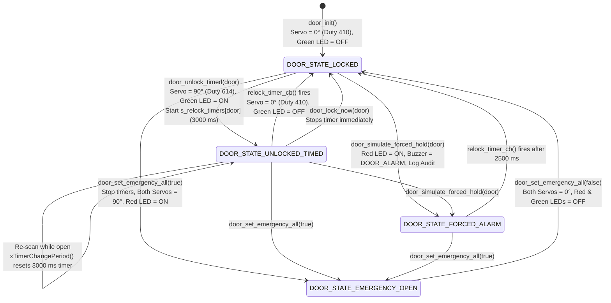

# Module Documentation: Dual Entry/Exit Servo Door Actuator & Alarm Controller (`door`)

**Files Documented:**
- Header: `main/include/door.h` (Lines 1–36)
- Implementation: `main/src/door.c` (Lines 1–209)
- Related Pin/System Configuration: `main/include/board_pins.h`, `main/include/config.h`

---

## 1. Purpose & Architectural Role

In the **CoCIS Smart Control and Monitoring System**, the `door` module is the **Physical Access Actuator and Door State Manager** for the two motorized turnstile/door barriers at the CoCIS Main Entrance:
- **Entry Door (`DOOR_ID_ENTRY` = 0):** Driven by a 50 Hz PWM Servo on **GPIO 13 (`PIN_SERVO_ENTRY`)** and paired with a green status LED on **GPIO 2 (`PIN_LED_ENTRY`)**.
- **Exit Door (`DOOR_ID_EXIT` = 1):** Driven by a 50 Hz PWM Servo on **GPIO 12 (`PIN_SERVO_EXIT`)** and paired with a green status LED on **GPIO 4 (`PIN_LED_EXIT`)**.
- **Deny / Forced-Alarm Indicator:** A shared red status LED on **GPIO 15 (`PIN_LED_ALARM`)**, coordinated with the piezo buzzer (`buzzer.c`) and tamper-evident audit logger (`logger.c`).

### Responsibilities
1. **Motorized Barrier Actuation via ESP32 LEDC PWM:** Generates precise 50 Hz (20 ms period) servo control pulses using 13-bit duty resolution (`8192` steps) to position each door at either **0° Closed/Locked** (`1.0 ms` pulse, duty `410`) or **90° Open/Unlocked** (`1.5 ms` pulse, duty `614`).
2. **Non-Blocking Auto-Relock via FreeRTOS Software Timers:** When `door_unlock_timed()` is called upon an authorized RFID scan, the door swings open to 90°, lights its green LED, and starts a one-shot FreeRTOS software timer (`s_relock_timers[door]`, default `3000 ms` from `cfg.door_open_ms`). When the timer expires, `relock_timer_cb()` automatically returns the servo to 0° and turns off the green LED without blocking any task.
3. **Emergency Evacuation Latching Override:** When fire evacuation mode is triggered (`door_set_emergency_all(true)`), both Entry and Exit auto-relock timers are stopped, both doors are latched open at 90° in state `DOOR_STATE_EMERGENCY_OPEN`, the red alarm LED is illuminated continuously, and the emergency siren pattern is played.
4. **Tailgate / Forced-Open / Held-Open Alarm Simulation:** Provides `door_simulate_forced_hold()` to handle forced or propped-open door events (`DOOR_STATE_FORCED_ALARM`), incrementing `forced_alarm_count`, sounding `BUZZER_PAT_DOOR_ALARM`, illuminating `PIN_LED_ALARM`, and recording a hash-chained `TAILGATE_FORCED_ALARM` audit log entry.

### Architectural Data & State Flow (Mermaid Diagram)



---

## 2. Public API Reference (`main/include/door.h`)

### 2.1 Enumerations

#### `door_id_t` (Lines 8–12)
```c
typedef enum {
    DOOR_ID_ENTRY = 0,
    DOOR_ID_EXIT = 1,
    DOOR_ID_COUNT = 2
} door_id_t;
```
- **Purpose:** Identifies which physical door actuator is being addressed, and provides `DOOR_ID_COUNT` (`2`) for sizing internal arrays (`s_doors[DOOR_ID_COUNT]`, `s_relock_timers[DOOR_ID_COUNT]`).

#### `door_state_t` (Lines 14–19)
```c
typedef enum {
    DOOR_STATE_LOCKED = 0,
    DOOR_STATE_UNLOCKED_TIMED,
    DOOR_STATE_EMERGENCY_OPEN,
    DOOR_STATE_FORCED_ALARM
} door_state_t;
```
- **Purpose:** Tracks the current operational state of a door (`LOCKED`, `UNLOCKED_TIMED` during a granted scan window, `EMERGENCY_OPEN` during fire evacuation, or `FORCED_ALARM` during a tailgate/forced-hold event).

---

### 2.2 Structures

#### `door_status_t` (Lines 21–25)
```c
typedef struct {
    door_state_t state;
    uint32_t     open_count;
    uint32_t     forced_alarm_count;
} door_status_t;
```
- **Purpose:** Snapshot of a door's current state and cumulative telemetry counters.
- **Fields:**
  - `state`: Current `door_state_t` of the door.
  - `open_count`: Total number of times `door_unlock_timed()` has been called for this door since boot.
  - `forced_alarm_count`: Total number of forced/held-open tailgate alarms triggered on this door since boot.

---

### 2.3 Public Functions

| Function Prototype | Parameters & Return Value | Side Effects | Caller & Task Context | Blocking? |
| :--- | :--- | :--- | :--- | :--- |
| **`esp_err_t door_init(void)`** (Line 27) | **Params:** None.<br/>**Returns:** `ESP_OK` on success, or LEDC driver error code. | Configures `LEDC_TIMER_0` at 50 Hz (13-bit), configures `LEDC_CHANNEL_0` (GPIO 13) and `LEDC_CHANNEL_1` (GPIO 12) at 0° (`duty = 410`), zeroes `s_doors[]`, creates 2 one-shot relock timers and 1 alarm LED timer. | Called once by `app_main()` (`main.c:50`) in `main` task context. | Non-blocking. |
| **`esp_err_t door_unlock_timed(door_id_t door)`** (Line 28) | **Params:** `door` (`DOOR_ID_ENTRY` or `DOOR_ID_EXIT`).<br/>**Returns:** `ESP_OK` or `ESP_ERR_INVALID_ARG`. | Reads `cfg.door_open_ms` via `config_get()`, increments `open_count`, sets state to `DOOR_STATE_UNLOCKED_TIMED` (unless in `EMERGENCY_OPEN`), rotates servo to 90° (`duty = 614`), turns ON green LED, and starts/resets `s_relock_timers[door]`. | Called by `process_scan_event()` in `access_control.c:140, 144` (`access_task` or `cli_task`). | Non-blocking (`0` tick wait on timer command queue). |
| **`esp_err_t door_lock_now(door_id_t door)`** (Line 29) | **Params:** `door` (`DOOR_ID_ENTRY` or `DOOR_ID_EXIT`).<br/>**Returns:** `ESP_OK` or `ESP_ERR_INVALID_ARG`. | Stops `s_relock_timers[door]`, sets state to `DOOR_STATE_LOCKED`, sets servo to 0° (`duty = 410`), turns OFF green LED. | Available for immediate lockdown override from upper layers. | Non-blocking. |
| **`esp_err_t door_set_emergency_all(bool emergency_open)`** (Line 30) | **Params:** `emergency_open` (`true` to latch open, `false` to relock all).<br/>**Returns:** `ESP_OK`. | Stops both relock timers, sets both doors to `DOOR_STATE_EMERGENCY_OPEN` (90°, green LEDs ON) or `DOOR_STATE_LOCKED` (0°, green LEDs OFF), sets `PIN_LED_ALARM` to `1` or `0`, and plays `BUZZER_PAT_EMERGENCY` if `true`. | Called by `access_control.c` (emergency button & evac exit), `cli.c` (`emergency on\|off` and `selftest`). | Non-blocking. |
| **`esp_err_t door_trigger_deny_indicator(void)`** (Line 31) | **Params:** None.<br/>**Returns:** `ESP_OK`. | Turns ON red `PIN_LED_ALARM` (GPIO 15) and starts `s_alarm_led_timer` (`1200 ms` one-shot) to auto-extinguish the red LED. | Called by `process_scan_event()` in `access_control.c` on every access denial. | Non-blocking. |
| **`esp_err_t door_simulate_forced_hold(door_id_t door)`** (Line 32) | **Params:** `door` (`DOOR_ID_ENTRY` or `DOOR_ID_EXIT`).<br/>**Returns:** `ESP_OK` or `ESP_ERR_INVALID_ARG`. | Sets state to `DOOR_STATE_FORCED_ALARM`, increments `forced_alarm_count`, lights `PIN_LED_ALARM`, plays `BUZZER_PAT_DOOR_ALARM`, logs `"TAILGATE_FORCED_ALARM"` to audit log, starts `2500 ms` recovery timer. | Called by `cmd_sim()` in `cli.c:739` (`sim door_hold <entry\|exit>`). | Non-blocking. |
| **`esp_err_t door_get_status(door_id_t door, door_status_t *out_status)`** (Line 33) | **Params:** `door`, non-null `out_status` pointer.<br/>**Returns:** `ESP_OK` or `ESP_ERR_INVALID_ARG`. | Copies `s_doors[door]` into `*out_status`. | Called by `cmd_status()` in `cli.c:100-101` and `display.c` LCD refresh loop. | Non-blocking. |
| **`const char *door_state_to_str(door_state_t state)`** (Line 34) | **Params:** `state`.<br/>**Returns:** Pointer to static string literal (`"LOCKED (Closed)"`, etc.). | None (pure function). | Called by `cmd_status()` in `cli.c:140`. | Non-blocking. |

---

## 3. Line-by-Line / Block-by-Block Code Walkthrough (`main/src/door.c`)

### 3.1 Includes, Servo Duty Constants & Module State (Lines 1–24)
```c
#include "door.h"
#include "board_pins.h"
#include "buzzer.h"
#include "config.h"
#include "driver/gpio.h"
#include "driver/ledc.h"
#include "esp_log.h"
#include "freertos/FreeRTOS.h"
#include "freertos/timers.h"
#include "logger.h"

static const char *TAG = "DOOR";

/* 50 Hz servo (20 ms period) with 13-bit duty (8192 steps):
 * 0 deg (~1.0 ms pulse) = 8192 * (1.0 / 20.0) = 410
 * 90 deg (~1.5 ms pulse) = 8192 * (1.5 / 20.0) = 614
 */
#define SERVO_DUTY_CLOSED_0DEG   410
#define SERVO_DUTY_OPEN_90DEG    614

static door_status_t s_doors[DOOR_ID_COUNT];
static TimerHandle_t s_relock_timers[DOOR_ID_COUNT] = { NULL, NULL };
static TimerHandle_t s_alarm_led_timer = NULL;
```
- **Lines 14–19 (`SERVO_DUTY_CLOSED_0DEG` and `SERVO_DUTY_OPEN_90DEG`):** Defines the exact 13-bit LEDC PWM duty counts for 0° (`410`) and 90° (`614`) at 50 Hz. (Full mathematical derivation in Section 5 below.)
- **Line 21 (`s_doors`):** Private array holding the live `door_status_t` for `DOOR_ID_ENTRY` (`0`) and `DOOR_ID_EXIT` (`1`).
- **Lines 22–23 (`s_relock_timers`, `s_alarm_led_timer`):** FreeRTOS software timer handles for the two independent door auto-relock timers and the red alarm LED auto-off timer.

---

### 3.2 Hardware Helper: `apply_servo_and_led()` (Lines 25–34)
```c
static void apply_servo_and_led(door_id_t door, bool open)
{
    ledc_channel_t ch = (door == DOOR_ID_ENTRY) ? BOARD_LEDC_CH_ENTRY_SRV : BOARD_LEDC_CH_EXIT_SRV;
    gpio_num_t led_pin = (door == DOOR_ID_ENTRY) ? PIN_LED_ENTRY : PIN_LED_EXIT;
    uint32_t duty = open ? SERVO_DUTY_OPEN_90DEG : SERVO_DUTY_CLOSED_0DEG;

    ledc_set_duty(BOARD_LEDC_SPEED_MODE, ch, duty);
    ledc_update_duty(BOARD_LEDC_SPEED_MODE, ch);
    gpio_set_level(led_pin, open ? 1 : 0);
}
```
- **Lines 27–29:** Uses the C ternary operator (`? :`) to select the correct LEDC channel (`LEDC_CHANNEL_0` for Entry, `LEDC_CHANNEL_1` for Exit), the corresponding green status LED (`GPIO_NUM_2` for Entry, `GPIO_NUM_4` for Exit), and the PWM duty (`614` if `open == true`, `410` if `open == false`).
- **Lines 31–32:** `ledc_set_duty()` writes the new duty value into a staging register; `ledc_update_duty()` latches that value into the active hardware PWM comparator for the next PWM cycle. Both calls are required in ESP-IDF!
- **Line 33:** Sets the green door indicator LED HIGH (`1`) when open and LOW (`0`) when locked.

---

### 3.3 Software Timer Callbacks: `relock_timer_cb()` & `alarm_led_timer_cb()` (Lines 36–55)
```c
static void relock_timer_cb(TimerHandle_t xTimer)
{
    intptr_t idx = (intptr_t)pvTimerGetTimerID(xTimer);
    if (idx >= 0 && idx < DOOR_ID_COUNT) {
        if (s_doors[idx].state != DOOR_STATE_EMERGENCY_OPEN) {
            s_doors[idx].state = DOOR_STATE_LOCKED;
            apply_servo_and_led((door_id_t)idx, false);
            ESP_LOGI(TAG, "%s door auto-locked", (idx == DOOR_ID_ENTRY) ? "ENTRY" : "EXIT");
        }
    }
}

static void alarm_led_timer_cb(TimerHandle_t xTimer)
{
    (void)xTimer;
    if (s_doors[DOOR_ID_ENTRY].state != DOOR_STATE_EMERGENCY_OPEN &&
        s_doors[DOOR_ID_EXIT].state != DOOR_STATE_EMERGENCY_OPEN) {
        gpio_set_level(PIN_LED_ALARM, 0);
    }
}
```
- **Lines 36–46 (`relock_timer_cb`):** Executed by the FreeRTOS Timer Daemon Task (`Tmr Svc`) when either door's open duration expires:
  - Retrieves which door (`0` = Entry, `1` = Exit) owns the expired timer via `pvTimerGetTimerID(xTimer)`.
  - Checks `if (s_doors[idx].state != DOOR_STATE_EMERGENCY_OPEN)` as a safety guard so a timer callback can **never** accidentally lock a door during an active fire evacuation!
  - Sets `s_doors[idx].state = DOOR_STATE_LOCKED`, moves the servo back to 0° and turns off the green LED via `apply_servo_and_led((door_id_t)idx, false)`, and logs `"ENTRY door auto-locked"` or `"EXIT door auto-locked"`.
- **Lines 48–55 (`alarm_led_timer_cb`):** Executed 1200 ms after a denied scan or forced-door alarm to turn off `PIN_LED_ALARM` (GPIO 15), provided the building is not in `DOOR_STATE_EMERGENCY_OPEN` (during which `PIN_LED_ALARM` must remain solid ON).

---

### 3.4 Initialization: `door_init()` (Lines 57–104)
```c
esp_err_t door_init(void)
{
    ledc_timer_config_t tcfg = {
        .speed_mode = BOARD_LEDC_SPEED_MODE,
        .duty_resolution = LEDC_TIMER_13_BIT,
        .timer_num = BOARD_LEDC_SERVO_TIMER,
        .freq_hz = 50,
        .clk_cfg = LEDC_AUTO_CLK
    };
    esp_err_t err = ledc_timer_config(&tcfg);
    if (err != ESP_OK) {
        return err;
    }

    const gpio_num_t pins[DOOR_ID_COUNT] = { PIN_SERVO_ENTRY, PIN_SERVO_EXIT };
    const ledc_channel_t chs[DOOR_ID_COUNT] = { BOARD_LEDC_CH_ENTRY_SRV, BOARD_LEDC_CH_EXIT_SRV };

    for (int i = 0; i < DOOR_ID_COUNT; i++) {
        ledc_channel_config_t ccfg = {
            .gpio_num = pins[i],
            .speed_mode = BOARD_LEDC_SPEED_MODE,
            .channel = chs[i],
            .intr_type = LEDC_INTR_DISABLE,
            .timer_sel = BOARD_LEDC_SERVO_TIMER,
            .duty = SERVO_DUTY_CLOSED_0DEG,
            .hpoint = 0
        };
        err = ledc_channel_config(&ccfg);
        if (err != ESP_OK) {
            return err;
        }
        s_doors[i].state = DOOR_STATE_LOCKED;
        s_doors[i].open_count = 0;
        s_doors[i].forced_alarm_count = 0;
        apply_servo_and_led((door_id_t)i, false);

        s_relock_timers[i] = xTimerCreate("door_tmr",
                                          pdMS_TO_TICKS(CFG_DOOR_OPEN_DURATION_MS),
                                          pdFALSE,
                                          (void *)(intptr_t)i,
                                          relock_timer_cb);
    }

    s_alarm_led_timer = xTimerCreate("alm_led", pdMS_TO_TICKS(1200), pdFALSE, NULL, alarm_led_timer_cb);
    ESP_LOGI(TAG, "Entry (GPIO %d) and Exit (GPIO %d) servo door actuators initialized",
             (int)PIN_SERVO_ENTRY, (int)PIN_SERVO_EXIT);
    return ESP_OK;
}
```
- **Lines 59–69:** Configures `BOARD_LEDC_SERVO_TIMER` (`LEDC_TIMER_0`) in `LEDC_LOW_SPEED_MODE` with 13-bit duty resolution (`LEDC_TIMER_13_BIT` = 8192 steps) at `50 Hz`. Notice `LEDC_TIMER_0` is shared by both servos because both servos run at the exact same 50 Hz frequency (whereas the buzzer uses `LEDC_TIMER_1` because it changes frequency dynamically!).
- **Lines 71–98:** Loops over `i = 0` (`DOOR_ID_ENTRY`, GPIO 13, `LEDC_CHANNEL_0`) and `i = 1` (`DOOR_ID_EXIT`, GPIO 12, `LEDC_CHANNEL_1`):
  - Binds each channel to `LEDC_TIMER_0` with initial duty `SERVO_DUTY_CLOSED_0DEG` (`410`).
  - Initializes `s_doors[i]` state to `DOOR_STATE_LOCKED` and zeroes counters.
  - Calls `xTimerCreate()` with `uxAutoReload = pdFALSE` (one-shot timer) and passes `(void *)(intptr_t)i` as `pvTimerID` so `relock_timer_cb` knows which door to relock.
- **Line 100:** Creates the one-shot `1200 ms` `s_alarm_led_timer`.

---

### 3.5 Timed Unlock, Immediate Lock & Emergency Override (Lines 106–156)
```c
esp_err_t door_unlock_timed(door_id_t door)
{
    if (door < 0 || door >= DOOR_ID_COUNT) {
        return ESP_ERR_INVALID_ARG;
    }

    sys_config_t cfg;
    config_get(&cfg);

    s_doors[door].open_count++;
    if (s_doors[door].state != DOOR_STATE_EMERGENCY_OPEN) {
        s_doors[door].state = DOOR_STATE_UNLOCKED_TIMED;
    }
    apply_servo_and_led(door, true);

    if (s_relock_timers[door] != NULL) {
        xTimerChangePeriod(s_relock_timers[door], pdMS_TO_TICKS(cfg.door_open_ms), 0);
        xTimerStart(s_relock_timers[door], 0);
    }
    return ESP_OK;
}
```
- **Lines 108–110:** Validates `door` index (`0` or `1`).
- **Lines 112–113:** Fetches the runtime configuration `cfg.door_open_ms` (default `3000 ms`) from `config_get()`.
- **Lines 115–119:** Increments `open_count`, transitions state to `DOOR_STATE_UNLOCKED_TIMED` (unless already in `DOOR_STATE_EMERGENCY_OPEN`), and drives the servo to 90° and green LED ON.
- **Lines 121–124:** Updates the software timer period to `cfg.door_open_ms` via `xTimerChangePeriod()` and starts/restarts the countdown via `xTimerStart()`. Note that in FreeRTOS, calling `xTimerChangePeriod()` or `xTimerStart()` on an already-running timer **resets its countdown back to zero**, cleanly extending the open window if a second person scans while the door is still open!

```c
esp_err_t door_lock_now(door_id_t door)
{
    if (door < 0 || door >= DOOR_ID_COUNT) {
        return ESP_ERR_INVALID_ARG;
    }

    if (s_relock_timers[door] != NULL) {
        xTimerStop(s_relock_timers[door], 0);
    }
    s_doors[door].state = DOOR_STATE_LOCKED;
    apply_servo_and_led(door, false);
    return ESP_OK;
}

esp_err_t door_set_emergency_all(bool emergency_open)
{
    for (int i = 0; i < DOOR_ID_COUNT; i++) {
        if (s_relock_timers[i] != NULL) {
            xTimerStop(s_relock_timers[i], 0);
        }
        s_doors[i].state = emergency_open ? DOOR_STATE_EMERGENCY_OPEN : DOOR_STATE_LOCKED;
        apply_servo_and_led((door_id_t)i, emergency_open);
    }
    gpio_set_level(PIN_LED_ALARM, emergency_open ? 1 : 0);
    if (emergency_open) {
        buzzer_play(BUZZER_PAT_EMERGENCY);
    }
    return ESP_OK;
}
```
- **Lines 128–140 (`door_lock_now`):** Cancels any pending relock timer via `xTimerStop()` and immediately locks the specified door.
- **Lines 142–156 (`door_set_emergency_all`):** Loops over both doors, cancels their auto-relock timers so they cannot auto-close during an evacuation, sets both states to `DOOR_STATE_EMERGENCY_OPEN` (when `true`) or `DOOR_STATE_LOCKED` (when `false`), actuates both servos and green LEDs, sets the red alarm LED (`PIN_LED_ALARM`), and triggers `buzzer_play(BUZZER_PAT_EMERGENCY)` when entering emergency mode.

---

### 3.6 Deny Indicator, Forced-Hold Alarm & Status Helpers (Lines 158–209)
```c
esp_err_t door_trigger_deny_indicator(void)
{
    gpio_set_level(PIN_LED_ALARM, 1);
    if (s_alarm_led_timer != NULL) {
        xTimerStart(s_alarm_led_timer, 0);
    }
    return ESP_OK;
}

esp_err_t door_simulate_forced_hold(door_id_t door)
{
    if (door < 0 || door >= DOOR_ID_COUNT) {
        return ESP_ERR_INVALID_ARG;
    }

    s_doors[door].state = DOOR_STATE_FORCED_ALARM;
    s_doors[door].forced_alarm_count++;
    gpio_set_level(PIN_LED_ALARM, 1);
    buzzer_play(BUZZER_PAT_DOOR_ALARM);

    const char *dname = (door == DOOR_ID_ENTRY) ? "ENTRY_DOOR" : "EXIT_DOOR";
    logger_log_audit(dname, "TAILGATE_FORCED_ALARM", "Door held open / forced without valid scan");

    if (s_relock_timers[door] != NULL) {
        xTimerChangePeriod(s_relock_timers[door], pdMS_TO_TICKS(2500), 0);
        xTimerStart(s_relock_timers[door], 0);
    }
    if (s_alarm_led_timer != NULL) {
        xTimerStart(s_alarm_led_timer, 0);
    }
    return ESP_OK;
}

esp_err_t door_get_status(door_id_t door, door_status_t *out_status)
{
    if (door < 0 || door >= DOOR_ID_COUNT || out_status == NULL) {
        return ESP_ERR_INVALID_ARG;
    }
    *out_status = s_doors[door];
    return ESP_OK;
}

const char *door_state_to_str(door_state_t state)
{
    switch (state) {
        case DOOR_STATE_LOCKED:         return "LOCKED (Closed)";
        case DOOR_STATE_UNLOCKED_TIMED: return "OPEN (Granted)";
        case DOOR_STATE_EMERGENCY_OPEN: return "EMERGENCY UNLOCKED";
        case DOOR_STATE_FORCED_ALARM:   return "ALARM (Forced/Held)";
        default:                        return "UNKNOWN";
    }
}
```
- **`door_trigger_deny_indicator()` (Lines 158–165):** Drives `PIN_LED_ALARM` HIGH (`1`) and starts the `1200 ms` `s_alarm_led_timer` so the red LED flashes for 1.2 seconds on any denied RFID scan.
- **`door_simulate_forced_hold()` (Lines 167–189):** Transitions the door to `DOOR_STATE_FORCED_ALARM`, increments `forced_alarm_count`, turns on `PIN_LED_ALARM`, plays `BUZZER_PAT_DOOR_ALARM`, writes a tamper-evident SHA-256 audit log entry via `logger_log_audit()`, and schedules `s_relock_timers[door]` to clear the alarm state back to `DOOR_STATE_LOCKED` after `2500 ms`.
- **`door_get_status()` & `door_state_to_str()` (Lines 191–209):** Provide safe struct copy retrieval (`*out_status = s_doors[door]`) and human-readable state strings for the CLI `status` dashboard and LCD.

---

## 4. C Language Constructs Explained

| C Construct | Where Used in `door` | Detailed Explanation for Examiners |
| :--- | :--- | :--- |
| **`DOOR_ID_COUNT = 2` Enum Sentinel Pattern** | `door.h:11`, `door.c:21-22, 74` | Defining `DOOR_ID_COUNT` as the final entry in `door_id_t` (after `0` and `1`) automatically equals the number of doors (`2`). Using it for array declarations (`s_doors[DOOR_ID_COUNT]`), loop bounds (`i < DOOR_ID_COUNT`), and parameter validation (`door >= DOOR_ID_COUNT`) eliminates magic numbers. |
| **Ternary Operator (`condition ? expr_true : expr_false`)** | `door.c:27-29, 33, 43, 148, 151, 178` | Evaluates a boolean condition inline to select between two values (e.g., `open ? SERVO_DUTY_OPEN_90DEG : SERVO_DUTY_CLOSED_0DEG`), allowing variables like `ch`, `led_pin`, and `duty` to be initialized cleanly in a single statement. |
| **`(void *)(intptr_t)i` & `(intptr_t)pvTimerGetTimerID(xTimer)`** | `door.c:38, 96` | FreeRTOS software timers associate an arbitrary `void *` "Timer ID" with each timer instance. By casting the signed loop index `i` (`0` or `1`) through `intptr_t` (signed integer type with the exact bit-width of a pointer) to `void *`, both `s_relock_timers[0]` and `s_relock_timers[1]` share the single callback function `relock_timer_cb()`. |
| **Struct Assignment by Value (`*out_status = s_doors[door];`)** | `door.c:196` | In C, structs can be assigned directly with `=`, which copies all member fields (`state`, `open_count`, `forced_alarm_count`) into the caller's `door_status_t` variable without needing `memcpy()`. |
| **`switch` Statement with String Literal Return** | `door.c:200-209` | String literals like `"LOCKED (Closed)"` are stored in read-only flash memory (`.rodata` section) with static storage duration, meaning they live for the entire program execution. Returning `const char *` pointing to them is completely safe and requires zero heap or caller buffer allocation. |

---

## 5. ESP-IDF & FreeRTOS Constructs Explained

### 5.1 50 Hz Servo PWM Duty Cycle Mathematics (`410` vs `614` out of `8192`)
Standard hobby/industrial RC servos (such as the SG90 / MG996R modeled in Wokwi) expect a **50 Hz PWM signal**, which corresponds to a repetition period $T$:
$$T = \frac{1}{50\text{ Hz}} = 0.020\text{ s} = 20.0\text{ ms}$$
In `door_init()`, we configure `LEDC_TIMER_0` with a **13-bit duty resolution** (`LEDC_TIMER_13_BIT`):
$$N_{\text{steps}} = 2^{13} = 8192\text{ steps per } 20\text{ ms period}$$
For standard pulse-width modulation servo positioning:
- **0° (Closed / Locked Position)** requires a high pulse width $t_{\text{closed}} \approx 1.0\text{ ms}$:
  $$\text{Duty}_{0^\circ} = 8192 \times \frac{1.0\text{ ms}}{20.0\text{ ms}} = 8192 \times 0.05 = 409.6 \approx \mathbf{410}$$
- **90° (Open / Unlocked Position)** requires a high pulse width $t_{\text{open}} \approx 1.5\text{ ms}$:
  $$\text{Duty}_{90^\circ} = 8192 \times \frac{1.5\text{ ms}}{20.0\text{ ms}} = 8192 \times 0.075 = 614.4 \approx \mathbf{614}$$

Why 13-bit (`8192`) instead of 8-bit (`256`)? With 8-bit resolution, the entire `1.0 ms` to `2.0 ms` servo travel range spans only $256 \times 0.05 = 12.8$ steps (coarse, jerky movement). With 13-bit resolution, the `1.0 ms` to `2.0 ms` range spans $410$ steps, giving sub-quarter-degree angular precision while remaining supported by the ESP32 LEDC divider at 50 Hz.

### 5.2 ESP-IDF LEDC Driver (`ledc_timer_config_t` & `ledc_channel_config_t`)
- The ESP32 **LEDC (LED Control)** peripheral is a hardware PWM generator that runs autonomously in silicon once configured—zero CPU interrupts are needed to maintain the 50 Hz pulse train.
- **Timer vs. Channel Separation:**
  - `BOARD_LEDC_SERVO_TIMER` (`LEDC_TIMER_0`) sets the base frequency (`50 Hz`) and resolution (`13-bit`).
  - `BOARD_LEDC_CH_ENTRY_SRV` (`LEDC_CHANNEL_0` on GPIO 13) and `BOARD_LEDC_CH_EXIT_SRV` (`LEDC_CHANNEL_1` on GPIO 12) both attach to `LEDC_TIMER_0` (`.timer_sel = BOARD_LEDC_SERVO_TIMER`), allowing independent duty cycles (`410` or `614`) on each door while consuming only one hardware timer.
  - Meanwhile, `buzzer.c` uses `BOARD_LEDC_BUZZER_TIMER` (`LEDC_TIMER_1`) and `LEDC_CHANNEL_2` so changing buzzer audio frequencies (`380 Hz`–`2600 Hz`) never disturbs the `50 Hz` servo timer!

### 5.3 FreeRTOS Software Timers (`xTimerCreate`, `xTimerStart`, `xTimerChangePeriod`, `xTimerStop`, `pvTimerGetTimerID`)
- **`xTimerCreate("door_tmr", pdMS_TO_TICKS(CFG_DOOR_OPEN_DURATION_MS), pdFALSE, (void *)(intptr_t)i, relock_timer_cb)`:**
  - `pdFALSE` (`uxAutoReload`): Configures a **one-shot timer** (fires once after 3000 ms and stops, rather than firing repeatedly every 3000 ms).
  - `(void *)(intptr_t)i` (`pvTimerID`): Tags timer `0` with ID `0` (Entry) and timer `1` with ID `1` (Exit).
- **`xTimerChangePeriod()` & `xTimerStart()`:** Sends a command to the FreeRTOS Timer Service Task (`Tmr Svc`) queue to update the timer duration from `cfg.door_open_ms` and start/restart the countdown.
- **`xTimerStop()`:** Immediately disarms the timer so `relock_timer_cb()` will not fire (used in `door_lock_now()` and `door_set_emergency_all()`).

---

## 6. Alternatives & "What If You Change This?"

| What If You Change... | Alternative Option | What Happens / Why It Breaks or Changes Behavior |
| :--- | :--- | :--- |
| **FreeRTOS Software Timers $\rightarrow$ `vTaskDelay(3000)` inside `door_unlock_timed()`** | Sleeping for 3 seconds directly inside `door_unlock_timed()` before locking | **Severe Responsiveness Bug!** `door_unlock_timed()` is called by `access_task`. If `door_unlock_timed()` blocked for 3000 ms via `vTaskDelay()`, `access_task` would be frozen for 3 seconds after every valid entry! Nobody else could scan in at Entry or scan out at Exit during those 3 seconds. Software timers make `door_unlock_timed()` return in microseconds. |
| **FreeRTOS Software Timers $\rightarrow$ Two Dedicated Door Tasks (`entry_door_task`, `exit_door_task`)** | Creating two extra `xTaskCreate()` tasks just to sleep and relock doors | Wastes `2 × 2048 = 4096 bytes` of precious ESP32 RAM for two task stacks that sit idle 99.9% of the time. FreeRTOS software timers multiplex all timers onto the single shared kernel `Tmr Svc` daemon task. |
| **Servo PWM (`ledc`) $\rightarrow$ Simple Digital Relay (`gpio_set_level`)** | Driving a magnetic strike relay on/off instead of a 50 Hz servo | In Wokwi (`diagram.json`), the visual door barriers (`servo_entry`, `servo_exit`) are servo motors with green and blue horns that physically rotate from 0° to 90° on screen. Note that `apply_servo_and_led()` *already* drives both the PWM servo and a digital GPIO (`PIN_LED_ENTRY` / `PIN_LED_EXIT`), which can drive an opto-isolated magnetic lock relay in parallel! |
| **Sharing `LEDC_TIMER_0` between Servos and Buzzer** | Configuring `BOARD_LEDC_BUZZER_TIMER` to also be `LEDC_TIMER_0` | **Hardware Conflict Bug!** Whenever `buzzer.c` calls `ledc_set_freq(..., 2200)` to play the grant beep, it would change `LEDC_TIMER_0` from `50 Hz` to `2200 Hz`, corrupting the servo pulse period from `20 ms` to `0.45 ms` and causing the door servos to twitch or stall! Keeping servos on `LEDC_TIMER_0` and the buzzer on `LEDC_TIMER_1` isolates their frequencies completely. |

---

## 7. Design Rationale

1. **Zero-Task-Overhead Asynchronous Timing:**
   Using three one-shot FreeRTOS software timers (`s_relock_timers[0]`, `s_relock_timers[1]`, `s_alarm_led_timer`) gives the `door` module completely independent, concurrent timing for the Entry door, Exit door, and Alarm LED without allocating a single dedicated task stack in `door.c`.
2. **Dynamic Configuration Integration (`config_get`):**
   Instead of hardcoding `CFG_DOOR_OPEN_DURATION_MS` in `door_unlock_timed()`, line 113 reads `cfg.door_open_ms` from `config_get(&cfg)` and passes it to `xTimerChangePeriod()`. If an administrator updates the door hold time in NVS configuration, the very next scan immediately uses the new duration without rebooting.
3. **Defense-in-Depth Emergency Safety:**
   During a fire evacuation (`door_set_emergency_all(true)`), `door.c` both stops the relock timers (`xTimerStop()`) **and** checks `if (s_doors[idx].state != DOOR_STATE_EMERGENCY_OPEN)` inside `relock_timer_cb()` and `door_unlock_timed()`. Even if someone scans an RFID card at the Exit reader during an evacuation (which calls `occupancy_ledger_check_out`), the doors remain permanently latched in `DOOR_STATE_EMERGENCY_OPEN` until emergency mode is explicitly cleared.

---

## 8. Failure Modes, Edge Cases & Recovery

1. **Re-Scanning a Valid Card While the Door Is Already Open (`DOOR_STATE_UNLOCKED_TIMED`):**
   - *Scenario:* Student A scans in at $t = 0\text{ s}$ (door opens for 3.0 s). Student B scans in right behind them at $t = 2.0\text{ s}$.
   - *What Happens:* Without timer reset, the door would slam shut on Student B at $t = 3.0\text{ s}$ (only 1 second after Student B's scan!).
   - *Recovery:* `door_unlock_timed()` calls `xTimerChangePeriod()` and `xTimerStart()` on `s_relock_timers[DOOR_ID_ENTRY]`. In FreeRTOS, starting an already-active timer resets its expiry counter, smoothly extending the open window to $t = 2.0 + 3.0 = 5.0\text{ s}$.
2. **Emergency Evacuation Triggered While a Door Is Counting Down to Relock:**
   - *Scenario:* Entry door is unlocked with 1.5 seconds left on `s_relock_timers[0]`, and someone presses the yellow Emergency Evacuation button.
   - *Recovery:* `door_set_emergency_all(true)` immediately calls `xTimerStop(s_relock_timers[i], 0)` on both doors and sets `state = DOOR_STATE_EMERGENCY_OPEN`. Even if `relock_timer_cb()` had already been queued in the timer daemon right as the button was pressed, the guard `if (s_doors[idx].state != DOOR_STATE_EMERGENCY_OPEN)` on line 40 prevents the callback from relocking the door.
3. **Forced / Held-Open Door Tailgate Alarm (`door_simulate_forced_hold`):**
   - *Scenario:* An intruder forces a door or props it open beyond the authorized window.
   - *Recovery:* Sets `state = DOOR_STATE_FORCED_ALARM`, increments `forced_alarm_count`, lights the red alarm LED, plays the 4-cycle two-tone `BUZZER_PAT_DOOR_ALARM`, logs `"TAILGATE_FORCED_ALARM"` to the SHA-256 audit log, and schedules `s_relock_timers[door]` (2500 ms) to re-secure the door and return state to `DOOR_STATE_LOCKED`.
4. **Denied Scan During Active Emergency Evacuation:**
   - *Scenario:* During an evacuation (`PIN_LED_ALARM` is solid ON), an unknown tag is scanned, triggering `door_trigger_deny_indicator()`, which starts the 1200 ms `s_alarm_led_timer`.
   - *Recovery:* When `alarm_led_timer_cb()` fires 1200 ms later, lines 51–54 check whether either door is in `DOOR_STATE_EMERGENCY_OPEN`. Because they are, `alarm_led_timer_cb()` refuses to turn off `PIN_LED_ALARM`, preserving the continuous visual evacuation warning.

---

## 9. How to Test This Module in Isolation

### 9.1 Wokwi Visual Servo & LED Verification
1. **Boot State Check:**
   - Observe in Wokwi that both `servo_entry` (green horn, GPIO 13) and `servo_exit` (blue horn, GPIO 12) rest at **0°**, and `ENTRY DOOR` (green LED), `EXIT DOOR` (green LED), and `DENY / ALARM` (red LED) are all **OFF**.
2. **Timed Unlock & Auto-Relock (`SCAN ENTRY (VALID)` button or CLI):**
   ```text
   cocis> sim scan entry 04A1B2C3
   ```
   - Immediately run `status` within 3 seconds:
     ```text
     Main Entrance Doors: Entry=OPEN (Granted) | Exit=LOCKED (Closed)
     ```
   - Watch the green Entry servo rotate to **90°** and the green `ENTRY DOOR` LED light up.
   - Wait 3 seconds: the serial monitor prints:
     ```text
     I (xxx) DOOR: ENTRY door auto-locked
     ```
   - Run `status` again:
     ```text
     Main Entrance Doors: Entry=LOCKED (Closed) | Exit=LOCKED (Closed)
     ```
3. **Forced / Propped Door Alarm Simulation (`sim door_hold`):**
   ```text
   cocis> sim door_hold entry
   OK: Triggered forced/held-open tailgate alarm on ENTRY door.
   ```
   - Immediately run `status` (within 2.5 seconds):
     ```text
     Main Entrance Doors: Entry=ALARM (Forced/Held) | Exit=LOCKED (Closed)
     ```
   - Verify the audit log entry with `log 5`:
     ```text
     | 000x | 2026-10-24 08:3x:xx | ENTRY_DOOR | TAILGATE_FORCED_ALAR | Door held open / forced  |        0 | xxxxxxxx |
     ```
4. **Emergency Evacuation Latching Test:**
   - Click the yellow `EMERGENCY EVAC` button in Wokwi (or log in as admin `login admin Cocis@2026` and run `emergency on`).
   - Run `status`:
     ```text
     Emergency Mode     : !! ACTIVE - ALL DOORS UNLOCKED FOR EVACUATION !!
     Main Entrance Doors: Entry=EMERGENCY UNLOCKED | Exit=EMERGENCY UNLOCKED
     ```
   - Verify that both servos stay at 90° indefinitely (they do **not** relock after 3 seconds). Click `EMERGENCY EVAC` again (or `emergency off`) to return both doors to `LOCKED (Closed)`.

---

## 10. Likely Examiner Questions & Model Answers

### Q1: Show me the exact calculation for why `SERVO_DUTY_CLOSED_0DEG` is `410` and `SERVO_DUTY_OPEN_90DEG` is `614` on lines 18–19.
**Model Answer:**
In `door_init()`, we configure the LEDC timer at $f = 50\text{ Hz}$, which gives a period of $T = \frac{1}{50} = 20\text{ ms}$, and a 13-bit duty resolution (`LEDC_TIMER_13_BIT`), which divides each $20\text{ ms}$ period into $2^{13} = 8192$ discrete ticks.
- A standard hobby servo moves to **0° (Closed)** when given a $1.0\text{ ms}$ high pulse every $20\text{ ms}$:
  $$\text{Duty}_{0^\circ} = 8192 \times \frac{1.0\text{ ms}}{20.0\text{ ms}} = 409.6 \approx 410$$
- It moves to **90° (Open)** when given a $1.5\text{ ms}$ high pulse every $20\text{ ms}$:
  $$\text{Duty}_{90^\circ} = 8192 \times \frac{1.5\text{ ms}}{20.0\text{ ms}} = 614.4 \approx 614$$
(If we wanted 180°, a $2.0\text{ ms}$ pulse would be $8192 \times \frac{2.0}{20.0} = 819$.)

### Q2: Why must you call both `ledc_set_duty()` AND `ledc_update_duty()` in `apply_servo_and_led()` (lines 31–32)?
**Model Answer:**
In the ESP32 LEDC hardware architecture, duty cycle registers are **double-buffered** to prevent glitching the PWM waveform mid-period. `ledc_set_duty()` only writes the new duty value (`410` or `614`) into a shadow staging register in software/hardware. The hardware PWM comparator does not actually switch to the new pulse width until `ledc_update_duty()` sets the `LEDC_PARA_UP` latch bit, which loads the shadow register into the active comparator at the start of the next PWM cycle.

### Q3: Both servos share `BOARD_LEDC_SERVO_TIMER` (`LEDC_TIMER_0`), so how can the Entry door be open (`duty = 614`) while the Exit door is closed (`duty = 410`)?
**Model Answer:**
In the ESP32 LEDC peripheral, a **Timer** (`LEDC_TIMER_0`) only generates the base counter sawtooth wave—defining the **frequency** (`50 Hz`) and **bit resolution** (`13-bit`, counting `0` to `8191` every 20 ms). Each **Channel** (`LEDC_CHANNEL_0` for Entry on GPIO 13, `LEDC_CHANNEL_1` for Exit on GPIO 12) has its own independent hardware duty comparator register (`duty` and `hpoint`). Therefore, multiple channels can share one timer as long as they operate at the same frequency, while maintaining completely independent duty cycles.

### Q4: How does the single callback function `relock_timer_cb(TimerHandle_t xTimer)` know whether to lock the Entry door or the Exit door?
**Model Answer:**
When creating the two timers in `door_init()` (lines 93–97), we pass `(void *)(intptr_t)i` (where `i = 0` for `DOOR_ID_ENTRY` and `i = 1` for `DOOR_ID_EXIT`) as the 4th parameter (`pvTimerID`) of `xTimerCreate()`. Inside `relock_timer_cb(TimerHandle_t xTimer)` (line 38), we call `intptr_t idx = (intptr_t)pvTimerGetTimerID(xTimer);` to extract `0` or `1`, allowing one callback function to service both doors cleanly.

### Q5: What happens if a second student scans a valid RFID card at the Entry door 2 seconds after the first student scanned (while the door is still open)?
**Model Answer:**
`door_unlock_timed(DOOR_ID_ENTRY)` is called again. It increments `open_count`, keeps the servo at 90°, and calls `xTimerChangePeriod()` and `xTimerStart()` on `s_relock_timers[DOOR_ID_ENTRY]`. In FreeRTOS, calling `xTimerChangePeriod()` or `xTimerStart()` on a timer that is already running **resets the timer's countdown back to the full `cfg.door_open_ms` (3000 ms) from the moment of the second scan**. Thus, the door stays open for a full 3 seconds after the second student's scan instead of closing prematurely after 1 second.

### Q6: Why does `relock_timer_cb()` check `if (s_doors[idx].state != DOOR_STATE_EMERGENCY_OPEN)` on line 40 even though `door_set_emergency_all()` already calls `xTimerStop()`?
**Model Answer:**
FreeRTOS timer functions (`xTimerStop()`, `xTimerStart()`) work asynchronously by posting messages to the FreeRTOS Timer Command Queue, which is processed by the `Tmr Svc` daemon task. If a door relock timer expires at the exact millisecond that `door_set_emergency_all(true)` is called from another task, `relock_timer_cb()` might execute right before the `xTimerStop()` command is processed. Checking `state != DOOR_STATE_EMERGENCY_OPEN` inside `relock_timer_cb()` guarantees that under no race condition can a software timer ever re-lock a door during a fire evacuation.

### Q7: Which FreeRTOS task executes `relock_timer_cb()` and `alarm_led_timer_cb()`, and what rules must code inside a timer callback follow?
**Model Answer:**
All FreeRTOS software timer callbacks execute in the context of the kernel's **Timer Service / Daemon Task (`Tmr Svc`)**. Because all software timers in the entire firmware share this single task, a timer callback must **never block** (no `vTaskDelay()`, no blocking `xQueueReceive()`)—blocking inside one timer callback would freeze every other software timer in the system! In `door.c`, both `relock_timer_cb()` and `alarm_led_timer_cb()` only update struct state, call non-blocking GPIO/LEDC register writes, and return immediately.

### Q8: Why didn't `door_init()` call `gpio_config()` for `PIN_LED_ENTRY`, `PIN_LED_EXIT`, and `PIN_LED_ALARM`?
**Model Answer:**
Those three digital output LED pins (`GPIO_NUM_2`, `GPIO_NUM_4`, `GPIO_NUM_15`) were already configured as `GPIO_MODE_OUTPUT` and driven LOW (`0`) in Step 1 of system boot by `board_pins_init()` (`main/src/board_pins.c:8-30`). Centralizing all basic GPIO output initialization in `board_pins_init()` ensures that status LEDs are held in a known safe LOW state from the very first millisecond of boot before individual subsystem drivers start up.
