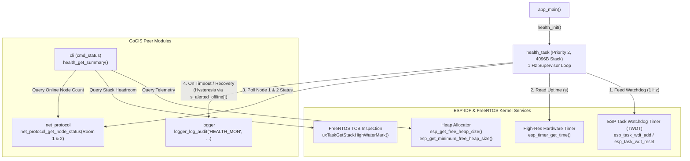

# Module Documentation: `health` — Task Watchdog & Distributed Node Heartbeat Monitor

**Files Covered:**
- Header: [`main/include/health.h`](../../include/health.h)
- Implementation: [`main/src/health.c`](../../src/health.c)

---

## 1. Purpose & Architectural Role

An unattended building security and automation controller must continuously self-diagnose both its **internal microcontroller resources** (CPU task responsiveness, dynamic heap memory, and FreeRTOS task stack headroom) and the **external distributed terminal links** (Lecture Room 1 and Lecture Room 2 heartbeats).

The `health` module fulfills this role through a dedicated background supervisor task (`health_task`, running every 1000 ms at priority 2) and an on-demand diagnostic API (`health_get_summary()`):
1. **Hardware Task Watchdog Timer (`TWDT`) Registration & Feeding:** `health_task` registers itself with the ESP-IDF Task Watchdog Timer (`esp_task_wdt_add(NULL)`) and resets ("pets/feeds") the watchdog (`esp_task_wdt_reset()`) once per second, incrementing `s_wdt_feeds`. If the system locks up or a higher-priority task starves the CPU indefinitely, the TWDT expires and triggers a panic/reset to recover the controller.
2. **Distributed Node Heartbeat Supervision with Hysteresis:** Every 1 second, `health_task` queries `net_protocol_get_node_status()` for Lecture Room 1 (`NODE_ID_ROOM_1`) and Lecture Room 2 (`NODE_ID_ROOM_2`). If a node's link goes offline (`!st.link_simulated_online`) or its last heartbeat timestamp exceeds `CFG_NODE_OFFLINE_THRESHOLD_SEC` (`15` seconds), `health_task` logs a tamper-evident `NODE_OFFLINE_ALERT` audit event to the SHA-256 chain and increments `s_node_alerts`. Using per-node state flags (`s_alerted_offline[]`), it suppresses repeated alert spam and logs a corresponding `NODE_RECOVERED` audit event when the node comes back online.
3. **Heap & Stack High-Water Mark Telemetry:** Provides live free heap (`esp_get_free_heap_size()`), lifetime minimum free heap (`esp_get_minimum_free_heap_size()`), and stack high-water mark (`uxTaskGetStackHighWaterMark()`) metrics to the CLI (`status`) and display subsystems.

### Architectural Diagram



---

## 2. Public API Reference (`include/health.h`)

### 2.1 Structures

#### `health_summary_t`
```c
typedef struct {
    uint32_t uptime_sec;
    uint32_t free_heap_bytes;
    uint32_t min_free_heap_bytes;
    uint32_t health_task_stack_hwm;
    uint8_t  online_nodes;
    uint32_t watchdog_feeds;
    uint32_t node_timeout_alerts;
} health_summary_t;
```
- **Fields:**
  - `uptime_sec`: System uptime in seconds since boot (`esp_timer_get_time() / 1000000LL`).
  - `free_heap_bytes`: Current available dynamic RAM in bytes across all data-capable heap regions.
  - `min_free_heap_bytes`: Lowest free heap byte count ever recorded since boot (the "all-time low" watermark for detecting memory leaks or peak allocation spikes).
  - `health_task_stack_hwm`: Minimum remaining unused stack space (high-water mark) of `health_task` since it started.
  - `online_nodes`: Count of currently online nodes (`1` to `3`, where Node 0 Entrance is always `1` plus up to `2` healthy Room nodes).
  - `watchdog_feeds`: Cumulative count of `esp_task_wdt_reset()` calls performed by `health_task`.
  - `node_timeout_alerts`: Cumulative count of `NODE_OFFLINE_ALERT` transitions detected since boot.

### 2.2 Functions

| Function Prototype | Parameters | Return Value | Side Effects | Callers & Task Context | Blocking Behavior |
|---|---|---|---|---|---|
| `esp_err_t health_init(void)` | `void` | `ESP_OK` on success; `ESP_ERR_NO_MEM` if `xTaskCreate` fails to allocate the 4096-byte task stack or TCB. | Spawns `health_task` at priority `2` and saves its handle in `s_health_task_handle`. | Called once in `app_main()` (`main.c` line 59) in `main` task context. | Non-blocking. |
| `esp_err_t health_get_summary(health_summary_t *out_summary)` | `out_summary`: Non-null pointer to caller's `health_summary_t` struct. | `ESP_OK` on success; `ESP_ERR_INVALID_ARG` if `out_summary == NULL`. | Queries uptime, node statuses (acquiring `LOCK_LEVEL_ROOM` briefly via `net_protocol_get_node_status`), free/min heap, and stack high-water mark, populating `*out_summary`. | Called by `cmd_status()` in `cli.c` (`cli_task`) and `display.c` (`display_task`). | Blocks briefly (up to `CFG_LOCK_TIMEOUT_MS` = 250 ms) inside `net_protocol_get_node_status()`. |

---

## 3. Line-by-Line / Block-by-Block Code Walkthrough (`src/health.c`)

### 3.1 Includes and Module-Private State (Lines 1–20)

```c
#include "health.h"
#include <stdio.h>
#include "config.h"
#include "esp_heap_caps.h"
#include "esp_log.h"
#include "esp_system.h"
#include "esp_task_wdt.h"
#include "esp_timer.h"
#include "freertos/FreeRTOS.h"
#include "freertos/task.h"
#include "logger.h"
#include "net_protocol.h"

static const char *TAG = "HEALTH";

static uint32_t     s_wdt_feeds = 0;
static uint32_t     s_node_alerts = 0;
static TaskHandle_t s_health_task_handle = NULL;
static bool         s_alerted_offline[NODE_ID_COUNT] = { false, false, false };
```
- **Lines 1–12:** Includes ESP-IDF system headers (`esp_heap_caps.h`, `esp_system.h`, `esp_task_wdt.h`, `esp_timer.h`), FreeRTOS task APIs, and CoCIS `config.h`, `logger.h`, and `net_protocol.h`.
- **Lines 16–19:**
  - `s_wdt_feeds`: Counts successful watchdog resets.
  - `s_node_alerts`: Counts how many times any room terminal has transitioned from online to offline/timed-out.
  - `s_health_task_handle`: Stores the `TaskHandle_t` created by `xTaskCreate()` so `health_get_summary()` can inspect its stack high-water mark.
  - `s_alerted_offline[NODE_ID_COUNT]`: Per-node boolean latch (`false` when online, `true` once an offline alert has been emitted) providing **edge-triggered hysteresis** so the audit log is not flooded every second while a node remains offline.

### 3.2 `health_task()` — Watchdog Feeder & Node Heartbeat Monitor (Lines 21–54)

```c
static void health_task(void *arg)
{
    (void)arg;
    bool wdt_registered = (esp_task_wdt_add(NULL) == ESP_OK);

    while (1) {
        if (wdt_registered) {
            esp_task_wdt_reset();
            s_wdt_feeds++;
        }

        int64_t now_s = esp_timer_get_time() / 1000000LL;
        for (int n = NODE_ID_ROOM_1; n <= NODE_ID_ROOM_2; n++) {
            node_net_status_t st;
            if (net_protocol_get_node_status((node_id_t)n, &st) == ESP_OK) {
                int64_t silent_sec = now_s - st.last_seen_uptime_sec;
                bool timed_out = (!st.link_simulated_online) || (silent_sec >= CFG_NODE_OFFLINE_THRESHOLD_SEC);
                if (timed_out && !s_alerted_offline[n]) {
                    s_alerted_offline[n] = true;
                    s_node_alerts++;
                    char detail[48];
                    snprintf(detail, sizeof(detail), "Node %d (%s) heartbeat lost", n, st.name);
                    logger_log_audit("HEALTH_MON", "NODE_OFFLINE_ALERT", detail);
                    ESP_LOGW(TAG, "%s", detail);
                } else if (!timed_out && s_alerted_offline[n]) {
                    s_alerted_offline[n] = false;
                    logger_log_audit("HEALTH_MON", "NODE_RECOVERED", st.name);
                }
            }
        }

        vTaskDelay(pdMS_TO_TICKS(1000));
    }
}
```
- **Line 24 (`esp_task_wdt_add(NULL)`):** Subscribes the currently running task (`NULL` means "self") to the ESP-IDF Task Watchdog Timer (TWDT). Storing the boolean result in `wdt_registered` ensures that even if the TWDT was not pre-initialized by the bootloader/sdkconfig, the task still runs its node-monitoring loop without error.
- **Lines 27–30:** Inside the infinite `while (1)` loop, if `wdt_registered` is true, calls `esp_task_wdt_reset()` to tell the hardware watchdog timer that `health_task` is alive and unblocked, and increments `s_wdt_feeds`.
- **Lines 32–50 (Distributed Node Supervision):**
  - Computes current uptime in seconds (`now_s`).
  - Loops `n` over the two remote terminals: `NODE_ID_ROOM_1` (`1`) and `NODE_ID_ROOM_2` (`2`).
  - Fetches the node's status snapshot `st` via `net_protocol_get_node_status()`.
  - Calculates `silent_sec = now_s - st.last_seen_uptime_sec` (how many seconds since the Coordinator last heard from node `n`).
  - Evaluates `timed_out`: `true` if either the link is explicitly marked offline (`!st.link_simulated_online`) **or** `silent_sec >= CFG_NODE_OFFLINE_THRESHOLD_SEC` (`15` seconds, which is $3 \times$ the 5-second heartbeat interval `CFG_PROTO_HEARTBEAT_SEC`).
  - **Rising-Edge Offline Alert (Lines 38–44):** If `timed_out` is true and we have *not* yet alerted (`!s_alerted_offline[n]`), sets `s_alerted_offline[n] = true`, increments `s_node_alerts`, formats `"Node X (Lecture Room X) heartbeat lost"`, writes a tamper-evident audit entry via `logger_log_audit("HEALTH_MON", "NODE_OFFLINE_ALERT", detail)`, and prints a warning to the console.
  - **Falling-Edge Recovery Notice (Lines 45–48):** If `!timed_out` and the node was previously in the alerted state (`s_alerted_offline[n] == true`), clears `s_alerted_offline[n] = false` and logs `logger_log_audit("HEALTH_MON", "NODE_RECOVERED", st.name)`.
- **Line 52:** Sleeps for `1000` ms (`1` second) via `vTaskDelay(pdMS_TO_TICKS(1000))`, yielding the CPU to other tasks.

### 3.3 `health_init()` and `health_get_summary()` (Lines 56–91)

```c
esp_err_t health_init(void)
{
    if (xTaskCreate(health_task, "health_task", 4096, NULL, 2, &s_health_task_handle) != pdPASS) {
        return ESP_ERR_NO_MEM;
    }
    ESP_LOGI(TAG, "Task watchdog and distributed node heartbeat monitor started");
    return ESP_OK;
}

esp_err_t health_get_summary(health_summary_t *out_summary)
{
    if (out_summary == NULL) {
        return ESP_ERR_INVALID_ARG;
    }

    int64_t now_s = esp_timer_get_time() / 1000000LL;
    uint8_t online = 1; /* Entrance node */
    for (int n = NODE_ID_ROOM_1; n <= NODE_ID_ROOM_2; n++) {
        node_net_status_t st;
        if (net_protocol_get_node_status((node_id_t)n, &st) == ESP_OK) {
            if (st.link_simulated_online && (now_s - st.last_seen_uptime_sec) < CFG_NODE_OFFLINE_THRESHOLD_SEC) {
                online++;
            }
        }
    }

    out_summary->uptime_sec = (uint32_t)now_s;
    out_summary->free_heap_bytes = esp_get_free_heap_size();
    out_summary->min_free_heap_bytes = esp_get_minimum_free_heap_size();
    out_summary->health_task_stack_hwm = (s_health_task_handle != NULL)
                                         ? (uint32_t)uxTaskGetStackHighWaterMark(s_health_task_handle) : 0;
    out_summary->online_nodes = online;
    out_summary->watchdog_feeds = s_wdt_feeds;
    out_summary->node_timeout_alerts = s_node_alerts;
    return ESP_OK;
}
```
- **`health_init()` (Lines 56–63):** Creates `health_task` with a 4096-byte stack at **priority 2** (deliberately lower than `rfid_task`, `proto_task` [5], and `cli_task` [4]—explained in Section 6 & 7!) and stores the created task handle in `&s_health_task_handle`.
- **`health_get_summary()` (Lines 65–91):**
  - Counts how many of the 3 nodes are online (starts at `online = 1` for the local Entrance Coordinator, and adds `1` for each Room node that is online and within the 15-second heartbeat window).
  - Queries ESP-IDF heap metrics (`esp_get_free_heap_size()`, `esp_get_minimum_free_heap_size()`) and `uxTaskGetStackHighWaterMark(s_health_task_handle)`.
  - Copies `s_wdt_feeds` and `s_node_alerts` into `out_summary`.

---

## 4. C Language Constructs Explained

1. **64-Bit Integer Literal Suffix (`1000000LL`):**
   `esp_timer_get_time()` returns an `int64_t` (signed 64-bit integer) representing microseconds since boot. Note that a 32-bit microsecond counter overflows after $2^{32}\ \mu\text{s} \approx 71.58\text{ minutes}$! Using `int64_t` and dividing by the `long long` literal `1000000LL` avoids 32-bit truncation and prevents timer wrap-around for over 292,000 years.
2. **State-Latch Hysteresis (`s_alerted_offline[n]`):**
   Lines 38–48 implement a classic **Schmitt-trigger / state-latch** pattern in C:
   - Transition `false -> true`: fires once when `timed_out` becomes `true`.
   - Transition `true -> false`: fires once when `timed_out` becomes `false`.
   Without `s_alerted_offline[n]`, `health_task` would write a new `NODE_OFFLINE_ALERT` record to the SD card every single second (`86,400` log entries per day!) while a room node is unplugged.
3. **Pass-by-Pointer Output Parameter (`&s_health_task_handle` and `health_summary_t *out_summary`):**
   Because C functions only have a single return value (used here for `esp_err_t` status codes), `xTaskCreate` writes the new task handle into `&s_health_task_handle` (a pointer to a `TaskHandle_t`, i.e., `TaskHandle_t *`), and `health_get_summary` writes the 7 diagnostic metrics into the caller-allocated struct `out_summary`.

---

## 5. ESP-IDF & FreeRTOS Constructs Explained

### 5.1 Task Watchdog Timer (`esp_task_wdt_add` & `esp_task_wdt_reset`)
A **Watchdog Timer (WDT)** is a hardware timer peripheral inside the ESP32 SoC that counts down independently of the CPU.
- **`esp_task_wdt_add(NULL)`:** Registers the calling FreeRTOS task (`NULL` = current task) with ESP-IDF's Task Watchdog Timer (TWDT). Once registered, the task promises to call `esp_task_wdt_reset()` before the TWDT timeout period (typically 5 seconds in `sdkconfig`) elapses.
- **`esp_task_wdt_reset()`:** Resets the task's watchdog timer counter back to zero ("feeding" or "petting" the dog).
- **What happens if a task hangs?** If a registered task enters an infinite loop without yielding, deadlocks on a resource, or is starved of CPU time by a runaway higher-priority task for longer than the TWDT timeout, the hardware timer expires, prints a backtrace showing the exact PC (Program Counter) and task name of every CPU core, and can automatically reboot the ESP32 so the building controller self-heals.

### 5.2 Heap Diagnostics (`esp_get_free_heap_size` & `esp_get_minimum_free_heap_size`)
- **`esp_get_free_heap_size()`:** Returns the total number of unallocated bytes currently available in DRAM across all `MALLOC_CAP_DEFAULT` heap regions.
- **`esp_get_minimum_free_heap_size()`:** Returns the **lowest** value that free heap has ever reached at any instant since boot.
- **Why do we need both?** Suppose a function allocates a huge 40 KB buffer and frees it 1 millisecond later. Calling `esp_get_free_heap_size()` later via the CLI will look completely normal, hiding the fact that the system came dangerously close to an Out-Of-Memory (`ENOMEM`) crash during that 1 ms spike! `esp_get_minimum_free_heap_size()` catches transient allocation spikes, while watching `esp_get_free_heap_size()` over hours detects gradual **memory leaks** (if free heap steadily decreases and never recovers).

### 5.3 Stack High-Water Mark (`uxTaskGetStackHighWaterMark`)
When `xTaskCreate()` allocates a task's stack (e.g., `4096` bytes for `health_task`), FreeRTOS fills the entire stack memory block with a known canary byte pattern (`0xA5`). As the task runs, calls nested functions, and allocates local stack variables, it overwrites those `0xA5` bytes from the top of the stack downward.
- **`uxTaskGetStackHighWaterMark(TaskHandle_t xTask)`** scans from the bottom of the stack upward to count how many bytes still contain the untouched `0xA5` pattern.
- This number is the **Stack High-Water Mark (HWM)**: the minimum amount of free stack space the task has ever had left since it started.
- If the HWM approaches `0`, the task is at risk of a **stack overflow** (corrupting adjacent heap/TCB memory). If the HWM is very large (e.g., 3,500 bytes unused out of 4,096), the developer knows the stack size can be safely reduced if RAM is tight.

---

## 6. Alternatives & "What If You Change This?"

| Aspect | Current Implementation in `health.c` | Alternative Approach | What Happens If You Change It? |
|---|---|---|---|
| **`health_task` Priority** | Low priority (`2`) | High priority (e.g., `10`, higher than `rfid_task`, `proto_task`, `cli_task`) | If `health_task` has the highest priority in the system, it will preempt a hung `proto_task` or `cli_task` every 1 second, feed the watchdog, and go back to sleep—**masking CPU starvation bugs** in medium-priority tasks! Running `health_task` at low priority (`2`) guarantees that if *any* higher-priority task (`3..9`) gets stuck in a tight `while(1)` loop without blocking, `health_task` is starved of CPU time and the TWDT catches the runaway task! |
| **Offline Threshold** | `CFG_NODE_OFFLINE_THRESHOLD_SEC = 15` s ($3 \times$ the 5 s heartbeat) | `5` s ($1 \times$ heartbeat) | Setting the timeout equal to a single heartbeat interval (`5` s) causes false-positive `NODE_OFFLINE_ALERT` alarms whenever a single heartbeat packet is delayed by a few milliseconds due to scheduling jitter or lock contention. Using $3 \times$ the heartbeat period (`15` s) tolerates up to 2 missed heartbeats before declaring a link dead. |
| **Alert Logging** | State-latched (`s_alerted_offline[n]`) | Unlatched (`if (timed_out) logger_log_audit(...)`) | Floods the RAM ring buffer and `/sdcard/audit.csv` with a new log line every 1 second while a node is offline, quickly rotating the 64 KB SD log file and wearing out the Flash/SD cells. |

---

## 7. Design Rationale

1. **Why Priority 2 for `health_task`?**
   In real-time systems engineering, a watchdog feeder task should run at one of the lowest application priorities (`2` in our system, where `cli_task` is `4` and `proto_task` is `5`). That way, feeding the watchdog proves not only that the hardware timer ISR works, but that the FreeRTOS scheduler is healthy and **no higher-priority application task is monopolizing the CPU**.
2. **Why Log Both `NODE_OFFLINE_ALERT` and `NODE_RECOVERED` to the Audit Chain?**
   For security compliance at Makerere University CoCIS, an attacker who physically cuts the power or network cable to Lecture Room 1 or 2 must leave an immutable forensic trail in `/sdcard/audit.csv` showing the exact second the terminal went dark and the exact second it recovered.

---

## 8. Failure Modes, Edge Cases & Recovery

1. **Task Hang / Infinite Loop in a Higher-Priority Task:**
   - *Cause:* A bug causes a priority 4+ task to spin without calling a blocking FreeRTOS API.
   - *Detection & Recovery:* `health_task` (priority 2) is starved of CPU time and cannot call `esp_task_wdt_reset()`. The ESP-IDF Task Watchdog Timer expires, logs the offending task's call stack, and resets the MCU to restore building access control.
2. **Remote Terminal Power Loss or Cable Cut:**
   - *Detection & Recovery:* Either `link_simulated_online` drops to `false` or `now_s - st.last_seen_uptime_sec` reaches `15` seconds (`CFG_NODE_OFFLINE_THRESHOLD_SEC`). Within 1 second, `health_task` sets `s_alerted_offline[n] = true`, increments `s_node_alerts`, logs `NODE_OFFLINE_ALERT` to the SHA-256 audit log, and updates `online_nodes` in `health_get_summary()` from `3/3` to `2/3`. When the node reconnects, `health_task` logs `NODE_RECOVERED` and restores `online_nodes` to `3/3`.
3. **TWDT Not Initialized by Bootloader/Config:**
   - *Recovery:* Line 24 checks `bool wdt_registered = (esp_task_wdt_add(NULL) == ESP_OK);` and only calls `esp_task_wdt_reset()` if registration succeeded, avoiding `ESP_ERR_INVALID_STATE` log spam.

---

## 9. How to Test This Module in Isolation

Connect to the UART0 CLI (`115200` baud) and run the following commands:

### Step 1: Verify Baseline Health, Free Heap, Uptime & Online Nodes
```text
cocis> status
```
**Expected Output Excerpt:**
```text
 Distributed Nodes  : 3/3 Nodes ONLINE | Wi-Fi=CONNECTED (10.13.37.2) | MQTT=ONLINE
 Admin CLI Session  : LOCKED (Guest) (Free Heap: 198432 B, Uptime: 25 s)
```

### Step 2: Simulate a Node Failure and Verify Watchdog Audit Alert
```text
cocis> sim node 1 offline
```
Wait **1 second** for `health_task` to run its next 1 Hz cycle:
**Expected Console Warning:**
```text
W (26410) HEALTH: Node 1 (Lecture Room 1) heartbeat lost
```
Now check `status` and `log 5`:
```text
cocis> status
cocis> log 5
```
**Expected Output:**
- `status` shows `Distributed Nodes : 2/3 Nodes ONLINE`.
- `log 5` shows an audit entry with `UID/Actor = HEALTH_MON`, `Action = NODE_OFFLINE_ALERT`, and `Detail = Node 1 (Lecture Room 1) heartbeat lost`, sealed with a SHA-256 chain hash.

### Step 3: Restore Node 1 and Verify Recovery Audit Log
```text
cocis> sim node 1 online
```
Wait **1 second**, then run:
```text
cocis> status
cocis> log 5
```
**Expected Output:**
- `status` shows `Distributed Nodes : 3/3 Nodes ONLINE`.
- `log 5` shows `UID/Actor = HEALTH_MON`, `Action = NODE_RECOVERED`, `Detail = Lecture Room 1`.

---

## 10. Likely Examiner Questions & Model Answers

### Q1: What do `esp_task_wdt_add(NULL)` and `esp_task_wdt_reset()` do, and why does `esp_task_wdt_add` pass `NULL`?
**Model Answer:** `esp_task_wdt_add(TaskHandle_t handle)` subscribes a FreeRTOS task to the ESP32 Task Watchdog Timer (TWDT); passing `NULL` tells FreeRTOS/ESP-IDF to register the **currently executing task** (`health_task`). Once registered, `health_task` must call `esp_task_wdt_reset()` periodically (every 1000 ms in our loop) to reset its watchdog countdown. If `health_task` fails to call `esp_task_wdt_reset()` before the TWDT timeout expires, the watchdog triggers a panic handler and resets the microcontroller.

### Q2: Why did you assign `health_task` a low priority (`2`) instead of a high priority (like `10`)?
**Model Answer:** If `health_task` ran at priority `10` (higher than `proto_task` at `5` and `cli_task` at `4`), then even if `proto_task` got stuck in an accidental infinite loop (`while(1){}`), `health_task` would preempt it for a few microseconds every second, feed the watchdog, and go back to sleep—so the watchdog would **never fire**! By placing `health_task` at low priority `2`, any higher-priority task that hangs without yielding will starve `health_task` of CPU time, preventing `esp_task_wdt_reset()` from running and ensuring the TWDT catches the hung task.

### Q3: Explain the difference between `esp_get_free_heap_size()` and `esp_get_minimum_free_heap_size()`.
**Model Answer:** `esp_get_free_heap_size()` returns the instantaneous number of free bytes in the heap right now, which goes up and down as memory is `malloc`'d and `free`'d. `esp_get_minimum_free_heap_size()` returns the **all-time lowest** free heap value recorded since the ESP32 booted. Comparing the two allows us to detect both gradual memory leaks (current free heap steadily dropping) and transient peak memory usage spikes (minimum free heap much lower than current free heap).

### Q4: How does `uxTaskGetStackHighWaterMark()` work internally in FreeRTOS?
**Model Answer:** When `xTaskCreate()` allocates a task's stack buffer, FreeRTOS fills every byte of that stack with `0xA5`. As the task executes and pushes stack frames, it overwrites the `0xA5` bytes starting from the high address downward toward the end of the stack. `uxTaskGetStackHighWaterMark()` walks from the end of the stack upward counting how many contiguous `0xA5` bytes remain untouched. That value represents the smallest amount of free stack space the task has ever had left since boot.

### Q5: Why do we need the `s_alerted_offline[NODE_ID_COUNT]` array in `health_task`?
**Model Answer:** `s_alerted_offline[]` provides **edge-triggered hysteresis**. `health_task` runs every 1 second. Without `s_alerted_offline[n]`, if Lecture Room 1 went offline for 1 hour, `timed_out` would be `true` on every iteration and `health_task` would log `3,600` identical `NODE_OFFLINE_ALERT` entries to the SD card! By latching `s_alerted_offline[n] = true` on the first detection, we log `NODE_OFFLINE_ALERT` **exactly once** when the node drops, and log `NODE_RECOVERED` **exactly once** when `!timed_out` becomes true again.

### Q6: Why is `CFG_NODE_OFFLINE_THRESHOLD_SEC` set to `15` seconds when `CFG_PROTO_HEARTBEAT_SEC` is `5` seconds?
**Model Answer:** In distributed systems, a timeout threshold should always be a multiple (typically $3\times$) of the heartbeat interval. If the threshold were `5` seconds (equal to 1 heartbeat period), even a 1 millisecond scheduling delay between `proto_task` and `health_task` would trigger a false-positive `NODE_OFFLINE_ALERT`. Setting the threshold to `15` seconds ($3 \times 5\text{ s}$) tolerates up to two delayed or lost heartbeat intervals before declaring a terminal offline.

### Q7: Why does `health_task` divide `esp_timer_get_time()` by `1000000LL` instead of using `xTaskGetTickCount()`?
**Model Answer:** `esp_timer_get_time()` reads the ESP32's 64-bit hardware microsecond timer, which has 1-microsecond accuracy and never wraps around (`int64_t` lasts >292,000 years). By contrast, `xTaskGetTickCount()` returns a 32-bit `TickType_t` (which wraps around every ~49.7 days at 1000 Hz) and has coarser tick resolution. Dividing `esp_timer_get_time()` by `1000000LL` matches the exact `uptime_sec()` timebase used by `net_protocol.c`.

### Q8: In `health_get_summary()`, why is `uint8_t online = 1;` initialized to `1` before the loop?
**Model Answer:** The CoCIS system has 3 logical nodes (`NODE_ID_COUNT = 3`): Node 0 (`NODE_ID_ENTRANCE`, the Entrance Coordinator running on this ESP32), Node 1 (`NODE_ID_ROOM_1`), and Node 2 (`NODE_ID_ROOM_2`). Because `health_get_summary()` is executing on the Entrance Coordinator itself, Node 0 is inherently online (`online = 1`), and the `for` loop checks the two remote terminals (`NODE_ID_ROOM_1` and `NODE_ID_ROOM_2`) to yield a total of `1`, `2`, or `3` online nodes.
