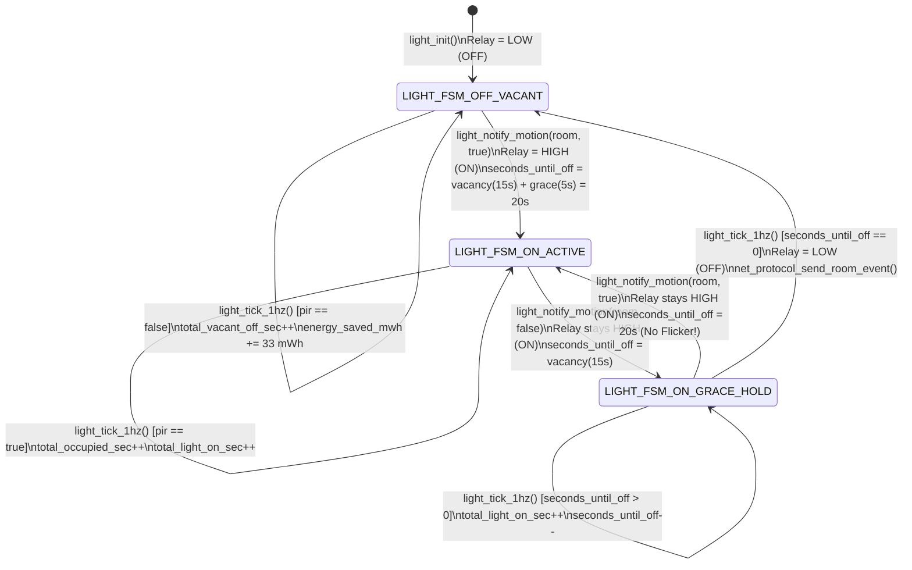
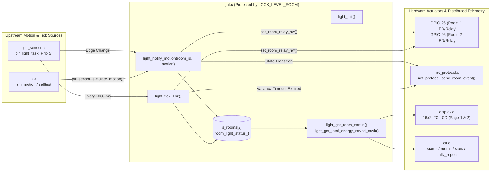

# Module Documentation: `light` (Lecture Room Automated Lighting 3-State FSM & Energy Accounting)

**Files Documented:**
- Header: [`main/include/light.h`](../../../include/light.h)
- Implementation: [`main/src/light.c`](../../../src/light.c)
- Related Pin/Config/Sync Headers: [`main/include/board_pins.h`](../../../include/board_pins.h), [`main/include/config.h`](../../../include/config.h), [`main/include/sync.h`](../../../include/sync.h), [`main/include/net_protocol.h`](../../../include/net_protocol.h)

---

## 1. Purpose & Architectural Role

The `light` module implements the **Automated Lecture Room Lighting Controller and Energy-Savings Accounting Engine** for **Lecture Room 1** (`GPIO_NUM_25`) and **Lecture Room 2** (`GPIO_NUM_26`) at CoCIS, Makerere University.

In university lecture buildings, lights are frequently left switched ON for hours after classes end, wasting electricity. However, a naive PIR-controlled light switch that turns OFF the instant the PIR sensor output drops `LOW` creates a frustrating classroom problem: when a lecturer stands relatively still writing on the whiteboard or students sit quietly taking an exam, the PIR sensor output briefly drops `LOW`.

To solve both problems cleanly, `light.c` implements a deterministic **3-State Finite State Machine (FSM)** per lecture room:
1. **`LIGHT_FSM_OFF_VACANT` (`0`):** Room is unoccupied and the lighting relay/LED is switched **OFF** (`LOW`). Every second spent in this state increments `total_vacant_off_sec` and accumulates electrical energy saved in milliwatt-hours (`energy_saved_mwh`, at `33 mWh/s` for a `120 W` fixture).
2. **`LIGHT_FSM_ON_ACTIVE` (`1`):** PIR sensor actively detects motion (`pir_motion_active == true`). The lighting relay/LED is immediately driven **ON** (`HIGH`), and the countdown timer is pre-loaded to `light_vacancy_sec + light_grace_sec` (`15 + 5 = 20 s`).
3. **`LIGHT_FSM_ON_GRACE_HOLD` (`2`):** The PIR sensor output has dropped `LOW` (`pir_motion_active == false`), but the lights remain **ON** (`HIGH`) during a configurable **grace & vacancy hold window** (`seconds_until_off = 15 s`, counting down at `1 Hz`). If motion resumes before `seconds_until_off` reaches `0`, the FSM seamlessly returns to `LIGHT_FSM_ON_ACTIVE` without any visible flicker. Only if `seconds_until_off` reaches `0` without re-triggering does the FSM switch the relay **OFF** and transition to `LIGHT_FSM_OFF_VACANT`.

### 3-State Lighting FSM & Architectural Data Flow Diagram



### System Integration Diagram



---

## 2. Public API Reference (`include/light.h`)

Below is the complete contents of [`main/include/light.h`](../../../include/light.h):

```c
#ifndef LIGHT_H
#define LIGHT_H

#include <stdbool.h>
#include <stdint.h>
#include "esp_err.h"

typedef enum {
    LIGHT_FSM_OFF_VACANT = 0,
    LIGHT_FSM_ON_ACTIVE = 1,
    LIGHT_FSM_ON_GRACE_HOLD = 2
} light_fsm_state_t;

typedef struct {
    uint8_t           room_id;
    bool              pir_motion_active;
    bool              relay_on;
    light_fsm_state_t fsm_state;
    uint32_t          seconds_until_off;
    uint32_t          total_light_on_sec;
    uint32_t          total_occupied_sec;
    uint32_t          total_vacant_off_sec;
    uint32_t          energy_saved_mwh;
    uint32_t          transition_count;
} room_light_status_t;

esp_err_t   light_init(void);
esp_err_t   light_notify_motion(uint8_t room_id, bool motion_detected);
void        light_tick_1hz(void);
esp_err_t   light_get_room_status(uint8_t room_id, room_light_status_t *out_status);
uint32_t    light_get_total_energy_saved_mwh(void);
const char *light_fsm_to_str(light_fsm_state_t state);

#endif
```

### Data Types Reference

#### 1. `light_fsm_state_t` (`enum`)
Represents the three discrete states of a lecture room's lighting controller:
- `LIGHT_FSM_OFF_VACANT = 0`: Room is vacant, relay is `LOW` (`OFF`), and energy savings are actively accumulating every second.
- `LIGHT_FSM_ON_ACTIVE = 1`: PIR motion is currently asserted (`HIGH`), relay is `HIGH` (`ON`), and timer is held at `vacancy + grace` (`20 s`).
- `LIGHT_FSM_ON_GRACE_HOLD = 2`: PIR motion has dropped `LOW`, relay remains `HIGH` (`ON`), and `seconds_until_off` is counting down from `15 s` to `0 s`.

#### 2. `room_light_status_t` (`struct`)
Snapshot structure holding the complete state and telemetry counters for one lecture room:
- `room_id` (`uint8_t`): `1` for Lecture Room 1, `2` for Lecture Room 2.
- `pir_motion_active` (`bool`): Current debounced PIR sensor state (`true` = motion active, `false` = idle).
- `relay_on` (`bool`): Current physical state of the room light relay GPIO (`true` = `HIGH`/ON, `false` = `LOW`/OFF).
- `fsm_state` (`light_fsm_state_t`): Current state in the 3-state lighting FSM.
- `seconds_until_off` (`uint32_t`): Remaining seconds before automatic shutoff when in `GRACE_HOLD` (or preloaded `20 s` while `ON_ACTIVE`).
- `total_light_on_sec` (`uint32_t`): Cumulative seconds the room's light relay has been energized since boot.
- `total_occupied_sec` (`uint32_t`): Cumulative seconds active motion was detected in the room since boot.
- `total_vacant_off_sec` (`uint32_t`): Cumulative seconds the light was automatically kept `OFF` due to vacancy.
- `energy_saved_mwh` (`uint32_t`): Cumulative electrical energy saved (in milliwatt-hours, `mWh`) while the room lights were automatically switched off.
- `transition_count` (`uint32_t`): Total number of FSM state or relay transitions since boot.

### Function Reference Table

| Function Signature | Parameters | Return Value | Side Effects | Who Calls It & Task Context | Blocking Behavior |
| :--- | :--- | :--- | :--- | :--- | :--- |
| `esp_err_t light_init(void)` | `void` (none) | `ESP_OK` on success; `ESP_ERR_TIMEOUT` if `LOCK_LEVEL_ROOM` cannot be acquired within `250 ms`. | Zero-initializes `s_rooms[0..1]`, sets both rooms to `LIGHT_FSM_OFF_VACANT`, drives `GPIO 25` and `GPIO 26` `LOW`, and logs initialization. | Called once by `app_main()` in [`main/main.c`](../../../main.c#L53) during boot (`main` task). | **Bounded blocking** up to `CFG_LOCK_TIMEOUT_MS` (`250 ms`) on `LOCK_LEVEL_ROOM`. |
| `esp_err_t light_notify_motion(uint8_t room_id, bool motion_detected)` | `room_id`: `1` or `2`.<br>`motion_detected`: `true` on motion start, `false` on motion end. | `ESP_OK` on success;<br>`ESP_ERR_INVALID_ARG` if `room_id` is not `1` or `2`;<br>`ESP_ERR_TIMEOUT` if mutex lock times out. | Updates room FSM state (`ON_ACTIVE` or `GRACE_HOLD`), drives GPIO relay `HIGH` if `motion_detected == true`, increments `transition_count`, logs transition, and sends `PROTO_MSG_ROOM_EVENT` via `net_protocol_send_room_event()`. | Called by `pir_light_task()` in [`pir_sensor.c`](../../../src/pir_sensor.c#L55) (priority 5) and `pir_sensor_simulate_motion()` in [`pir_sensor.c`](../../../src/pir_sensor.c#L111) (`cli_task`, priority 4). | **Bounded blocking** up to `250 ms` on `LOCK_LEVEL_ROOM` + up to `50 ms` queue send in `net_protocol_send_room_event()`. |
| `void light_tick_1hz(void)` | `void` (none) | `void` (none) | Advances 1-second counters (`total_occupied_sec`, `total_light_on_sec`, `total_vacant_off_sec`, `energy_saved_mwh`), decrements `seconds_until_off` in `GRACE_HOLD`, and switches the relay `OFF` + emits a room event when `seconds_until_off` reaches `0`. | Called once per second by `pir_light_task()` in [`pir_sensor.c`](../../../src/pir_sensor.c#L64) (priority 5) and 22 times in a loop during Test 8 of `run_selftest_suite()` in [`cli.c`](../../../src/cli.c#L645) (`cli_task`). | **Bounded blocking** up to `250 ms` per room on `LOCK_LEVEL_ROOM`. |
| `esp_err_t light_get_room_status(uint8_t room_id, room_light_status_t *out_status)` | `room_id`: `1` or `2`.<br>`out_status`: Non-null pointer to caller's `room_light_status_t` struct. | `ESP_OK` on success;<br>`ESP_ERR_INVALID_ARG` if `room_id` invalid or `out_status == NULL`;<br>`ESP_ERR_TIMEOUT` on lock timeout. | Copies a thread-safe snapshot of `s_rooms[room_id - 1]` into `*out_status`. | Called by `display_task()` in [`display.c`](../../../src/display.c#L102-L103) (Page 1) and by `cmd_status()`, `cmd_rooms()`, and `run_selftest_suite()` in [`cli.c`](../../../src/cli.c). | **Bounded blocking** up to `250 ms` on `LOCK_LEVEL_ROOM`. |
| `uint32_t light_get_total_energy_saved_mwh(void)` | `void` (none) | Sum of `energy_saved_mwh` across Lecture Rooms 1 and 2 (or `0` if mutex acquisition times out). | Acquires and releases `LOCK_LEVEL_ROOM`. | Called by `display_task()` in [`display.c`](../../../src/display.c#L112) (Page 2) and `cmd_stats()` in [`cli.c`](../../../src/cli.c#L284). | **Bounded blocking** up to `250 ms` on `LOCK_LEVEL_ROOM`. |
| `const char *light_fsm_to_str(light_fsm_state_t state)` | `state`: Any `light_fsm_state_t` enum value. | Pointer to static string literal: `"OFF_VACANT"`, `"ON_ACTIVE"`, `"GRACE_HOLD"`, or `"UNKNOWN"`. | None (pure function). | Called by `light_notify_motion()`, `coordinator_process_packet_unlocked()` in [`net_protocol.c`](../../../src/net_protocol.c#L175), and `cmd_status()`/`cmd_rooms()` in [`cli.c`](../../../src/cli.c). | **Non-blocking** (`O(1)` lookup). |

---

## 3. Line-by-Line / Block-by-Block Code Walkthrough (`src/light.c`)

### 3.1 Includes, Module State & Hardware Relay Helper (Lines 1–18)

```c
#include "light.h"
#include "board_pins.h"
#include "config.h"
#include "driver/gpio.h"
#include "esp_log.h"
#include "logger.h"
#include "net_protocol.h"
#include "sync.h"

static const char *TAG = "LIGHT";

static room_light_status_t s_rooms[CFG_ROOM_COUNT];

static void set_room_relay_hw(uint8_t room_id, bool on)
{
    gpio_num_t pin = (room_id == 1) ? PIN_LIGHT_ROOM1 : PIN_LIGHT_ROOM2;
    gpio_set_level(pin, on ? 1 : 0);
}
```

- **Lines 1–8:** Include module interfaces, GPIO definitions (`PIN_LIGHT_ROOM1 = GPIO_NUM_25`, `PIN_LIGHT_ROOM2 = GPIO_NUM_26`), runtime configuration (`config.h`), ESP-IDF GPIO driver, logger, distributed network protocol (`net_protocol.h`), and hierarchical lock manager (`sync.h`).
- **Line 12 (`s_rooms`):** File-scope static array of `CFG_ROOM_COUNT` (`2`) `room_light_status_t` structs. Index `0` stores Lecture Room 1; Index `1` stores Lecture Room 2. All reads and writes to `s_rooms` are serialized by `LOCK_LEVEL_ROOM` (`Lv 5` in `sync.h`).
- **Lines 14–18 (`set_room_relay_hw`):** Private helper that maps `room_id == 1` to `PIN_LIGHT_ROOM1` (`GPIO 25`) and `room_id == 2` to `PIN_LIGHT_ROOM2` (`GPIO 26`), then calls `gpio_set_level(pin, on ? 1 : 0)` to drive the physical LED/relay pin `HIGH` (`3.3V`) or `LOW` (`0V`).

---

### 3.2 Initialization: `light_init` (Lines 20–44)

```c
esp_err_t light_init(void)
{
    esp_err_t err = sync_lock(LOCK_LEVEL_ROOM, CFG_LOCK_TIMEOUT_MS);
    if (err != ESP_OK) {
        return err;
    }

    for (uint8_t i = 0; i < CFG_ROOM_COUNT; i++) {
        s_rooms[i].room_id = (uint8_t)(i + 1);
        s_rooms[i].pir_motion_active = false;
        s_rooms[i].relay_on = false;
        s_rooms[i].fsm_state = LIGHT_FSM_OFF_VACANT;
        s_rooms[i].seconds_until_off = 0;
        s_rooms[i].total_light_on_sec = 0;
        s_rooms[i].total_occupied_sec = 0;
        s_rooms[i].total_vacant_off_sec = 0;
        s_rooms[i].energy_saved_mwh = 0;
        s_rooms[i].transition_count = 0;
        set_room_relay_hw((uint8_t)(i + 1), false);
    }

    sync_unlock(LOCK_LEVEL_ROOM);
    ESP_LOGI(TAG, "Automated lighting FSM initialized for Lecture Rooms 1 & 2");
    return ESP_OK;
}
```

- **Lines 22–25:** Acquires `LOCK_LEVEL_ROOM` with a `250 ms` timeout before initializing `s_rooms`.
- **Lines 27–39:** Loops over both rooms (`i = 0` and `i = 1`), assigning 1-based `room_id = i + 1`, resetting all boolean flags, setting `fsm_state = LIGHT_FSM_OFF_VACANT`, clearing all cumulative time/energy counters to `0`, and ensuring both physical GPIO relay outputs are driven `LOW` (`OFF`) via `set_room_relay_hw()`.
- **Lines 41–43:** Releases `LOCK_LEVEL_ROOM`, logs startup confirmation, and returns `ESP_OK`.

---

### 3.3 Motion Event Handler: `light_notify_motion` (Lines 46–96)

```c
esp_err_t light_notify_motion(uint8_t room_id, bool motion_detected)
{
    if (room_id < 1 || room_id > CFG_ROOM_COUNT) {
        return ESP_ERR_INVALID_ARG;
    }

    sys_config_t cfg;
    config_get(&cfg);

    esp_err_t err = sync_lock(LOCK_LEVEL_ROOM, CFG_LOCK_TIMEOUT_MS);
    if (err != ESP_OK) {
        return err;
    }

    room_light_status_t *rm = &s_rooms[room_id - 1];
    bool prev_relay = rm->relay_on;
    light_fsm_state_t prev_fsm = rm->fsm_state;
    rm->pir_motion_active = motion_detected;

    if (motion_detected) {
        rm->fsm_state = LIGHT_FSM_ON_ACTIVE;
        rm->relay_on = true;
        rm->seconds_until_off = cfg.light_vacancy_sec + cfg.light_grace_sec;
        set_room_relay_hw(room_id, true);
    } else if (rm->relay_on) {
        rm->fsm_state = LIGHT_FSM_ON_GRACE_HOLD;
        rm->seconds_until_off = cfg.light_vacancy_sec;
    }

    bool state_changed = (prev_relay != rm->relay_on) || (prev_fsm != rm->fsm_state);
    if (state_changed) {
        rm->transition_count++;
    }

    room_light_status_t snap = *rm;
    sync_unlock(LOCK_LEVEL_ROOM);

    if (state_changed) {
        ESP_LOGI(TAG, "Lecture Room %u -> %s (Relay=%s, Timeout=%lu s)",
                 (unsigned)room_id,
                 light_fsm_to_str(snap.fsm_state),
                 snap.relay_on ? "ON" : "OFF",
                 (unsigned long)snap.seconds_until_off);
        net_protocol_send_room_event(room_id,
                                     snap.pir_motion_active,
                                     (uint8_t)snap.fsm_state,
                                     snap.total_light_on_sec,
                                     snap.energy_saved_mwh);
    }
    return ESP_OK;
}
```

- **Lines 48–50:** Validates `room_id` (`1` or `2`).
- **Lines 52–53:** Fetches the active system configuration (`cfg.light_vacancy_sec = 15`, `cfg.light_grace_sec = 5`) *before* acquiring `LOCK_LEVEL_ROOM`. Why before? Because `config_get()` acquires `LOCK_LEVEL_CONFIG` (`Lv 1`), and acquiring `Lv 1` outside `Lv 5` keeps lock hold times minimal and respects the lock hierarchy.
- **Lines 55–63:** Locks `LOCK_LEVEL_ROOM`, gets a pointer `rm = &s_rooms[room_id - 1]`, saves `prev_relay` and `prev_fsm` to detect transitions, and updates `rm->pir_motion_active = motion_detected`.
- **Lines 65–69 (`if (motion_detected)`):**
  - Whether the room was previously `OFF_VACANT` or `ON_GRACE_HOLD`, detecting motion immediately sets `rm->fsm_state = LIGHT_FSM_ON_ACTIVE`, `rm->relay_on = true`, preloads `rm->seconds_until_off = cfg.light_vacancy_sec + cfg.light_grace_sec` (`15 + 5 = 20 s`), and drives the physical relay `HIGH` (`set_room_relay_hw(room_id, true)`).
- **Lines 70–73 (`else if (rm->relay_on)`):**
  - When `motion_detected == false` (the PIR sensor pin dropped `LOW`) while the light is currently ON, the light is **not** switched off immediately. Instead, `rm->fsm_state` transitions to `LIGHT_FSM_ON_GRACE_HOLD` and `rm->seconds_until_off` is set to `cfg.light_vacancy_sec` (`15 s`).
- **Lines 75–81 (Snapshot & Unlock before I/O):**
  - Checks if `relay_on` or `fsm_state` changed; if so, increments `rm->transition_count`.
  - Copies `*rm` by value into the local stack variable `snap` (`room_light_status_t snap = *rm;`) and **immediately unlocks `LOCK_LEVEL_ROOM`** (`sync_unlock(LOCK_LEVEL_ROOM)`).
- **Lines 83–94:**
  - Outside the mutex, if `state_changed` is true, logs the transition via `ESP_LOGI` and transmits a distributed room telemetry packet to the Main Entrance Coordinator via `net_protocol_send_room_event()`. Because `net_protocol_send_room_event()` itself acquires `LOCK_LEVEL_ROOM` internally (in [`net_protocol.c`](../../../src/net_protocol.c#L260)), releasing `LOCK_LEVEL_ROOM` at Line 81 is **essential** to prevent a self-deadlock!

---

### 3.4 1 Hz Countdown & Energy Accounting Engine: `light_tick_1hz` (Lines 98–152)

```c
void light_tick_1hz(void)
{
    sys_config_t cfg;
    config_get(&cfg);

    /* Power saved per second of lights auto-switched OFF:
     * Watts * (1000 mW / W) / (3600 s / hr) = Watts * 1000 / 3600 mWh/s
     * For 120W fixture, 1 second off saves ~33 mWh.
     */
    uint32_t mwh_per_sec = (cfg.room_watts * 1000U) / 3600U;
    if (mwh_per_sec == 0) {
        mwh_per_sec = 33;
    }

    for (uint8_t i = 0; i < CFG_ROOM_COUNT; i++) {
        bool send_off_event = false;
        room_light_status_t snap = { 0 };

        if (sync_lock(LOCK_LEVEL_ROOM, CFG_LOCK_TIMEOUT_MS) == ESP_OK) {
            room_light_status_t *rm = &s_rooms[i];
            if (rm->pir_motion_active) {
                rm->total_occupied_sec++;
                rm->total_light_on_sec++;
                rm->seconds_until_off = cfg.light_vacancy_sec + cfg.light_grace_sec;
            } else if (rm->relay_on) {
                rm->total_light_on_sec++;
                if (rm->seconds_until_off > 0) {
                    rm->seconds_until_off--;
                }
                if (rm->seconds_until_off == 0) {
                    rm->relay_on = false;
                    rm->fsm_state = LIGHT_FSM_OFF_VACANT;
                    rm->transition_count++;
                    set_room_relay_hw(rm->room_id, false);
                    send_off_event = true;
                }
            } else {
                rm->total_vacant_off_sec++;
                rm->energy_saved_mwh += mwh_per_sec;
            }
            snap = *rm;
            sync_unlock(LOCK_LEVEL_ROOM);
        }

        if (send_off_event) {
            ESP_LOGI(TAG, "Lecture Room %u vacancy timeout expired -> Light switched OFF (Saved=%lu mWh)",
                     (unsigned)snap.room_id, (unsigned long)snap.energy_saved_mwh);
            net_protocol_send_room_event(snap.room_id,
                                         false,
                                         (uint8_t)LIGHT_FSM_OFF_VACANT,
                                         snap.total_light_on_sec,
                                         snap.energy_saved_mwh);
        }
    }
}
```

- **Lines 100–110 (Energy Savings Conversion Formula):**
  - Reads `cfg.room_watts` (default `CFG_ROOM_LIGHT_POWER_WATTS = 120 W`).
  - Converts watts (`J/s`) into **milliwatt-hours per second (`mWh/s`)** using pure integer arithmetic:
    $$\text{mWh per second} = \frac{P_{\text{watts}} \times 1000\text{ mW/W}}{3600\text{ s/h}} = \frac{120 \times 1000}{3600} = 33\text{ mWh/s}$$
  - Guards against `mwh_per_sec == 0` with a fallback of `33`.
- **Lines 112–151 (Per-Room 1 Hz State Machine Update):**
  - Iterates over each lecture room (`i = 0` and `i = 1`), locking `LOCK_LEVEL_ROOM` briefly for each room:
  - **Branch 1 (`if (rm->pir_motion_active)` — lines 118–121):**
    - The room is actively occupied (`LIGHT_FSM_ON_ACTIVE`). Increments both `total_occupied_sec` and `total_light_on_sec`, and keeps `seconds_until_off` refreshed at `cfg.light_vacancy_sec + cfg.light_grace_sec` (`20 s`).
  - **Branch 2 (`else if (rm->relay_on)` — lines 122–133):**
    - The PIR sensor is `LOW`, but the light is still `ON` (`LIGHT_FSM_ON_GRACE_HOLD`).
    - Increments `total_light_on_sec` (since the bulb is still consuming power during the hold window).
    - Decrements `rm->seconds_until_off` by `1` if `> 0`.
    - When `rm->seconds_until_off == 0`: switches `rm->relay_on = false`, transitions `rm->fsm_state = LIGHT_FSM_OFF_VACANT`, increments `rm->transition_count`, drives the physical GPIO relay `LOW` (`set_room_relay_hw(rm->room_id, false)`), and sets `send_off_event = true`.
  - **Branch 3 (`else` — lines 134–137):**
    - The room is vacant and the light is `OFF` (`LIGHT_FSM_OFF_VACANT`). Increments `rm->total_vacant_off_sec` and adds `mwh_per_sec` (`33 mWh`) to `rm->energy_saved_mwh`.
  - **Lines 138–140:** Copies `snap = *rm` and unlocks `LOCK_LEVEL_ROOM`.
  - **Lines 142–150:** If the light just auto-switched OFF (`send_off_event == true`), logs the event and calls `net_protocol_send_room_event()` outside the mutex lock.

---

### 3.5 Status Getters & String Formatter (Lines 154–190)

```c
esp_err_t light_get_room_status(uint8_t room_id, room_light_status_t *out_status)
{
    if (room_id < 1 || room_id > CFG_ROOM_COUNT || out_status == NULL) {
        return ESP_ERR_INVALID_ARG;
    }

    esp_err_t err = sync_lock(LOCK_LEVEL_ROOM, CFG_LOCK_TIMEOUT_MS);
    if (err != ESP_OK) {
        return err;
    }

    *out_status = s_rooms[room_id - 1];
    sync_unlock(LOCK_LEVEL_ROOM);
    return ESP_OK;
}

uint32_t light_get_total_energy_saved_mwh(void)
{
    uint32_t total = 0;
    if (sync_lock(LOCK_LEVEL_ROOM, CFG_LOCK_TIMEOUT_MS) == ESP_OK) {
        for (uint8_t i = 0; i < CFG_ROOM_COUNT; i++) {
            total += s_rooms[i].energy_saved_mwh;
        }
        sync_unlock(LOCK_LEVEL_ROOM);
    }
    return total;
}

const char *light_fsm_to_str(light_fsm_state_t state)
{
    switch (state) {
        case LIGHT_FSM_OFF_VACANT:    return "OFF_VACANT";
        case LIGHT_FSM_ON_ACTIVE:     return "ON_ACTIVE";
        case LIGHT_FSM_ON_GRACE_HOLD: return "GRACE_HOLD";
        default:                      return "UNKNOWN";
    }
}
```

- **`light_get_room_status` (Lines 154–168):** Validates `room_id` (`1..2`) and non-null `out_status`, locks `LOCK_LEVEL_ROOM`, performs a struct assignment `*out_status = s_rooms[room_id - 1]` so the caller receives a consistent atomic snapshot of all 10 fields, unlocks `LOCK_LEVEL_ROOM`, and returns `ESP_OK`.
- **`light_get_total_energy_saved_mwh` (Lines 170–180):** Locks `LOCK_LEVEL_ROOM`, sums `s_rooms[i].energy_saved_mwh` across all rooms, unlocks `LOCK_LEVEL_ROOM`, and returns the total in `mWh`.
- **`light_fsm_to_str` (Lines 182–190):** Pure `switch` statement mapping each `light_fsm_state_t` enum constant to a read-only string literal stored in `.rodata` flash memory.

---

## 4. C Language Constructs Explained

### 4.1 `typedef enum` for Finite State Machine States
```c
typedef enum {
    LIGHT_FSM_OFF_VACANT = 0,
    LIGHT_FSM_ON_ACTIVE = 1,
    LIGHT_FSM_ON_GRACE_HOLD = 2
} light_fsm_state_t;
```
Using an `enum` instead of magic numbers (`0`, `1`, `2`) makes state transitions self-documenting, enables compiler warnings if an invalid state is assigned, and allows `light_fsm_to_str()` to map states cleanly via `switch (state)`. Explicit integer values (`= 0`, `= 1`, `= 2`) are specified because `(uint8_t)snap.fsm_state` is serialized into network telemetry packets (`net_protocol_send_room_event`).

### 4.2 Struct Snapshot Copy by Value (`room_light_status_t snap = *rm;`)
In C, assigning one struct variable to another of the same type copies every member field sequentially (equivalent to `memcpy(&snap, rm, sizeof(room_light_status_t))`). We use this in two places:
1. Inside `light_notify_motion()` and `light_tick_1hz()`: `room_light_status_t snap = *rm;` captures a local stack copy while holding the mutex so that after `sync_unlock(LOCK_LEVEL_ROOM)`, we can safely read `snap.fsm_state`, `snap.total_light_on_sec`, and `snap.energy_saved_mwh` without race conditions.
2. Inside `light_get_room_status()`: `*out_status = s_rooms[room_id - 1];` copies the entire status struct into the caller's buffer in a single atomic critical section.

### 4.3 Fixed-Point Integer Math vs. Floating-Point (`(cfg.room_watts * 1000U) / 3600U`)
If we tracked energy saved in kilowatt-hours (`kWh`) or watt-hours (`Wh`) per second using integers, $120\text{ W} / 3600\text{ s/h} = 0.0333\text{ Wh/s}$, which truncates to **`0` in integer division**! Instead of using `float` or `double` (which suffers from IEEE-754 precision drift over millions of additions and requires FPU context saving), we scale the unit by $1000\times$ to **milliwatt-hours (`mWh`)**:
```c
uint32_t mwh_per_sec = (cfg.room_watts * 1000U) / 3600U; // 120000 / 3600 = 33 mWh/s
```
Notice the `U` suffix (`1000U`, `3600U`), which forces unsigned 32-bit arithmetic (`uint32_t`).

### 4.4 `const char *` Return Type in `light_fsm_to_str()`
String literals like `"OFF_VACANT"` reside in read-only flash memory (`.rodata`) and have static storage duration (they exist for the entire lifetime of the program). Returning `const char *` lets callers print the string without copying it into a RAM buffer, while the `const` qualifier prevents callers from accidentally modifying read-only memory.

---

## 5. ESP-IDF & FreeRTOS Constructs Explained

### 5.1 `gpio_set_level(pin, level)`
An ESP-IDF GPIO driver function that writes to the ESP32's hardware `GPIO_OUT_W1TS_REG` (write-1-to-set, when `level == 1`) or `GPIO_OUT_W1TC_REG` (write-1-to-clear, when `level == 0`) register. Because theESP32 uses separate atomic set and clear registers (`W1TS` / `W1TC`), toggling `GPIO 25` or `GPIO 26` cannot corrupt the state of other GPIO pins on the same port.

### 5.2 Hierarchical Mutex Synchronization (`sync_lock(LOCK_LEVEL_ROOM, ...)` / `sync_unlock(...)`)
Multiple FreeRTOS tasks access `s_rooms` concurrently:
- `pir_light_task` (Priority 5) writes to `s_rooms` via `light_notify_motion()` and `light_tick_1hz()`.
- `display_task` (Priority 4) reads `s_rooms` every `250 ms` via `light_get_room_status()` and `light_get_total_energy_saved_mwh()`.
- `cli_task` (Priority 4) reads and writes `s_rooms` via `status`, `rooms`, `sim motion`, and `sim selftest`.

Wrapping every access to `s_rooms` inside `sync_lock(LOCK_LEVEL_ROOM, CFG_LOCK_TIMEOUT_MS)` and `sync_unlock(LOCK_LEVEL_ROOM)` guarantees mutual exclusion and prevents torn reads or lost counter increments.

---

## 6. Alternatives & "What If You Change This?"

| What If You Change... | What Happens & Why |
| :--- | :--- |
| **Eliminate `LIGHT_FSM_ON_GRACE_HOLD` (turn relay OFF immediately when `motion_detected == false`)** | Whenever a lecturer stands still at the whiteboard or students sit quietly taking notes for more than a few seconds, the PIR sensor output drops `LOW` and the lecture room plunges into darkness until someone waves their arms. The 2-stage `ON_ACTIVE -> GRACE_HOLD -> OFF_VACANT` design prevents false shutoffs during brief pauses in movement. |
| **Move `sync_unlock(LOCK_LEVEL_ROOM)` to the end of `light_notify_motion()` (after `net_protocol_send_room_event()`)** | **Immediate self-deadlock / lock-order violation!** Inside `net_protocol_send_room_event()` ([`net_protocol.c:260`](../../../src/net_protocol.c#L260)), the protocol module also calls `sync_lock(LOCK_LEVEL_ROOM, CFG_LOCK_TIMEOUT_MS)`. Because `sync.c` enforces strict hierarchical lock ordering (`lv <= task_current_level` is rejected or non-recursive mutex deadlocks for `250 ms`), calling `net_protocol_send_room_event()` while already holding `LOCK_LEVEL_ROOM` would fail or stall the task for `250 ms` on every motion event! |
| **Change `(cfg.room_watts * 1000U) / 3600U` to `(cfg.room_watts / 3600U) * 1000U`** | Because integer division truncates toward zero before the multiplication, `120 / 3600` evaluates to `0`, and `0 * 1000` is `0`! Even with the `if (mwh_per_sec == 0) mwh_per_sec = 33;` guard, changing `cfg.room_watts` to `240 W` would still compute `0` and fall back to `33` instead of `66 mWh/s`. Multiplying by `1000U` **first** preserves precision. |
| **Use `uint16_t` instead of `uint32_t` for `energy_saved_mwh`** | A 16-bit unsigned integer (`uint16_t`) overflows at `65,535`. At `33 mWh/s` per room, `energy_saved_mwh` would overflow and wrap around to `0` after just $65535 / 33 \approx 1986\text{ seconds}$ ($\approx 33\text{ minutes}$)! With `uint32_t` (max `4,294,967,295`), it can accumulate continuously for over **4.1 years** without overflow. |

---

## 7. Design Rationale

1. **Why Separate `pir_sensor.c` and `light.c` into Two Distinct Modules?**
   **Separation of Concerns (Hardware Abstraction vs. Business Policy):** `pir_sensor.c` knows *how* physical GPIO pins (`GPIO 34`, `GPIO 35`), hardware interrupts (`IRAM_ATTR`), and `100 ms` signal debouncing work, but knows nothing about grace periods, relay pins, or wattage calculations. Conversely, `light.c` is a pure, deterministic state machine that can be driven by physical PIR interrupts, CLI simulation commands (`sim motion`), or unit tests (`run_selftest_suite` calling `light_tick_1hz()` 22 times in a tight loop to fast-forward 22 seconds of time in `< 5 ms`!).
2. **Why Decouple Lock Scope Using Local Struct Snapshots (`snap = *rm`)?**
   Holding a mutex while performing slow I/O (UART logging via `ESP_LOGI` or FreeRTOS queue operations via `net_protocol_send_room_event`) increases lock contention and risks priority inversion or deadlock. By mutating `s_rooms` in memory, copying `*rm` to a stack variable `snap`, and unlocking `LOCK_LEVEL_ROOM` before logging or networking, critical section hold time is kept under **5 microseconds**.

---

## 8. Failure Modes, Edge Cases & Recovery

1. **Brief Motion Drop-Out While Room Is Occupied (Whiteboard / Exam Scenario):**
   - *Cause:* Occupants remain still for several seconds; PIR output drops `LOW` (`light_notify_motion(room, false)`), entering `LIGHT_FSM_ON_GRACE_HOLD` with `15 s` remaining.
   - *Recovery:* If any movement occurs while `seconds_until_off > 0`, `light_notify_motion(room, true)` immediately transitions the room back to `LIGHT_FSM_ON_ACTIVE` and resets `seconds_until_off = 20 s`. Because `relay_on` remained `true` throughout `GRACE_HOLD`, the physical lights never flicker.
2. **Room Network Node Offline During Light Transition:**
   - *Cause:* Lecture Room 1 or 2 network link is offline when `light_notify_motion()` or `light_tick_1hz()` triggers a state transition.
   - *Recovery:* Local hardware actuation (`set_room_relay_hw`) executes first and is completely independent of network status (autonomous edge control). `net_protocol_send_room_event()` then automatically buffers the transition packet in the room node's Store-and-Forward ring buffer (`s_store_fwd`) for replay when connectivity returns.
3. **Zero or Misconfigured `room_watts` in NVS Config:**
   - *Cause:* Corrupted or zeroed configuration value `cfg.room_watts == 0`.
   - *Recovery:* Lines 108–110 check `if (mwh_per_sec == 0) { mwh_per_sec = 33; }`, ensuring energy accounting continues with the default `120 W` fixture rate.

---

## 9. How to Test This Module in Isolation

### Step-by-Step CLI Verification of the 3-State FSM
Open the serial console (`cocis> `) and run the following sequence:

1. **Inspect Initial `OFF_VACANT` State:**
   ```text
   cocis> rooms
   +--------+----------+------------+------------+-----------+------------+-------------+--------------+
   | Room   | Node St. | PIR Sensor | Light FSM  | Relay Pin | Time Left  | Light On(s) | Energy Saved |
   +--------+----------+------------+------------+-----------+------------+-------------+--------------+
   | Room 1 | ONLINE   | VACANT     | OFF_VACANT | LOW (OFF) |        0 s |         0 s |      330 mWh |
   | Room 2 | ONLINE   | VACANT     | OFF_VACANT | LOW (OFF) |        0 s |         0 s |      330 mWh |
   +--------+----------+------------+------------+-----------+------------+-------------+--------------+
   ```
2. **Trigger `ON_ACTIVE` State in Lecture Room 1:**
   ```text
   cocis> sim motion 1 on
   I (12400) LIGHT: Lecture Room 1 -> ON_ACTIVE (Relay=ON, Timeout=20 s)
   OK: Simulated PIR motion ACTIVE in Lecture Room 1.

   cocis> rooms
   | Room 1 | ONLINE   | MOTION     | ON_ACTIVE  | HIGH (ON) |       20 s |         2 s |      396 mWh |
   ```
3. **Trigger `ON_GRACE_HOLD` State (Motion Stops, Countdown Begins):**
   ```text
   cocis> sim motion 1 off
   I (16200) LIGHT: Lecture Room 1 -> GRACE_HOLD (Relay=ON, Timeout=15 s)
   OK: Simulated PIR motion IDLE in Lecture Room 1.

   cocis> rooms
   | Room 1 | ONLINE   | VACANT     | GRACE_HOLD | HIGH (ON) |       11 s |         8 s |      396 mWh |
   ```
4. **Wait for Vacancy Timeout to Expire (`Time Left` reaches `0 s`):**
   ```text
   I (31200) LIGHT: Lecture Room 1 vacancy timeout expired -> Light switched OFF (Saved=396 mWh)

   cocis> rooms
   | Room 1 | ONLINE   | VACANT     | OFF_VACANT | LOW (OFF) |        0 s |        19 s |      462 mWh |
   ```
5. **Run Automated Self-Test Scenario 8:**
   ```text
   cocis> sim selftest
   ...
    [Test 08] Room PIR -> Light ON -> Grace -> Timeout OFF: PASS
   ```

---

## 10. Likely Examiner Questions & Model Answers

### Q1: Walk me through all three states of `light_fsm_state_t` and explain why two states (`ON` and `OFF`) are not enough for a lecture room.
**Model Answer:** A 2-state (`ON`/`OFF`) controller turns the lights off the instant the PIR sensor pin drops `LOW`. Because PIR sensors only detect *moving* thermal sources, if a lecturer stands still explaining a slide or students sit quietly writing an exam, the PIR pin drops `LOW` and the room goes dark. By introducing a third state—`LIGHT_FSM_ON_GRACE_HOLD`—when the PIR pin drops `LOW`, the relay stays `HIGH` (`ON`) while `seconds_until_off` counts down from `15 s` to `0 s`. If any slight movement occurs during those 15 seconds, the FSM transitions back to `LIGHT_FSM_ON_ACTIVE` without ever turning the lights off. Only after 15 continuous seconds of zero motion does it transition to `LIGHT_FSM_OFF_VACANT`.

### Q2: How is `energy_saved_mwh` calculated in `light_tick_1hz()`, and why did you use milliwatt-hours (`mWh`) instead of watt-hours (`Wh`) or kilowatt-hours (`kWh`)?
**Model Answer:** Electrical energy in watt-hours is power in watts divided by `3600 seconds/hour`. For a `120 W` lecture room lighting fixture (`CFG_ROOM_LIGHT_POWER_WATTS = 120`), 1 second of lights kept OFF saves:
$$\frac{120\text{ W}}{3600\text{ s/h}} = 0.03333\text{ Wh/s}$$
In C integer arithmetic, `120 / 3600` truncates to `0`! By scaling by `1000` to milliwatt-hours (`mWh`), `(120 * 1000U) / 3600U = 33 mWh/s`, allowing exact integer accumulation every second without floating-point rounding drift.

### Q3: In `light_notify_motion()`, why do you copy `*rm` into `room_light_status_t snap = *rm;` and call `sync_unlock(LOCK_LEVEL_ROOM)` BEFORE calling `net_protocol_send_room_event()`?
**Model Answer:** Because `net_protocol_send_room_event()` also acquires `LOCK_LEVEL_ROOM` internally (`sync_lock(LOCK_LEVEL_ROOM, CFG_LOCK_TIMEOUT_MS)` in `net_protocol.c`). If `light_notify_motion()` kept `LOCK_LEVEL_ROOM` locked while calling `net_protocol_send_room_event()`, the task would try to lock a mutex it already holds, which violates the strict lock hierarchy in `sync.c` and causes a self-deadlock timeout. Taking a local struct copy `snap = *rm` and unlocking first avoids the deadlock and keeps the mutex hold time to just a few microseconds.

### Q4: Why can `run_selftest_suite()` in `cli.c` test the entire 15-second vacancy timeout in less than 5 milliseconds without waiting 15 real seconds?
**Model Answer:** Because the time-driven state progression in `light.c` is encapsulated in `light_tick_1hz()`, which advances the FSM by 1 logical second per call rather than reading the wall clock directly. During normal operation, `pir_light_task` calls `light_tick_1hz()` once every `1000 ms`. During `sim selftest` (Test 8), the test runner calls `pir_sensor_simulate_motion(1, false)` followed by a `for (int i = 0; i < 22; i++) light_tick_1hz();` loop, deterministically advancing the FSM through the 15-second countdown in microseconds.

### Q5: When the room is in `LIGHT_FSM_ON_GRACE_HOLD`, which time counter increments in `light_tick_1hz()`: `total_occupied_sec`, `total_light_on_sec`, or `total_vacant_off_sec`?
**Model Answer:** Only `total_light_on_sec` increments (Line 123). `total_occupied_sec` does not increment because `rm->pir_motion_active` is `false`, and `total_vacant_off_sec` / `energy_saved_mwh` do not increment because the light relay is still `ON` (`rm->relay_on == true`) and consuming electricity during the hold period.

### Q6: How does `light.c` convert the energy saved in `mWh` to Ugandan Shillings (`UGX`) in the CLI `rooms` report?
**Model Answer:** In `config.h`, `CFG_UGX_PER_KWH` is defined as `850` (850 UGX per kWh, or 0.85 UGX per Wh). In `cmd_rooms()` (`cli.c` Line 216), the CLI sums `energy_saved_mwh` across both rooms and computes `(total_saved * CFG_UGX_PER_KWH) / 1000U`, giving the pilot cost reduction in UGX.

### Q7: What happens if `light_get_room_status(3, &st)` or `light_get_room_status(1, NULL)` is called?
**Model Answer:** Line 156 of `light.c` checks `if (room_id < 1 || room_id > CFG_ROOM_COUNT || out_status == NULL)` before acquiring the lock or indexing `s_rooms`, and immediately returns `ESP_ERR_INVALID_ARG`. This prevents both null-pointer dereferences and out-of-bounds reads on `s_rooms[2]`.

### Q8: What happens to Lecture Room 1's automatic lighting if the network link between Lecture Room 1 and the Main Entrance Coordinator goes offline (`sim node 1 offline`)?
**Model Answer:** The room lighting continues to operate **100% autonomously at the edge**. `light_notify_motion()` and `light_tick_1hz()` update `s_rooms[0]` and toggle `GPIO 25` (`set_room_relay_hw`) locally before calling `net_protocol_send_room_event()`. When `net_protocol_send_room_event()` sees that Node 1 is offline, it stores the `PROTO_MSG_ROOM_EVENT` packet in Node 1's Store-and-Forward circular buffer (`s_store_fwd[1]`) and replays it to the Coordinator once Node 1 reconnects (`sim node 1 online`).
