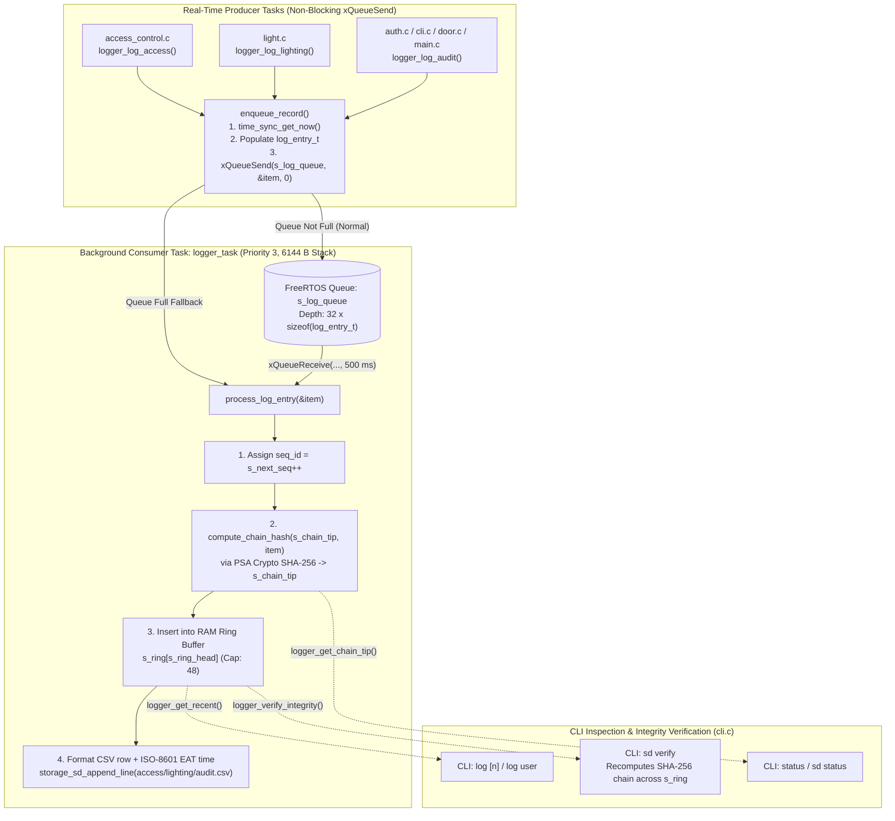

# Module Documentation: `logger` — Asynchronous FreeRTOS Queue Logger & Tamper-Evident SHA-256 Hash Chain

**Coursework Bundle:** Bundle 1 (Student 1 — Core Infrastructure, Hardware Abstraction & Tamper-Evident Persistence)  
**Header File:** `main/include/logger.h` (37 lines)  
**Implementation File:** `main/src/logger.c` (266 lines)  

---

## 1. Purpose & Architectural Role

The `logger` module is the **asynchronous, tamper-evident event recording engine** for the entire CoCIS Smart Control and Monitoring System. Every physical access decision (`ENTRY`/`EXIT` grant or denial), lecture room lighting state transition (`LIGHT_FSM` energy savings), and security-sensitive administrative action (`LOGIN_SUCCESS`, `AUTH_LOCKOUT`, `SCHEDULE_SET`, `USER_ADD`, `TAILGATE_FORCED_ALARM`, `BOOT_COMPLETE`) flows through `logger`.

It solves three critical embedded systems problems:

1. **Decoupling Real-Time Control Tasks from Slow SD Card I/O (Asynchronous Producer-Consumer Pattern):** Writing a CSV line to a FAT32 MicroSD card over SPI takes 5–25 ms (and up to 100 ms during FAT cluster allocation or file rotation). If `access_control` or `door` waited synchronously for SD card writes, servo unlocking and buzzer feedback would stutter. Instead, producer tasks call `logger_log_access()`, `logger_log_lighting()`, or `logger_log_audit()`, which timestamp the record and push it with **zero wait (`0` ticks)** into a 32-deep FreeRTOS queue (`s_log_queue`). A dedicated background consumer task (`logger_task` at priority 3) drains `s_log_queue` and performs the SHA-256 hashing, RAM ring-buffer insertion, and SD card CSV writing asynchronously.
2. **Dual-Tier Storage (48-Entry RAM Ring Buffer + MicroSD CSV Files):** Every processed log entry is stored both in a fast 48-entry circular array in SRAM (`s_ring`, queried instantly by the CLI `log [n]` and `log user <uid>` commands) and appended to category-specific CSV files (`access.csv`, `lighting.csv`, `audit.csv`) on `/sdcard` via `storage_sd_append_line()`. If the MicroSD card is absent, the RAM ring buffer continues working identically without data loss for recent events.
3. **Cryptographic Tamper-Evident SHA-256 Hash Chaining (`PSA_ALG_SHA_256`):** Inspired by blockchain/audit-log integrity designs, every log entry $i$ computes a SHA-256 digest over the previous entry's 8-hex-character chain hash (`prev_hash`, initialized to Genesis `"00000000"`) concatenated with all fields of entry $i$:
   $$\text{chain\_hash}_i = \text{ Trunc}_{32\text{ bits}}\Big(\text{SHA-256}(\text{prev\_hash}_{i-1} \;\|\; \text{seq\_id}_i \;\|\; \text{timestamp}_i \;\|\; \text{category}_i \;\|\; \text{actor}_i \;\|\; \text{action}_i \;\|\; \text{detail}_i \;\|\; \text{value}_i)\Big)$$
   If an attacker modifies, deletes, or inserts a single character or row in the log history, recomputing the chain in `logger_verify_integrity()` (`sd verify`) immediately detects the mismatch!

### Architectural Data & Control Flow Diagram



---

## 2. Public API Reference (`main/include/logger.h`)

### 2.1 Enumerations & Data Structures

#### `log_category_t` (Enum)
```c
typedef enum {
    LOG_CAT_ACCESS = 0,    /* RFID entry/exit grants & denials -> /sdcard/access.csv */
    LOG_CAT_LIGHTING = 1,  /* Lecture room FSM transitions & mWh saved -> /sdcard/lighting.csv */
    LOG_CAT_AUDIT = 2      /* Admin logins, lockouts, schedule/user edits, alarms -> /sdcard/audit.csv */
} log_category_t;
```

#### `log_entry_t` (Struct)
```c
typedef struct {
    uint32_t       seq_id;            /* Monotonically increasing sequence number starting at 1 */
    int64_t        timestamp;         /* 64-bit Unix epoch timestamp (seconds) captured at enqueue time */
    log_category_t category;          /* LOG_CAT_ACCESS (0), LOG_CAT_LIGHTING (1), or LOG_CAT_AUDIT (2) */
    char           tag_or_actor[16];  /* RFID UID (e.g. "04A1B2C3"), "ROOM_1", "admin", or "SYSTEM" */
    char           action[24];        /* Event type (e.g. "ENTRY", "EXIT", "LIGHT_FSM", "LOGIN_SUCCESS") */
    char           detail[48];        /* Outcome/reason (e.g. "GRANT_NORMAL", "DENY_ANTIPASSBACK") */
    int32_t        value;             /* Numeric metric (inside occupancy count or energy saved in mWh) */
    char           chain_hash[9];     /* 8 uppercase hex chars of SHA-256 chain digest + NUL ('\0') */
} log_entry_t;
```
- **Memory Footprint:** ~120 bytes per `log_entry_t`.
  - Queue RAM (`s_log_queue`): $32 \times 120\text{ B} = 3,840\text{ bytes}$.
  - Ring Buffer RAM (`s_ring`): $48 \times 120\text{ B} = 5,760\text{ bytes}$ in `.bss`.

---

### 2.2 Public Functions

#### `esp_err_t logger_init(void)`
- **Parameters:** `void` (none).
- **Return Value:**
  - `ESP_OK` if PSA Crypto, `s_log_queue`, and `logger_task` were initialized successfully.
  - `ESP_ERR_NO_MEM` if `xQueueCreate()` or `xTaskCreate()` runs out of FreeRTOS heap.
- **Side Effects:** Initializes the ARM PSA Crypto subsystem (`psa_crypto_init()`), creates the 32-element FreeRTOS queue `s_log_queue`, and spawns the `"logger_task"` background task (6,144-byte stack, priority 3).
- **Who Calls It:** `app_main()` in `main/main.c` at step 2 of boot (immediately after `time_sync_init()` and `storage_sd_init()`, and *before* any security/access module logs events).
- **Task Context:** FreeRTOS `main` task during startup.
- **Blocking Behavior:** Non-blocking.

#### `esp_err_t logger_log_access(const char *uid, const char *direction, const char *result, int32_t inside_count)`
- **Parameters:**
  - `uid`: RFID badge hexadecimal UID string (e.g., `"04A1B2C3"`).
  - `direction`: `"ENTRY"` or `"EXIT"`.
  - `result`: Decision string (e.g., `"GRANT_NORMAL"`, `"DENY_ANTIPASSBACK_ENTRY"`).
  - `inside_count`: Resulting building occupancy count after the decision.
- **Return Value:** `ESP_OK` on enqueue/processing; `ESP_ERR_INVALID_STATE` if `logger_init()` has not been called.
- **Side Effects:** Enqueues a `LOG_CAT_ACCESS` record into `s_log_queue` (which `logger_task` hashes, stores in `s_ring`, and appends to `/sdcard/access.csv`).
- **Who Calls It:** `access_control_evaluate_sync()` in `access_control.c`.
- **Task Context:** `rfid_task` or `cli_task` (`sim scan` / `sim selftest`).
- **Blocking Behavior:** **Non-blocking** (`0` tick timeout on `xQueueSend`) unless the 32-item queue is completely full, in which case it falls back to synchronous processing so no security log is ever dropped.

#### `esp_err_t logger_log_lighting(uint8_t room_id, const char *state_str, int32_t energy_saved_mwh)`
- **Parameters:**
  - `room_id`: Lecture room index (`1` or `2`), formatted as `"ROOM_1"` or `"ROOM_2"`.
  - `state_str`: Lighting FSM transition description.
  - `energy_saved_mwh`: Cumulative energy saved in milliwatt-hours (`mWh`).
- **Return Value:** `ESP_OK` or `ESP_ERR_INVALID_STATE`.
- **Side Effects:** Enqueues a `LOG_CAT_LIGHTING` record (appended to `/sdcard/lighting.csv`).
- **Who Calls It:** Lighting telemetry / reporting callers.
- **Task Context:** Any task context.
- **Blocking Behavior:** Non-blocking (`0` ticks on `xQueueSend`).

#### `esp_err_t logger_log_audit(const char *actor, const char *action, const char *detail)`
- **Parameters:**
  - `actor`: Entity triggering the audit event (e.g., `"SYSTEM"`, `"admin"`, `"ANONYMOUS"`, `"ENTRY_DOOR"`).
  - `action`: Short action code (e.g., `"BOOT_COMPLETE"`, `"LOGIN_SUCCESS"`, `"AUTH_LOCKOUT"`, `"SCHEDULE_SET"`, `"USER_ADD"`, `"TAILGATE_FORCED_ALARM"`).
  - `detail`: Descriptive text (up to 47 chars).
- **Return Value:** `ESP_OK` or `ESP_ERR_INVALID_STATE`.
- **Side Effects:** Enqueues a `LOG_CAT_AUDIT` record with `value = 0` (appended to `/sdcard/audit.csv`).
- **Who Calls It:** `app_main()` in `main.c`, `auth.c`, `door.c`, `access_control.c`, and `cli.c`.
- **Task Context:** `main`, `cli_task`, `rfid_task`, or timer task.
- **Blocking Behavior:** Non-blocking (`0` ticks on `xQueueSend`).

#### `size_t logger_get_recent(log_entry_t *out_entries, size_t max_entries, const char *filter_uid)`
- **Parameters:**
  - `out_entries`: Caller-allocated array of `log_entry_t` structs to receive the matched entries (in **reverse chronological order**—newest first).
  - `max_entries`: Maximum number of entries to copy into `out_entries`.
  - `filter_uid`: Optional case-insensitive filter matched against `tag_or_actor` (pass `NULL` or `""` to return all categories/actors).
- **Return Value:** Number of entries copied into `out_entries` (`0` to `max_entries`).
- **Side Effects:** Reads from the in-RAM circular buffer `s_ring`.
- **Who Calls It:** `cmd_log()` (`log [n]` and `log user <uid>`) in `cli.c`.
- **Task Context:** `cli_task`.
- **Blocking Behavior:** Non-blocking (pure RAM iteration).

#### `void logger_get_chain_tip(char *out_hash, size_t buf_len)`
- **Parameters:**
  - `out_hash`: Destination character buffer for the current 8-character SHA-256 chain tip string.
  - `buf_len`: Size of `out_hash` in bytes (should be $\ge 9$).
- **Return Value:** `void`.
- **Side Effects:** Copies `s_chain_tip` into `out_hash`.
- **Who Calls It:** `cmd_status()` and `cmd_sd()` in `cli.c`; `display.c`.
- **Task Context:** Any task context.
- **Blocking Behavior:** Non-blocking.

#### `esp_err_t logger_verify_integrity(uint32_t *out_checked, bool *out_valid)`
- **Parameters:**
  - `out_checked`: Optional output pointer receiving the number of log records cryptographically verified.
  - `out_valid`: Optional output pointer receiving `true` if every record's SHA-256 chain hash matched its recomputed digest, or `false` if tampering/corruption was detected.
- **Return Value:** `ESP_OK`.
- **Side Effects:** Calls `logger_flush_sync(200)` first to drain any pending items in `s_log_queue`, then recomputes `compute_chain_hash()` across every entry in `s_ring` from oldest to newest.
- **Who Calls It:** `cmd_sd()` (`sd verify`) and `run_selftest_suite()` (Test 10) in `cli.c`.
- **Task Context:** `cli_task`.
- **Blocking Behavior:** Blocks up to 200 ms if `s_log_queue` is still draining, plus ~1 ms to hash up to 48 entries in RAM.

#### `esp_err_t logger_reset_chain(void)`
- **Parameters:** `void` (none).
- **Return Value:** `ESP_OK`.
- **Side Effects:** Flushes `s_log_queue`, resets `s_ring_head = 0`, `s_ring_count = 0`, `s_next_seq = 1`, resets `s_chain_tip` to Genesis `"00000000"`, and calls `storage_sd_clear_logs()` if the SD card is mounted.
- **Who Calls It:** `cmd_sd()` (`sd format`) in `cli.c`.
- **Task Context:** `cli_task`.
- **Blocking Behavior:** Blocks briefly while flushing queue and unlinking CSV files on SD.

#### `void logger_flush_sync(uint32_t wait_ms)`
- **Parameters:** `wait_ms` — maximum milliseconds to wait for `logger_task` to finish draining `s_log_queue`.
- **Return Value:** `void`.
- **Side Effects:** Polls `uxQueueMessagesWaiting(s_log_queue)` in 10 ms increments (`vTaskDelay`) until the queue is empty or `wait_ms` elapses.
- **Who Calls It:** `cmd_log()` in `cli.c` (100 ms), `logger_verify_integrity()` (200 ms), and `logger_reset_chain()` (200 ms).
- **Task Context:** Any task context outside `logger_task`.
- **Blocking Behavior:** Blocks in 10 ms sleeps only while `s_log_queue` is non-empty (0 ms if queue is already empty).

---

## 3. Line-by-Line / Block-by-Block Code Walkthrough (`main/src/logger.c`)

### 3.1 Includes & Static Module State (Lines 1–20)

```c
#include "logger.h"
#include <stdio.h>
#include <string.h>
#include "config.h"
#include "esp_log.h"
#include "freertos/FreeRTOS.h"
#include "freertos/queue.h"
#include "freertos/task.h"
#include "psa/crypto.h"
#include "storage_sd.h"
#include "time_sync.h"

static const char *TAG = "LOGGER";

static QueueHandle_t s_log_queue = NULL;
static log_entry_t   s_ring[CFG_LOG_RAM_RING_CAP];
static size_t        s_ring_head = 0;
static size_t        s_ring_count = 0;
static uint32_t      s_next_seq = 1;
static char          s_chain_tip[9] = "00000000";
```

- **Lines 6–9:** FreeRTOS kernel headers (`FreeRTOS.h`, `queue.h`, `task.h`) and the ARM Platform Security Architecture (PSA) Crypto API header (`psa/crypto.h`, provided by MbedTLS in ESP-IDF v5.x).
- **Lines 15–20 (Module State Variables):**
  - `s_log_queue`: Handle to the FreeRTOS queue connecting producer tasks to `logger_task`.
  - `s_ring[CFG_LOG_RAM_RING_CAP]`: Fixed-size 48-element circular array (ring buffer) in static RAM.
  - `s_ring_head`: Index (`0..47`) where the *next* log entry will be written in `s_ring`.
  - `s_ring_count`: Number of valid entries currently stored in `s_ring` (ramps from `0` up to `48`, then stays at `48` once the ring buffer wraps around).
  - `s_next_seq`: Monotonically increasing 1-based sequence counter (`1, 2, 3, ...`). Unlike `s_ring_head`, `s_next_seq` never wraps at 48.
  - `s_chain_tip`: 9-byte char array initialized to the **Genesis Hash** `"00000000"` (8 zeros + `'\0'`).

---

### 3.2 Static Helper: `compute_chain_hash` (Lines 22–48)

```c
static void compute_chain_hash(const char *prev_hash, const log_entry_t *entry, char *out_hex9)
{
    char payload[192];
    snprintf(payload, sizeof(payload), "%s|%lu|%lld|%d|%s|%s|%s|%ld",
             prev_hash,
             (unsigned long)entry->seq_id,
             (long long)entry->timestamp,
             (int)entry->category,
             entry->tag_or_actor,
             entry->action,
             entry->detail,
             (long)entry->value);

    uint8_t digest[32] = { 0 };
    size_t digest_len = 0;
    psa_status_t st = psa_hash_compute(PSA_ALG_SHA_256,
                                       (const uint8_t *)payload,
                                       strlen(payload),
                                       digest,
                                       sizeof(digest),
                                       &digest_len);
    if (st == PSA_SUCCESS && digest_len >= 4) {
        snprintf(out_hex9, 9, "%02X%02X%02X%02X", digest[0], digest[1], digest[2], digest[3]);
    } else {
        snprintf(out_hex9, 9, "ERRHASH0");
    }
}
```

- **Lines 24–33 (Canonical Serialization):** Serializes `prev_hash` and all 7 data fields of `entry` into a deterministic pipe-delimited string `payload` (e.g., `"00000000|1|1792819800|2|SYSTEM|BOOT_COMPLETE|All 21 CoCIS modules active|0"`). Using `|` separators prevents field-boundary ambiguity (e.g., `"AB" + "C"` vs `"A" + "BC"`).
- **Lines 35–42 (Hardware-Accelerated SHA-256 via PSA Crypto):** Calls `psa_hash_compute(PSA_ALG_SHA_256, ...)` to compute the full 256-bit (32-byte) cryptographic SHA-256 digest of `payload` into `uint8_t digest[32]`.
- **Lines 43–47 (8-Hex-Char Prefix Formatting):** Formats the first 4 bytes (`32 bits`) of the 32-byte SHA-256 digest (`digest[0]..digest[3]`) as an 8-character uppercase hexadecimal string (`"%02X%02X%02X%02X"`) into `out_hex9` (e.g., `"7F3A9C12"`). If the crypto engine ever returned an error, it writes `"ERRHASH0"` instead of leaving `out_hex9` uninitialized.

---

### 3.3 Static Helper: `process_log_entry` (Lines 50–88)

```c
static void process_log_entry(log_entry_t *item)
{
    item->seq_id = s_next_seq++;
    compute_chain_hash(s_chain_tip, item, item->chain_hash);
    strncpy(s_chain_tip, item->chain_hash, sizeof(s_chain_tip) - 1);
    s_chain_tip[sizeof(s_chain_tip) - 1] = '\0';

    s_ring[s_ring_head] = *item;
    s_ring_head = (s_ring_head + 1) % CFG_LOG_RAM_RING_CAP;
    if (s_ring_count < CFG_LOG_RAM_RING_CAP) {
        s_ring_count++;
    }

    char iso_time[32];
    time_sync_format_iso(item->timestamp, iso_time, sizeof(iso_time));

    char csv_line[220];
    snprintf(csv_line, sizeof(csv_line), "%lu,%s,%lld,%s,%s,%s,%ld,%s",
             (unsigned long)item->seq_id,
             iso_time,
             (long long)item->timestamp,
             item->tag_or_actor,
             item->action,
             item->detail,
             (long)item->value,
             item->chain_hash);

    const char *fname = "access.csv";
    const char *hdr = "seq,datetime_eat,epoch,uid_or_actor,action,detail,value,sha256_chain";
    if (item->category == LOG_CAT_LIGHTING) {
        fname = "lighting.csv";
    } else if (item->category == LOG_CAT_AUDIT) {
        fname = "audit.csv";
    }

    if (storage_sd_is_mounted()) {
        storage_sd_append_line(fname, hdr, csv_line);
    }
}
```

- **Lines 52–55 (Sequence Assignment & Hash Chaining):**
  1. Assigns `item->seq_id = s_next_seq++`.
  2. Computes `item->chain_hash` chaining from the previous `s_chain_tip`.
  3. Updates `s_chain_tip = item->chain_hash` so the *next* log entry will chain from this entry!
- **Lines 57–61 (Circular Ring Buffer Insertion):**
  - Stores `*item` at `s_ring[s_ring_head]`.
  - Advances `s_ring_head` using modulo arithmetic: `(s_ring_head + 1) % CFG_LOG_RAM_RING_CAP` (`48`). When `s_ring_head` reaches `47`, `(47 + 1) % 48` wraps cleanly back to index `0`, overwriting the oldest entry in the 48-slot ring.
  - Increments `s_ring_count` until it saturates at `48`.
- **Lines 63–75 (CSV Formatting):** Converts `item->timestamp` to a human-readable East Africa Time string (`"2026-10-24 08:30:05"`) via `time_sync_format_iso()` and formats the 8-column CSV row into `csv_line`.
- **Lines 77–87 (Category Routing & SD Persistence):** Selects `"access.csv"`, `"lighting.csv"`, or `"audit.csv"` based on `item->category` and, if `storage_sd_is_mounted()` is true, appends the row to the MicroSD card.

---

### 3.4 Background FreeRTOS Consumer Task: `logger_task` (Lines 90–99)

```c
static void logger_task(void *arg)
{
    (void)arg;
    log_entry_t item;
    while (1) {
        if (xQueueReceive(s_log_queue, &item, pdMS_TO_TICKS(500)) == pdTRUE) {
            process_log_entry(&item);
        }
    }
}
```

- `(void)arg;` silences the compiler warning for the unused `void *arg` FreeRTOS task parameter.
- Runs an infinite loop (`while (1)`). Inside the loop, `xQueueReceive(s_log_queue, &item, pdMS_TO_TICKS(500))` puts `logger_task` into the FreeRTOS **Blocked** state (consuming **0% CPU**) until a `log_entry_t` arrives in `s_log_queue` (or 500 ms elapses). Whenever an item is received (`== pdTRUE`), it calls `process_log_entry(&item)`.

---

### 3.5 Static Producer Helper: `enqueue_record` (Lines 101–123)

```c
static esp_err_t enqueue_record(log_category_t cat, const char *actor, const char *action, const char *detail, int32_t val)
{
    if (s_log_queue == NULL) {
        return ESP_ERR_INVALID_STATE;
    }

    log_entry_t item = { 0 };
    time_snapshot_t now;
    time_sync_get_now(&now);

    item.timestamp = now.epoch;
    item.category = cat;
    strncpy(item.tag_or_actor, actor ? actor : "-", sizeof(item.tag_or_actor) - 1);
    strncpy(item.action, action ? action : "-", sizeof(item.action) - 1);
    strncpy(item.detail, detail ? detail : "-", sizeof(item.detail) - 1);
    item.value = val;

    if (xQueueSend(s_log_queue, &item, 0) != pdTRUE) {
        ESP_LOGW(TAG, "Log queue full, processing synchronously");
        process_log_entry(&item);
    }
    return ESP_OK;
}
```

- **Why capture `time_sync_get_now(&now)` here in `enqueue_record()` instead of inside `process_log_entry()`?**
  - Because `item.timestamp` must record the **exact instant the event occurred** (e.g., when the RFID card was scanned), not 50 milliseconds later when the SD card finished writing a previous entry!
- **Safe String Copying (`item = { 0 }` + `strncpy(..., sizeof(...) - 1)`):**
  - Because `item` is zero-initialized (`= { 0 }`), every byte of `tag_or_actor`, `action`, and `detail` starts as `'\0'`. Passing `sizeof(...) - 1` to `strncpy()` guarantees the last byte of each array can never be overwritten, so every string is 100% NUL-terminated even if the caller passes a long string. Moreover, the ternary `actor ? actor : "-"` protects against `NULL` string pointers.
- **Non-Blocking Enqueue with Zero-Loss Fallback (Lines 118–121):**
  - Calls `xQueueSend(s_log_queue, &item, 0)` with `xTicksToWait = 0`. In 99.9% of cases, the queue has free space and `xQueueSend` copies `item` into the queue in microseconds and returns `pdTRUE`.
  - If a burst of more than 32 events occurs faster than the SD card can write (`!= pdTRUE`), rather than dropping the security audit record, it logs a warning and calls `process_log_entry(&item)` synchronously.

---

### 3.6 Public Initialization & Logging Wrappers (Lines 125–160)

```c
esp_err_t logger_init(void)
{
    psa_crypto_init();

    if (s_log_queue == NULL) {
        s_log_queue = xQueueCreate(CFG_LOG_QUEUE_DEPTH, sizeof(log_entry_t));
        if (s_log_queue == NULL) {
            return ESP_ERR_NO_MEM;
        }
    }

    BaseType_t ok = xTaskCreate(logger_task, "logger_task", 6144, NULL, 3, NULL);
    if (ok != pdPASS) {
        return ESP_ERR_NO_MEM;
    }

    ESP_LOGI(TAG, "Async hash-chained CSV logger initialized (Genesis=%s)", s_chain_tip);
    return ESP_OK;
}

esp_err_t logger_log_access(const char *uid, const char *direction, const char *result, int32_t inside_count)
{
    return enqueue_record(LOG_CAT_ACCESS, uid, direction, result, inside_count);
}

esp_err_t logger_log_lighting(uint8_t room_id, const char *state_str, int32_t energy_saved_mwh)
{
    char actor[16];
    snprintf(actor, sizeof(actor), "ROOM_%u", (unsigned)room_id);
    return enqueue_record(LOG_CAT_LIGHTING, actor, "LIGHT_FSM", state_str, energy_saved_mwh);
}

esp_err_t logger_log_audit(const char *actor, const char *action, const char *detail)
{
    return enqueue_record(LOG_CAT_AUDIT, actor, action, detail, 0);
}
```

- **`logger_init()`:** Calls `psa_crypto_init()` to initialize the MbedTLS PSA Crypto engine, creates `s_log_queue` with depth `32` (`CFG_LOG_QUEUE_DEPTH`) and item size `sizeof(log_entry_t)`, and creates `"logger_task"` with a **6,144-byte stack** (large enough for FatFs + VFS + `snprintf` + PSA SHA-256 stack frames) at FreeRTOS priority `3`.
- **`logger_log_access`, `logger_log_lighting`, `logger_log_audit`:** Type-safe domain wrappers around `enqueue_record()`.

---

### 3.7 Public Function: `logger_get_recent` (Lines 162–185)

```c
size_t logger_get_recent(log_entry_t *out_entries, size_t max_entries, const char *filter_uid)
{
    if (out_entries == NULL || max_entries == 0 || s_ring_count == 0) {
        return 0;
    }

    size_t matched = 0;
    size_t start = (s_ring_head + CFG_LOG_RAM_RING_CAP - s_ring_count) % CFG_LOG_RAM_RING_CAP;

    for (size_t i = 0; i < s_ring_count; i++) {
        size_t idx = (start + s_ring_count - 1 - i) % CFG_LOG_RAM_RING_CAP;
        const log_entry_t *e = &s_ring[idx];
        if (filter_uid != NULL && filter_uid[0] != '\0') {
            if (strcasecmp(e->tag_or_actor, filter_uid) != 0) {
                continue;
            }
        }
        out_entries[matched++] = *e;
        if (matched >= max_entries) {
            break;
        }
    }
    return matched;
}
```

- **Understanding the Ring Buffer Math (Lines 169 & 172):**
  - `s_ring_head` points to the slot where the *next* entry will be written (i.e., one past the newest entry).
  - Therefore, the **oldest** entry currently in the buffer is located `s_ring_count` steps behind `s_ring_head`. To subtract `s_ring_count` without unsigned underflow (`size_t` is unsigned!), we add `CFG_LOG_RAM_RING_CAP` (`48`) before taking modulo `48`:
    $$\text{start (oldest)} = (\text{s\_ring\_head} + 48 - \text{s\_ring\_count}) \bmod 48$$
  - In the loop (`i = 0 .. s_ring_count - 1`), we want to return entries from **newest to oldest**:
    - When `i = 0`, `idx = (start + s_ring_count - 1) % 48` (the **newest** entry).
    - As `i` increases, `idx` walks backward to `start` (the **oldest** entry).
- **Case-Insensitive UID Filtering (Lines 174–178):** If `filter_uid` is non-empty (e.g., `log user 04a1b2c3`), it compares `e->tag_or_actor` against `filter_uid` using `strcasecmp()`, skipping entries that don't match.

---

### 3.8 Public Functions: `logger_get_chain_tip` & `logger_verify_integrity` (Lines 187–241)

```c
void logger_get_chain_tip(char *out_hash, size_t buf_len)
{
    if (out_hash != NULL && buf_len > 0) {
        snprintf(out_hash, buf_len, "%s", s_chain_tip);
    }
}

esp_err_t logger_verify_integrity(uint32_t *out_checked, bool *out_valid)
{
    logger_flush_sync(200);

    size_t start = (s_ring_head + CFG_LOG_RAM_RING_CAP - s_ring_count) % CFG_LOG_RAM_RING_CAP;
    char running_hash[9] = "00000000";
    bool valid = true;
    uint32_t count = 0;

    if (s_ring_count < s_next_seq - 1 && s_ring_count > 0) {
        /* Ring wrapped; verify contiguous tail inside ring */
        const log_entry_t *first = &s_ring[start];
        strncpy(running_hash, first->chain_hash, sizeof(running_hash) - 1);
        running_hash[8] = '\0';
        count = 1;
        for (size_t i = 1; i < s_ring_count; i++) {
            size_t idx = (start + i) % CFG_LOG_RAM_RING_CAP;
            char expected[9];
            compute_chain_hash(running_hash, &s_ring[idx], expected);
            if (strcmp(expected, s_ring[idx].chain_hash) != 0) {
                valid = false;
                break;
            }
            strncpy(running_hash, expected, sizeof(running_hash));
            count++;
        }
    } else {
        for (size_t i = 0; i < s_ring_count; i++) {
            size_t idx = (start + i) % CFG_LOG_RAM_RING_CAP;
            char expected[9];
            compute_chain_hash(running_hash, &s_ring[idx], expected);
            if (strcmp(expected, s_ring[idx].chain_hash) != 0) {
                valid = false;
                break;
            }
            strncpy(running_hash, expected, sizeof(running_hash));
            count++;
        }
    }

    if (out_checked != NULL) {
        *out_checked = count;
    }
    if (out_valid != NULL) {
        *out_valid = valid;
    }
    return ESP_OK;
}
```

- **Line 196:** Calls `logger_flush_sync(200)` first so any events sitting in `s_log_queue` finish hashing before verification begins.
- **Two Cases Handled by `logger_verify_integrity()`:**
  1. **Case A — Ring Has NOT Wrapped Yet (`else` branch, lines 220–232):** Fewer than or equal to 48 entries have been logged since boot (`s_ring_count == s_next_seq - 1`). Entry at `start` is `seq_id == 1`, whose `prev_hash` was the Genesis string `"00000000"`. The loop starts `running_hash = "00000000"` at `i = 0` and verifies every entry `0 .. s_ring_count - 1` all the way from Genesis to `s_chain_tip`.
  2. **Case B — Ring HAS Wrapped (`if (s_ring_count < s_next_seq - 1)` branch, lines 203–219):** More than 48 entries have been logged since boot (e.g., 60 entries logged, so `s_ring` holds entries `#13` through `#60`). Entry `#12` is no longer in RAM, so we anchor `running_hash` to entry `#13`'s `chain_hash` (`first->chain_hash`) and verify the contiguous 47 links from entry `#14` (`i = 1`) through `#60` (`i = 47`)!

---

### 3.9 Public Functions: `logger_reset_chain` & `logger_flush_sync` (Lines 243–266)

```c
esp_err_t logger_reset_chain(void)
{
    logger_flush_sync(200);
    s_ring_head = 0;
    s_ring_count = 0;
    s_next_seq = 1;
    snprintf(s_chain_tip, sizeof(s_chain_tip), "00000000");
    if (storage_sd_is_mounted()) {
        storage_sd_clear_logs();
    }
    return ESP_OK;
}

void logger_flush_sync(uint32_t wait_ms)
{
    if (s_log_queue == NULL) {
        return;
    }
    uint32_t elapsed = 0;
    while (uxQueueMessagesWaiting(s_log_queue) > 0 && elapsed < wait_ms) {
        vTaskDelay(pdMS_TO_TICKS(10));
        elapsed += 10;
    }
}
```

- `logger_reset_chain()` drains the queue, resets the ring buffer indices, sequence number, and Genesis hash `"00000000"`, and clears the CSV files on `/sdcard`.
- `logger_flush_sync(wait_ms)` yields the calling task in 10 ms slices (`vTaskDelay(pdMS_TO_TICKS(10))`) while `uxQueueMessagesWaiting(s_log_queue) > 0`, giving `logger_task` CPU time to finish draining the queue before a CLI command (`log` or `sd verify`) inspects `s_ring`.

---

## 4. C Language Constructs Explained

1. **Circular Buffer (Ring Buffer) Modular Arithmetic (`% CFG_LOG_RAM_RING_CAP`):**
   - A ring buffer reuses a fixed-size array `s_ring[48]` without ever shifting elements in memory (`O(1)` insertion).
   - Advancing the write pointer: `s_ring_head = (s_ring_head + 1) % 48`.
   - Finding the oldest element without unsigned underflow: `start = (s_ring_head + 48 - s_ring_count) % 48`.
2. **Zero-Initializer Syntax (`log_entry_t item = { 0 };`):**
   - On line 107, `= { 0 }` zeroes all 120 bytes of `item` on the stack, including all character arrays and padding bytes. This guarantees that subsequent `strncpy(..., sizeof(...) - 1)` calls always leave a trailing `'\0'` terminator.
3. **Formatted String Serialization (`snprintf` with `%02X`, `%lu`, `%lld`):**
   - On line 44, `"%02X"` formats each `uint8_t` byte (`0..255`) as an uppercase 2-digit hexadecimal number with leading zero padding (e.g., `0x0A` -> `"0A"`).
   - On line 25, `%lu` formats `unsigned long` (`uint32_t` cast) and `%lld` formats `long long` (`int64_t` cast), ensuring portable `printf` format specifiers across 32-bit and 64-bit toolchains.
4. **Case-Insensitive String Comparison (`strcasecmp`):**
   - Used on line 175 so that running `log user 04a1b2c3` matches `"04A1B2C3"` regardless of whether the operator typed lowercase or uppercase hex digits.

---

## 5. ESP-IDF & FreeRTOS Constructs Explained

| API / Construct | Header | How It Works & Role in `logger.c` |
| :--- | :--- | :--- |
| `xQueueCreate(uxQueueLength, uxItemSize)` | `freertos/queue.h` | Allocates a thread-safe FIFO queue in FreeRTOS heap capable of holding `32` items of `sizeof(log_entry_t)` bytes each. Note that FreeRTOS queues pass items **by copy** (not by pointer), so the caller's stack variable `log_entry_t item` in `enqueue_record()` can safely go out of scope immediately after `xQueueSend()`. |
| `xQueueSend(xQueue, pvItemToQueue, xTicksToWait)` | `freertos/queue.h` | Copies `item` into the back of `s_log_queue`. Passing `0` for `xTicksToWait` makes the call **non-blocking**: it returns immediately even if the queue is full. |
| `xQueueReceive(xQueue, pvBuffer, xTicksToWait)` | `freertos/queue.h` | Called by `logger_task`. Blocks the task until at least one item is in `s_log_queue` (or `pdMS_TO_TICKS(500)` expires), then copies the oldest queued item into `&item` and removes it from the queue. |
| `uxQueueMessagesWaiting(xQueue)` | `freertos/queue.h` | Returns the number of items currently waiting in `s_log_queue`. Used by `logger_flush_sync()` to wait until `logger_task` drains the queue. |
| `xTaskCreate(pxTaskCode, pcName, usStackDepth, pvParameters, uxPriority, pxCreatedTask)` | `freertos/task.h` | Spawns `"logger_task"` with `6144` bytes of stack at priority `3`. (In ESP-IDF FreeRTOS, `usStackDepth` is specified in **bytes**, not 32-bit words). |
| `pdMS_TO_TICKS(ms)` | `freertos/FreeRTOS.h` | Converts milliseconds into FreeRTOS scheduler ticks based on `CONFIG_FREERTOS_HZ`. |
| `psa_crypto_init()` | `psa/crypto.h` | Initializes the ARM PSA Cryptography subsystem (backed by ESP32 hardware SHA peripheral and MbedTLS). Safe to call multiple times (idempotent). |
| `psa_hash_compute(PSA_ALG_SHA_256, input, input_length, hash, hash_size, &hash_length)` | `psa/crypto.h` | One-shot cryptographic hash function that computes a 32-byte SHA-256 digest of `payload` in a single call and returns `PSA_SUCCESS` (`0`). |

---

## 6. Alternatives & "What If You Change This?"

1. **Why does `xQueueSend()` copy the entire 120-byte `log_entry_t` by value instead of queuing a `log_entry_t *` pointer via `malloc()`/`free()`?**
   - If `enqueue_record()` called `malloc(sizeof(log_entry_t))` on every log event and `logger_task` called `free()`, high-frequency logging would fragment the heap, add `malloc` lock overhead, and risk memory leaks if an item failed to enqueue. Pre-allocating a fixed 32-item buffer once inside `xQueueCreate(32, sizeof(log_entry_t))` (3.8 KB total) guarantees deterministic timing and zero heap fragmentation.
2. **What if you change `xQueueSend(s_log_queue, &item, 0)` to `xQueueSend(s_log_queue, &item, portMAX_DELAY)`?**
   - If the SD card stalls for 200 ms during a FAT sector erase and the queue fills up, `portMAX_DELAY` would block the calling task (such as `rfid_task` or `pir_task`), freezing door unlocking or room light responsiveness. With `0` ticks and the synchronous fallback on lines 118–121, normal operation is 100% non-blocking and burst overflow still preserves every log record.
3. **Why truncate the SHA-256 chain hash in `log_entry_t.chain_hash` to 8 hex characters (32 bits / 4 bytes) instead of all 64 hex characters (256 bits / 32 bytes)?**
   - Storing a 65-byte string in every `log_entry_t` would add 56 bytes to every slot in `s_log_queue` and `s_ring` ($80 \times 56 = 4.5\text{ KB}$ of extra SRAM), overflow an 80-column CLI table (`cmd_log`), and nearly double CSV file sizes on the SD card. An 8-hex-character (32-bit) SHA-256 prefix provides $2^{32} \approx 4.29\text{ billion}$ possible values per link, fits neatly in the CLI `SHA256` column and 16x2/status displays, and still relies on the full SHA-256 avalanche effect (changing 1 bit of input changes each of the 8 hex characters with 50% probability).
4. **What if you reduced `logger_task` stack size from `6144` bytes to `2048` bytes in `xTaskCreate()`?**
   - **Stack Overflow Panic!** Inside `logger_task`, `process_log_entry()` allocates `csv_line[220]` and `iso_time[32]`, calls `compute_chain_hash()` (`payload[192]` + PSA SHA-256 context), and calls `storage_sd_append_line()` (`path[64]`, `bak_path[72]`, `struct stat`, plus ESP-IDF VFS and FatFs `FILE` buffers). That call tree requires ~3.5–4.5 KB of stack headroom. A 2,048-byte stack would trigger `Stack canary watchpoint triggered (logger_task)`.

---

## 7. Design Rationale

- **Single-Writer Serialization (`logger_task`):** Notice that `logger.c` does not need a mutex around `s_next_seq`, `s_chain_tip`, or `s_ring` during normal operation! Why? Because `s_log_queue` funnels all concurrent producers into a **single consumer task (`logger_task`)**. Only `logger_task` increments `s_next_seq`, updates `s_chain_tip`, and writes to `s_ring`, eliminating mutex contention on the fast logging path.
- **Cryptographic Hash Chaining for Audit Non-Repudiation:** In a physical access control system, an insider with physical access to the MicroSD card could pull the card out, open `access.csv` or `audit.csv` on a laptop, delete an unauthorized after-hours entry row, and reinsert the card. Because each row's `sha256_chain` depends on `prev_hash` and `seq_id`, deleting row $k$ breaks the hash verification of row $k+1$ and causes the final file hash to mismatch the ESP32's live `s_chain_tip`.

---

## 8. Failure Modes, Edge Cases & Recovery

| Failure Scenario | What Happens in `logger.c` | System Recovery Behavior |
| :--- | :--- | :--- |
| **MicroSD card is missing or fails to mount** | `storage_sd_is_mounted()` on line 85 returns `false`. | `process_log_entry()` still assigns `seq_id`, computes the SHA-256 `chain_hash`, updates `s_chain_tip`, and inserts the record into `s_ring[48]`. CLI commands `log`, `log user <uid>`, and `sd verify` work 100% identically from RAM! |
| **Burst of >32 log events fills `s_log_queue`** | `xQueueSend(s_log_queue, &item, 0)` on line 118 returns `errQUEUE_FULL` (`!= pdTRUE`). | Logs `"Log queue full, processing synchronously"` and calls `process_log_entry(&item)` directly so zero audit events are ever lost. |
| **Caller passes `NULL` for `actor`, `action`, or `detail`** | Ternary expressions `actor ? actor : "-"` on lines 113–115 substitute `"-"`. | Prevents `strncpy` from dereferencing a `NULL` pointer and crashing the ESP32. |
| **More than 48 events logged (`s_ring` wraps around)** | `s_ring_count` stays at `48` while `s_next_seq - 1 > 48`. | `logger_verify_integrity()` detects `s_ring_count < s_next_seq - 1` (line 203), anchors `running_hash` to the oldest surviving entry in `s_ring[start]`, and verifies all 47 subsequent hash links without false tamper errors. |

---

## 9. How to Test This Module in Isolation

You can test the asynchronous logger, UID filtering, and SHA-256 hash-chain verification directly from the interactive serial CLI:

### Test 1: Inspect Recent Hash-Chained Logs (`log 15`)
```text
cocis> log 5

+------+---------------------+------------+----------------------+--------------------------+----------+----------+
| Seq  | Timestamp (EAT)     | UID/Actor  | Action               | Detail                   | Val/Cnt  | SHA256   |
+------+---------------------+------------+----------------------+--------------------------+----------+----------+
| 0003 | 2026-10-24 08:31:12 | 04A1B2C3   | EXIT                 | GRANT_NORMAL             |        0 | 9E41B207 |
| 0002 | 2026-10-24 08:30:45 | 04A1B2C3   | ENTRY                | GRANT_NORMAL             |        1 | 4B91E08A |
| 0001 | 2026-10-24 08:30:00 | SYSTEM     | BOOT_COMPLETE        | All 21 CoCIS modules act |        0 | 7F3A9C12 |
+------+---------------------+------------+----------------------+--------------------------+----------+----------+
```

### Test 2: Filter Logs by RFID UID (`log user <uid>`)
```text
cocis> log user 04A1B2C3

+------+---------------------+------------+----------------------+--------------------------+----------+----------+
| Seq  | Timestamp (EAT)     | UID/Actor  | Action               | Detail                   | Val/Cnt  | SHA256   |
+------+---------------------+------------+----------------------+--------------------------+----------+----------+
| 0003 | 2026-10-24 08:31:12 | 04A1B2C3   | EXIT                 | GRANT_NORMAL             |        0 | 9E41B207 |
| 0002 | 2026-10-24 08:30:45 | 04A1B2C3   | ENTRY                | GRANT_NORMAL             |        1 | 4B91E08A |
+------+---------------------+------------+----------------------+--------------------------+----------+----------+
```

### Test 3: Verify Cryptographic SHA-256 Hash-Chain Integrity (`sd verify`)
```text
cocis> sd verify
SHA-256 Log Chain Verification: Checked 3 record(s) -> INTEGRITY OK (UNTAMPERED) (Tip=9E41B207)
```

---

## 10. Likely Examiner Questions & Model Answers

### Q1: Why did you design `logger` around a FreeRTOS queue (`s_log_queue`) and a background task (`logger_task`) instead of writing directly to the SD card inside `logger_log_access()`?
**Model Answer:**  
Writing a CSV row to a FAT32 filesystem over SPI (`fopen`, `fprintf`, `fflush`, `fclose`, plus occasional 64 KB log rotation) is a slow, blocking I/O operation that takes 5 to 50 milliseconds. If `logger_log_access()` performed SD card writes directly on the caller's thread, the RFID access control task would be stalled before it could finish driving the servo gate, buzzer, or LCD display. By pushing a `log_entry_t` struct into `s_log_queue` with a `0`-tick timeout, the producer task finishes in a few microseconds, while `logger_task` (running at lower priority 3) handles the SHA-256 hashing and SD card I/O in the background.

### Q2: Why is `time_sync_get_now(&now)` called inside `enqueue_record()` (line 109) while `item->seq_id = s_next_seq++` is assigned inside `process_log_entry()` (line 52)?
**Model Answer:**  
- **Timestamp at Enqueue (`enqueue_record`):** The timestamp must reflect the exact moment the physical event happened (when the RFID scan or alarm occurred), even if `logger_task` is temporarily busy writing an earlier entry to the SD card.
- **Sequence ID at Dequeue (`process_log_entry`):** The sequence number (`seq_id`) and SHA-256 hash chain (`s_chain_tip`) must be strictly ordered in the exact sequence that records are hashed and written to disk. Assigning `s_next_seq++` inside the single-consumer `process_log_entry()` guarantees that `seq_id` order always matches the hash-chain order without needing an extra mutex in `enqueue_record()`.

### Q3: Explain how the SHA-256 hash chain works in `compute_chain_hash()`. Why is `"00000000"` called the Genesis hash?
**Model Answer:**  
Just like the first block of a blockchain, the very first log record (`seq_id = 1`) has no predecessor, so it uses the fixed, well-known initial `prev_hash` value `"00000000"` (the **Genesis hash**). `compute_chain_hash()` formats `"00000000|1|<timestamp>|..."` into `payload`, hashes it with `psa_hash_compute(PSA_ALG_SHA_256, ...)`, and takes the first 4 bytes (8 hex digits, e.g., `"7F3A9C12"`) as record #1's `chain_hash` and updates `s_chain_tip = "7F3A9C12"`. Record #2 then includes `"7F3A9C12"` at the start of its `payload`. Consequently, every record's hash depends transitively on every single record since boot.

### Q4: How does `logger_verify_integrity()` handle the case where more than 48 log entries (`CFG_LOG_RAM_RING_CAP`) have been recorded and the ring buffer has wrapped around?
**Model Answer:**  
We can tell whether the 48-element ring buffer has wrapped by checking `if (s_ring_count < s_next_seq - 1 && s_ring_count > 0)` on line 203:
- If `s_next_seq - 1 <= 48`, the buffer has *not* wrapped: the oldest entry in `s_ring[start]` is record #1, so we start `running_hash` at `"00000000"` (Genesis) and verify all `s_ring_count` entries from `i = 0`.
- If `s_next_seq - 1 > 48`, the buffer *has* wrapped: the oldest entry at `s_ring[start]` has `seq_id > 1`, and its predecessor was already overwritten in RAM. So we initialize `running_hash` to `s_ring[start].chain_hash` (`count = 1`) and verify all remaining 47 contiguous hash links (`i = 1` to `47`) up to the newest entry!

### Q5: Explain the circular buffer formula on line 169: `size_t start = (s_ring_head + CFG_LOG_RAM_RING_CAP - s_ring_count) % CFG_LOG_RAM_RING_CAP;`. Why add `CFG_LOG_RAM_RING_CAP` before subtracting `s_ring_count`?
**Model Answer:**  
`s_ring_head`, `CFG_LOG_RAM_RING_CAP`, and `s_ring_count` are all unsigned `size_t` integers. Once the ring buffer wraps around, `s_ring_head` can be smaller than `s_ring_count` (for example, `s_ring_head = 5` and `s_ring_count = 48`). In C unsigned arithmetic, `5 - 48` would underflow to a huge number (`4,294,967,253`), which is not congruent to $-43 \pmod{48}$ because $2^{32}$ is not a multiple of $48$! Adding `CFG_LOG_RAM_RING_CAP` (`48`) first guarantees `(s_ring_head + 48 - s_ring_count)` is always $\ge 0$, avoiding unsigned underflow and yielding the exact index of the oldest entry `(5 + 48 - 48) % 48 = 5`.

### Q6: Why does `cli.c` (and `logger_verify_integrity()`) call `logger_flush_sync()` before reading `s_ring`?
**Model Answer:**  
Because logging is asynchronous, if an operator or self-test (`sim selftest`) triggers an event and immediately runs `log` or `sd verify` on the very next line of C code, the newly enqueued `log_entry_t` might still be sitting in `s_log_queue` waiting for `logger_task` (priority 3) to be scheduled by FreeRTOS. Calling `logger_flush_sync(200)` checks `uxQueueMessagesWaiting(s_log_queue)` and sleeps for 10 ms (`vTaskDelay`) whenever items are still queued, yielding the CPU so `logger_task` can finish hashing and inserting them into `s_ring` before the query reads `s_ring`.

### Q7: In `enqueue_record()`, why do you write `strncpy(item.tag_or_actor, actor ? actor : "-", sizeof(item.tag_or_actor) - 1);` with `- 1`?
**Model Answer:**  
Standard C `strncpy(dst, src, n)` has a famous gotcha: if `strlen(src) >= n`, `strncpy` copies `n` characters into `dst` and **does not append a NUL terminator `'\0'`**. Because we zero-initialized the entire struct on line 107 (`log_entry_t item = { 0 };`), passing `sizeof(item.tag_or_actor) - 1` (`15`) leaves the 16th byte (`item.tag_or_actor[15]`) untouched as `'\0'`, guaranteeing `item.tag_or_actor` is always properly NUL-terminated regardless of input length.

### Q8: Why is the PSA Crypto API (`psa_crypto_init()` and `psa_hash_compute(PSA_ALG_SHA_256, ...)`) used instead of legacy `mbedtls_sha256_ret()`?
**Model Answer:**  
In ESP-IDF v5.x (which ships with MbedTLS 3.x), the legacy `mbedtls_sha256_*_ret()` APIs are deprecated in favor of the standardized ARM **PSA (Platform Security Architecture) Crypto API** (`psa/crypto.h`). `psa_hash_compute(PSA_ALG_SHA_256, ...)` provides a clean, single-call, hardware-accelerated interface that automatically manages the hash context lifecycle and returns standardized `psa_status_t` (`PSA_SUCCESS`) error codes.
