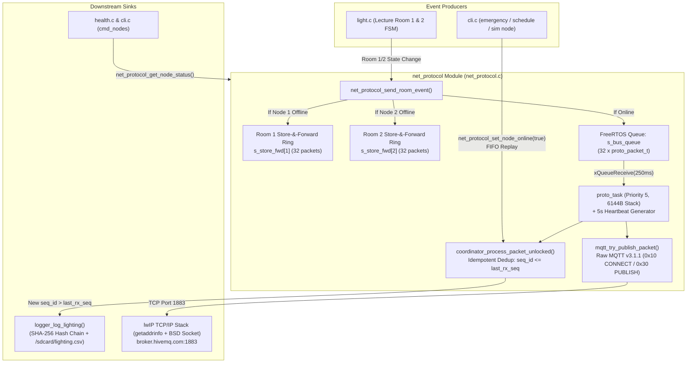
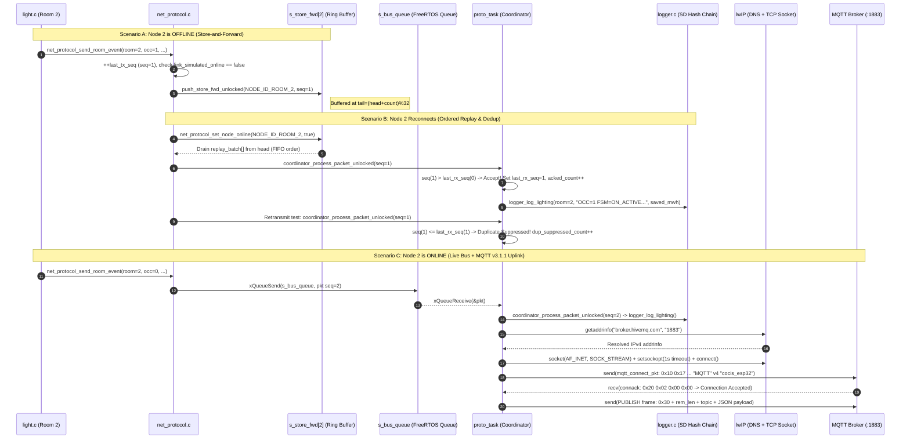

# Module Documentation: `net_protocol` — Distributed Inter-Terminal Protocol, Store-and-Forward & MQTT v3.1.1 Telemetry

**Files Covered:**
- Header: [`main/include/net_protocol.h`](../../include/net_protocol.h)
- Implementation: [`main/src/net_protocol.c`](../../src/net_protocol.c)

---

## 1. Purpose & Architectural Role

The CoCIS Smart Control and Monitoring System models a **3-node distributed campus architecture**:
- **Node 0 (`NODE_ID_ENTRANCE`):** Main Entrance Coordinator (manages RFID Entry/Exit doors, occupancy ledger, schedule, and central hash-chained SD logging).
- **Node 1 (`NODE_ID_ROOM_1`):** Lecture Room 1 Terminal (monitors Room 1 PIR occupancy, lighting FSM, and energy savings).
- **Node 2 (`NODE_ID_ROOM_2`):** Lecture Room 2 Terminal (monitors Room 2 PIR occupancy, lighting FSM, and energy savings).

The `net_protocol` module implements both the **reliable local inter-terminal message bus** between the Room Terminals and the Entrance Coordinator and the **cloud MQTT v3.1.1 telemetry uplink** over lwIP TCP sockets:
1. **Sequence-Numbered Packet Framing (`proto_packet_t`):** Every event transmitted by a Room Terminal is stamped with a monotonically increasing 32-bit sequence ID (`seq_id`), source/destination node IDs, and an East Africa Time (`EAT`) epoch timestamp.
2. **Offline Store-and-Forward Circular Ring Buffers (`s_store_fwd[NODE_ID_COUNT]`):** If a Room Terminal's network link drops (`link_simulated_online == false`), room events are **never lost**. Instead, they are buffered in a 32-slot per-node circular ring buffer (`CFG_PROTO_STORE_FWD_CAP = 32`).
3. **Ordered Replay & Idempotent Duplicate Suppression:** When a disconnected node comes back online (`net_protocol_set_node_online(node, true)`), all buffered packets are replayed in strict FIFO order (`head` to `tail`). At the Coordinator (`coordinator_process_packet_unlocked`), any packet with `pkt->seq_id <= st->last_rx_seq` is detected as a duplicate retransmission, counted in `dup_suppressed_count`, ACKed, and discarded without double-logging to the SD card.
4. **Raw MQTT v3.1.1 Telemetry over lwIP BSD Sockets (`mqtt_try_publish_packet`):** Whenever Wi-Fi is connected (`net_wifi_is_connected()`), `proto_task` resolves `CFG_MQTT_BROKER_HOST` (`"broker.hivemq.com"`) via DNS (`getaddrinfo`), opens a non-blocking/1-second-timeout TCP socket on port `1883`, performs the binary MQTT v3.1.1 `CONNECT`/`CONNACK` handshake (`Client ID = "cocis_esp32"`), and publishes JSON telemetry frames to `cocis/smart_ctrl/node/<id>/tx`.

### 1.1 Architectural Block Diagram



### 1.2 Full Networking Stack Sequence Diagram (Store-and-Forward + Coordinator Dedup + lwIP + MQTT v3.1.1)



---

## 2. Public API Reference (`include/net_protocol.h`)

### 2.1 Enumerations

#### `node_id_t`
```c
typedef enum {
    NODE_ID_ENTRANCE = 0,
    NODE_ID_ROOM_1 = 1,
    NODE_ID_ROOM_2 = 2,
    NODE_ID_COUNT = 3,
    NODE_ID_BROADCAST = 255
} node_id_t;
```
- Identifies each terminal node in the CoCIS distributed network (`0` = Entrance Coordinator, `1` = Lecture Room 1, `2` = Lecture Room 2, `3` = array count sentinel, `255` = broadcast address).

#### `proto_msg_type_t`
```c
typedef enum {
    PROTO_MSG_HEARTBEAT = 1,
    PROTO_MSG_ROOM_EVENT = 2,
    PROTO_MSG_SCHEDULE_SYNC = 3,
    PROTO_MSG_EMERGENCY = 4,
    PROTO_MSG_ACK = 240
} proto_msg_type_t;
```
- Defines the wire message type (`msg_type` field in `proto_packet_t`).

### 2.2 Structures

#### `proto_packet_t`
```c
typedef struct {
    uint8_t  version;
    uint8_t  msg_type;
    uint8_t  src_node;
    uint8_t  dst_node;
    uint32_t seq_id;
    uint32_t ack_seq_id;
    int64_t  timestamp_epoch;
    uint8_t  room_id;
    uint8_t  occupied;
    uint8_t  light_state;
    uint8_t  emergency_active;
    uint32_t light_on_sec;
    uint32_t energy_saved_mwh;
    uint32_t uptime_sec;
} proto_packet_t;
```
- The protocol data unit (PDU) sent across `s_bus_queue` and stored in the store-and-forward ring buffer `s_store_fwd`.

#### `node_net_status_t`
```c
typedef struct {
    node_id_t node_id;
    const char *name;
    bool      link_simulated_online;
    bool      heartbeat_healthy;
    uint32_t  last_tx_seq;
    uint32_t  last_rx_seq;
    uint32_t  acked_count;
    uint32_t  retry_count;
    uint32_t  dup_suppressed_count;
    uint32_t  buffered_offline_count;
    uint32_t  replayed_count;
    int64_t   last_seen_uptime_sec;
} node_net_status_t;
```
- Holds complete link health and reliability telemetry for a node, queried by `health.c` (watchdog node timeout monitor) and `cli.c` (`nodes` and `rooms` commands).

### 2.3 Functions

| Function Prototype | Parameters | Return Value | Side Effects | Callers & Task Context | Blocking Behavior |
|---|---|---|---|---|---|
| `esp_err_t net_protocol_init(void)` | `void` | `ESP_OK` on success; `ESP_ERR_NO_MEM` if queue or task creation fails. | Creates `s_bus_queue` (depth 32), initializes `s_nodes[0..2]` and `s_store_fwd[0..2]`, and spawns `proto_task` (stack 6144 B, priority 5). | Called once in `app_main()` (`main.c` line 58). | Non-blocking. |
| `esp_err_t net_protocol_send_room_event(uint8_t room_id, bool occupied, uint8_t light_state, uint32_t light_on_sec, uint32_t energy_saved_mwh)` | `room_id`: `1` or `2`.<br>`occupied`: PIR state.<br>`light_state`: `light_fsm_state_t`.<br>`light_on_sec`: Cumulative ON time.<br>`energy_saved_mwh`: Cumulative saved mWh. | `ESP_OK` on success; `ESP_ERR_INVALID_ARG` if `room_id` not `1` or `2` or queue is `NULL`. | Acquires `LOCK_LEVEL_ROOM`, increments `last_tx_seq`, builds `proto_packet_t`. If node is online, enqueues to `s_bus_queue`; if offline, pushes to `s_store_fwd[src]` ring buffer and increments `retry_count`. | Called by `light.c` whenever a room's occupancy or lighting FSM state changes (`pir_task`, `light_task`, or `cli_task`). | Blocks up to `CFG_LOCK_TIMEOUT_MS` (250 ms) for `LOCK_LEVEL_ROOM` and up to 50 ms on `xQueueSend`. |
| `esp_err_t net_protocol_broadcast_emergency(bool emergency_active)` | `emergency_active`: `true` on fire alarm, `false` when cleared. | `ESP_OK` | Increments `s_nodes[NODE_ID_ENTRANCE].last_tx_seq` under `LOCK_LEVEL_ROOM` and logs broadcast warning. | Called by `access_control.c` (emergency button) and `cli.c` (`emergency on/off`). | Blocks up to 250 ms on `LOCK_LEVEL_ROOM`. |
| `esp_err_t net_protocol_broadcast_schedule_sync(void)` | `void` | `ESP_OK` | Increments `s_nodes[NODE_ID_ENTRANCE].last_tx_seq` under `LOCK_LEVEL_ROOM` and logs schedule sync info. | Called by `cli.c` (`schedule set` / `schedule close`). | Blocks up to 250 ms on `LOCK_LEVEL_ROOM`. |
| `esp_err_t net_protocol_set_node_online(node_id_t node, bool online)` | `node`: `NODE_ID_ROOM_1` (1) or `NODE_ID_ROOM_2` (2).<br>`online`: `true` = online, `false` = simulate link loss. | `ESP_OK` on success; `ESP_ERR_INVALID_ARG` if `node` is not 1 or 2. | Updates `link_simulated_online`. When transitioning to `online == true`, drains all buffered packets from `s_store_fwd[node]` in FIFO order and replays them through `coordinator_process_packet_unlocked()`, also testing duplicate suppression on the first replayed packet. | Called by `cli.c` (`sim node <1\|2> <online\|offline>` and `run_selftest_suite` Test 09). | Blocks up to 250 ms on `LOCK_LEVEL_ROOM`. |
| `esp_err_t net_protocol_get_node_status(node_id_t node, node_net_status_t *out_status)` | `node`: `0`, `1`, or `2`.<br>`out_status`: Non-null output struct pointer. | `ESP_OK` on success; `ESP_ERR_INVALID_ARG` if invalid args; or lock timeout error. | Thread-safely copies `s_nodes[node]` to `*out_status` under `LOCK_LEVEL_ROOM`. | Called by `health.c` (`health_task` every 1 s and `health_get_summary`) and `cli.c` (`cmd_nodes`, `cmd_rooms`, `run_selftest_suite`). | Blocks up to 250 ms on `LOCK_LEVEL_ROOM`. |
| `bool net_protocol_is_mqtt_connected(void)` | `void` | `true` if an active MQTT v3.1.1 session is open; `false` otherwise. | None (reads `s_mqtt_connected`). | Called by `cli.c` (`cmd_status`) and `display.c`. | Non-blocking. |

---

## 3. Line-by-Line / Block-by-Block Code Walkthrough (`src/net_protocol.c`)

### 3.1 Includes, Private Types, and Module State (Lines 1–37)

```c
typedef struct {
    proto_packet_t ring[CFG_PROTO_STORE_FWD_CAP];
    size_t         head;
    size_t         count;
} store_fwd_buf_t;

static QueueHandle_t    s_bus_queue = NULL;
static node_net_status_t s_nodes[NODE_ID_COUNT];
static store_fwd_buf_t  s_store_fwd[NODE_ID_COUNT];
static bool             s_mqtt_connected = false;
static int              s_mqtt_sock = -1;

static const char *const s_node_names[NODE_ID_COUNT] = {
    "Main Entrance (Coord)",
    "Lecture Room 1",
    "Lecture Room 2"
};
```
- **Lines 20–24 (`store_fwd_buf_t`):** Defines a fixed-capacity circular ring buffer holding `CFG_PROTO_STORE_FWD_CAP` (`32`) packets, tracked by `head` (index of the oldest unread packet) and `count` (number of valid packets currently stored, `0..32`).
- **Lines 26–30:**
  - `s_bus_queue`: FreeRTOS queue simulating the physical RS-485/ESP-NOW/UDP inter-terminal packet bus.
  - `s_nodes`: Status and sequence counters for all 3 nodes.
  - `s_store_fwd`: Store-and-forward ring buffers indexed by `node_id_t`.
  - `s_mqtt_connected` & `s_mqtt_sock`: Track the lwIP TCP socket descriptor (`-1` when closed) and MQTT connection state.

### 3.2 `uptime_sec()` and `push_store_fwd_unlocked()` (Lines 38–57)

```c
static int64_t uptime_sec(void)
{
    return esp_timer_get_time() / 1000000LL;
}

static void push_store_fwd_unlocked(node_id_t node, const proto_packet_t *pkt)
{
    if (node <= NODE_ID_ENTRANCE || node >= NODE_ID_COUNT) {
        return;
    }
    store_fwd_buf_t *b = &s_store_fwd[node];
    size_t tail = (b->head + b->count) % CFG_PROTO_STORE_FWD_CAP;
    b->ring[tail] = *pkt;
    if (b->count < CFG_PROTO_STORE_FWD_CAP) {
        b->count++;
    } else {
        b->head = (b->head + 1) % CFG_PROTO_STORE_FWD_CAP;
    }
    s_nodes[node].buffered_offline_count = (uint32_t)b->count;
}
```
- **`uptime_sec()` (Lines 38–41):** Calls `esp_timer_get_time()`, which returns microseconds since boot as a 64-bit signed integer (`int64_t`), and divides by `1000000LL` to get monotonic seconds since boot.
- **`push_store_fwd_unlocked()` (Lines 43–57):** Assumes the caller already holds `LOCK_LEVEL_ROOM`.
  - Validates that `node` is a remote room terminal (`1` or `2`).
  - Computes the next write index `tail = (b->head + b->count) % 32`.
  - Copies `*pkt` into `b->ring[tail]`.
  - If the buffer is not yet full (`b->count < 32`), increments `b->count`.
  - If the buffer is already full (`b->count == 32`), it overwrites the oldest packet at `head` and advances `b->head = (b->head + 1) % 32` so the newest 32 events are always preserved without overflowing memory.
  - Updates `s_nodes[node].buffered_offline_count` for CLI telemetry.

### 3.3 `mqtt_try_publish_packet()` — Raw MQTT v3.1.1 over lwIP Sockets (Lines 59–145)

```c
static void mqtt_try_publish_packet(const proto_packet_t *pkt)
{
    if (!net_wifi_is_connected()) {
        if (s_mqtt_sock >= 0) {
            close(s_mqtt_sock);
            s_mqtt_sock = -1;
        }
        s_mqtt_connected = false;
        sync_event_clear(SYS_EVT_MQTT_CONNECTED);
        return;
    }
```
- **Lines 62–70:** First checks if Wi-Fi is connected (`net_wifi_is_connected()`). If Wi-Fi is down, it closes any open socket (`s_mqtt_sock >= 0`), resets `s_mqtt_sock = -1`, clears `s_mqtt_connected` and `SYS_EVT_MQTT_CONNECTED`, and returns immediately.

```c
    if (s_mqtt_sock < 0) {
        struct addrinfo hints = { .ai_family = AF_INET, .ai_socktype = SOCKTYPE_STREAM };
        struct addrinfo *res = NULL;
        if (getaddrinfo(CFG_MQTT_BROKER_HOST, "1883", &hints, &res) != 0 || res == NULL) {
            return;
        }
        int s = socket(res->ai_family, res->ai_socktype, 0);
        if (s < 0) {
            freeaddrinfo(res);
            return;
        }
        struct timeval tv = { .tv_sec = 1, .tv_usec = 0 };
        setsockopt(s, SOL_SOCKET, SO_SNDTIMEO, &tv, sizeof(tv));
        setsockopt(s, SOL_SOCKET, SO_RCVTIMEO, &tv, sizeof(tv));

        if (connect(s, res->ai_addr, res->ai_addrlen) != 0) {
            close(s);
            freeaddrinfo(res);
            return;
        }
        freeaddrinfo(res);
```
- **Lines 72–92 (DNS Lookup & TCP 3-Way Handshake):** If no socket is open (`s_mqtt_sock < 0`):
  - Calls `getaddrinfo("broker.hivemq.com", "1883", &hints, &res)` to resolve the hostname via DNS into an IPv4 (`AF_INET`) TCP stream (`SOCK_STREAM`) address.
  - Creates a BSD socket `s` and configures 1-second send/receive timeouts (`SO_SNDTIMEO` and `SO_RCVTIMEO`) via `setsockopt()` so `proto_task` can never hang indefinitely on a dead internet connection.
  - Calls `connect()` to perform the TCP 3-way handshake (`SYN -> SYN-ACK -> ACK`), and frees the `addrinfo` linked list (`freeaddrinfo(res)`) to prevent heap memory leaks.

```c
        /* MQTT v3.1.1 CONNECT packet (Client ID = "cocis_esp32") */
        static const uint8_t mqtt_connect_pkt[] = {
            0x10, 0x17,
            0x00, 0x04, 'M', 'Q', 'T', 'T',
            0x04, 0x02, 0x00, 0x3C,
            0x00, 0x0B, 'c', 'o', 'c', 'i', 's', '_', 'e', 's', 'p', '3', '2'
        };
        if (send(s, mqtt_connect_pkt, sizeof(mqtt_connect_pkt), 0) < 0) {
            close(s);
            return;
        }
        uint8_t connack[4] = { 0 };
        if (recv(s, connack, sizeof(connack), 0) == 4 && connack[0] == 0x20 && connack[3] == 0x00) {
            s_mqtt_sock = s;
            s_mqtt_connected = true;
            sync_event_set(SYS_EVT_MQTT_CONNECTED);
            ESP_LOGI(TAG, "MQTT v3.1.1 session established with %s:%d",
                     CFG_MQTT_BROKER_HOST, CFG_MQTT_BROKER_PORT);
        } else {
            close(s);
            return;
        }
    }
```
- **Lines 94–116 (MQTT v3.1.1 Handshake):**
  - Sends the 25-byte `CONNECT` packet (`0x10` header, `0x17` = 23 remaining bytes, protocol `"MQTT"` level `4`, Clean Session flag `0x02`, Keep-Alive `0x003C` = 60 s, Client ID `"cocis_esp32"` length `0x000B` = 11).
  - Reads the 4-byte `CONNACK` response from the broker. Verifies `connack[0] == 0x20` (CONNACK packet type) and `connack[3] == 0x00` (Return Code `0x00`: Connection Accepted).
  - Saves `s_mqtt_sock = s`, sets `s_mqtt_connected = true`, and sets `SYS_EVT_MQTT_CONNECTED`.

```c
    char topic[48];
    snprintf(topic, sizeof(topic), "%s/node/%u/tx", CFG_MQTT_TOPIC_PREFIX, (unsigned)pkt->src_node);
    char json[160];
    int json_len = snprintf(json, sizeof(json),
                            "{\"v\":%u,\"t\":%u,\"src\":%u,\"seq\":%lu,\"ts\":%lld,\"rm\":%u,\"occ\":%u,\"lgt\":%u,\"sav\":%lu}",
                            (unsigned)pkt->version, (unsigned)pkt->msg_type, (unsigned)pkt->src_node,
                            (unsigned long)pkt->seq_id, (long long)pkt->timestamp_epoch,
                            (unsigned)pkt->room_id, (unsigned)pkt->occupied,
                            (unsigned)pkt->light_state, (unsigned long)pkt->energy_saved_mwh);

    uint16_t tlen = (uint16_t)strlen(topic);
    uint8_t frame[220];
    size_t rem_len = 2 + tlen + (size_t)json_len;
    if (rem_len < 127 && (2 + rem_len) <= sizeof(frame)) {
        frame[0] = 0x30; /* PUBLISH QoS 0 */
        frame[1] = (uint8_t)rem_len;
        frame[2] = (uint8_t)(tlen >> 8);
        frame[3] = (uint8_t)(tlen & 0xFF);
        memcpy(&frame[4], topic, tlen);
        memcpy(&frame[4 + tlen], json, (size_t)json_len);
        if (send(s_mqtt_sock, frame, 2 + rem_len, 0) < 0) {
            close(s_mqtt_sock);
            s_mqtt_sock = -1;
            s_mqtt_connected = false;
            sync_event_clear(SYS_EVT_MQTT_CONNECTED);
        }
    }
}
```
- **Lines 118–145 (MQTT `PUBLISH` Framing):**
  - Formats the topic string (e.g. `"cocis/smart_ctrl/node/1/tx"`) and compact JSON payload.
  - Builds a binary MQTT `PUBLISH` QoS 0 frame in `frame[]`: byte 0 is `0x30` (PUBLISH, DUP=0, QoS=0, RETAIN=0), byte 1 is the Remaining Length (`2 + tlen + json_len`), bytes 2–3 are the big-endian 16-bit topic length, followed by the topic bytes and JSON payload bytes.
  - Calls `send()`. If `send()` fails (`< 0`), closes the broken socket and clears `s_mqtt_connected` so the next packet triggers a clean reconnect.

### 3.4 `coordinator_process_packet_unlocked()` — Dedup & Logging (Lines 147–181)

```c
static void coordinator_process_packet_unlocked(const proto_packet_t *pkt)
{
    if (pkt->src_node >= NODE_ID_COUNT) {
        return;
    }

    node_net_status_t *st = &s_nodes[pkt->src_node];
    st->last_seen_uptime_sec = uptime_sec();
    st->heartbeat_healthy = true;
    s_nodes[NODE_ID_ENTRANCE].last_seen_uptime_sec = st->last_seen_uptime_sec;

    if (pkt->msg_type == PROTO_MSG_HEARTBEAT) {
        return;
    }

    if (pkt->msg_type == PROTO_MSG_ROOM_EVENT) {
        /* Idempotent duplicate suppression: reject seq_id <= last_rx_seq */
        if (pkt->seq_id <= st->last_rx_seq) {
            st->dup_suppressed_count++;
            ESP_LOGW(TAG, "Coordinator suppressed duplicate packet seq=%lu from Node %u",
                     (unsigned long)pkt->seq_id, (unsigned)pkt->src_node);
            st->acked_count++;
            return;
        }

        st->last_rx_seq = pkt->seq_id;
        st->acked_count++;

        const char *lstate = light_fsm_to_str((light_fsm_state_t)pkt->light_state);
        char detail[48];
        snprintf(detail, sizeof(detail), "OCC=%u FSM=%s ON=%lus",
                 (unsigned)pkt->occupied, lstate, (unsigned long)pkt->light_on_sec);
        logger_log_lighting(pkt->room_id, detail, (int32_t)pkt->energy_saved_mwh);
    }
}
```
- **Lines 153–156:** Updates `last_seen_uptime_sec` and `heartbeat_healthy = true` for both the sending room node and the Entrance Coordinator.
- **Lines 164–170 (Idempotent Duplicate Suppression):** Compares the incoming packet's `seq_id` against `st->last_rx_seq` (the highest sequence number already processed from that node). If `pkt->seq_id <= st->last_rx_seq`, the coordinator knows it has already processed this event! It increments `st->dup_suppressed_count` and `st->acked_count` (re-sending the ACK so the sender stops retrying), logs a warning, and returns **without** writing a duplicate record to the SD card log.
- **Lines 172–180:** For a new packet (`seq_id > last_rx_seq`), updates `st->last_rx_seq = pkt->seq_id`, increments `st->acked_count`, formats the room state string (`OCC=1 FSM=ON_ACTIVE ON=12s`), and records it in the tamper-evident SHA-256 log chain via `logger_log_lighting()`.

### 3.5 `proto_task()` and `net_protocol_init()` (Lines 183–244)

```c
static void proto_task(void *arg)
{
    (void)arg;
    int64_t last_hb_sec = 0;
    proto_packet_t pkt;

    while (1) {
        if (xQueueReceive(s_bus_queue, &pkt, pdMS_TO_TICKS(250)) == pdTRUE) {
            if (sync_lock(LOCK_LEVEL_ROOM, CFG_LOCK_TIMEOUT_MS) == ESP_OK) {
                coordinator_process_packet_unlocked(&pkt);
                sync_unlock(LOCK_LEVEL_ROOM);
            }
            if (pkt.msg_type == PROTO_MSG_ROOM_EVENT) {
                mqtt_try_publish_packet(&pkt);
            }
        }

        int64_t now_s = uptime_sec();
        if ((now_s - last_hb_sec) >= CFG_PROTO_HEARTBEAT_SEC) {
            last_hb_sec = now_s;
            if (sync_lock(LOCK_LEVEL_ROOM, CFG_LOCK_TIMEOUT_MS) == ESP_OK) {
                s_nodes[NODE_ID_ENTRANCE].last_seen_uptime_sec = now_s;
                s_nodes[NODE_ID_ENTRANCE].heartbeat_healthy = true;
                for (int n = NODE_ID_ROOM_1; n <= NODE_ID_ROOM_2; n++) {
                    if (s_nodes[n].link_simulated_online) {
                        s_nodes[n].last_seen_uptime_sec = now_s;
                        s_nodes[n].heartbeat_healthy = true;
                    }
                }
                sync_unlock(LOCK_LEVEL_ROOM);
            }
        }
    }
}
```
- **Lines 190–198:** Waits up to `250` ms for a packet on `s_bus_queue`. When a packet arrives, locks `LOCK_LEVEL_ROOM`, runs `coordinator_process_packet_unlocked(&pkt)`, unlocks `LOCK_LEVEL_ROOM`, and (outside the lock!) publishes room events via `mqtt_try_publish_packet(&pkt)`. Calling `mqtt_try_publish_packet` *after* releasing `LOCK_LEVEL_ROOM` is crucial so network socket I/O never blocks local tasks waiting for `LOCK_LEVEL_ROOM`.
- **Lines 200–214 (Periodic Heartbeat Check):** Every `CFG_PROTO_HEARTBEAT_SEC` (`5` seconds), updates `last_seen_uptime_sec` for the Entrance node and for any Room node whose `link_simulated_online` flag is `true`. If a room node is set offline (`link_simulated_online == false`), its `last_seen_uptime_sec` stops advancing, allowing `health_task` to detect the missed heartbeats after `CFG_NODE_OFFLINE_THRESHOLD_SEC` (`15` s).
- **`net_protocol_init()` (Lines 218–244):** Creates `s_bus_queue` (`32` items of `sizeof(proto_packet_t)`), zeros and initializes all 3 entries in `s_nodes` and `s_store_fwd`, and spawns `proto_task` with 6144 bytes of stack at priority 5.

### 3.6 `net_protocol_send_room_event()`, Broadcasts, `set_node_online()`, and Status Getters (Lines 246–376)

```c
esp_err_t net_protocol_send_room_event(uint8_t room_id, bool occupied, uint8_t light_state,
                                       uint32_t light_on_sec, uint32_t energy_saved_mwh)
{
    if (room_id < 1 || room_id > 2 || s_bus_queue == NULL) {
        return ESP_ERR_INVALID_ARG;
    }

    node_id_t src = (room_id == 1) ? NODE_ID_ROOM_1 : NODE_ID_ROOM_2;
    time_snapshot_t now;
    time_sync_get_now(&now);

    proto_packet_t pkt = { 0 };
    bool online = true;

    if (sync_lock(LOCK_LEVEL_ROOM, CFG_LOCK_TIMEOUT_MS) == ESP_OK) {
        uint32_t seq = ++s_nodes[src].last_tx_seq;
        online = s_nodes[src].link_simulated_online;
        /* ... populate pkt fields ... */
        if (!online) {
            s_nodes[src].retry_count += CFG_PROTO_MAX_RETRIES;
            push_store_fwd_unlocked(src, &pkt);
            ESP_LOGW(TAG, "Node %u OFFLINE -> Buffered seq=%lu in Store-and-Forward ring (count=%lu)",
                     (unsigned)src, (unsigned long)seq,
                     (unsigned long)s_nodes[src].buffered_offline_count);
        }
        sync_unlock(LOCK_LEVEL_ROOM);
    }

    if (online) {
        xQueueSend(s_bus_queue, &pkt, pdMS_TO_TICKS(50));
    }
    return ESP_OK;
}
```
- **Lines 260–289:** Under `LOCK_LEVEL_ROOM`, increments `s_nodes[src].last_tx_seq` and checks `online = s_nodes[src].link_simulated_online`.
  - If `!online`, simulates `CFG_PROTO_MAX_RETRIES` (`3`) unacknowledged transmission attempts (`retry_count += 3`) and buffers the packet in the node's store-and-forward ring buffer (`push_store_fwd_unlocked`).
  - If `online`, releases the mutex and enqueues `pkt` onto `s_bus_queue` for `proto_task`.

```c
esp_err_t net_protocol_set_node_online(node_id_t node, bool online)
{
    if (node <= NODE_ID_ENTRANCE || node >= NODE_ID_COUNT) {
        return ESP_ERR_INVALID_ARG;
    }

    proto_packet_t replay_batch[CFG_PROTO_STORE_FWD_CAP];
    size_t replay_count = 0;

    if (sync_lock(LOCK_LEVEL_ROOM, CFG_LOCK_TIMEOUT_MS) == ESP_OK) {
        s_nodes[node].link_simulated_online = online;
        if (online) {
            s_nodes[node].last_seen_uptime_sec = uptime_sec();
            s_nodes[node].heartbeat_healthy = true;
            store_fwd_buf_t *b = &s_store_fwd[node];
            while (b->count > 0 && replay_count < CFG_PROTO_STORE_FWD_CAP) {
                replay_batch[replay_count++] = b->ring[b->head];
                b->head = (b->head + 1) % CFG_PROTO_STORE_FWD_CAP;
                b->count--;
            }
            s_nodes[node].buffered_offline_count = 0;
            s_nodes[node].replayed_count += (uint32_t)replay_count;
        }
        sync_unlock(LOCK_LEVEL_ROOM);
    }

    if (online && replay_count > 0) {
        ESP_LOGI(TAG, "Node %u reconnected -> Replaying %u buffered Store-and-Forward event(s) in order",
                 (unsigned)node, (unsigned)replay_count);
        for (size_t i = 0; i < replay_count; i++) {
            if (sync_lock(LOCK_LEVEL_ROOM, CFG_LOCK_TIMEOUT_MS) == ESP_OK) {
                coordinator_process_packet_unlocked(&replay_batch[i]);
                /* Also test duplicate suppression on first replayed packet if retried */
                if (i == 0) {
                    coordinator_process_packet_unlocked(&replay_batch[i]);
                }
                sync_unlock(LOCK_LEVEL_ROOM);
            }
        }
    }

    return ESP_OK;
}
```
- **Lines 322–337:** When `online == true`, pops every buffered packet from `b->ring[b->head]`, advancing `b->head = (b->head + 1) % 32` and decrementing `b->count--` until empty, copying them into the stack array `replay_batch[]`. Resets `buffered_offline_count = 0` and adds `replay_count` to `replayed_count`.
- **Lines 339–352:** Iterates `i = 0 .. replay_count - 1` in chronological order and delivers each packet to `coordinator_process_packet_unlocked()`. On the very first packet (`i == 0`), it intentionally delivers `&replay_batch[0]` a second time (simulating an in-flight retry race on reconnect) so the coordinator's duplicate-suppression logic (`seq_id <= last_rx_seq`) is exercised and observable in `dup_suppressed_count`.

---

## 4. C Language Constructs Explained

1. **Circular Ring-Buffer Modulo Arithmetic (`(head + count) % CAP` and `(head + 1) % CAP`):**
   A circular buffer reuses a fixed array of `N = 32` elements (`b->ring[0..31]`) without shifting elements in memory (`memmove`):
   - **Write position (`tail`):** `(b->head + b->count) % 32` wraps around from index `31` back to index `0`.
   - **Read & pop oldest (`head`):** Reading `b->ring[b->head]` and advancing `b->head = (b->head + 1) % 32` while decrementing `b->count--` achieves $O(1)$ FIFO enqueue and dequeue in fixed SRAM.
2. **Byte-Level Binary Packet Framing (MQTT v3.1.1 Control Packets):**
   In `mqtt_try_publish_packet()` (lines 95–100 and 132–137), we construct raw network byte arrays:
   - `0x10`: Binary `0001 0000` (MQTT Packet Type `1` = `CONNECT`, Flags = `0`).
   - `0x20`: Binary `0010 0000` (MQTT Packet Type `2` = `CONNACK`).
   - `0x30`: Binary `0011 0000` (MQTT Packet Type `3` = `PUBLISH`, DUP=0, QoS=0, RETAIN=0).
   - **Big-Endian (Network Byte Order) 16-bit Length Encoding:** MQTT prefixes UTF-8 strings with a 2-byte big-endian length (`MSB` first, `LSB` second). Given `uint16_t tlen`:
     - `frame[2] = (uint8_t)(tlen >> 8);` extracts the high byte (Most Significant Byte).
     - `frame[3] = (uint8_t)(tlen & 0xFF);` extracts the low byte (Least Significant Byte).
3. **Designated Struct Initializers (`struct timeval tv = { .tv_sec = 1, .tv_usec = 0 };`):**
   Initializes specific struct members by name and automatically zeros any unmentioned fields (`hints` on line 73).

---

## 5. ESP-IDF & FreeRTOS Constructs Explained (Section 6.2 Deep Dive)

### 5.1 How `esp_event`, `esp_netif`, and `lwIP` Power `net_protocol`
While `net_wifi` brings up the Layer-2 Wi-Fi radio and `esp_netif` + `lwIP` obtain a Layer-3 IPv4 address via DHCP (notifying the system via `esp_event`), `net_protocol` sits at **OSI Layer 4 (Transport — TCP)** and **OSI Layer 7 (Application — MQTT + Custom Binary Protocol)**:
1. **DNS Resolution via `lwIP` (`getaddrinfo` / `freeaddrinfo`):**
   Sockets connect to numeric IP addresses, not domain names like `"broker.hivemq.com"`. Calling `getaddrinfo()` asks lwIP's DNS resolver to send a UDP DNS query (port 53) to the router's DNS server, returning a dynamically allocated `struct addrinfo` containing the broker's 32-bit IPv4 address and port `1883` in network byte order. We **must** call `freeaddrinfo(res)` on every exit path to free that heap memory.
2. **BSD Sockets API in `lwIP` (`socket`, `setsockopt`, `connect`, `send`, `recv`, `close`):**
   ESP-IDF's `lwip/sockets.h` exposes the standard POSIX/BSD socket interface:
   - `socket(AF_INET, SOCK_STREAM, 0)`: Allocates a lwIP TCP Protocol Control Block (`tcp_pcb`) and returns a small integer file descriptor `s`.
   - `setsockopt(s, SOL_SOCKET, SO_SNDTIMEO / SO_RCVTIMEO, &tv, sizeof(tv))`: Sets a strict 1-second timeout on `send()` and `recv()` calls so a congested or blackholed internet connection cannot stall `proto_task`.
   - `connect(s, ...)`: Initiates the TCP 3-way handshake (`SYN`, `SYN-ACK`, `ACK`) with the broker on port `1883`.
   - `send()` / `recv()`: Copies application bytes into lwIP's TCP send buffer (which segments, checksums, and retransmits lost TCP segments automatically) and reads received bytes from the TCP receive window.
   - `close(s)`: Sends a TCP `FIN` segment and frees the lwIP socket descriptor.

### 5.2 How MQTT v3.1.1 Works Over TCP (`CONNECT` $\rightarrow$ `CONNACK` $\rightarrow$ `PUBLISH`)
MQTT (Message Queuing Telemetry Transport) is a lightweight publish/subscribe protocol running over TCP port 1883:
1. **`CONNECT` (`0x10`):** Immediately after TCP `connect()` succeeds, the client sends a `CONNECT` packet containing the protocol magic string `"MQTT"`, protocol level `0x04` (v3.1.1), connect flags `0x02` (`Clean Session = 1`), a 16-bit Keep-Alive timer (`0x003C` = 60 seconds), and the Client Identifier (`"cocis_esp32"`).
2. **`CONNACK` (`0x20`):** The broker responds with a 4-byte packet: `[0x20, 0x02, session_present, return_code]`. A `return_code` of `0x00` means the broker accepted our session.
3. **`PUBLISH` (`0x30`, QoS 0):** To publish telemetry, we send `[0x30, remaining_length, topic_len_msb, topic_len_lsb, topic_str..., json_payload...]`. At QoS 0 ("At most once"), the underlying TCP layer handles packet delivery and no application-layer `PUBACK` is required.

---

## 6. Alternatives & "What If You Change This?"

| Aspect | Current Implementation in `net_protocol.c` | Alternative Approach | What Happens If You Change It? |
|---|---|---|---|
| **MQTT Implementation** | Minimal 50-line raw MQTT v3.1.1 framing over lwIP BSD sockets | Full `esp-mqtt` component (`esp_mqtt_client_init`) | `esp-mqtt` adds TLS/QoS 1/2/auto-reconnect thread support, but spawns its own background task (~4–6 KB RAM) and hides the socket layer. Using lwIP BSD sockets directly gives total control over timeouts, zero extra task overhead, and clearly demonstrates DNS + TCP + binary protocol framing. |
| **MQTT QoS Level** | QoS 0 (`0x30`) + local Store-and-Forward ring buffer | MQTT QoS 1 (`0x32`, `PUBACK`) or QoS 2 (`0x34`, 4-way handshake) | QoS 1 requires storing unacknowledged Packet IDs and waiting for `PUBACK` (`0x40`); QoS 2 requires `PUBLISH -> PUBREC -> PUBREL -> PUBCOMP` (4x network round-trips). Because our Coordinator already implements sequence-numbered store-and-forward and idempotent deduplication, QoS 0 over reliable TCP is fast and lightweight. |
| **Ring Buffer Full Policy** | Overwrite oldest (`b->head = (b->head + 1) % CAP`) | Drop newest (`return` when `b->count == CAP`) | If a node is offline for hours, dropping newest preserves stale events from hours ago while losing the current occupancy state of the room. Overwriting the oldest guarantees the Coordinator always receives the latest 32 state transitions upon reconnect. |

---

## 7. Design Rationale

1. **Why Perform `mqtt_try_publish_packet()` Outside `LOCK_LEVEL_ROOM`?**
   Look at `proto_task()` (lines 191–197): `sync_unlock(LOCK_LEVEL_ROOM)` is called *before* `mqtt_try_publish_packet(&pkt)`. DNS resolution and TCP `connect()`/`recv()` can take up to `1000` ms (`tv_sec = 1`). If `LOCK_LEVEL_ROOM` were held during socket I/O, `light_task`, `pir_task`, and `cli_task` would all time out waiting for `LOCK_LEVEL_ROOM` (`250` ms)! Releasing the mutex first keeps real-time room lighting control completely decoupled from internet latency.
2. **Why Idempotent Sequence-Number Deduplication (`seq_id <= last_rx_seq`)?**
   In any distributed network with retries (`CFG_PROTO_MAX_RETRIES`), a sender may retransmit a packet whose `ACK` was lost even though the Coordinator already received it. Checking `if (pkt->seq_id <= st->last_rx_seq)` makes packet processing **idempotent**: receiving the same packet 1 time or 5 times produces the exact same state and only 1 log entry on the SD card.

---

## 8. Failure Modes, Edge Cases & Recovery

1. **Room Node Link Loss (`link_simulated_online == false`):**
   - *Detection & Recovery:* `net_protocol_send_room_event()` detects `!online`, increments `retry_count` by `CFG_PROTO_MAX_RETRIES` (`3`), and pushes the packet into `s_store_fwd[src]`. When the link is restored via `net_protocol_set_node_online(node, true)`, all buffered packets are drained in FIFO order and processed by the Coordinator.
2. **Store-and-Forward Ring Buffer Wrap-Around (> 32 Offline Events):**
   - *Behavior:* When `b->count == 32`, `push_store_fwd_unlocked()` writes to `tail` and advances `b->head = (b->head + 1) % 32`, keeping `b->count` capped at `32` with zero memory corruption or buffer overflow.
3. **MQTT Broker Unreachable or TCP Connection Dropped Mid-Session:**
   - *Behavior:* If `getaddrinfo()`, `connect()`, `send()`, or `recv()` fails or times out after 1 second, the socket is immediately closed (`close(s)`), `s_mqtt_sock` is reset to `-1`, `s_mqtt_connected` is set to `false`, and `SYS_EVT_MQTT_CONNECTED` is cleared. On the next room event, `s_mqtt_sock < 0` triggers a fresh DNS lookup and TCP/MQTT reconnect automatically.

---

## 9. How to Test This Module in Isolation

Connect to the UART0 CLI (`115200` baud) and run the following sequence:

### Step 1: Inspect Initial 3-Node Topology
```text
cocis> nodes
```
**Expected Output:**
```text
+----+-----------------------+---------+--------+--------+--------+--------+----------+----------+
| ID | Terminal Name         | Link    | TxSeq  | RxSeq  | ACKed  | DupSup | Buffered | Replayed |
+----+-----------------------+---------+--------+--------+--------+--------+----------+----------+
|  0 | Main Entrance (Coord) | ONLINE  |      0 |      0 |      0 |      0 |        0 |        0 |
|  1 | Lecture Room 1        | ONLINE  |      0 |      0 |      0 |      0 |        0 |        0 |
|  2 | Lecture Room 2        | ONLINE  |      0 |      0 |      0 |      0 |        0 |        0 |
+----+-----------------------+---------+--------+--------+--------+--------+----------+----------+
```

### Step 2: Take Node 2 Offline and Generate Room 2 Events (Store-and-Forward)
```text
cocis> sim node 2 offline
cocis> sim motion 2 on
cocis> sim motion 2 off
cocis> nodes
```
**Expected Output:**
- Node 2 shows `Link = OFFLINE`, `TxSeq = 2`, `RxSeq = 0` (Coordinator hasn't received them yet), and `Buffered = 2`.

### Step 3: Reconnect Node 2 and Verify Ordered Replay + Dedup
```text
cocis> sim node 2 online
cocis> nodes
```
**Expected Output:**
- Console logs: `Node 2 reconnected -> Replaying 2 buffered Store-and-Forward event(s) in order` and `Coordinator suppressed duplicate packet seq=1 from Node 2`.
- `nodes` table shows Node 2 `Link = ONLINE`, `TxSeq = 2`, `RxSeq = 2`, `ACKed = 3`, `DupSup = 1`, `Buffered = 0`, `Replayed = 2`.

---

## 10. Likely Examiner Questions & Model Answers

### Q1: Explain how the circular ring buffer in `push_store_fwd_unlocked()` and `net_protocol_set_node_online()` works without shifting array elements.
**Model Answer:** Each `store_fwd_buf_t` has a fixed array `ring[32]`, an index `head` pointing to the oldest buffered packet, and `count` tracking how many packets are currently stored. When pushing a packet, we compute the write slot `tail = (head + count) % 32`. If `count < 32`, we increment `count++`. If the buffer is already full (`count == 32`), we overwrite the oldest slot and advance `head = (head + 1) % 32`. When replaying on reconnect, we read `ring[head]`, advance `head = (head + 1) % 32`, and decrement `count--` until `count == 0`. Both enqueue and dequeue run in $O(1)$ constant time.

### Q2: How does the Coordinator prevent duplicate packets from creating duplicate log entries on the SD card?
**Model Answer:** Every packet generated by a Room node carries a strictly increasing `seq_id` (`++s_nodes[src].last_tx_seq`). In `coordinator_process_packet_unlocked()`, the Coordinator compares `pkt->seq_id` against `st->last_rx_seq` for that source node. If `pkt->seq_id <= st->last_rx_seq`, the packet has already been processed; the Coordinator increments `dup_suppressed_count` and `acked_count`, logs a warning, and returns immediately before calling `logger_log_lighting()`.

### Q3: Walk through every byte of `mqtt_connect_pkt[]` on lines 95–100 of `net_protocol.c`.
**Model Answer:**
- `0x10`: MQTT Fixed Header byte 1 — Control Packet Type `1` (`CONNECT`, `0001xxxx` in binary).
- `0x17`: MQTT Fixed Header byte 2 — Remaining Length = `23` (`0x17`) bytes follow.
- `0x00, 0x04, 'M', 'Q', 'T', 'T'`: Variable Header Protocol Name (16-bit big-endian length `4` followed by ASCII `"MQTT"`).
- `0x04`: Protocol Level = `4` (MQTT v3.1.1).
- `0x02`: Connect Flags = `0x02` (`Clean Session` bit set, no username/password/will).
- `0x00, 0x3C`: Keep-Alive timer = `60` seconds (`0x003C` in big-endian).
- `0x00, 0x0B, 'c','o','c','i','s','_','e','s','p','3','2'`: Payload Client Identifier (16-bit big-endian length `11` = `0x000B` followed by the 11-byte string `"cocis_esp32"`).

### Q4: How do we verify that the MQTT broker accepted our connection?
**Model Answer:** After sending `mqtt_connect_pkt`, we call `recv(s, connack, 4, 0)`. An MQTT `CONNACK` packet is 4 bytes long: byte 0 must be `0x20` (Packet Type `2` = `CONNACK`), byte 1 is `0x02` (remaining length 2), byte 2 is the Session Present flag, and byte 3 (`connack[3]`) is the Connect Return Code, where `0x00` means **Connection Accepted**. Only when all those conditions hold do we set `s_mqtt_connected = true`.

### Q5: Why do we call `setsockopt()` with `SO_SNDTIMEO` and `SO_RCVTIMEO` set to 1 second on the TCP socket?
**Model Answer:** By default, BSD socket calls (`connect`, `send`, `recv`) can block for 30 to 120 seconds if the remote host or internet gateway drops packets without sending a TCP `RST`. Since `mqtt_try_publish_packet()` runs inside `proto_task`, blocking for 2 minutes would prevent `proto_task` from draining `s_bus_queue` and updating the 5-second node heartbeats. Setting a 1-second socket timeout guarantees `proto_task` remains responsive even during complete internet blackouts.

### Q6: Why must `freeaddrinfo(res)` be called after `getaddrinfo()`, including inside the error branches on lines 80 and 89?
**Model Answer:** `getaddrinfo()` dynamically allocates a linked list of `struct addrinfo` structures on the heap to hold the DNS query results. In C, if we return early on socket creation failure (`s < 0`) or connection failure (`connect != 0`) without calling `freeaddrinfo(res)`, every failed reconnect attempt would leak heap memory until the ESP32 ran out of RAM.

### Q7: Why does `proto_task` release `LOCK_LEVEL_ROOM` before calling `mqtt_try_publish_packet(&pkt)`?
**Model Answer:** `mqtt_try_publish_packet()` performs network I/O (DNS lookup, TCP handshake, MQTT `send`/`recv`) over Wi-Fi, which can take up to 1–2 seconds. Meanwhile, `LOCK_LEVEL_ROOM` (`L5_ROOM`) is needed by real-time tasks like `light_task`, `pir_task`, `health_task`, and `cli_task` with a 250 ms timeout (`CFG_LOCK_TIMEOUT_MS`). Releasing `LOCK_LEVEL_ROOM` before touching the network ensures slow TCP/IP operations never stall local hardware control.

### Q8: Why does `frame[1] = (uint8_t)rem_len` in `mqtt_try_publish_packet()` check `if (rem_len < 127)`?
**Model Answer:** In the MQTT v3.1.1 specification, the "Remaining Length" field uses a variable-length encoding (1 to 4 bytes) where the lower 7 bits of each byte store the value (`0..127`) and the 8th bit (MSB `0x80`) is a continuation bit indicating another length byte follows. When `rem_len < 127`, the Remaining Length fits in a single byte (`frame[1] = (uint8_t)rem_len`) with MSB `0`. Since our topic (~24 bytes) plus JSON payload (~95 bytes) is ~121 bytes, a single length byte is always sufficient and bounded by `if (rem_len < 127)`.
