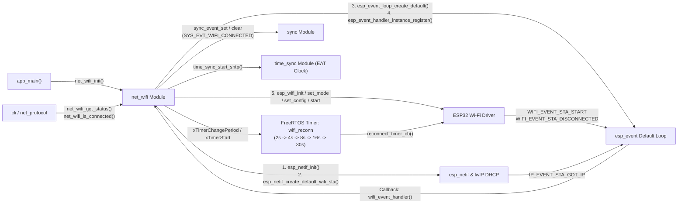
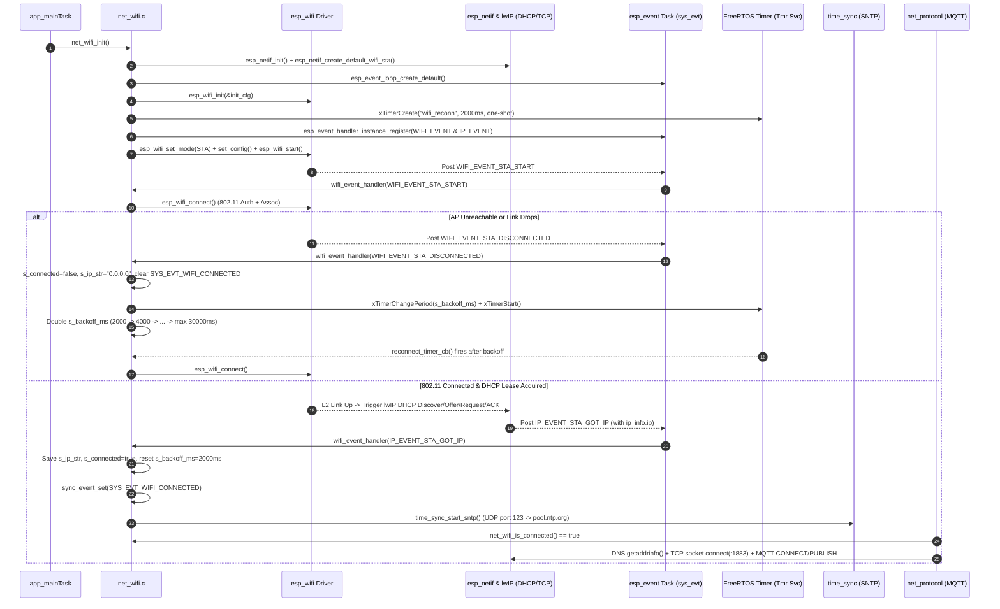

# Module Documentation: `net_wifi` — Wi-Fi Station Manager & Reconnect Timer

**Files Covered:**
- Header: [`main/include/net_wifi.h`](../../include/net_wifi.h)
- Implementation: [`main/src/net_wifi.c`](../../src/net_wifi.c)

---

## 1. Purpose & Architectural Role

The `net_wifi` module manages the ESP32's IEEE 802.11 Wi-Fi Station (STA) interface, connecting the CoCIS Smart Control and Monitoring System to the campus/simulator wireless access point (`CFG_WIFI_SSID` = `"Wokwi-GUEST"`). Its responsibilities are:
1. **Initializing the ESP-IDF Networking Foundation:** Bootstrapping the network interface abstraction layer (`esp_netif`), the default system event loop (`esp_event`), and the Wi-Fi radio/MAC driver (`esp_wifi`).
2. **Non-Blocking, Event-Driven Connection Lifecycle:** Listening asynchronously for `WIFI_EVENT_STA_START`, `WIFI_EVENT_STA_DISCONNECTED`, and `IP_EVENT_STA_GOT_IP` notifications dispatched by the ESP-IDF system event task.
3. **Resilient Exponential Backoff Reconnection:** Using a FreeRTOS software timer (`s_reconn_timer`) that starts at `CFG_WIFI_RECONNECT_BASE_MS` (`2000` ms) and doubles on each consecutive failure (`2s -> 4s -> 8s -> 16s -> 30s` cap at `CFG_WIFI_RECONNECT_MAX_MS`) so the ESP32 never blocks the event loop or floods the access point with connection requests during an outage.
4. **Triggering Downstream Network Services:** Setting `SYS_EVT_WIFI_CONNECTED` in the `sync` event group and starting the SNTP client (`time_sync_start_sntp()`) as soon as DHCP assigns an IPv4 address, while gracefully allowing the local 3-node inter-terminal bus (`net_protocol`) to operate even if Wi-Fi hardware or the AP is unavailable.

### 1.1 Module Interaction Diagram



### 1.2 Full Networking Stack Sequence Diagram (`net_wifi` + `esp_netif` + `lwIP` + `net_protocol`)



---

## 2. Public API Reference (`include/net_wifi.h`)

### 2.1 Structures

#### `wifi_status_t`
```c
typedef struct {
    bool     connected;
    char     ssid[33];
    char     ip_addr[16];
    int8_t   rssi;
    uint32_t reconnect_count;
} wifi_status_t;
```
- **Fields:**
  - `connected`: `true` when associated with the AP **and** an IPv4 address has been obtained via DHCP (`IP_EVENT_STA_GOT_IP`); `false` otherwise.
  - `ssid[33]`: Null-terminated target Wi-Fi SSID string. Sized at `33` bytes because the IEEE 802.11 standard allows up to 32 octets for an SSID plus `1` byte for the C null terminator `'\0'`.
  - `ip_addr[16]`: Null-terminated dotted-quad IPv4 string (e.g., `"10.13.37.2"` or `"0.0.0.0"` when disconnected). Sized at `16` bytes because the longest IPv4 text representation `"255.255.255.255"` is 15 characters plus `1` null byte.
  - `rssi`: Received Signal Strength Indicator in dBm (a signed 8-bit integer, typically `-30` to `-90` dBm when connected, or `0` when disconnected).
  - `reconnect_count`: Cumulative number of `WIFI_EVENT_STA_DISCONNECTED` events since boot.

### 2.2 Functions

| Function Prototype | Parameters | Return Value | Side Effects | Callers & Task Context | Blocking Behavior |
|---|---|---|---|---|---|
| `esp_err_t net_wifi_init(void)` | `void` | `ESP_OK` if Wi-Fi STA started; error code from `esp_netif_init`, `esp_event_loop_create_default`, or `esp_wifi_init` if hardware/driver init fails. | Initializes `esp_netif`, default `esp_event` loop, default STA netif, `esp_wifi` driver, creates `s_reconn_timer`, registers `wifi_event_handler`, configures SSID/password, and calls `esp_wifi_start()`. | Called once in `app_main()` (`main.c` line 57) in `main` task context. Note: `main.c` casts return to `(void)` so the system still boots if Wi-Fi is unavailable. | Non-blocking (starts asynchronous connection via event loop). |
| `bool net_wifi_is_connected(void)` | `void` | `true` if `s_connected` is true (STA has IP); `false` otherwise. | None (reads `s_connected`). | Called by `mqtt_try_publish_packet()` in `net_protocol.c` (`proto_task` context). | Non-blocking ($O(1)$ variable read). |
| `esp_err_t net_wifi_get_status(wifi_status_t *out_status)` | `out_status`: Non-null pointer to caller's `wifi_status_t` struct. | `ESP_OK` on success; `ESP_ERR_INVALID_ARG` if `out_status == NULL`. | Copies connection state, SSID, IP string, reconnect count, and queries live RSSI via `esp_wifi_sta_get_ap_info()` if connected. | Called by `cmd_status()` in `cli.c` (`cli_task`) and `display.c` (`display_task`). | Non-blocking. |

---

## 3. Line-by-Line / Block-by-Block Code Walkthrough (`src/net_wifi.c`)

### 3.1 Includes and Module-Private State (Lines 1–20)

```c
#include "net_wifi.h"
#include <stdio.h>
#include <string.h>
#include "config.h"
#include "esp_event.h"
#include "esp_log.h"
#include "esp_netif.h"
#include "esp_wifi.h"
#include "freertos/FreeRTOS.h"
#include "freertos/timers.h"
#include "sync.h"
#include "time_sync.h"

static const char *TAG = "NET_WIFI";

static bool          s_connected = false;
static char          s_ip_str[16] = "0.0.0.0";
static uint32_t      s_reconnects = 0;
static uint32_t      s_backoff_ms = CFG_WIFI_RECONNECT_BASE_MS;
static TimerHandle_t s_reconn_timer = NULL;
```
- **Lines 1–12:** Includes standard C string/I/O headers, ESP-IDF networking headers (`esp_event.h`, `esp_netif.h`, `esp_wifi.h`), FreeRTOS software timers (`freertos/timers.h`), and project headers (`config.h`, `sync.h`, `time_sync.h`).
- **Lines 16–20:** File-scope `static` state variables:
  - `s_connected`: Tracks whether the STA currently holds a valid IPv4 lease (`false` at boot).
  - `s_ip_str`: Holds the current dotted-decimal IPv4 address string, defaulting to `"0.0.0.0"`.
  - `s_reconnects`: Counts how many times the Wi-Fi link has dropped.
  - `s_backoff_ms`: Current reconnect timer delay in milliseconds, initialized to `CFG_WIFI_RECONNECT_BASE_MS` (`2000` ms).
  - `s_reconn_timer`: FreeRTOS software timer handle used to schedule non-blocking reconnect attempts.

### 3.2 `reconnect_timer_cb()` — FreeRTOS Software Timer Callback (Lines 22–28)

```c
static void reconnect_timer_cb(TimerHandle_t xTimer)
{
    (void)xTimer;
    if (!s_connected) {
        esp_wifi_connect();
    }
}
```
- **Line 24:** Casts `xTimer` to `(void)` to silence unused-parameter compiler warnings (`-Wunused-parameter`).
- **Lines 25–27:** Executes inside the FreeRTOS Timer Service Task (`Tmr Svc`) when the backoff period expires. If `s_connected` is still `false`, it calls `esp_wifi_connect()` to initiate a fresh 802.11 probe/authentication/association attempt with the configured AP.

### 3.3 `wifi_event_handler()` — Asynchronous Event Loop Callback (Lines 30–60)

```c
static void wifi_event_handler(void *arg, esp_event_base_t event_base, int32_t event_id, void *event_data)
{
    (void)arg;
    if (event_base == WIFI_EVENT && event_id == WIFI_EVENT_STA_START) {
        esp_wifi_connect();
    } else if (event_base == WIFI_EVENT && event_id == WIFI_EVENT_STA_DISCONNECTED) {
        s_connected = false;
        snprintf(s_ip_str, sizeof(s_ip_str), "0.0.0.0");
        sync_event_clear(SYS_EVT_WIFI_CONNECTED);
        s_reconnects++;

        if (s_reconn_timer != NULL) {
            xTimerChangePeriod(s_reconn_timer, pdMS_TO_TICKS(s_backoff_ms), 0);
            xTimerStart(s_reconn_timer, 0);
        }
        if (s_backoff_ms < CFG_WIFI_RECONNECT_MAX_MS) {
            s_backoff_ms *= 2;
            if (s_backoff_ms > CFG_WIFI_RECONNECT_MAX_MS) {
                s_backoff_ms = CFG_WIFI_RECONNECT_MAX_MS;
            }
        }
    } else if (event_base == IP_EVENT && event_id == IP_EVENT_STA_GOT_IP) {
        ip_event_got_ip_t *event = (ip_event_got_ip_t *)event_data;
        snprintf(s_ip_str, sizeof(s_ip_str), IPSTR, IP2STR(&event->ip_info.ip));
        s_connected = true;
        s_backoff_ms = CFG_WIFI_RECONNECT_BASE_MS;
        sync_event_set(SYS_EVT_WIFI_CONNECTED);
        ESP_LOGI(TAG, "Connected to %s (IP: %s)", CFG_WIFI_SSID, s_ip_str);
        time_sync_start_sntp();
    }
}
```
This callback runs in the context of the **Default System Event Loop Task (`sys_evt`)** whenever a registered `WIFI_EVENT` or `IP_EVENT` occurs:
- **Branch 1 (`WIFI_EVENT_STA_START`, Lines 33–34):** Fired immediately after `esp_wifi_start()` completes in `net_wifi_init()`. The station MAC is now ready, so we call `esp_wifi_connect()` to start scanning and associating with `CFG_WIFI_SSID`.
- **Branch 2 (`WIFI_EVENT_STA_DISCONNECTED`, Lines 35–50):** Fired if the initial connection fails (e.g., AP not found, wrong password) or if an existing Wi-Fi link drops.
  - Marks `s_connected = false`, resets `s_ip_str` to `"0.0.0.0"`, clears the global `SYS_EVT_WIFI_CONNECTED` bit in the `sync` event group, and increments `s_reconnects`.
  - **Lines 41–44:** Instead of calling `vTaskDelay()` or retrying immediately in a tight loop, it updates `s_reconn_timer`'s period to the current `s_backoff_ms` (via `xTimerChangePeriod`, which also starts/resets the timer) and calls `xTimerStart`.
  - **Lines 45–50 (Exponential Backoff):** Doubles `s_backoff_ms` (`*= 2`) for the *next* failure, clamping it at `CFG_WIFI_RECONNECT_MAX_MS` (`30000` ms = 30 s). Thus consecutive retries occur at `2 s`, `4 s`, `8 s`, `16 s`, `30 s`, `30 s`, ...
- **Branch 3 (`IP_EVENT_STA_GOT_IP`, Lines 51–59):** Fired *not* merely when 802.11 associates, but after the **lwIP DHCP client** completes the `DISCOVER -> OFFER -> REQUEST -> ACK` handshake and assigns a valid IPv4 address to the interface!
  - **Line 52:** Casts the generic `void *event_data` pointer to `ip_event_got_ip_t *`.
  - **Line 53:** Uses ESP-IDF's `IPSTR` (`"%d.%d.%d.%d"`) and `IP2STR(&event->ip_info.ip)` macros to format the 32-bit IPv4 address into `s_ip_str`.
  - **Lines 54–56:** Sets `s_connected = true`, resets `s_backoff_ms` back to the initial `2000` ms (`CFG_WIFI_RECONNECT_BASE_MS`), and sets `SYS_EVT_WIFI_CONNECTED` in the system event group.
  - **Lines 57–58:** Logs the SSID and IP address, and calls `time_sync_start_sntp()` to synchronize the ESP32's East Africa Time (EAT, `UTC+3`) clock against `pool.ntp.org`.

### 3.4 `net_wifi_init()` — Bootstrapping the Wi-Fi Stack (Lines 62–100)

```c
esp_err_t net_wifi_init(void)
{
    esp_err_t err = esp_netif_init();
    if (err != ESP_OK && err != ESP_ERR_INVALID_STATE) {
        return err;
    }

    err = esp_event_loop_create_default();
    if (err != ESP_OK && err != ESP_ERR_INVALID_STATE) {
        return err;
    }

    esp_netif_create_default_wifi_sta();

    wifi_init_config_t init_cfg = WIFI_INIT_CONFIG_DEFAULT();
    err = esp_wifi_init(&init_cfg);
    if (err != ESP_OK) {
        ESP_LOGW(TAG, "Wi-Fi init returned %s (continuing with local virtual bus)", esp_err_to_name(err));
        return err;
    }

    s_reconn_timer = xTimerCreate("wifi_reconn", pdMS_TO_TICKS(CFG_WIFI_RECONNECT_BASE_MS),
                                  pdFALSE, NULL, reconnect_timer_cb);

    esp_event_handler_instance_register(WIFI_EVENT, ESP_EVENT_ANY_ID, &wifi_event_handler, NULL, NULL);
    esp_event_handler_instance_register(IP_EVENT, IP_EVENT_STA_GOT_IP, &wifi_event_handler, NULL, NULL);

    wifi_config_t wifi_cfg = { 0 };
    strncpy((char *)wifi_cfg.sta.ssid, CFG_WIFI_SSID, sizeof(wifi_cfg.sta.ssid) - 1);
    strncpy((char *)wifi_cfg.sta.password, CFG_WIFI_PASSWORD, sizeof(wifi_cfg.sta.password) - 1);
    wifi_cfg.sta.threshold.authmode = WIFI_AUTH_OPEN;

    esp_wifi_set_mode(WIFI_MODE_STA);
    esp_wifi_set_config(WIFI_IF_STA, &wifi_cfg);
    esp_wifi_start();

    ESP_LOGI(TAG, "Wi-Fi STA started (Target SSID: '%s')", CFG_WIFI_SSID);
    return ESP_OK;
}
```
- **Lines 64–67 (`esp_netif_init`):** Initializes the underlying TCP/IP stack (`lwIP`) and the `esp_netif` glue layer. Accepting `ESP_ERR_INVALID_STATE` makes this safe even if another component already initialized `esp_netif`.
- **Lines 69–72 (`esp_event_loop_create_default`):** Creates the system event loop task (`sys_evt`) and its internal FreeRTOS event queue. Again, `ESP_ERR_INVALID_STATE` is tolerated if already created.
- **Line 74 (`esp_netif_create_default_wifi_sta`):** Creates the default `esp_netif_t` instance for a Wi-Fi Station and wires its transmit/receive/event hooks between the Wi-Fi driver and the lwIP TCP/IP stack (including the DHCP client).
- **Lines 76–81 (`WIFI_INIT_CONFIG_DEFAULT` & `esp_wifi_init`):** Populates `init_cfg` with ESP-IDF's recommended buffer counts, NVS settings, and magic number, then initializes the Wi-Fi driver task and radio buffers. If `esp_wifi_init` fails (for example, in a stripped simulation environment without RF emulation), it logs a warning and returns `err` gracefully so the local inter-terminal bus continues working.
- **Lines 83–84 (`xTimerCreate`):** Creates a **one-shot** (`pdFALSE` for `uxAutoReload`) software timer named `"wifi_reconn"` with initial period `2000` ms and callback `reconnect_timer_cb`.
- **Lines 86–87 (`esp_event_handler_instance_register`):** Subscribes `wifi_event_handler` to:
  1. All events (`ESP_EVENT_ANY_ID`) under the `WIFI_EVENT` base.
  2. Specifically `IP_EVENT_STA_GOT_IP` under the `IP_EVENT` base.
- **Lines 89–92 (`wifi_config_t`):** Zero-initializes `wifi_cfg`, copies `CFG_WIFI_SSID` (`"Wokwi-GUEST"`) and `CFG_WIFI_PASSWORD` (`""`) into the `uint8_t` arrays `wifi_cfg.sta.ssid` and `wifi_cfg.sta.password` using bounded `strncpy`, and sets `wifi_cfg.sta.threshold.authmode = WIFI_AUTH_OPEN` so the station accepts both open APs (like `"Wokwi-GUEST"`) and WPA2 APs.
- **Lines 94–96:** Sets the operating mode to Station (`WIFI_MODE_STA`), applies the station configuration (`WIFI_IF_STA`), and starts the Wi-Fi state machine (`esp_wifi_start()`), which asynchronously posts `WIFI_EVENT_STA_START`.

### 3.5 `net_wifi_is_connected()` and `net_wifi_get_status()` (Lines 102–128)

```c
bool net_wifi_is_connected(void)
{
    return s_connected;
}

esp_err_t net_wifi_get_status(wifi_status_t *out_status)
{
    if (out_status == NULL) {
        return ESP_ERR_INVALID_ARG;
    }

    out_status->connected = s_connected;
    strncpy(out_status->ssid, CFG_WIFI_SSID, sizeof(out_status->ssid) - 1);
    out_status->ssid[sizeof(out_status->ssid) - 1] = '\0';
    strncpy(out_status->ip_addr, s_ip_str, sizeof(out_status->ip_addr) - 1);
    out_status->ip_addr[sizeof(out_status->ip_addr) - 1] = '\0';
    out_status->reconnect_count = s_reconnects;
    out_status->rssi = 0;

    if (s_connected) {
        wifi_ap_record_t ap_info;
        if (esp_wifi_sta_get_ap_info(&ap_info) == ESP_OK) {
            out_status->rssi = ap_info.rssi;
        }
    }
    return ESP_OK;
}
```
- **`net_wifi_is_connected` (Lines 102–105):** Simple getter returning `s_connected`.
- **`net_wifi_get_status` (Lines 107–128):**
  - Validates `out_status != NULL`.
  - Copies `s_connected`, `CFG_WIFI_SSID`, `s_ip_str` (with explicit null termination `out_status->...[...] = '\0'`), and `s_reconnects`.
  - Initializes `out_status->rssi = 0`. If `s_connected` is true, queries the Wi-Fi driver via `esp_wifi_sta_get_ap_info(&ap_info)` to retrieve the live signal strength (`ap_info.rssi` in dBm) of the associated access point.

---

## 4. C Language Constructs Explained

1. **Void Cast for Unused Parameters (`(void)xTimer;`, `(void)arg;`):**
   Callback functions registered with FreeRTOS (`TimerCallbackFunction_t`) or ESP-IDF (`esp_event_handler_t`) must match a fixed function pointer signature even if our implementation does not need every parameter. Writing `(void)arg;` explicitly tells the C compiler that ignoring `arg` is intentional.
2. **Void Pointer Downcasting (`ip_event_got_ip_t *event = (ip_event_got_ip_t *)event_data;`):**
   Because `wifi_event_handler` receives payloads for many different event types, ESP-IDF passes the payload as a generic `void *event_data`. Once line 51 verifies `event_base == IP_EVENT && event_id == IP_EVENT_STA_GOT_IP`, we safely cast `event_data` to its concrete struct type `ip_event_got_ip_t *`.
3. **Macros `IPSTR` and `IP2STR(&event->ip_info.ip)`:**
   In ESP-IDF (`esp_netif_ip_addr.h`), `IPSTR` expands to the `printf` format string `"%d.%d.%d.%d"`, and `IP2STR(ipaddr)` expands to four comma-separated byte-extraction expressions (`esp_ip4_addr1_16(ipaddr), esp_ip4_addr2_16(ipaddr), ...`) that unpack a 32-bit network-byte-order integer into its 4 octets for `snprintf`.
4. **Bounded `strncpy` with Explicit Null Termination:**
   In `net_wifi_get_status()` (lines 114–117), `strncpy(dst, src, sizeof(dst) - 1)` prevents buffer overflow, and `dst[sizeof(dst) - 1] = '\0'` guarantees null termination even if `src` is longer than `sizeof(dst) - 1`. In `net_wifi_init()` (line 89), `wifi_config_t wifi_cfg = { 0 };` pre-zeros the entire struct before `strncpy(..., sizeof(...) - 1)`, which also guarantees the final byte is `0`.

---

## 5. ESP-IDF & FreeRTOS Constructs Explained (Section 6.2 Deep Dive)

### 5.1 The Event Loop (`esp_event`)
Why does ESP-IDF use an **event loop** instead of having your code sit in a `while (!connected)` polling loop?
- Wi-Fi association (802.11 scanning, authentication, 4-way WPA2 handshake) and DHCP negotiation take hundreds of milliseconds to several seconds and can drop asynchronously at any moment (e.g., if a router reboots).
- **How `esp_event` works:**
  1. `esp_event_loop_create_default()` spawns a dedicated background FreeRTOS task (`sys_evt`) backed by a FreeRTOS queue.
  2. Every event is identified by a two-part address: an **Event Base** (`esp_event_base_t`, a unique pointer constant like `WIFI_EVENT` or `IP_EVENT` identifying the subsystem) and an **Event ID** (`int32_t`, like `WIFI_EVENT_STA_START` or `IP_EVENT_STA_GOT_IP`).
  3. Producer subsystems (`esp_wifi` driver, `esp_netif` DHCP client) post events into the default loop's queue without blocking.
  4. Consumer modules call `esp_event_handler_instance_register(base, id, handler_fn, arg, instance_out)` to subscribe. When `sys_evt` dequeues a matching event, it invokes `handler_fn` (`wifi_event_handler`).
- **Golden Rule of `esp_event` Handlers:** Because all registered handlers on the default event loop share the single `sys_evt` task, **an event handler must never block (`vTaskDelay`, slow socket I/O, etc.)**. If `wifi_event_handler` blocked for 10 seconds waiting to reconnect, *every* other system event (IP events, timer events, etc.) would stall in the queue!

### 5.2 `esp_netif` (Network Interface Abstraction Layer)
The ESP32 Wi-Fi driver (`esp_wifi`) operates at **OSI Layer 2 (Data Link / MAC frames)**, while applications use **OSI Layer 3/4 (IP packets, TCP/UDP sockets)** provided by the **lwIP** stack. `esp_netif` is the thread-safe **glue layer** between them:
- `esp_netif_init()` initializes the lwIP TCP/IP task (`tiT`) and netif structures.
- `esp_netif_create_default_wifi_sta()` creates a virtual network card object for the Wi-Fi Station, attaches lwIP's DHCP client to it, forwards Layer-2 Ethernet/802.11 frames from `esp_wifi` up into lwIP, and translates lwIP IP assignment callbacks into `IP_EVENT_STA_GOT_IP` events on the `esp_event` loop.

### 5.3 `lwIP` (Lightweight IP Stack) Role in `net_wifi`
Once `esp_wifi` finishes 802.11 association (`WIFI_EVENT_STA_CONNECTED`), the ESP32 still cannot send TCP or UDP packets because it has no IP address, subnet mask, gateway, or DNS server.
1. `esp_netif` notifies **lwIP**, which automatically broadcasts a **DHCP DISCOVER** UDP packet (`0.0.0.0:68 -> 255.255.255.255:67`).
2. The router replies with a **DHCP OFFER**, lwIP sends **DHCP REQUEST**, and the router confirms with **DHCP ACK** containing the ESP32's IPv4 address, gateway, netmask, and DNS server IP.
3. lwIP configures its network interface and tells `esp_netif` to post `IP_EVENT_STA_GOT_IP`. Only then is the network truly ready for SNTP (`time_sync`) and MQTT (`net_protocol`).

### 5.4 The 4-Step Wi-Fi Driver Sequence (`init` $\rightarrow$ `start` $\rightarrow$ `connect` $\rightarrow$ `got IP`)
1. **`esp_wifi_init(&init_cfg)`:** Allocates RX/TX DMA buffers, reads RF calibration data from NVS/PHY, and starts the internal high-priority `wifi` FreeRTOS task.
2. **`esp_wifi_set_mode(WIFI_MODE_STA)` + `esp_wifi_set_config(...)` + `esp_wifi_start()`:** Powers on the 2.4 GHz radio in Station mode and posts `WIFI_EVENT_STA_START`.
3. **`esp_wifi_connect()` (inside `WIFI_EVENT_STA_START` handler):** Scans 2.4 GHz channels for `CFG_WIFI_SSID`, performs 802.11 Authentication and Association, and brings up the Layer-2 link.
4. **`IP_EVENT_STA_GOT_IP`:** lwIP DHCP completes; `wifi_event_handler` sets `s_connected = true`, sets `SYS_EVT_WIFI_CONNECTED`, and triggers `time_sync_start_sntp()`.

### 5.5 Exponential Backoff Timer (`xTimerCreate`, `xTimerChangePeriod`, `xTimerStart`)
When `WIFI_EVENT_STA_DISCONNECTED` fires:
- `s_reconn_timer` is configured as a **one-shot timer** (`uxAutoReload = pdFALSE`).
- `xTimerChangePeriod(s_reconn_timer, pdMS_TO_TICKS(s_backoff_ms), 0)` updates the timer duration (`2000` ms $\rightarrow$ `4000` ms $\rightarrow$ `8000` ms $\rightarrow$ `16000` ms $\rightarrow$ `30000` ms) and starts the countdown in the background `Tmr Svc` task.
- As soon as `IP_EVENT_STA_GOT_IP` succeeds (line 55), `s_backoff_ms` is reset to `CFG_WIFI_RECONNECT_BASE_MS` (`2000` ms) so any future transient drop reconnects quickly on the first try.

---

## 6. Alternatives & "What If You Change This?"

| Aspect | Current Implementation in `net_wifi.c` | Alternative Approach | What Happens If You Change It? |
|---|---|---|---|
| **Reconnect Strategy** | Exponential backoff via FreeRTOS Timer (`2s..30s`) | Immediate `esp_wifi_connect()` or `vTaskDelay()` directly inside `WIFI_EVENT_STA_DISCONNECTED` | Calling `vTaskDelay(5000)` inside `wifi_event_handler` **freezes the entire system event loop (`sys_evt`)** for 5 seconds! Calling `esp_wifi_connect()` immediately with 0 delay hammers the radio continuously when the AP is off, heating the ESP32, starving lower-priority tasks, and flooding the airwaves. |
| **Connection Flag Trigger** | Set `s_connected = true` on `IP_EVENT_STA_GOT_IP` | Set `s_connected = true` on `WIFI_EVENT_STA_CONNECTED` | `WIFI_EVENT_STA_CONNECTED` fires *before* DHCP assigns an IP address! If `net_protocol` or `time_sync` tried to open sockets or resolve DNS immediately on `WIFI_EVENT_STA_CONNECTED`, `getaddrinfo()` and `connect()` would fail with `ENETUNREACH` because the IP is still `0.0.0.0`. |
| **Auth Threshold** | `WIFI_AUTH_OPEN` | `WIFI_AUTH_WPA2_PSK` | Setting `threshold.authmode = WIFI_AUTH_WPA2_PSK` causes the ESP32 to refuse to connect to open networks like `"Wokwi-GUEST"` (which has an empty password `""`). `WIFI_AUTH_OPEN` sets the *minimum* acceptable security level, allowing both open and WPA2 networks. |

---

## 7. Design Rationale

1. **Decoupling Local Campus Bus from Cloud Wi-Fi:**
   In `main.c` (line 57), `net_wifi_init()` is called as `(void)net_wifi_init();` rather than `ESP_ERROR_CHECK(net_wifi_init())`, and `net_wifi.c` line 79 logs a warning `"continuing with local virtual bus"` if RF initialization fails. Why? Because physical security (RFID access control, emergency door release, local 3-node store-and-forward bus, and SD hash-chain logging) **must never depend on external Wi-Fi or Internet availability**.
2. **Triggering SNTP Directly on `IP_EVENT_STA_GOT_IP`:**
   Calling `time_sync_start_sntp()` inside the `IP_EVENT_STA_GOT_IP` branch ensures SNTP time synchronization starts at the exact instant UDP routing becomes available, and automatically re-syncs if Wi-Fi drops and reconnects later.

---

## 8. Failure Modes, Edge Cases & Recovery

1. **Access Point Turned Off or Out of Range at Boot:**
   - *Behavior:* `esp_wifi_connect()` fails after scanning; `WIFI_EVENT_STA_DISCONNECTED` fires. `s_connected` stays `false`, `s_ip_str` is `"0.0.0.0"`, and `s_reconn_timer` retries at `2s, 4s, 8s, 16s, 30s...` indefinitely in the background. Meanwhile, all local CoCIS features (RFID doors, PIR lights, CLI, SD logging, 3-node local bus) work at 100% speed.
2. **Access Point Reboots Mid-Operation (Transient Drop):**
   - *Behavior:* `WIFI_EVENT_STA_DISCONNECTED` immediately clears `s_connected` and `SYS_EVT_WIFI_CONNECTED` and increments `s_reconnects`. `net_protocol` sees `net_wifi_is_connected() == false` and cleanly closes its stale MQTT TCP socket. When the AP comes back up, `reconnect_timer_cb` reconnects, `IP_EVENT_STA_GOT_IP` restores `s_connected = true` and resets `s_backoff_ms = 2000`, and `net_protocol` automatically re-establishes its MQTT session on the next room event.
3. **Repeated `net_wifi_init()` Calls:**
   - *Behavior:* Handled safely because `esp_netif_init()` and `esp_event_loop_create_default()` explicitly ignore `ESP_ERR_INVALID_STATE`.

---

## 9. How to Test This Module in Isolation

Connect to the UART0 CLI (`115200` baud) and run:

### Test 1: Check Wi-Fi Status via `status`
```text
cocis> status
```
**Expected Output Excerpt (When Connected to Wokwi-GUEST or Campus AP):**
```text
 System Clock (EAT) : 2026-10-24 08:30:12 (Sat) [VALID RTC+SNTP]
 ...
 Distributed Nodes  : 3/3 Nodes ONLINE | Wi-Fi=CONNECTED (10.13.37.2) | MQTT=ONLINE
```
**Expected Output Excerpt (When Running Offline / AP Unavailable):**
```text
 Distributed Nodes  : 3/3 Nodes ONLINE | Wi-Fi=DISCONNECTED (0.0.0.0) | MQTT=LOCAL_BUS
```
- **Verification:** Notice how `Distributed Nodes : 3/3 Nodes ONLINE` remains healthy on `LOCAL_BUS` even if `Wi-Fi=DISCONNECTED (0.0.0.0)`, proving graceful degradation.

---

## 10. Likely Examiner Questions & Model Answers

### Q1: Why don't we just call `vTaskDelay(pdMS_TO_TICKS(s_backoff_ms))` followed by `esp_wifi_connect()` directly inside `wifi_event_handler` when `WIFI_EVENT_STA_DISCONNECTED` occurs?
**Model Answer:** `wifi_event_handler` executes on the shared system event loop task (`sys_evt`). If we called `vTaskDelay()` inside `wifi_event_handler`, we would block the `sys_evt` task for up to 30 seconds! During that time, no other event handlers in the entire ESP-IDF firmware could run. By starting a FreeRTOS software timer (`s_reconn_timer`), `wifi_event_handler` returns in microseconds, keeping `sys_evt` responsive, and `esp_wifi_connect()` is called later by the timer callback when the backoff expires.

### Q2: Why do we wait for `IP_EVENT_STA_GOT_IP` instead of `WIFI_EVENT_STA_CONNECTED` before setting `s_connected = true` and starting SNTP?
**Model Answer:** `WIFI_EVENT_STA_CONNECTED` only means OSI Layer 2 (802.11 wireless MAC association) succeeded; the ESP32 still has no IP address (`0.0.0.0`). Immediately after Layer-2 association, `esp_netif` triggers the **lwIP DHCP client** to negotiate an IPv4 lease with the router. Only when DHCP finishes does `esp_netif` post `IP_EVENT_STA_GOT_IP`. Starting SNTP or MQTT TCP sockets before `IP_EVENT_STA_GOT_IP` would fail because Layer-3 IP routing is not yet configured.

### Q3: Explain how the exponential backoff calculation works in `wifi_event_handler` and why it is capped.
**Model Answer:** `s_backoff_ms` starts at `CFG_WIFI_RECONNECT_BASE_MS` (`2000` ms). On each `WIFI_EVENT_STA_DISCONNECTED` event, we schedule `s_reconn_timer` for the current `s_backoff_ms`, and then if `s_backoff_ms < CFG_WIFI_RECONNECT_MAX_MS` (`30000` ms), we multiply `s_backoff_ms *= 2` and clamp it to `30000` ms. This produces retry intervals of `2s, 4s, 8s, 16s, 30s, 30s...`. Without the cap, `s_backoff_ms` would grow to hours (and eventually overflow a 32-bit integer), leaving the device offline long after a brief router reboot finished. And as soon as `IP_EVENT_STA_GOT_IP` fires, `s_backoff_ms` is reset to `2000` ms.

### Q4: What is the role of `esp_netif` in `net_wifi_init()`?
**Model Answer:** `esp_netif` is ESP-IDF's Network Interface abstraction layer that bridges the Layer-2 Wi-Fi hardware driver (`esp_wifi`) and the Layer-3/Layer-4 TCP/IP stack (`lwIP`). Calling `esp_netif_create_default_wifi_sta()` creates the virtual network adapter for the Wi-Fi station, binds lwIP's DHCP client to it, and hooks up the packet receive/transmit paths and `IP_EVENT` notifications.

### Q5: Why is `ssid` in `wifi_status_t` declared as `char ssid[33]` and `ip_addr` as `char ip_addr[16]`?
**Model Answer:** Per the IEEE 802.11 specification, a Wi-Fi SSID can be up to 32 bytes long; in C, storing it as a null-terminated string requires `32 + 1 = 33` bytes. Similarly, an IPv4 address in dotted-decimal notation has a maximum length of 15 characters (`"255.255.255.255"`), requiring `15 + 1 = 16` bytes for the null terminator `'\0'`.

### Q6: In `net_wifi_init()`, why do we check `if (err != ESP_OK && err != ESP_ERR_INVALID_STATE)` after calling `esp_netif_init()` and `esp_event_loop_create_default()`?
**Model Answer:** Both `esp_netif_init()` and `esp_event_loop_create_default()` are global singleton initializers in ESP-IDF; if they have already been called once, calling them a second time returns `ESP_ERR_INVALID_STATE`. Treating `ESP_ERR_INVALID_STATE` as non-fatal makes `net_wifi_init()` idempotent and safe regardless of whether another module initialized the event loop earlier.

### Q7: What do the `IPSTR` and `IP2STR` macros do on line 53 of `net_wifi.c`?
**Model Answer:** `event->ip_info.ip` is an `esp_ip4_addr_t` struct containing a single 32-bit unsigned integer (`uint32_t addr`) in network byte order. `IPSTR` expands to the format string `"%d.%d.%d.%d"`, and `IP2STR(&event->ip_info.ip)` extracts each of the 4 bytes (`(addr >> 0) & 0xFF`, `(addr >> 8) & 0xFF`, etc.) as four integer arguments to `snprintf`, formatting the binary IP address into human-readable text like `"192.168.1.105"`.

### Q8: How do other modules in the CoCIS firmware know whether Wi-Fi is connected?
**Model Answer:** We provide two mechanisms depending on the caller's needs:
1. **Direct function calls:** `net_wifi_is_connected()` returns a fast boolean for `net_protocol.c`, while `net_wifi_get_status(&wst)` fills a struct with SSID, IP, RSSI, and reconnect count for `cli.c` and `display.c`.
2. **System Event Group bit:** `wifi_event_handler` sets and clears `SYS_EVT_WIFI_CONNECTED` (`1 << 0`) via `sync_event_set()` and `sync_event_clear()`, allowing any task in the system to check or wait on Wi-Fi connectivity via the `sync` module without coupling directly to `net_wifi`.
