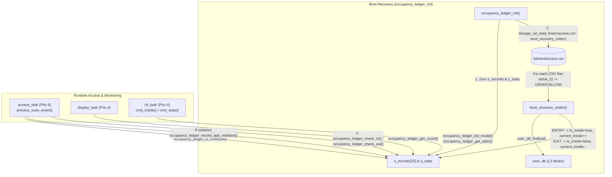

# Module Documentation: `occupancy_ledger` — Per-UID Anti-Passback State Machine, Live Building Roll-Call & MicroSD Boot Recovery

**Coursework:** Embedded Systems (CoCIS Smart Control and Monitoring System, Makerere University)  
**Bundle / Student Assignment:** Bundle 3 (Student 3 — Security, Identity, Schedule & Occupancy Authority)  
**Header File:** `main/include/occupancy_ledger.h`  
**Implementation File:** `main/src/occupancy_ledger.c`  
**Synchronization Level:** `LOCK_LEVEL_LEDGER` (Level 4 in the hierarchical mutex order)  
**Persistent Backing Store:** Reconstructed automatically at boot by replaying `/sdcard/access.csv` via `storage_sd_read_lines()`

---

## 1. Purpose & Architectural Role

The **`occupancy_ledger`** module is the **Live Building Presence Authority & Anti-Passback (APB) Enforcement Engine** for the CoCIS Smart Control and Monitoring System. A naive access control system only keeps a single integer counter (`int occupancy_count`). However, a simple integer counter has three fatal security and safety flaws:

1. **Card Passback Fraud (Entry Tailgating):** Without per-UID tracking, Student A can badge in at the Entry reader, hand their RFID card through a window to Student B, and Student B can badge in again with the same card — incrementing the counter twice for the same person!
2. **Exit Passback Fraud / Ghost Decrement:** Someone standing outside (or a student who climbed in through a window without badging in) could tap their card at the Exit reader, corrupting the building occupancy count by decrementing it for someone who was never recorded entering.
3. **No Emergency Evacuation Roll-Call & Power-Loss Amnesia:** During a fire evacuation (`emergency on`) or security inspection (`inside`), security personnel don't just need a number like `"3 people inside"` — they need the **exact names, roles, UIDs, entry timestamps, and dwell durations** of everyone currently inside CoCIS. And if the ESP32 experiences a power outage while students are inside the building, forgetting who was inside upon reboot would trap those students at the Exit reader due to Anti-Passback (`DENY_ANTIPASSBACK_OUT: Not Inside!`).

`occupancy_ledger` solves all three problems by maintaining a 32-slot per-UID presence table (`s_records[CFG_USER_DB_MAX_USERS]`) protected by `LOCK_LEVEL_LEDGER` (`L4_LEDGER`), and by automatically replaying the MicroSD card's `/sdcard/access.csv` log at boot (`boot_recovery_visitor`) to reconstruct the exact set of occupants inside the building before the power outage.



---

## 2. Public API Reference (`main/include/occupancy_ledger.h`)

### 2.1 Data Types: `occupant_record_t` and `occupancy_stats_t`

```c
typedef struct {
    bool        is_inside;
    char        uid[CFG_RFID_UID_MAX_LEN];
    char        name[CFG_USER_NAME_MAX_LEN];
    user_role_t role;
    int64_t     entry_epoch;
    int64_t     last_exit_epoch;
    uint32_t    visit_count;
} occupant_record_t;
```

* **`is_inside`**: Current presence state (`true` = currently inside CoCIS; `false` = currently outside, though historical `visit_count` and `last_exit_epoch` are retained in the slot).
* **`uid`**: Normalized RFID UID string (`""` if slot is unused).
* **`name`**: Full name cached from `user_record_t` on check-in (or `"Recovered User"` if a deleted user was recovered from SD log).
* **`role`**: User role (`ADMIN`, `STAFF`, `STUDENT`, `VISITOR`).
* **`entry_epoch`**: Unix timestamp (`int64_t`, seconds) of their most recent entry. Used by `cmd_inside()` to compute live dwell duration (`now.epoch - entry_epoch` formatted as `HH:MM:SS`).
* **`last_exit_epoch`**: Unix timestamp of their most recent exit.
* **`visit_count`**: Cumulative number of times this UID has entered CoCIS.

```c
typedef struct {
    uint32_t current_inside;
    uint32_t peak_inside;
    uint32_t total_entries;
    uint32_t total_exits;
    uint32_t antipassback_blocks;
    uint32_t recovered_on_boot;
} occupancy_stats_t;
```

* **`current_inside`**: Live count of occupants with `is_inside == true`.
* **`peak_inside`**: High-water mark of `current_inside` observed since boot (including boot recovery).
* **`total_entries` / `total_exits`**: Total successful runtime check-ins and check-outs.
* **`antipassback_blocks`**: Total blocked passback attempts (duplicate entry while inside, or exit while outside).
* **`recovered_on_boot`**: Number of occupants found still inside the building when `/sdcard/access.csv` replay finished at boot.

---

### 2.2 Function Reference Table

| Function Signature | Parameters | Return Value | Side Effects | Who Calls It & Task Context | Blocking Behavior |
| :--- | :--- | :--- | :--- | :--- | :--- |
| `esp_err_t occupancy_ledger_init(void)` | `void` | `ESP_OK` or `ESP_ERR_TIMEOUT`. | Zeroes `s_records` and `s_stats`, then if `/sdcard` is mounted, replays `/sdcard/access.csv` through `boot_recovery_visitor` to restore `is_inside`, `current_inside`, `peak_inside`, and `recovered_on_boot`. | Called once by `app_main()` in `main/main.c` (`main` task) *after* `storage_sd_init()` and `user_db_init()`. | Blocks on `LOCK_LEVEL_LEDGER` (`250 ms`) + SD SPI file read of `access.csv`. |
| `bool occupancy_ledger_is_inside(const char *uid)` | `uid`: RFID UID string (case-insensitive). | `true` if `uid` has a record with `is_inside == true`; `false` otherwise. | None (read-only). | Called by `process_scan_event()` in `access_control.c` (`access_task`, Prio 6) and `cmd_user()` in `cli.c` (`cli_task`, Prio 4). | Blocks up to `250 ms` on `LOCK_LEVEL_LEDGER`. |
| `esp_err_t occupancy_ledger_check_in(const user_record_t *user, int64_t now_epoch, uint32_t *out_new_count)` | `user`: Pointer to enrolled `user_record_t`.<br>`now_epoch`: Current Unix timestamp.<br>`out_new_count`: Optional output for updated `current_inside`. | `ESP_OK` on success;<br>`ESP_ERR_INVALID_ARG` if `user` is `NULL`/empty;<br>`ESP_ERR_NO_MEM` if all 32 slots are full;<br>`ESP_ERR_INVALID_STATE` if already inside (APB);<br>`ESP_ERR_TIMEOUT`. | Marks user `is_inside = true`, updates `entry_epoch`, `visit_count++`, `current_inside++`, `total_entries++`, and `peak_inside`. | Called by `process_scan_event()` in `access_control.c` (`access_task`, Prio 6) upon granted entry. | Blocks up to `250 ms` on `LOCK_LEVEL_LEDGER`. |
| `esp_err_t occupancy_ledger_check_out(const char *uid, int64_t now_epoch, uint32_t *out_new_count)` | `uid`: RFID UID string.<br>`now_epoch`: Current Unix timestamp.<br>`out_new_count`: Optional output for updated `current_inside`. | `ESP_OK` on success;<br>`ESP_ERR_INVALID_ARG`;<br>`ESP_ERR_INVALID_STATE` if user is not inside (APB);<br>`ESP_ERR_TIMEOUT`. | Marks user `is_inside = false`, sets `last_exit_epoch = now_epoch`, decrements `current_inside` (guarded `> 0`), increments `total_exits`. | Called by `process_scan_event()` in `access_control.c` (`access_task`, Prio 6) upon granted normal, supervisor, or emergency exit. | Blocks up to `250 ms` on `LOCK_LEVEL_LEDGER`. |
| `void occupancy_ledger_record_apb_violation(void)` | `void` | `void` | Increments `s_stats.antipassback_blocks`. | Called by `process_scan_event()` in `access_control.c` (`access_task`, Prio 6) when Step 5 catches an APB violation. | Blocks up to `250 ms` on `LOCK_LEVEL_LEDGER`. |
| `uint32_t occupancy_ledger_get_count(void)` | `void` | Current value of `s_stats.current_inside` (`0` on lock timeout). | None (read-only). | Called by `process_scan_event()` (`access_task`), `display_task()` (`display.c`, Prio 4), and `run_selftest_suite()` (`cli_task`). | Blocks up to `250 ms` on `LOCK_LEVEL_LEDGER`. |
| `size_t occupancy_ledger_list_inside(occupant_record_t *out_list, size_t max_items)` | `out_list`: Caller array.<br>`max_items`: Array capacity. | Number of currently inside occupants copied (`0..max_items`). | Copies all slots where `is_inside == true` into `out_list`. | Called by `cmd_inside()` in `cli.c` (`cli_task`, Prio 4) for `inside`, `daily_report`, and `emergency on` roll-call. | Blocks up to `250 ms` on `LOCK_LEVEL_LEDGER`. |
| `esp_err_t occupancy_ledger_get_stats(occupancy_stats_t *out_stats)` | `out_stats`: Output struct pointer. | `ESP_OK`, `ESP_ERR_INVALID_ARG`, or `ESP_ERR_TIMEOUT`. | Copies `s_stats` into `*out_stats`. | Called by `cmd_status()` and `cmd_stats()` in `cli.c` (`cli_task`, Prio 4). | Blocks up to `250 ms` on `LOCK_LEVEL_LEDGER`. |
| `esp_err_t occupancy_ledger_clear_all(void)` | `void` | `ESP_OK` or `ESP_ERR_TIMEOUT`. | Zeroes `s_records` and `s_stats`. | Called by `run_selftest_suite()` in `cli.c` (`cli_task`, Prio 4) to reset state before automated tests. | Blocks up to `250 ms` on `LOCK_LEVEL_LEDGER`. |

---

## 3. Line-by-Line / Block-by-Block Code Walkthrough (`main/src/occupancy_ledger.c`)

### 3.1 Includes and Static Module State (Lines 1–13)

```c
#include "occupancy_ledger.h"
#include <stdio.h>
#include <stdlib.h>
#include <string.h>
#include "esp_log.h"
#include "storage_sd.h"
#include "sync.h"

static const char *TAG = "OCC_LEDGER";

static occupant_record_t s_records[CFG_USER_DB_MAX_USERS];
static occupancy_stats_t s_stats = { 0 };
```

* **`s_records[CFG_USER_DB_MAX_USERS]`**: 32-element static array in `.bss`. Once a user checks in for the first time, a slot in `s_records` is bound to their `uid`. When they check out, `is_inside` becomes `false`, **but their `uid`, `visit_count`, and `last_exit_epoch` remain in the slot** so cumulative statistics (`visit_count`) are preserved across multiple visits!

---

### 3.2 Helper: `find_or_alloc_slot_unlocked()` (Lines 14–26)

```c
static occupant_record_t *find_or_alloc_slot_unlocked(const char *uid)
{
    occupant_record_t *free_slot = NULL;
    for (size_t i = 0; i < CFG_USER_DB_MAX_USERS; i++) {
        if (s_records[i].uid[0] != '\0' && strcasecmp(s_records[i].uid, uid) == 0) {
            return &s_records[i];
        }
        if (s_records[i].uid[0] == '\0' && free_slot == NULL) {
            free_slot = &s_records[i];
        }
    }
    return free_slot;
}
```

* **What it does**: Scans `s_records[0..31]`.
  * If a slot already has `s_records[i].uid` matching `uid` (case-insensitively via `strcasecmp`), it immediately returns a pointer `&s_records[i]` to that existing slot (whether the person is currently inside or outside).
  * Otherwise, it remembers the first completely unused slot (`s_records[i].uid[0] == '\0'`) in `free_slot` and returns that after scanning all 32 entries.
  * If all 32 slots are occupied by different UIDs and `uid` is not among them, it returns `NULL`.
* **Why returning a pointer is safe here**: Because `find_or_alloc_slot_unlocked()` is a `static` helper called **only** while holding `LOCK_LEVEL_LEDGER` (or during single-threaded `occupancy_ledger_init()`), and the caller dereferences the pointer and finishes its update before unlocking `LOCK_LEVEL_LEDGER`.

---

### 3.3 Helper: `boot_recovery_visitor()` (Lines 28–86)

```c
static void boot_recovery_visitor(const char *line, void *ctx)
{
    (void)ctx;
    /* Format: seq,datetime_eat,epoch,uid_or_actor,action,detail,value,sha256_chain */
    char buf[256];
    strncpy(buf, line, sizeof(buf) - 1);
    buf[sizeof(buf) - 1] = '\0';

    char *saveptr = NULL;
    char *tok_seq = strtok_r(buf, ",", &saveptr);
    char *tok_dt  = strtok_r(NULL, ",", &saveptr);
    char *tok_ep  = strtok_r(NULL, ",", &saveptr);
    char *tok_uid = strtok_r(NULL, ",", &saveptr);
    char *tok_act = strtok_r(NULL, ",", &saveptr);
    char *tok_det = strtok_r(NULL, ",", &saveptr);
    (void)tok_seq;
    (void)tok_dt;

    if (!tok_ep || !tok_uid || !tok_act || !tok_det) {
        return;
    }
    if (strncmp(tok_det, "GRANT", 5) != 0 && strncmp(tok_det, "ALLOW", 5) != 0) {
        return;
    }

    int64_t ep = atoll(tok_ep);
    user_record_t u;
    if (user_db_find(tok_uid, &u) != ESP_OK) {
        memset(&u, 0, sizeof(u));
        strncpy(u.uid, tok_uid, sizeof(u.uid) - 1);
        strncpy(u.name, "Recovered User", sizeof(u.name) - 1);
        u.role = USER_ROLE_STUDENT;
    }

    occupant_record_t *slot = find_or_alloc_slot_unlocked(tok_uid);
    if (slot == NULL) {
        return;
    }

    strncpy(slot->uid, u.uid, sizeof(slot->uid) - 1);
    strncpy(slot->name, u.name, sizeof(slot->name) - 1);
    slot->role = u.role;

    if (strcmp(tok_act, "ENTRY") == 0 && !slot->is_inside) {
        slot->is_inside = true;
        slot->entry_epoch = ep;
        slot->visit_count++;
        s_stats.current_inside++;
        if (s_stats.current_inside > s_stats.peak_inside) {
            s_stats.peak_inside = s_stats.current_inside;
        }
    } else if (strcmp(tok_act, "EXIT") == 0 && slot->is_inside) {
        slot->is_inside = false;
        slot->last_exit_epoch = ep;
        if (s_stats.current_inside > 0) {
            s_stats.current_inside--;
        }
    }
}
```

Let's walk through this callback step by step:
1. **Callback Signature (`sd_line_visitor_t`)**: `storage_sd_read_lines("access.csv", boot_recovery_visitor, NULL)` opens `/sdcard/access.csv` and invokes `boot_recovery_visitor(line, NULL)` once for every non-header line in chronological order from oldest to newest.
2. **Copying `line` into `buf[256]`**: Because `strtok_r()` modifies the string it tokenizes (replacing `','` delimiters with `'\0'`) and `line` is `const char *`, we first copy `line` into a mutable local buffer `buf`.
3. **Reentrant CSV Tokenization (`strtok_r`)**: Extracts the first 6 comma-separated columns:
   * Column 0 (`tok_seq`): Sequence number (unused, cast `(void)tok_seq` to silence compiler unused-variable warnings).
   * Column 1 (`tok_dt`): ISO datetime string (unused).
   * Column 2 (`tok_ep`): Unix epoch timestamp string (converted to `int64_t` via `atoll(tok_ep)`).
   * Column 3 (`tok_uid`): RFID UID string (e.g., `"04A1B2C3"`).
   * Column 4 (`tok_act`): Direction (`"ENTRY"` or `"EXIT"`).
   * Column 5 (`tok_det`): Outcome detail (e.g., `"GRANT_NORMAL"`, `"GRANT_SUPERVISOR_EXIT"`, `"DENY_UNKNOWN_TAG"`).
4. **Filtering Only Granted Events**: `if (strncmp(tok_det, "GRANT", 5) != 0 && strncmp(tok_det, "ALLOW", 5) != 0) return;` ignores all denied scans (`DENY_*`) and header lines.
5. **Enriching Identity from `user_db`**: Calls `user_db_find(tok_uid, &u)` to look up the person's full name and role. If the user was subsequently deleted from `user_db` after entering the building, it gracefully falls back to `u.name = "Recovered User"` and `u.role = USER_ROLE_STUDENT` so the person is still tracked!
6. **Replaying State Transitions**:
   * If `tok_act` is `"ENTRY"` and `!slot->is_inside`: transitions `slot->is_inside = true`, sets `slot->entry_epoch = ep`, increments `visit_count` and `s_stats.current_inside`, and updates `peak_inside`.
   * If `tok_act` is `"EXIT"` and `slot->is_inside`: transitions `slot->is_inside = false`, sets `slot->last_exit_epoch = ep`, and decrements `s_stats.current_inside`.

---

### 3.4 `occupancy_ledger_init()` (Lines 88–111)

```c
esp_err_t occupancy_ledger_init(void)
{
    esp_err_t err = sync_lock(LOCK_LEVEL_LEDGER, CFG_LOCK_TIMEOUT_MS);
    if (err != ESP_OK) {
        return err;
    }

    memset(s_records, 0, sizeof(s_records));
    memset(&s_stats, 0, sizeof(s_stats));
    sync_unlock(LOCK_LEVEL_LEDGER);

    if (storage_sd_is_mounted()) {
        if (storage_sd_read_lines("access.csv", boot_recovery_visitor, NULL) == ESP_OK) {
            s_stats.recovered_on_boot = s_stats.current_inside;
            if (s_stats.recovered_on_boot > 0) {
                ESP_LOGI(TAG, "Recovered %lu occupant(s) inside CoCIS from SD access.csv",
                         (unsigned long)s_stats.recovered_on_boot);
            }
        }
    }

    ESP_LOGI(TAG, "Occupancy ledger initialized (currently inside: %lu)", (unsigned long)s_stats.current_inside);
    return ESP_OK;
}
```

* **Crucial Lock-Ordering Detail**: Look closely at lines 90–100: `occupancy_ledger_init()` locks `LOCK_LEVEL_LEDGER` (Level 4), zeroes `s_records` and `s_stats`, and **unlocks `LOCK_LEVEL_LEDGER` on line 97 before calling `storage_sd_read_lines()`**!
* **Why?** Because `storage_sd_read_lines()` acquires `LOCK_LEVEL_SD` (Level 7) and calls `boot_recovery_visitor()`, which in turn calls `user_db_find()` (`LOCK_LEVEL_USER_DB`, Level 2). Since `occupancy_ledger_init()` runs sequentially in `app_main()` before `access_task` or `cli_task` is created, no other task is accessing `s_records` during boot, and releasing `LOCK_LEVEL_LEDGER` first avoids holding `L4_LEDGER` while `boot_recovery_visitor` acquires `L2_USER_DB`!

---

### 3.5 `occupancy_ledger_is_inside()` and `occupancy_ledger_record_apb_violation()` (Lines 113–133, 212–218)

```c
bool occupancy_ledger_is_inside(const char *uid)
{
    if (uid == NULL || uid[0] == '\0') {
        return false;
    }

    if (sync_lock(LOCK_LEVEL_LEDGER, CFG_LOCK_TIMEOUT_MS) != ESP_OK) {
        return false;
    }

    bool inside = false;
    for (size_t i = 0; i < CFG_USER_DB_MAX_USERS; i++) {
        if (s_records[i].uid[0] != '\0' && strcasecmp(s_records[i].uid, uid) == 0) {
            inside = s_records[i].is_inside;
            break;
        }
    }

    sync_unlock(LOCK_LEVEL_LEDGER);
    return inside;
}
```

* Called at Step 5 of `process_scan_event()` in `access_control.c` to check if the scanned UID is currently inside before deciding whether an Entry or Exit scan violates Anti-Passback.
* If Step 5 detects an APB violation (`!is_exit && currently_inside` or `is_exit && !currently_inside`), `access_control.c` calls `occupancy_ledger_record_apb_violation()`, which safely increments `s_stats.antipassback_blocks` under `LOCK_LEVEL_LEDGER`.

---

### 3.6 `occupancy_ledger_check_in()` and `occupancy_ledger_check_out()` (Lines 135–210)

```c
esp_err_t occupancy_ledger_check_in(const user_record_t *user, int64_t now_epoch, uint32_t *out_new_count)
{
    if (user == NULL || user->uid[0] == '\0') {
        return ESP_ERR_INVALID_ARG;
    }

    esp_err_t err = sync_lock(LOCK_LEVEL_LEDGER, CFG_LOCK_TIMEOUT_MS);
    if (err != ESP_OK) {
        return err;
    }

    occupant_record_t *slot = find_or_alloc_slot_unlocked(user->uid);
    if (slot == NULL) {
        sync_unlock(LOCK_LEVEL_LEDGER);
        return ESP_ERR_NO_MEM;
    }

    if (slot->is_inside) {
        s_stats.antipassback_blocks++;
        sync_unlock(LOCK_LEVEL_LEDGER);
        return ESP_ERR_INVALID_STATE;
    }

    strncpy(slot->uid, user->uid, sizeof(slot->uid) - 1);
    strncpy(slot->name, user->name, sizeof(slot->name) - 1);
    slot->role = user->role;
    slot->is_inside = true;
    slot->entry_epoch = now_epoch;
    slot->visit_count++;

    s_stats.current_inside++;
    s_stats.total_entries++;
    if (s_stats.current_inside > s_stats.peak_inside) {
        s_stats.peak_inside = s_stats.current_inside;
    }

    if (out_new_count != NULL) {
        *out_new_count = s_stats.current_inside;
    }

    sync_unlock(LOCK_LEVEL_LEDGER);
    return ESP_OK;
}
```

* **Double Defense-in-Depth**: Even though `access_control.c` already checked `occupancy_ledger_is_inside()` in Step 5, `occupancy_ledger_check_in()` *also* checks `if (slot->is_inside)` atomically under `LOCK_LEVEL_LEDGER` (and `occupancy_ledger_check_out()` checks `if (slot == NULL || !slot->is_inside)`), returning `ESP_ERR_INVALID_STATE` and incrementing `s_stats.antipassback_blocks` if violated.
* **Underflow Guard on Check-out**: On line 199 of `occupancy_ledger_check_out()`, `if (s_stats.current_inside > 0) s_stats.current_inside--;` ensures the unsigned `uint32_t current_inside` counter can never underflow and wrap around to `4,294,967,295` (`UINT32_MAX`).

---

### 3.7 Query & Reset Functions: `occupancy_ledger_get_count()`, `occupancy_ledger_list_inside()`, `occupancy_ledger_get_stats()`, `occupancy_ledger_clear_all()` (Lines 220–278)

* **`occupancy_ledger_get_count()`**: Returns `s_stats.current_inside` under `LOCK_LEVEL_LEDGER`.
* **`occupancy_ledger_list_inside()`**: Iterates over `s_records[0..31]` and copies only records where `s_records[i].uid[0] != '\0' && s_records[i].is_inside` into `out_list`.
* **`occupancy_ledger_get_stats()`**: Copies `s_stats` into `*out_stats`.
* **`occupancy_ledger_clear_all()`**: Zeroes `s_records` and `s_stats` under `LOCK_LEVEL_LEDGER`.

---

## 4. C Language Constructs Explained

1. **Function Pointers & Callbacks (`boot_recovery_visitor` passed as `sd_line_visitor_t`)**:
   * In `storage_sd.h`, `typedef void (*sd_line_visitor_t)(const char *line, void *ctx);` defines a function pointer type.
   * Passing `boot_recovery_visitor` to `storage_sd_read_lines("access.csv", boot_recovery_visitor, NULL)` decouples low-level FATFS/SPI file reading (`storage_sd.c`) from high-level CSV parsing and occupancy state reconstruction (`occupancy_ledger.c`).
2. **Reentrant String Tokenization (`strtok_r(buf, ",", &saveptr)`)**:
   * Unlike standard `strtok()`, which uses a hidden global `static char *` pointer and is **not thread-safe** in a multi-tasking FreeRTOS environment (if `cli_task` and `main` or another task called `strtok()` simultaneously, they would corrupt each other's tokens), `strtok_r()` stores its progress in the caller's local `char *saveptr` variable on the stack.
3. **ASCII-to-Long-Long Conversion (`atoll(tok_ep)`)**:
   * Converts the epoch string token (e.g., `"1792819800"`) into a 64-bit signed integer (`int64_t`) so timestamps survive the Year 2038 problem (`2^31 - 1`).
4. **Suppressing Unused Parameter Warnings (`(void)ctx;`, `(void)tok_seq;`, `(void)tok_dt;`)**:
   * Explicitly casting unused variables to `(void)` tells the GCC compiler (`-Wall -Wextra`) that ignoring those values is intentional, producing a zero-warning build.

---

## 5. ESP-IDF & FreeRTOS Constructs Explained

1. **Level 4 Hierarchical Mutex (`LOCK_LEVEL_LEDGER`)**:
   * Protects `s_records` and `s_stats` against concurrent access from `access_task` (Priority 6), `display_task` (Priority 4), and `cli_task` (Priority 4).
2. **SD Card VFS / FATFS Integration (`storage_sd_is_mounted()`, `storage_sd_read_lines()`)**:
   * During `occupancy_ledger_init()`, queries whether the SPI2 MicroSD card is mounted at `/sdcard` (`SYS_EVT_SD_MOUNTED`). If mounted, streams `/sdcard/access.csv` line-by-line without loading the entire CSV file into RAM at once.

---

## 6. Alternatives & "What If You Change This?"

| Design Aspect | Current Implementation in `occupancy_ledger` | Alternative Approach | What Happens If You Change It? (Trade-offs) |
| :--- | :--- | :--- | :--- |
| **Power-Loss Persistence Mechanism** | Replays `/sdcard/access.csv` at boot (`boot_recovery_visitor`) to reconstruct state. | Writing `s_records` to NVS flash on **every** entry and exit scan. | Writing a 2 KB blob to NVS flash on every single student entry and exit (hundreds of times per day) wears out internal ESP32 NOR flash sectors (`~100,000` erase cycles) and slows down door actuation. Since every access event is *already* appended to `/sdcard/access.csv`, replaying `access.csv` once at boot achieves full power-loss recovery with **zero extra NVS flash wear**! |
| **Occupancy Tracking Granularity** | Per-UID state table (`s_records[32]`) tracking `is_inside`, `entry_epoch`, `visit_count`. | Single integer `uint32_t s_occupancy_count`. | With a single integer, you **cannot** detect Anti-Passback (a student can tap entry 10 times in a row to make `count = 10`) and you **cannot** print an emergency roll-call of *who* is inside (`cmd_inside`). |
| **Check-out When Not Recorded Inside** | Strict Anti-Passback (`DENY_ANTIPASSBACK_OUT`), **except** in Emergency Evacuation Mode where `access_control.c` Step 1 unlocks all doors regardless. | Silently allowing exit when `!is_inside` during normal operation ("Soft Anti-Passback"). | Under Soft APB, tailgaters who snuck in without badging can badge out normally. Strict APB catches tailgaters at the exit gate and forces them to report to security (while Emergency Mode still guarantees life-safety egress during a fire). |
| **Unsigned Counter Decrement** | `if (s_stats.current_inside > 0) s_stats.current_inside--;` | Unchecked `s_stats.current_inside--;` | In emergency mode (`access_control.c` line 34), `occupancy_ledger_check_out()` is called for anyone badging out. Even if an edge case occurred, the `> 0` guard prevents unsigned integer underflow to `4294967295`. |

---

## 7. Design Rationale

1. **Event-Sourced Boot Recovery from `/sdcard/access.csv`**:
   * In distributed systems and database engineering, reconstructing current state by replaying an append-only event log is called **Event Sourcing**. Because `logger.c` already writes every `ENTRY` and `EXIT` event to `/sdcard/access.csv` with a tamper-evident SHA-256 hash chain, `occupancy_ledger` treats `access.csv` as its write-ahead log (WAL). At boot, `occupancy_ledger_init()` replays the log in milliseconds and records how many occupants were recovered in `s_stats.recovered_on_boot`.
2. **Retaining Historical Slot Metadata on Check-Out**:
   * When a user checks out (`occupancy_ledger_check_out`), their slot is **not** zeroed; only `slot->is_inside = false` and `slot->last_exit_epoch = now_epoch` are updated. This preserves `slot->visit_count` across multiple entries during the day and avoids re-copying static strings on their next visit.

---

## 8. Failure Modes, Edge Cases & Recovery

1. **Sudden Power Loss While Students Are Inside CoCIS**:
   * **Scenario**: 3 students badge into CoCIS at `10:00 EAT`. At `10:15 EAT`, mains power fails and the ESP32 reboots.
   * **Recovery**: During `app_main()`, `storage_sd_init()` mounts `/sdcard`, `user_db_init()` loads user names/roles, and `occupancy_ledger_init()` streams `/sdcard/access.csv` through `boot_recovery_visitor()`. It sees the 3 `ENTRY` (`GRANT_NORMAL`) records with no matching `EXIT` records, restores all 3 students to `is_inside = true`, sets `current_inside = 3` and `recovered_on_boot = 3`, and logs:
     `I (...) OCC_LEDGER: Recovered 3 occupant(s) inside CoCIS from SD access.csv`
     When those 3 students later badge at the Exit reader, they are cleanly allowed to exit!
2. **SD Card Missing or Unmounted at Boot**:
   * **Scenario**: MicroSD card is removed or SPI mount fails.
   * **Behavior**: `storage_sd_is_mounted()` returns `false`. `occupancy_ledger_init()` skips file replay, initializes an empty ledger in RAM (`current_inside = 0`), and continues normal runtime operation without crashing.
3. **User Deleted from `user_db` While Still Recorded in `access.csv`**:
   * **Scenario**: `access.csv` contains an `ENTRY` for a UID that an admin later deleted via `user del <uid>`.
   * **Recovery**: In `boot_recovery_visitor()` (lines 55–60), if `user_db_find(tok_uid, &u) != ESP_OK`, it synthesizes a fallback record with `name = "Recovered User"` and `role = USER_ROLE_STUDENT` so the occupant count and roll-call remain accurate.

---

## 9. How to Test This Module in Isolation

Run the following commands in the serial CLI (`115200 8N1`):

### Test 1: Check In, Inspect Live Roll-Call (`inside`), and Trigger Entry Anti-Passback
```text
cocis> sim scan entry 04A1B2C3
I (...) ACCESS_CTRL: [ENTRY] GRANT_NORMAL for 04A1B2C3 (Matthew Mumbere) -> Building Occupancy: 1

cocis> inside
+------+------------+--------------------------+---------+---------------------+----------+
| Slot | Tag UID    | Full Name                | Role    | Entry Time (EAT)    | Duration |
+------+------------+--------------------------+---------+---------------------+----------+
| 01   | 04A1B2C3   | Matthew Mumbere          | STUDENT | 2026-10-24 08:31:12 | 00:00:05 |
+------+------------+--------------------------+---------+---------------------+----------+
Total Currently Inside CoCIS: 1 person(s)

cocis> sim scan entry 04A1B2C3
W (...) ACCESS_CTRL: [ENTRY] DENIED anti-passback: 04A1B2C3 (Matthew Mumbere) is already inside
```

### Test 2: Valid Check-Out, Trigger Exit Anti-Passback, and View `stats`
```text
cocis> sim scan exit 04A1B2C3
I (...) ACCESS_CTRL: [EXIT] GRANT_NORMAL for 04A1B2C3 (Matthew Mumbere) -> Building Occupancy: 0

cocis> sim scan exit 04A1B2C3
W (...) ACCESS_CTRL: [EXIT] DENIED anti-passback: 04A1B2C3 (Matthew Mumbere) is not recorded inside

cocis> stats
+----------------------------------------+------------+
| Security & Performance Metric          |      Value |
+----------------------------------------+------------+
| Granted Entries                        |          1 |
| Granted Exits                          |          1 |
...
| Denied: Anti-Passback Violations       |          2 |
| Current Building Occupancy             |          0 |
| Peak Building Occupancy                |          1 |
| Boot-Recovered Occupants from SD       |          0 |
...
```

---

## 10. Likely Examiner Questions & Model Answers

### Q1: What is Anti-Passback (APB), and how does `occupancy_ledger` enforce it in both directions?
**Model Answer:**  
Anti-Passback is a physical access control security rule that requires every entry to alternate strictly with an exit for any given credential (`OUTSIDE -> ENTRY -> INSIDE -> EXIT -> OUTSIDE`). `occupancy_ledger` enforces APB in both directions by storing a boolean `is_inside` per enrolled UID in `s_records`:
1. **Entry APB**: If `is_inside == true` when the card is scanned at the Entry reader, the scan is rejected (`ACCESS_RESULT_DENIED_ANTIPASSBACK_ENTRY`), preventing a user inside from passing their card back to a friend outside.
2. **Exit APB**: If `is_inside == false` when the card is scanned at the Exit reader, the scan is rejected (`ACCESS_RESULT_DENIED_ANTIPASSBACK_EXIT`), catching tailgaters who entered without badging in.

### Q2: How does the system recover building occupancy if power fails while students are inside CoCIS?
**Model Answer:**  
During boot, `occupancy_ledger_init()` checks `storage_sd_is_mounted()` and calls `storage_sd_read_lines("access.csv", boot_recovery_visitor, NULL)`. The callback `boot_recovery_visitor()` parses each CSV line using `strtok_r()`. For every line whose detail starts with `"GRANT"` or `"ALLOW"`, it replays the state transition: an `"ENTRY"` sets `slot->is_inside = true` and increments `current_inside`, while an `"EXIT"` sets `slot->is_inside = false` and decrements `current_inside`. When the end of `access.csv` is reached, any user who entered without a subsequent exit remains marked `is_inside = true`, and the final count is stored in `s_stats.recovered_on_boot`.

### Q3: Why did you use `strtok_r()` instead of `strtok()` inside `boot_recovery_visitor()`?
**Model Answer:**  
Standard C `strtok()` maintains its internal parsing position in a hidden static global variable inside the C library, making it **non-reentrant and thread-unsafe**. If two FreeRTOS tasks (for instance, `cli_task` parsing a CLI command and another task parsing a string) call `strtok()` concurrently, one overwrites the other's internal pointer. `strtok_r()` is the POSIX reentrant version that stores the parsing state in an explicit `char *saveptr` variable on the caller's stack.

### Q4: In `boot_recovery_visitor()`, why do you copy `const char *line` into `char buf[256]` before calling `strtok_r()`?
**Model Answer:**  
`strtok_r()` is a destructive tokenizer: whenever it finds a comma delimiter `','`, it overwrites that byte in the buffer with a null terminator `'\0'` so it can return a null-terminated substring pointer. Because the input parameter `const char *line` points to a read-only buffer owned by `storage_sd_read_lines()`, modifying it directly would violate `const` correctness. Copying `line` into the local stack array `char buf[256]` allows `strtok_r()` to safely mutate `buf` in place.

### Q5: In `occupancy_ledger_init()`, why do you call `sync_unlock(LOCK_LEVEL_LEDGER)` on line 97 *before* calling `storage_sd_read_lines()` on line 100?
**Model Answer:**  
Because of the **strict lock acquisition hierarchy** defined in `sync.h`:
* `LOCK_LEVEL_USER_DB` is Level 2 (`L2_USER_DB`)
* `LOCK_LEVEL_LEDGER` is Level 4 (`L4_LEDGER`)
* `LOCK_LEVEL_SD` is Level 7 (`L7_SD`)
Inside `storage_sd_read_lines()`, our callback `boot_recovery_visitor()` calls `user_db_find()`, which acquires `LOCK_LEVEL_USER_DB` (Level 2). If `occupancy_ledger_init()` held `LOCK_LEVEL_LEDGER` (Level 4) while calling `user_db_find()` (Level 2), that would acquire a lower-level lock (`L2`) while holding a higher-level lock (`L4`), violating the ascending lock hierarchy rule (`L2 -> L4 -> L7`). Since `occupancy_ledger_init()` runs in `app_main()` before any FreeRTOS worker tasks are spawned, releasing `L4_LEDGER` after `memset` is completely safe and preserves strict lock ordering.

### Q6: Look at `find_or_alloc_slot_unlocked()`. What happens when a user exits the building (`occupancy_ledger_check_out`) and then enters again an hour later? Does it allocate a second slot in `s_records`?
**Model Answer:**  
No. When `occupancy_ledger_check_out()` runs, it sets `slot->is_inside = false` and `slot->last_exit_epoch = now_epoch`, but it leaves `slot->uid` intact in that array slot. When the same user badges in an hour later, `find_or_alloc_slot_unlocked()` sees `s_records[i].uid[0] != '\0' && strcasecmp(s_records[i].uid, uid) == 0` and returns a pointer to the **exact same slot**, incrementing `slot->visit_count` from `1` to `2`.

### Q7: What happens during an Emergency Evacuation (`schedule_is_emergency_mode() == true`) when someone badges at the Exit reader?
**Model Answer:**  
In `access_control.c` (Step 1, lines 31–42), if `schedule_is_emergency_mode() && is_exit` is true, the system bypasses schedule and anti-passback blocks, immediately calls `occupancy_ledger_check_out(evt->uid, now.epoch, &new_cnt)` to mark the person as safely evacuated (if they were recorded inside), unlocks all doors (`door_set_emergency_all(true)`), and logs `GRANT_EMERGENCY_EVAC`. And when the admin triggers `emergency on` via the CLI, `cli.c` automatically invokes `cmd_inside()` (`occupancy_ledger_list_inside()`) to print a full roll-call of everyone still inside the building for fire marshals.

### Q8: Why does `boot_recovery_visitor()` use `atoll(tok_ep)` instead of `atoi(tok_ep)` to parse the timestamp?
**Model Answer:**  
On 32-bit architectures or toolchains where `int` is 32 bits, `atoi()` returns a 32-bit signed `int` whose maximum value is `2,147,483,647` (`2038-01-19 03:14:07 UTC`, the Year 2038 bug). Because `time_snapshot_t.epoch` and `occupant_record_t.entry_epoch` are 64-bit integers (`int64_t`), using `atoll()` (`ASCII to long long`, returning a 64-bit `long long`) ensures full 64-bit timestamp precision without overflow.
