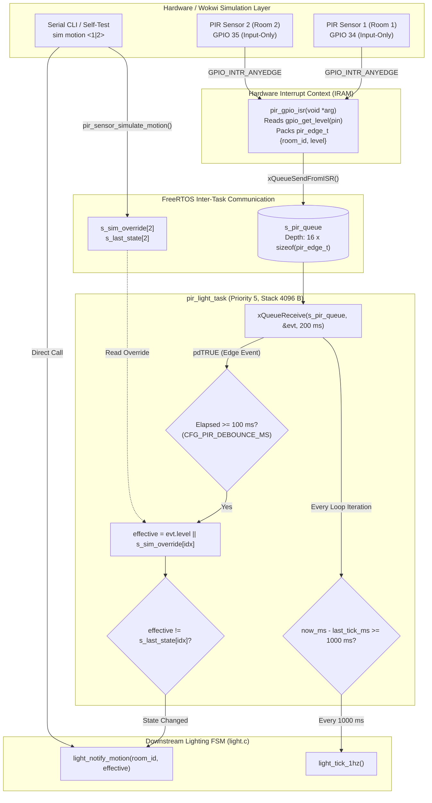

# Module Documentation: `pir_sensor` (Lecture Room PIR Motion Sensing & 1 Hz Lighting Heartbeat)

**Files Documented:**
- Header: [`main/include/pir_sensor.h`](../../../include/pir_sensor.h)
- Implementation: [`main/src/pir_sensor.c`](../../../src/pir_sensor.c)
- Related Pin/Config Headers: [`main/include/board_pins.h`](../../../include/board_pins.h), [`main/include/config.h`](../../../include/config.h), [`main/include/light.h`](../../../include/light.h)

---

## 1. Purpose & Architectural Role

The `pir_sensor` module is the hardware-facing occupancy detection front-end for **Lecture Room 1** and **Lecture Room 2** at the College of Computing and Information Sciences (CoCIS), Makerere University. In the physical and Wokwi-simulated hardware topology, two passive infrared (PIR) motion detectors (`pir1` on `GPIO_NUM_34` and `pir2` on `GPIO_NUM_35`) observe thermal infrared changes caused by students or lecturers moving inside the rooms.

Architecturally, `pir_sensor` serves three critical roles:
1. **Interrupt-Driven Edge Capture (Bottom-Half Deferral):** Rather than polling GPIO pins in a busy loop or executing heavy state-machine logic inside an Interrupt Service Routine (ISR), `pir_gpio_isr()` captures both rising (`LOW -> HIGH`, motion started) and falling (`HIGH -> LOW`, motion ceased) edges on `GPIO 34` and `GPIO 35`, packages the room ID and logic level into a compact 2-byte `pir_edge_t` struct, and enqueues it onto a FreeRTOS queue (`s_pir_queue`) using `xQueueSendFromISR()`.
2. **Software Debouncing & Simulation Multiplexing:** The background FreeRTOS task `pir_light_task()` dequeues edge events, applies a `100 ms` per-room software debounce filter (`CFG_PIR_DEBOUNCE_MS`), ORs the hardware signal with a CLI simulation override flag (`s_sim_override`), deduplicates unchanged states (`s_last_state`), and forwards clean occupancy transitions to `light_notify_motion()`.
3. **1 Hz Lighting FSM Heartbeat Generator:** Because `pir_light_task()` wakes up at least every `200 ms` (when `xQueueReceive` times out), it also tracks elapsed monotonic time using `esp_timer_get_time()` and invokes `light_tick_1hz()` once every `1000 ms` (`1 second`) to drive the lighting countdown timers and energy-savings accumulators in the `light` module.

### Data & Control Flow Diagram



---

## 2. Public API Reference (`include/pir_sensor.h`)

Below is the complete contents of [`main/include/pir_sensor.h`](../../../include/pir_sensor.h):

```c
#ifndef PIR_SENSOR_H
#define PIR_SENSOR_H

#include <stdbool.h>
#include <stdint.h>
#include "esp_err.h"

esp_err_t pir_sensor_init(void);
esp_err_t pir_sensor_simulate_motion(uint8_t room_id, bool motion_active);
bool      pir_sensor_get_state(uint8_t room_id);

#endif
```

### Detailed Function Specifications

| Function Signature | Parameters | Return Value | Side Effects | Who Calls It & Task Context | Blocking Behavior |
| :--- | :--- | :--- | :--- | :--- | :--- |
| `esp_err_t pir_sensor_init(void)` | `void` (none) | `ESP_OK` on success;<br>`ESP_ERR_NO_MEM` if queue or task allocation fails;<br>ESP-IDF GPIO error code if `gpio_config()` fails. | 1. Allocates `s_pir_queue` (16 items).<br>2. Configures `GPIO 34` and `GPIO 35` as inputs with `GPIO_INTR_ANYEDGE` and pull resistors disabled.<br>3. Registers `pir_gpio_isr` for both pins.<br>4. Spawns `pir_light_task` (stack `4096`, priority `5`).<br>5. Prints an `ESP_LOGI` boot message. | Called once by `app_main()` in [`main/main.c`](../../../main.c#L54) during Phase 4 of system boot (`main` task context, priority 1). | **Non-blocking** (executes in `< 2 ms`). |
| `esp_err_t pir_sensor_simulate_motion(uint8_t room_id, bool motion_active)` | `room_id`: `1` (Room 1) or `2` (Room 2).<br>`motion_active`: `true` to simulate occupancy/motion, `false` to clear motion. | `ESP_OK` if `room_id` is `1..2` and `light_notify_motion()` succeeds;<br>`ESP_ERR_INVALID_ARG` if `room_id < 1` or `room_id > 2`;<br>`ESP_ERR_TIMEOUT` if `light_notify_motion()` fails to acquire `LOCK_LEVEL_ROOM`. | Updates `s_sim_override[room_id - 1]` and `s_last_state[room_id - 1]` to `motion_active`, then immediately invokes `light_notify_motion(room_id, motion_active)`. | Called by:<br>1. `cmd_sim()` in [`main/src/cli.c`](../../../src/cli.c#L716) when user runs `sim motion <1\|2> <on\|off>`.<br>2. `run_selftest_suite()` in [`main/src/cli.c`](../../../src/cli.c#L640) (Tests 8 & 9).<br>Runs in `cli_task` context (priority 4). | **Bounded blocking** up to `CFG_LOCK_TIMEOUT_MS` (`250 ms`) inside `light_notify_motion()` while acquiring `LOCK_LEVEL_ROOM`. |
| `bool pir_sensor_get_state(uint8_t room_id)` | `room_id`: `1` (Room 1) or `2` (Room 2). | `true` if the room's last debounced or simulated motion state is active; `false` if idle or if `room_id` is out of range (`< 1` or `> 2`). | None (pure read of `s_last_state[room_id - 1]`). | Available to external monitoring/diagnostic callers from any FreeRTOS task context. | **Non-blocking** (`O(1)` memory read). |

---

## 3. Line-by-Line / Block-by-Block Code Walkthrough (`src/pir_sensor.c`)

### 3.1 Header Includes & Module-Scope State (Lines 1–22)

```c
#include "pir_sensor.h"
#include "board_pins.h"
#include "config.h"
#include "driver/gpio.h"
#include "esp_log.h"
#include "esp_timer.h"
#include "freertos/FreeRTOS.h"
#include "freertos/queue.h"
#include "freertos/task.h"
#include "light.h"

static const char *TAG = "PIR_SENSOR";

typedef struct {
    uint8_t room_id;
    bool    level;
} pir_edge_t;

static QueueHandle_t s_pir_queue = NULL;
static bool          s_sim_override[CFG_ROOM_COUNT] = { false, false };
static bool          s_last_state[CFG_ROOM_COUNT] = { false, false };
```

- **Lines 1–10:** Pull in the module's own header (`pir_sensor.h`), hardware pin assignments (`board_pins.h`, where `PIN_PIR_ROOM1 = GPIO_NUM_34` and `PIN_PIR_ROOM2 = GPIO_NUM_35`), system constants (`config.h`, where `CFG_ROOM_COUNT = 2` and `CFG_PIR_DEBOUNCE_MS = 100`), the ESP-IDF GPIO driver (`driver/gpio.h`), logging (`esp_log.h`), high-resolution 64-bit hardware timer (`esp_timer.h`), FreeRTOS kernel/queue/task primitives, and the downstream lighting controller (`light.h`).
- **Line 12:** `TAG` is the module identifier string `"PIR_SENSOR"` passed to `ESP_LOGI`.
- **Lines 14–17 (`pir_edge_t`):** A private message structure passed from the GPIO ISR to `pir_light_task` through `s_pir_queue`. It holds `room_id` (`1` or `2`) and `level` (`true` when the PIR pin is `HIGH`, `false` when `LOW`). Because both fields are 1-byte types (`uint8_t` and `bool`), `sizeof(pir_edge_t)` is just **2 bytes**, minimizing copy overhead inside the ISR.
- **Line 19 (`s_pir_queue`):** Handle to the FreeRTOS queue connecting `pir_gpio_isr` (producer) to `pir_light_task` (consumer).
- **Line 20 (`s_sim_override`):** Per-room boolean array indexed by `room_id - 1` (`0` for Room 1, `1` for Room 2). When set to `true` via `pir_sensor_simulate_motion(room, true)`, it forces the effective motion state to remain `true` even if the physical GPIO pin is `LOW`.
- **Line 21 (`s_last_state`):** Tracks the most recently committed motion state (`true` = motion active, `false` = idle) for each room so duplicate edges do not trigger redundant `light_notify_motion()` calls.

---

### 3.2 Interrupt Service Routine: `pir_gpio_isr` (Lines 23–36)

```c
static void IRAM_ATTR pir_gpio_isr(void *arg)
{
    uint8_t room_id = (uint8_t)(uintptr_t)arg;
    gpio_num_t pin = (room_id == 1) ? PIN_PIR_ROOM1 : PIN_PIR_ROOM2;
    pir_edge_t evt = {
        .room_id = room_id,
        .level = (gpio_get_level(pin) != 0)
    };
    BaseType_t high_woken = pdFALSE;
    if (s_pir_queue != NULL) {
        xQueueSendFromISR(s_pir_queue, &evt, &high_woken);
    }
    portYIELD_FROM_ISR(high_woken);
}
```

- **Line 23 (`static void IRAM_ATTR pir_gpio_isr(void *arg)`):**
  - `IRAM_ATTR` places the compiled machine code of this ISR into the ESP32's internal Instruction RAM (IRAM) rather than external SPI Flash. If another task is writing to SPI flash (e.g., NVS commit) when a person walks into a lecture room, the flash cache is temporarily disabled, and an ISR in IRAM can still execute without crashing.
- **Line 25 (`uint8_t room_id = (uint8_t)(uintptr_t)arg;`):**
  - Extracts the room number (`1` or `2`) that was packed directly into the `void *arg` pointer when `gpio_isr_handler_add()` was called in `pir_sensor_init()`. Casting through `uintptr_t` first avoids compiler warnings when converting a 32-bit pointer (`void *`) to an 8-bit integer (`uint8_t`).
- **Line 26 (`gpio_num_t pin = (room_id == 1) ? PIN_PIR_ROOM1 : PIN_PIR_ROOM2;`):**
  - Maps `room_id == 1` to `PIN_PIR_ROOM1` (`GPIO_NUM_34`) and `room_id == 2` to `PIN_PIR_ROOM2` (`GPIO_NUM_35`). That way, a single shared ISR handles both rooms.
- **Lines 27–30:**
  - Reads the current logic level of `pin` via `gpio_get_level(pin)` (which reads the ESP32's `GPIO.in1.val` hardware register directly in IRAM) and converts it to a clean `bool` (`!= 0`).
- **Lines 31–35:**
  - Initializes `high_woken = pdFALSE`.
  - Calls `xQueueSendFromISR(s_pir_queue, &evt, &high_woken)` to copy the 2-byte `evt` into `s_pir_queue` without blocking. If `pir_light_task` (priority 5) was blocked waiting on `s_pir_queue` and has a higher priority than whatever task was interrupted, FreeRTOS sets `high_woken = pdTRUE`.
  - `portYIELD_FROM_ISR(high_woken)` requests an immediate context switch to `pir_light_task` upon ISR exit if `high_woken == pdTRUE`, ensuring sub-millisecond response to motion events.

---

### 3.3 Background Consumer & 1 Hz Heartbeat Task: `pir_light_task` (Lines 38–67)

```c
static void pir_light_task(void *arg)
{
    (void)arg;
    int64_t last_tick_ms = esp_timer_get_time() / 1000LL;
    int64_t last_edge_ms[CFG_ROOM_COUNT] = { 0, 0 };
    pir_edge_t evt;

    while (1) {
        if (xQueueReceive(s_pir_queue, &evt, pdMS_TO_TICKS(200)) == pdTRUE) {
            if (evt.room_id >= 1 && evt.room_id <= CFG_ROOM_COUNT) {
                uint8_t idx = (uint8_t)(evt.room_id - 1);
                int64_t now_ms = esp_timer_get_time() / 1000LL;
                if ((now_ms - last_edge_ms[idx]) >= CFG_PIR_DEBOUNCE_MS) {
                    last_edge_ms[idx] = now_ms;
                    bool effective = evt.level || s_sim_override[idx];
                    if (effective != s_last_state[idx]) {
                        s_last_state[idx] = effective;
                        light_notify_motion(evt.room_id, effective);
                    }
                }
            }
        }

        int64_t now_ms = esp_timer_get_time() / 1000LL;
        if ((now_ms - last_tick_ms) >= 1000) {
            last_tick_ms = now_ms;
            light_tick_1hz();
        }
    }
}
```

- **Line 40 (`(void)arg;`):** Explicitly silences the `-Wunused-parameter` compiler warning because `xTaskCreate()` passes `NULL` as `pvParameters`.
- **Lines 41–42:**
  - `last_tick_ms`: Records the monotonic boot timestamp in milliseconds (`esp_timer_get_time()` returns microseconds since boot as an `int64_t`; dividing by `1000LL` converts to milliseconds) for the 1 Hz lighting tick.
  - `last_edge_ms[CFG_ROOM_COUNT]`: Stores the timestamp (in ms) of the last accepted GPIO transition for Room 1 (`idx 0`) and Room 2 (`idx 1`) to enforce the `100 ms` debounce window.
- **Line 46 (`if (xQueueReceive(s_pir_queue, &evt, pdMS_TO_TICKS(200)) == pdTRUE)`):**
  - Blocks the task in the FreeRTOS `Blocked` state (consuming **0% CPU**) for up to `200 ms` waiting for an edge event from `s_pir_queue`.
  - If an edge arrives immediately, `xQueueReceive` returns `pdTRUE` right away. If no motion occurs for `200 ms`, it returns `pdFALSE` and falls through to Line 61 so the 1 Hz timer check still runs at least 5 times per second.
- **Lines 47–48:** Validates that `evt.room_id` is within `1..CFG_ROOM_COUNT` (`1` or `2`) and computes the 0-based array index `idx = evt.room_id - 1`.
- **Lines 49–51 (Software Debounce Filter):**
  - Reads current monotonic time `now_ms`.
  - Checks if `(now_ms - last_edge_ms[idx]) >= CFG_PIR_DEBOUNCE_MS` (`100 ms`). Any electrical bounce or rapid re-trigger occurring within `100 ms` of the previous accepted edge on that room's sensor is ignored.
  - Updates `last_edge_ms[idx] = now_ms`.
- **Line 52 (`bool effective = evt.level || s_sim_override[idx];`):**
  - Computes the effective occupancy signal by logical-ORing the hardware pin level (`evt.level`) with the CLI simulation flag (`s_sim_override[idx]`).
- **Lines 53–56 (State-Change Deduplication & Notification):**
  - Compares `effective` against `s_last_state[idx]`. Only if the state actually changed (`false -> true` or `true -> false`) does it update `s_last_state[idx]` and call `light_notify_motion(evt.room_id, effective)`.
- **Lines 61–65 (1 Hz Periodic Heartbeat):**
  - Reads `now_ms` again and checks if at least `1000 ms` (`1 second`) have elapsed since `last_tick_ms`.
  - Notice why `esp_timer_get_time()` is used instead of counting 5 timeouts of `xQueueReceive(200 ms)`: if many PIR edges arrive rapidly, `xQueueReceive` returns in `< 1 ms` many times per second. By comparing hardware monotonic timestamps (`now_ms - last_tick_ms >= 1000`), `light_tick_1hz()` is guaranteed to run once per real second regardless of queue traffic!

---

### 3.4 Module Initialization: `pir_sensor_init` (Lines 69–100)

```c
esp_err_t pir_sensor_init(void)
{
    if (s_pir_queue == NULL) {
        s_pir_queue = xQueueCreate(16, sizeof(pir_edge_t));
        if (s_pir_queue == NULL) {
            return ESP_ERR_NO_MEM;
        }
    }

    gpio_config_t pcfg = {
        .pin_bit_mask = (1ULL << PIN_PIR_ROOM1) | (1ULL << PIN_PIR_ROOM2),
        .mode = GPIO_MODE_INPUT,
        .pull_up_en = GPIO_PULLUP_DISABLE,
        .pull_down_en = GPIO_PULLDOWN_DISABLE,
        .intr_type = GPIO_INTR_ANYEDGE
    };
    esp_err_t err = gpio_config(&pcfg);
    if (err != ESP_OK) {
        return err;
    }

    gpio_isr_handler_add(PIN_PIR_ROOM1, pir_gpio_isr, (void *)(uintptr_t)1);
    gpio_isr_handler_add(PIN_PIR_ROOM2, pir_gpio_isr, (void *)(uintptr_t)2);

    if (xTaskCreate(pir_light_task, "pir_light_task", 4096, NULL, 5, NULL) != pdPASS) {
        return ESP_ERR_NO_MEM;
    }

    ESP_LOGI(TAG, "PIR motion sensors initialized (Room 1=GPIO %d, Room 2=GPIO %d)",
             (int)PIN_PIR_ROOM1, (int)PIN_PIR_ROOM2);
    return ESP_OK;
}
```

- **Lines 71–76:** Creates `s_pir_queue` with a capacity of `16` events of `sizeof(pir_edge_t)` (2 bytes each = 32 bytes of queue storage). Guards against double initialization with `if (s_pir_queue == NULL)`.
- **Lines 78–88:** Configures both PIR GPIO pins (`GPIO 34` and `GPIO 35`) in a single `gpio_config()` call:
  - `.pin_bit_mask = (1ULL << PIN_PIR_ROOM1) | (1ULL << PIN_PIR_ROOM2)`: Uses `1ULL` (64-bit unsigned integer literal) because `GPIO 34` and `GPIO 35` are bit positions 34 and 35, which would overflow a standard 32-bit `1UL << 34` shift!
  - `.mode = GPIO_MODE_INPUT`: Sets both pins as digital inputs.
  - `.pull_up_en = GPIO_PULLUP_DISABLE` and `.pull_down_en = GPIO_PULLDOWN_DISABLE`: Disables internal pull resistors because `GPIO 34–39` on the ESP32 are **input-only pads** that physically lack internal pull-up/pull-down circuitry, and because HC-SR501 / Wokwi PIR sensor modules have an active push-pull CMOS output stage that drives the line actively `HIGH` (`3.3V`) and `LOW` (`0V`).
  - `.intr_type = GPIO_INTR_ANYEDGE`: Triggers an interrupt on both rising (`LOW -> HIGH`, person detected) and falling (`HIGH -> LOW`, PIR hold-time expired) transitions.
- **Lines 90–91:** Attaches `pir_gpio_isr` to `PIN_PIR_ROOM1` with argument `(void *)(uintptr_t)1` and to `PIN_PIR_ROOM2` with argument `(void *)(uintptr_t)2`. Note that `gpio_install_isr_service(0)` was already called earlier during boot by `board_pins_init()` in [`main/src/board_pins.c`](../../../src/board_pins.c#L33).
- **Lines 93–95:** Creates `pir_light_task` with a `4096`-byte stack and FreeRTOS priority `5`.
- **Lines 97–99:** Logs successful initialization and returns `ESP_OK`.

---

### 3.5 CLI Simulation & State Getter: `pir_sensor_simulate_motion` and `pir_sensor_get_state` (Lines 102–120)

```c
esp_err_t pir_sensor_simulate_motion(uint8_t room_id, bool motion_active)
{
    if (room_id < 1 || room_id > CFG_ROOM_COUNT) {
        return ESP_ERR_INVALID_ARG;
    }

    uint8_t idx = (uint8_t)(room_id - 1);
    s_sim_override[idx] = motion_active;
    s_last_state[idx] = motion_active;
    return light_notify_motion(room_id, motion_active);
}

bool pir_sensor_get_state(uint8_t room_id)
{
    if (room_id < 1 || room_id > CFG_ROOM_COUNT) {
        return false;
    }
    return s_last_state[room_id - 1];
}
```

- **Lines 102–112 (`pir_sensor_simulate_motion`):**
  - Validates `room_id` is `1` or `2`; returns `ESP_ERR_INVALID_ARG` otherwise.
  - Converts 1-based `room_id` to 0-based `idx = room_id - 1`.
  - Sets `s_sim_override[idx] = motion_active` and `s_last_state[idx] = motion_active`.
  - Directly calls `light_notify_motion(room_id, motion_active)` so that CLI commands (`sim motion 1 on`) and the automated self-test suite (`sim selftest`) take effect synchronously before returning to the caller.
- **Lines 114–120 (`pir_sensor_get_state`):**
  - Bounds-checks `room_id` (`1..2`), returning `false` for invalid IDs, or `s_last_state[room_id - 1]` for valid rooms.

---

## 4. C Language Constructs Explained

### 4.1 Header Guards (`#ifndef PIR_SENSOR_H` / `#define PIR_SENSOR_H` / `#endif`)
In [`pir_sensor.h`](../../../include/pir_sensor.h#L1-L12), the preprocessor conditional `#ifndef PIR_SENSOR_H` ensures that if multiple headers or `.c` files include `pir_sensor.h` in the same translation unit, its declarations are processed only once.

### 4.2 `typedef struct` for Anonymous Struct Aliasing
```c
typedef struct {
    uint8_t room_id;
    bool    level;
} pir_edge_t;
```
Defines an unnamed structure and aliases it to the type name `pir_edge_t`. Using fixed-width integer `uint8_t` (from `<stdint.h>`) and `bool` (from `<stdbool.h>`) keeps each queue item to exactly 2 bytes.

### 4.3 `static` File-Scope Encapsulation
All internal state variables (`s_pir_queue`, `s_sim_override`, `s_last_state`) and internal functions (`pir_gpio_isr`, `pir_light_task`) are marked `static`. In C, `static` at file scope gives an identifier **internal linkage**, meaning no other `.c` file in the firmware can read or corrupt `s_last_state` or call `pir_gpio_isr` directly.

### 4.4 64-Bit Bit-Shifting (`1ULL << PIN_PIR_ROOM1`)
In `pir_sensor_init()`:
```c
.pin_bit_mask = (1ULL << PIN_PIR_ROOM1) | (1ULL << PIN_PIR_ROOM2),
```
On the 32-bit Xtensa LX6 CPU inside the ESP32, `1` or `1UL` is a 32-bit integer (`uint32_t`). Shifting a 32-bit integer left by `34` or `35` bits (`PIN_PIR_ROOM1 = 34`, `PIN_PIR_ROOM2 = 35`) is **undefined behavior in C** and evaluates to `0`! Using the `ULL` suffix (`unsigned long long`, 64-bit `uint64_t`) ensures the shift operates on a 64-bit value matching `gpio_config_t.pin_bit_mask` (`uint64_t`).

### 4.5 Pointer-to-Integer Casting via `uintptr_t`: `(void *)(uintptr_t)1` and `(uint8_t)(uintptr_t)arg`
ESP-IDF's `gpio_isr_handler_add()` accepts a generic pointer `void *args` to pass context to the ISR. Rather than allocating a `uint8_t` variable in RAM and passing its address, we pass the integer room number `1` or `2` disguised as a pointer:
- Registration: `(void *)(uintptr_t)1` converts `1` to a pointer-sized unsigned integer (`uintptr_t`, 32 bits on ESP32) and then to `void *`.
- Extraction in ISR: `(uint8_t)(uintptr_t)arg` converts `void *` back to `uintptr_t` and then truncates to `uint8_t`. This pattern is zero-allocation, thread-safe, and free of pointer-dereference overhead inside the ISR.

---

## 5. ESP-IDF & FreeRTOS Constructs Explained

### 5.1 ESP32 Input-Only GPIOs (`GPIO 34` and `GPIO 35`) & Pull-Up Restrictions
On the ESP32 silicon, GPIOs `34`, `35`, `36`, and `39` belong to the RTC/ADC input-only pad group:
- They have **no output driver** (cannot be used as outputs).
- They have **no internal pull-up or pull-down resistors** in hardware (`GPIO_PULLUP_DISABLE` and `GPIO_PULLDOWN_DISABLE` must be used).
- This makes `GPIO 34` and `GPIO 35` ideal for PIR motion sensors, which actively drive their `OUT` pin to `3.3V` (`HIGH`) on motion and `0V` (`LOW`) when idle, freeing full-featured bidirectional GPIOs for SPI, I2C, servos, and LEDs.

### 5.2 `GPIO_INTR_ANYEDGE`
Unlike pushbuttons (which only care about a press on `GPIO_INTR_NEGEDGE`), a PIR sensor asserts its output `HIGH` for the duration of motion and drops `LOW` when motion ceases. By configuring `GPIO_INTR_ANYEDGE`:
- The **rising edge (`0 -> 1`)** immediately notifies the lighting FSM to turn the room lights **ON** (`LIGHT_FSM_ON_ACTIVE`).
- The **falling edge (`1 -> 0`)** notifies the lighting FSM that active motion has stopped, transitioning the room into `LIGHT_FSM_ON_GRACE_HOLD` to start the vacancy countdown.

### 5.3 `IRAM_ATTR`
Macros from `"esp_attr.h"` (included via ESP-IDF driver headers) that place `pir_gpio_isr` into `.iram1` memory. This ensures the ISR remains executable even when SPI flash cache is disabled during NVS or flash operations.

### 5.4 `xQueueSendFromISR` & `portYIELD_FROM_ISR`
Standard FreeRTOS APIs (`xQueueSend`, `vTaskDelay`, mutexes) **must never be called from an ISR** because an ISR has no task control block (TCB) and cannot block. Instead:
- `xQueueSendFromISR(s_pir_queue, &evt, &high_woken)` enqueues `evt` without blocking. If the queue is full (all 16 slots occupied), it immediately returns `errQUEUE_FULL` instead of sleeping.
- If enqueuing wakes `pir_light_task` (which has priority `5`), `high_woken` is set to `pdTRUE`, and `portYIELD_FROM_ISR(high_woken)` switches context straight to `pir_light_task` as the interrupt returns.

### 5.5 `esp_timer_get_time()` Monotonic Clock
Returns the number of microseconds elapsed since the ESP32 booted (`int64_t`). Unlike wall-clock time (`gettimeofday()` / `time()`), `esp_timer_get_time()` never jumps forward or backward when `time set` or SNTP updates the system clock, making it safe for debounce timing and the 1 Hz lighting heartbeat.

---

## 6. Alternatives & "What If You Change This?"

| What If You Change... | What Happens & Why |
| :--- | :--- |
| **Change `(1ULL << PIN_PIR_ROOM1)` to `(1 << PIN_PIR_ROOM1)`** | Because `PIN_PIR_ROOM1` is `34`, shifting a 32-bit `int` by 34 bits is undefined behavior in C and compiles to `0` or shifts modulo 32 (`1 << 2 = GPIO 2`). `GPIO 34` and `GPIO 35` will never be configured as inputs with interrupts, and physical/Wokwi PIR clicks will be completely dead. |
| **Change `GPIO_INTR_ANYEDGE` to `GPIO_INTR_POSEDGE`** | Rising edges (`LOW -> HIGH`) will turn the room lights **ON** (`LIGHT_FSM_ON_ACTIVE`), and `rm->pir_motion_active` will become `true`. However, when motion stops and the PIR pin drops `LOW`, no falling-edge interrupt will fire! `rm->pir_motion_active` will stay stuck at `true` forever, and the room lights will **never** auto-shut off. |
| **Call `light_notify_motion()` directly inside `pir_gpio_isr()` instead of using `s_pir_queue`** | `light_notify_motion()` acquires a FreeRTOS mutex (`sync_lock(LOCK_LEVEL_ROOM)`), calls `ESP_LOGI()` (UART formatting), and calls `net_protocol_send_room_event()`. Calling mutex locks or `ESP_LOGI` inside an ISR triggers an immediate **ESP-IDF FreeRTOS kernel panic / `abort()` (`Guru Meditation Error`)** because mutexes cannot be taken in ISR context. |
| **Increase `xQueueReceive` timeout from `200 ms` to `portMAX_DELAY`** | `pir_light_task` will sleep forever whenever no one is moving in the lecture rooms. As a result, Lines 61–65 (`light_tick_1hz()`) will never execute while the rooms are quiet, freezing the vacancy countdown timer (`seconds_until_off`) and energy-saved accumulators! |
| **Remove `CFG_PIR_DEBOUNCE_MS` (`100 ms`) check** | If a PIR sensor or mechanical test switch chatters on transition, dozens of rapid `HIGH`/`LOW` transitions within a few milliseconds will flood `light_notify_motion()`, artificially inflating `transition_count` and flooding the distributed network queue (`net_protocol`) with redundant `PROTO_MSG_ROOM_EVENT` packets. |

---

## 7. Design Rationale

1. **Why Combine PIR Edge Processing and the 1 Hz Lighting Tick into One Task (`pir_light_task`)?**
   Each FreeRTOS task requires its own TCB and dedicated stack memory (`4096 bytes`). By using a `200 ms` bounded timeout on `xQueueReceive(s_pir_queue, &evt, pdMS_TO_TICKS(200))` combined with `esp_timer_get_time()`, `pir_light_task` processes hardware PIR edges with **sub-millisecond latency** (waking immediately on `xQueueSendFromISR`) while also driving `light_tick_1hz()` every `1000 ms`—saving `4 KB` of RAM and avoiding a separate timer task.
2. **Why Support Both Hardware GPIO Interrupts and Software Simulation (`pir_sensor_simulate_motion`)?**
   During live demonstrations in Wokwi, an examiner may click the physical PIR sensor widget (`pir1` / `pir2`), OR run automated CLI tests (`sim motion 1 on`, `sim selftest`) over the serial console. Supporting both seamlessly through `s_sim_override` and `light_notify_motion()` ensures 100% testability both interactively and in automated grading scripts.

---

## 8. Failure Modes, Edge Cases & Recovery

1. **PIR Rapid Re-Triggering / Chatter Storm:**
   - *Cause:* Noisy power supply or rapid movement near the Fresnel lens boundary causing rapid `HIGH`/`LOW` pulses.
   - *Mitigation:* `s_pir_queue` buffers up to 16 edges without dropping interrupts, and `pir_light_task` enforces a `100 ms` software debounce window (`(now_ms - last_edge_ms[idx]) >= CFG_PIR_DEBOUNCE_MS`) plus state-change deduplication (`effective != s_last_state[idx]`).
2. **Queue Overflow Under Extreme Interrupt Storm:**
   - *Cause:* More than 16 edges occurring before `pir_light_task` is scheduled.
   - *Mitigation:* `xQueueSendFromISR` safely ignores excess items without crashing or blocking the CPU, and `pir_light_task` runs at priority `5` (higher than CLI and display tasks at priority `4`), so it preempts background work immediately via `portYIELD_FROM_ISR`.
3. **Invalid `room_id` Passed to API Functions:**
   - *Cause:* Caller passes `room_id = 0` or `room_id = 3`.
   - *Mitigation:* Both `pir_sensor_simulate_motion()` and `pir_sensor_get_state()` bounds-check `if (room_id < 1 || room_id > CFG_ROOM_COUNT)` before indexing `s_sim_override[room_id - 1]` or `s_last_state[room_id - 1]`, preventing out-of-bounds array corruption.

---

## 9. How to Test This Module in Isolation

### Method A: Interactive Wokwi Hardware PIR Sensor Click
1. Start the Wokwi simulation.
2. Click on the **Room 1 PIR Motion Sensor (`pir1`, wired to `D34`)** or **Room 2 PIR Motion Sensor (`pir2`, wired to `D35`)** in the Wokwi diagram and toggle motion **ON**.
3. Observe the immediate serial log and yellow LED (`ROOM 1 LIGHT` on `D25`):
   ```text
   I (14250) LIGHT: Lecture Room 1 -> ON_ACTIVE (Relay=ON, Timeout=20 s)
   ```
4. Wait for the Wokwi PIR sensor hold time to expire (or toggle motion **OFF**), and observe:
   ```text
   I (19300) LIGHT: Lecture Room 1 -> GRACE_HOLD (Relay=ON, Timeout=15 s)
   ```

### Method B: Serial CLI Simulation Commands (`sim motion` and `rooms`)
Run the following commands in the serial console (`cocis> `):

```text
cocis> sim motion 1 on
I (25110) LIGHT: Lecture Room 1 -> ON_ACTIVE (Relay=ON, Timeout=20 s)
OK: Simulated PIR motion ACTIVE in Lecture Room 1.

cocis> rooms
+--------+----------+------------+------------+-----------+------------+-------------+--------------+
| Room   | Node St. | PIR Sensor | Light FSM  | Relay Pin | Time Left  | Light On(s) | Energy Saved |
+--------+----------+------------+------------+-----------+------------+-------------+--------------+
| Room 1 | ONLINE   | MOTION     | ON_ACTIVE  | HIGH (ON) |       20 s |         3 s |      825 mWh |
| Room 2 | ONLINE   | VACANT     | OFF_VACANT | LOW (OFF) |        0 s |         0 s |      924 mWh |
+--------+----------+------------+------------+-----------+------------+-------------+--------------+
Cumulative Building Energy Saved: 1749 mWh (Scaled Pilot Cost Reductions: ~1 UGX)

cocis> sim motion 1 off
I (28400) LIGHT: Lecture Room 1 -> GRACE_HOLD (Relay=ON, Timeout=15 s)
OK: Simulated PIR motion IDLE in Lecture Room 1.
```

Wait 15 seconds for `pir_light_task`'s 1 Hz tick (`light_tick_1hz()`) to count `Time Left` down to `0 s`, and observe:
```text
I (43400) LIGHT: Lecture Room 1 vacancy timeout expired -> Light switched OFF (Saved=825 mWh)
```

---

## 10. Likely Examiner Questions & Model Answers

### Q1: Why are `GPIO 34` and `GPIO 35` configured with `GPIO_PULLUP_DISABLE` and `GPIO_PULLDOWN_DISABLE` in `pir_sensor_init()`?
**Model Answer:** On the ESP32 microcontroller, GPIOs `34` through `39` are **input-only pads** routed through the RTC/ADC multiplexer. Unlike GPIOs `0–33`, they physically lack internal pull-up and pull-down resistor FETs on the silicon die. Furthermore, PIR motion sensor modules (such as the HC-SR501 and Wokwi's `wokwi-pir-motion-sensor`) have an active push-pull output driver that actively drives the signal line to `3.3V` (`HIGH`) when motion is detected and `0V` (`LOW`) when idle, so no pull resistor is needed.

### Q2: Why did you use `1ULL << PIN_PIR_ROOM1` instead of `1 << PIN_PIR_ROOM1` when setting `.pin_bit_mask`?
**Model Answer:** `PIN_PIR_ROOM1` is `GPIO_NUM_34` (`34`) and `PIN_PIR_ROOM2` is `GPIO_NUM_35` (`35`). In C on a 32-bit processor like the ESP32, the literal `1` is a 32-bit signed `int`. Shifting a 32-bit integer left by 32 or more bits (`1 << 34`) is **undefined behavior** in the C standard and results in `0` or a wrapped shift. Using `1ULL` makes the constant a 64-bit `unsigned long long` (`uint64_t`), matching the 64-bit `pin_bit_mask` field of `gpio_config_t`.

### Q3: How does a single ISR function `pir_gpio_isr()` know whether Room 1 or Room 2 triggered the interrupt?
**Model Answer:** When registering the per-pin ISR handlers in `pir_sensor_init()`, we pass the room ID cast to a pointer as the context argument:
```c
gpio_isr_handler_add(PIN_PIR_ROOM1, pir_gpio_isr, (void *)(uintptr_t)1);
gpio_isr_handler_add(PIN_PIR_ROOM2, pir_gpio_isr, (void *)(uintptr_t)2);
```
Inside `pir_gpio_isr(void *arg)`, we recover the room number via `uint8_t room_id = (uint8_t)(uintptr_t)arg;` and select the corresponding GPIO pin (`PIN_PIR_ROOM1` or `PIN_PIR_ROOM2`) to sample its logic level.

### Q4: Why is `pir_gpio_isr()` marked with `IRAM_ATTR`?
**Model Answer:** `IRAM_ATTR` instructs the linker to place the function's machine instructions in internal Instruction RAM (IRAM) instead of external SPI Flash. Whenever the ESP32 writes to SPI Flash (for example, saving schedules or user records to NVS), the SPI flash instruction cache is temporarily disabled. If a GPIO interrupt fired while flash cache was disabled and the ISR lived in flash, the CPU would crash with a cache-error panic. Placing `pir_gpio_isr()` in IRAM guarantees it can execute safely at any time.

### Q5: Why does `pir_gpio_isr()` push an event to `s_pir_queue` instead of calling `light_notify_motion()` directly?
**Model Answer:** `light_notify_motion()` locks a FreeRTOS mutex (`sync_lock(LOCK_LEVEL_ROOM, 250)`), prints formatted logs via `ESP_LOGI()`, and transmits a network packet via `net_protocol_send_room_event()`. None of these operations are ISR-safe—taking a mutex or blocking inside an ISR causes an immediate FreeRTOS kernel panic. Using `xQueueSendFromISR()` defers all heavy processing to `pir_light_task` (the "bottom-half" handler task).

### Q6: What is the purpose of `BaseType_t high_woken = pdFALSE;` and `portYIELD_FROM_ISR(high_woken);` at the end of `pir_gpio_isr()`?
**Model Answer:** When `xQueueSendFromISR()` places the `pir_edge_t` event into `s_pir_queue`, `pir_light_task` (priority 5) may be unblocked from `xQueueReceive()`. If `pir_light_task` has a strictly higher priority than the task that was running when the interrupt occurred (for example, `display_task` at priority 4 or the idle task at priority 0), `xQueueSendFromISR()` sets `high_woken = pdTRUE`. Calling `portYIELD_FROM_ISR(high_woken)` tells the FreeRTOS scheduler to switch directly to `pir_light_task` on interrupt exit instead of waiting for the next RTOS tick interrupt.

### Q7: In `pir_light_task()`, why do we check `(now_ms - last_tick_ms) >= 1000` using `esp_timer_get_time()` instead of just calling `light_tick_1hz()` every 5 iterations of `xQueueReceive(..., pdMS_TO_TICKS(200))`?
**Model Answer:** `xQueueReceive()` only takes `200 ms` when the queue is **empty** (timeout). Whenever a PIR edge arrives in `s_pir_queue`, `xQueueReceive()` returns `pdTRUE` immediately (potentially after just 1 millisecond). If we counted loop iterations instead of measuring actual elapsed time via `esp_timer_get_time()`, a burst of PIR motion events would cause `light_tick_1hz()` to fire much faster than 1 Hz, corrupting the room light-on duration counters and vacancy countdown timers.

### Q8: How do hardware PIR interrupts and CLI simulated motion (`sim motion 1 on`) interact in `pir_light_task()`?
**Model Answer:** In `pir_sensor_simulate_motion(room_id, motion_active)`, the module stores the simulated state in `s_sim_override[idx]` and `s_last_state[idx]`, and immediately calls `light_notify_motion()`. Meanwhile, in `pir_light_task()`, any hardware GPIO edge computes `bool effective = evt.level || s_sim_override[idx];`. Using logical OR means that while CLI simulation has forced motion `on` (`s_sim_override[idx] == true`), a `LOW` reading on the physical pin will not prematurely override the simulated occupancy state.
