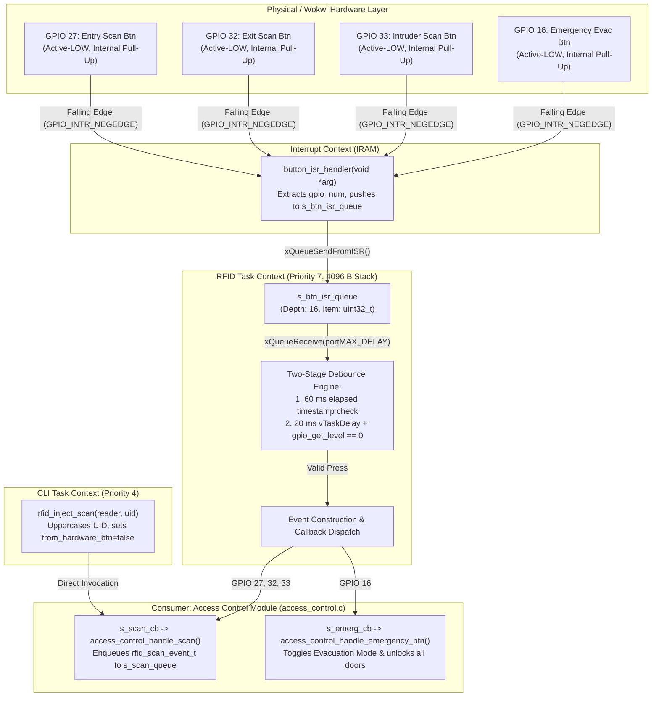

# Module Documentation: Dual Entry/Exit RFID Reader & Emergency Button Driver (`rfid`)

**Files Documented:**
- Header: `main/include/rfid.h` (Lines 1–26)
- Implementation: `main/src/rfid.c` (Lines 1–146)
- Related Pin/System Configuration: `main/include/board_pins.h`, `main/include/config.h`

---

## 1. Purpose & Architectural Role

In the **CoCIS Smart Control and Monitoring System**, the `rfid` module acts as the **Hardware Abstraction Layer (HAL) and Event Producer** for physical entrance/exit card scans and the physical Emergency Evacuation pushbutton at the Main Entrance of the College of Computing and Information Sciences (CoCIS).

### Why Does This Module Exist?
In a physical deployment, an ESP32 reads 13.56 MHz ISO/IEC 14443A contactless smartcards using two SPI-connected **MFRC522** or UART-connected **PN532** RFID reader modules (one mounted outside the Entry turnstile/door, and one mounted inside at the Exit door). In the **Wokwi Simulator** (and during automated bench grading), physical RF fields do not exist. Therefore, `rfid.c` unifies **two input channels** behind a single, clean callback-driven interface (`rfid_scan_event_t`):

1. **Hardware Pushbutton Interrupt Channel (Wokwi & Bench Test Buttons):**
   - **GPIO 27 (`PIN_BTN_ENTRY_SCAN` — Green button "SCAN ENTRY (VALID)"):** Simulates tapping enrolled student card `04A1B2C3` (Matthew Mumbere) at the Entry reader.
   - **GPIO 32 (`PIN_BTN_EXIT_SCAN` — Blue button "SCAN EXIT (VALID)"):** Simulates tapping enrolled card `04A1B2C3` at the Exit reader.
   - **GPIO 33 (`PIN_BTN_INTRUDER_SCAN` — Red button "SCAN INTRUDER TAG"):** Simulates tapping an un-enrolled/unknown card `DEADBEEF` at the Entry reader.
   - **GPIO 16 (`PIN_BTN_EMERGENCY` — Yellow button "EMERGENCY EVAC"):** Simulates pressing the physical break-glass fire evacuation override button.
2. **Software/CLI Injection Channel (`rfid_inject_scan`):**
   - Allows the interactive serial CLI (`sim scan entry <uid>` / `sim scan exit <uid>`) and the automated 10-scenario verification suite (`sim selftest`) to inject arbitrary UID strings (e.g., `04A00001`, `04C3D4E5`, `0499DEAD`) into either the Entry or Exit reader pipeline.

### Architectural Data & Control Flow (Mermaid Diagram)



---

## 2. Public API Reference (`main/include/rfid.h`)

### 2.1 Enumerations

#### `rfid_reader_t` (Lines 9–12)
```c
typedef enum {
    RFID_READER_ENTRY = 0,
    RFID_READER_EXIT = 1
} rfid_reader_t;
```
- **Purpose:** Identifies which physical RFID reader antenna produced the scan event.
- **Values:**
  - `RFID_READER_ENTRY` (`0`): The external reader mounted outside the CoCIS Main Entrance door.
  - `RFID_READER_EXIT` (`1`): The internal reader mounted inside the CoCIS Main Entrance lobby for egress tracking and anti-passback checkout.

---

### 2.2 Structures

#### `rfid_scan_event_t` (Lines 14–18)
```c
typedef struct {
    rfid_reader_t reader;
    char          uid[CFG_RFID_UID_MAX_LEN];
    bool          from_hardware_btn;
} rfid_scan_event_t;
```
- **Purpose:** Encapsulates a single RFID tag read event passed from the `rfid` driver to the `access_control` decision engine.
- **Fields:**
  - `reader`: Either `RFID_READER_ENTRY` or `RFID_READER_EXIT`.
  - `uid`: Null-terminated ASCII hexadecimal string representing the card's Unique Identifier (up to `CFG_RFID_UID_MAX_LEN - 1` = 15 characters plus `'\0'`, since `CFG_RFID_UID_MAX_LEN` is `16` in `config.h`).
  - `from_hardware_btn`: `true` if triggered by pressing a physical Wokwi GPIO pushbutton (`PIN_BTN_ENTRY_SCAN`, `PIN_BTN_EXIT_SCAN`, or `PIN_BTN_INTRUDER_SCAN`); `false` if injected via `rfid_inject_scan()` from the serial CLI.

---

### 2.3 Callback Function Pointer Types

#### `rfid_scan_callback_t` (Line 20)
```c
typedef void (*rfid_scan_callback_t)(const rfid_scan_event_t *evt);
```
- **Purpose:** Signature for the upper-layer callback invoked whenever a valid RFID scan occurs.
- **Registered Callback in System:** `access_control_handle_scan` (registered in `app_main()` at `main/main.c:52`).

#### `rfid_emergency_button_cb_t` (Line 21)
```c
typedef void (*rfid_emergency_button_cb_t)(void);
```
- **Purpose:** Signature for the upper-layer callback invoked whenever the physical emergency button (`PIN_BTN_EMERGENCY`) is pressed and debounced.
- **Registered Callback in System:** `access_control_handle_emergency_btn` (registered in `app_main()` at `main/main.c:52`).

---

### 2.4 Public Functions

#### `rfid_init()` (Line 23)
```c
esp_err_t rfid_init(rfid_scan_callback_t scan_cb, rfid_emergency_button_cb_t emerg_cb);
```
- **Parameters:**
  - `scan_cb`: Function pointer invoked on card scan events (may be `NULL` if unused, though in normal operation it points to `access_control_handle_scan`).
  - `emerg_cb`: Function pointer invoked on emergency button press events (points to `access_control_handle_emergency_btn`).
- **Return Value:**
  - `ESP_OK` (`0`) on success.
  - `ESP_ERR_NO_MEM` if creating the FreeRTOS ISR queue (`s_btn_isr_queue`) or spawning `rfid_task` fails due to insufficient heap.
  - Any `esp_err_t` returned by `gpio_config()` if pin configuration fails.
- **Side Effects:**
  - Stores `scan_cb` and `emerg_cb` in module-static variables `s_scan_cb` and `s_emerg_cb`.
  - Allocates a FreeRTOS queue of depth `CFG_RFID_QUEUE_DEPTH` (16) holding `uint32_t` GPIO numbers.
  - Configures GPIOs 27, 32, 33, and 16 as inputs with internal pull-up resistors enabled and falling-edge interrupts (`GPIO_INTR_NEGEDGE`).
  - Attaches `button_isr_handler` to each of the 4 GPIO pins.
  - Creates the background FreeRTOS task `"rfid_task"` (stack: 4096 bytes, priority: 7).
- **Who Calls It & Task Context:** Called once during boot by `app_main()` (`main/main.c:52`) running in the `main` task context (Priority 1).
- **Blocking Behavior:** Non-blocking; returns immediately after initializing peripherals and spawning `rfid_task`.

#### `rfid_inject_scan()` (Line 24)
```c
esp_err_t rfid_inject_scan(rfid_reader_t reader, const char *uid);
```
- **Parameters:**
  - `reader`: Target reader (`RFID_READER_ENTRY` or `RFID_READER_EXIT`).
  - `uid`: Non-empty null-terminated string containing the hexadecimal UID to simulate (e.g., `"04a1b2c3"` or `"04A1B2C3"`).
- **Return Value:**
  - `ESP_OK` on successful event creation and callback invocation.
  - `ESP_ERR_INVALID_ARG` if `uid == NULL`, `uid[0] == '\0'`, or `reader` is neither `RFID_READER_ENTRY` nor `RFID_READER_EXIT`.
- **Side Effects:**
  - Normalizes `uid` to uppercase ASCII characters (`toupper`) into a stack-allocated `rfid_scan_event_t`, sets `from_hardware_btn = false`, and invokes `s_scan_cb(&evt)` (`access_control_handle_scan`), which enqueues the scan into `access_control`'s queue.
- **Who Calls It & Task Context:** Called by `cmd_sim()` in `main/src/cli.c:708` when the user runs `sim scan <entry|exit> <uid>` in the `cli_task` context (Priority 4).
- **Blocking Behavior:** Almost completely non-blocking (the underlying `access_control_handle_scan` uses a max queue send timeout of `50 ms` if the scan queue were full).

---

## 3. Line-by-Line / Block-by-Block Code Walkthrough (`main/src/rfid.c`)

### 3.1 Header Includes & Module-Static State (Lines 1–17)
```c
#include "rfid.h"
#include <ctype.h>
#include <string.h>
#include "board_pins.h"
#include "driver/gpio.h"
#include "esp_log.h"
#include "esp_timer.h"
#include "freertos/FreeRTOS.h"
#include "freertos/queue.h"
#include "freertos/task.h"

static const char *TAG = "RFID";

static QueueHandle_t              s_btn_isr_queue = NULL;
static rfid_scan_callback_t       s_scan_cb = NULL;
static rfid_emergency_button_cb_t s_emerg_cb = NULL;
```
- **Lines 1–10:** Pulls in the module's own header (`rfid.h`), standard C character/string utilities (`<ctype.h>` for `toupper()`, `<string.h>` for `strncpy()`), hardware pin macros (`board_pins.h`), ESP-IDF GPIO and high-resolution timer drivers (`driver/gpio.h`, `esp_timer.h`), logging (`esp_log.h`), and FreeRTOS kernel primitives (`FreeRTOS.h`, `queue.h`, `task.h`).
- **Line 12:** `TAG` is the module identifier string `"RFID"` passed to `ESP_LOGI()` for structured serial log output.
- **Line 14 (`s_btn_isr_queue`):** Handle to the FreeRTOS queue that bridges the hardware GPIO Interrupt Service Routine (`button_isr_handler`) and the background processing task (`rfid_task`). Initialized to `NULL` so we can guard against uninitialized access.
- **Lines 15–16 (`s_scan_cb`, `s_emerg_cb`):** Private (`static`) function pointers storing the callbacks supplied to `rfid_init()`. Keeping these `static` enforces loose coupling: `rfid.c` does not `#include "access_control.h"` at all!

---

### 3.2 GPIO Interrupt Service Routine: `button_isr_handler()` (Lines 18–26)
```c
static void IRAM_ATTR button_isr_handler(void *arg)
{
    uint32_t gpio_num = (uint32_t)(uintptr_t)arg;
    BaseType_t high_task_woken = pdFALSE;
    if (s_btn_isr_queue != NULL) {
        xQueueSendFromISR(s_btn_isr_queue, &gpio_num, &high_task_woken);
    }
    portYIELD_FROM_ISR(high_task_woken);
}
```
- **Line 18 (`IRAM_ATTR`):** Places the compiled machine code of `button_isr_handler` into the ESP32's internal Instruction RAM (IRAM) rather than external SPI flash. This guarantees the ISR can execute immediately even if SPI flash cache is temporarily disabled during NVS writes or SD/flash operations.
- **Line 20:** Extracts the GPIO pin number from `void *arg`. When the ISR was registered in `rfid_init()`, the pin number was cast to a pointer (`(void *)(uintptr_t)btns[i]`). Here we reverse that cast safely via `uintptr_t` to `uint32_t`.
- **Line 21:** Initializes `high_task_woken = pdFALSE`. `xQueueSendFromISR()` will set this flag to `pdTRUE` if posting to `s_btn_isr_queue` unblocks a task (`rfid_task`, Priority 7) whose priority is higher than whichever task was interrupted.
- **Lines 22–24:** Checks that `s_btn_isr_queue` exists and copies the 4-byte `gpio_num` into the queue without blocking. If the queue is full (e.g., 16 unserviced bounces), `xQueueSendFromISR()` simply drops the item and returns `errQUEUE_FULL` immediately rather than stalling the CPU.
- **Line 25 (`portYIELD_FROM_ISR(high_task_woken)`):** If `high_task_woken == pdTRUE`, requests an immediate context switch to `rfid_task` as soon as the ISR exits, instead of waiting for the next 1 ms FreeRTOS SysTick interrupt.

---

### 3.3 Background Debounce & Dispatch Task: `rfid_task()` (Lines 28–76)
```c
static void rfid_task(void *arg)
{
    (void)arg;
    int64_t last_press_ms[40] = { 0 };
    uint32_t gpio_num = 0;

    while (1) {
        if (xQueueReceive(s_btn_isr_queue, &gpio_num, portMAX_DELAY) == pdTRUE) {
            if (gpio_num >= 40) {
                continue;
            }
            int64_t now_ms = esp_timer_get_time() / 1000LL;
            if ((now_ms - last_press_ms[gpio_num]) < CFG_RFID_DEBOUNCE_MS) {
                continue;
            }
            vTaskDelay(pdMS_TO_TICKS(20));
            if (gpio_get_level((gpio_num_t)gpio_num) != 0) {
                continue;
            }
            last_press_ms[gpio_num] = esp_timer_get_time() / 1000LL;
```
- **Line 30 (`(void)arg;`):** Explicitly silences compiler `-Wunused-parameter` warnings since `rfid_task` does not use its `arg` pointer.
- **Line 31 (`last_press_ms[40] = { 0 };`):** An array indexed by ESP32 GPIO number (`0` through `39`, covering all 40 ESP32 GPIO pads) storing the timestamp (in milliseconds since boot) of the last confirmed press on each pin.
- **Line 35 (`xQueueReceive(..., portMAX_DELAY)`):** Blocks the task in the FreeRTOS `Blocked` state (consuming **0% CPU**) until `button_isr_handler` pushes a `gpio_num` into `s_btn_isr_queue`.
- **Lines 36–38:** Defensive bounds check (`gpio_num >= 40`) to prevent an out-of-bounds array read/write on `last_press_ms[40]`.
- **Lines 39–42 (Stage 1 Debounce — Time Window Filter):** Reads the 64-bit microsecond hardware timer via `esp_timer_get_time()` and divides by `1000LL` to get milliseconds (`now_ms`). If fewer than `CFG_RFID_DEBOUNCE_MS` (`60 ms`) have elapsed since the last valid press on this pin, the interrupt is discarded as trailing contact bounce.
- **Lines 43–46 (Stage 2 Debounce — Physical Settling Verification):** Delays the task for `20 ms` (`vTaskDelay(pdMS_TO_TICKS(20))`) to allow mechanical switch contacts to stop bouncing, then re-samples the physical pin voltage via `gpio_get_level((gpio_num_t)gpio_num)`. Because the buttons are wired **Active-LOW**, a genuinely held button must still read `0`. If it reads `1` (HIGH), the falling edge was just a transient electrical glitch or release bounce, so it is ignored (`continue`).
- **Line 47:** Records the confirmed press timestamp in `last_press_ms[gpio_num]`.

```c
            if (gpio_num == PIN_BTN_EMERGENCY) {
                if (s_emerg_cb != NULL) {
                    s_emerg_cb();
                }
                continue;
            }

            rfid_scan_event_t evt = { 0 };
            evt.from_hardware_btn = true;
            if (gpio_num == PIN_BTN_ENTRY_SCAN) {
                evt.reader = RFID_READER_ENTRY;
                strncpy(evt.uid, CFG_BTN_ENTRY_VALID_UID, sizeof(evt.uid) - 1);
            } else if (gpio_num == PIN_BTN_EXIT_SCAN) {
                evt.reader = RFID_READER_EXIT;
                strncpy(evt.uid, CFG_BTN_EXIT_VALID_UID, sizeof(evt.uid) - 1);
            } else if (gpio_num == PIN_BTN_INTRUDER_SCAN) {
                evt.reader = RFID_READER_ENTRY;
                strncpy(evt.uid, CFG_BTN_INTRUDER_UID, sizeof(evt.uid) - 1);
            } else {
                continue;
            }

            if (s_scan_cb != NULL) {
                s_scan_cb(&evt);
            }
        }
    }
}
```
- **Lines 49–54:** If the debounced press came from `PIN_BTN_EMERGENCY` (GPIO 16), invokes `s_emerg_cb()` (`access_control_handle_emergency_btn()`) and loops back to wait for the next interrupt.
- **Lines 56–70:** Zero-initializes an `rfid_scan_event_t evt = { 0 };` on the stack, marks `evt.from_hardware_btn = true`, and maps the GPIO pin to its simulated reader and UID:
  - `PIN_BTN_ENTRY_SCAN` (GPIO 27) $\rightarrow$ `RFID_READER_ENTRY`, UID `"04A1B2C3"` (`CFG_BTN_ENTRY_VALID_UID`).
  - `PIN_BTN_EXIT_SCAN` (GPIO 32) $\rightarrow$ `RFID_READER_EXIT`, UID `"04A1B2C3"` (`CFG_BTN_EXIT_VALID_UID`).
  - `PIN_BTN_INTRUDER_SCAN` (GPIO 33) $\rightarrow$ `RFID_READER_ENTRY`, UID `"DEADBEEF"` (`CFG_BTN_INTRUDER_UID`).
  - Notice `strncpy(..., sizeof(evt.uid) - 1)` is safe because `evt` was zero-initialized by `{ 0 }`, guaranteeing that the last byte `evt.uid[15]` is always `'\0'`.
- **Lines 71–73:** Invokes `s_scan_cb(&evt)` (`access_control_handle_scan`), which copies `evt` into the `access_control` scan queue.

---

### 3.4 Module Initialization: `rfid_init()` (Lines 78–123)
```c
esp_err_t rfid_init(rfid_scan_callback_t scan_cb, rfid_emergency_button_cb_t emerg_cb)
{
    s_scan_cb = scan_cb;
    s_emerg_cb = emerg_cb;

    if (s_btn_isr_queue == NULL) {
        s_btn_isr_queue = xQueueCreate(CFG_RFID_QUEUE_DEPTH, sizeof(uint32_t));
        if (s_btn_isr_queue == NULL) {
            return ESP_ERR_NO_MEM;
        }
    }

    uint64_t btn_mask = (1ULL << PIN_BTN_ENTRY_SCAN)    |
                        (1ULL << PIN_BTN_EXIT_SCAN)     |
                        (1ULL << PIN_BTN_INTRUDER_SCAN) |
                        (1ULL << PIN_BTN_EMERGENCY);

    gpio_config_t bcfg = {
        .pin_bit_mask = btn_mask,
        .mode = GPIO_MODE_INPUT,
        .pull_up_en = GPIO_PULLUP_ENABLE,
        .pull_down_en = GPIO_PULLDOWN_DISABLE,
        .intr_type = GPIO_INTR_NEGEDGE
    };
    esp_err_t err = gpio_config(&bcfg);
    if (err != ESP_OK) {
        return err;
    }

    const gpio_num_t btns[4] = {
        PIN_BTN_ENTRY_SCAN,
        PIN_BTN_EXIT_SCAN,
        PIN_BTN_INTRUDER_SCAN,
        PIN_BTN_EMERGENCY
    };
    for (int i = 0; i < 4; i++) {
        gpio_isr_handler_add(btns[i], button_isr_handler, (void *)(uintptr_t)btns[i]);
    }

    if (xTaskCreate(rfid_task, "rfid_task", 4096, NULL, 7, NULL) != pdPASS) {
        return ESP_ERR_NO_MEM;
    }

    ESP_LOGI(TAG, "Entry/Exit RFID reader abstraction and button ISRs initialized");
    return ESP_OK;
}
```
- **Lines 80–88:** Saves the two callbacks and creates `s_btn_isr_queue` with capacity `CFG_RFID_QUEUE_DEPTH` (16 items of size `sizeof(uint32_t)` = 4 bytes).
- **Lines 90–93:** Computes a 64-bit bitmask (`uint64_t btn_mask`) combining bit 27, bit 32, bit 33, and bit 16 using `1ULL << pin`.
- **Lines 95–105:** Configures all 4 GPIO pins in a single atomic call to `gpio_config(&bcfg)` as digital inputs (`GPIO_MODE_INPUT`), with internal weak ~45 k$\Omega$ pull-up resistors enabled (`GPIO_PULLUP_ENABLE`), pull-downs disabled, and falling-edge interrupt trigger (`GPIO_INTR_NEGEDGE`).
- **Lines 107–115:** Iterates over the 4 button pins and registers `button_isr_handler` with the ESP-IDF GPIO ISR service (which was already installed by `board_pins_init()` via `gpio_install_isr_service(0)`). Each pin's integer number is passed as the `void *` user argument.
- **Lines 117–119:** Spawns `rfid_task` with 4096 bytes of stack at FreeRTOS priority `7` (higher than `access_task` at priority 6 and `cli_task` at priority 4 so hardware button edges are debounced with crisp timing).

---

### 3.5 Software / CLI Scan Injection: `rfid_inject_scan()` (Lines 125–146)
```c
esp_err_t rfid_inject_scan(rfid_reader_t reader, const char *uid)
{
    if (uid == NULL || uid[0] == '\0' || (reader != RFID_READER_ENTRY && reader != RFID_READER_EXIT)) {
        return ESP_ERR_INVALID_ARG;
    }

    rfid_scan_event_t evt = { 0 };
    evt.reader = reader;
    evt.from_hardware_btn = false;

    size_t i = 0;
    while (uid[i] != '\0' && i + 1 < sizeof(evt.uid)) {
        evt.uid[i] = (char)toupper((unsigned char)uid[i]);
        i++;
    }
    evt.uid[i] = '\0';

    if (s_scan_cb != NULL) {
        s_scan_cb(&evt);
    }
    return ESP_OK;
}
```
- **Lines 127–129:** Validates arguments—rejecting `NULL` pointers, empty strings `""`, or invalid enum values with `ESP_ERR_INVALID_ARG`.
- **Lines 131–133:** Initializes `evt` to all zeros, sets `evt.reader`, and sets `evt.from_hardware_btn = false` to distinguish CLI simulation from physical button presses.
- **Lines 135–140:** Copies up to `sizeof(evt.uid) - 1` (15) characters from `uid` into `evt.uid`, converting each character to uppercase via `toupper((unsigned char)uid[i])` so that `"04a1b2c3"` and `"04A1B2C3"` match identically, and explicitly writes the terminating null byte `'\0'`.
- **Lines 142–145:** Calls `s_scan_cb(&evt)` and returns `ESP_OK`.

---

## 4. C Language Constructs Explained

| C Construct | Where Used in `rfid` | Detailed Explanation for Examiners |
| :--- | :--- | :--- |
| **`#ifndef RFID_H` / `#define RFID_H` / `#endif`** | `rfid.h:1-2, 26` | **Include Guards:** Prevents double-inclusion errors (`redefinition of typedef...`) if multiple headers/source files (e.g., `access_control.h` and `main.c`) both `#include "rfid.h"` in the same translation unit. |
| **`typedef enum { ... } rfid_reader_t;`** | `rfid.h:9-12` | Defines a strongly named enumeration type so functions accept `rfid_reader_t` instead of raw magic numbers `0` and `1`. |
| **`typedef struct { ... } rfid_scan_event_t;`** | `rfid.h:14-18` | Bundles heterogenous data (`rfid_reader_t`, `char[16]`, `bool`) into a single contiguous value type that can be copied by value into a FreeRTOS queue (`xQueueSend`). |
| **Function Pointer `typedef`** (`typedef void (*rfid_scan_callback_t)(...)`) | `rfid.h:20-21` | Declares a type alias for a pointer to a function returning `void`. Enables **Inversion of Control (IoC)**: the low-level `rfid` driver can notify the high-level `access_control` module without knowing anything about `access_control` at compile time. |
| **`static` (File-Scope Variables & Functions)** | `rfid.c:12-28` | Limits symbol visibility (internal linkage) to `rfid.c` only. No other `.c` file can directly read or corrupt `s_btn_isr_queue` or call `button_isr_handler()`. |
| **`const` Qualifier** | `rfid.h:20, 24`, `rfid.c:12, 107` | Promises the compiler and caller that the pointed-to data (`const rfid_scan_event_t *evt`, `const char *uid`) will not be mutated by the function, and allows `btns[4]` to reside in read-only flash. |
| **`(void *)(uintptr_t)btns[i]` & `(uint32_t)(uintptr_t)arg`** | `rfid.c:20, 114` | **Integer-to-Pointer Cast via `uintptr_t`:** `gpio_isr_handler_add()` passes a `void *` context pointer to the ISR. Instead of allocating a `uint32_t` on the heap or keeping a global variable per pin, we pack the integer pin number directly inside the pointer value itself. Casting through `uintptr_t` (an unsigned integer type guaranteed by `<stdint.h>` to be the exact bit-width of a pointer, 32 bits on ESP32) prevents compiler warnings about casting between integers and pointers of different sizes. |
| **`1ULL << PIN_BTN_EXIT_SCAN`** | `rfid.c:90-93` | **64-bit Left Shift:** The ESP32 has 40 GPIO pins (GPIO 0–39). A standard integer literal `1` is a 32-bit signed `int`. Shifting a 32-bit integer by `32` (`1 << 32` for `PIN_BTN_EXIT_SCAN = GPIO_NUM_32`) or `33` (`PIN_BTN_INTRUDER_SCAN = GPIO_NUM_33`) is **Undefined Behavior (UB)** in C! Suffixing `1ULL` makes the literal a 64-bit `unsigned long long`, making shifts up to bit 63 completely safe. |
| **Designated Initializers (`.mode = ...`) & Zero Initializer (`{ 0 }`)** | `rfid.c:31, 56, 95-101` | C99 designated initializers initialize specific struct fields by name regardless of declaration order, while automatically zeroing any omitted fields. `{ 0 }` zeroes the entire array (`last_press_ms[40]`) or struct (`evt`). |
| **`strncpy()` & `toupper((unsigned char)c)`** | `rfid.c:60-66, 136-140` | `strncpy` bounds the number of characters copied to prevent buffer overflow. In `rfid_inject_scan()`, `uid[i]` is cast to `(unsigned char)` before passing to `toupper()` because passing a negative signed `char` (other than `EOF`) to `<ctype.h>` functions is undefined behavior in C. |
| **Fixed-Width Integers (`uint32_t`, `uint64_t`, `int64_t`)** | `rfid.c:20, 31, 39, 90` | Guarantees exact bit widths across architectures: `uint32_t` (32-bit unsigned GPIO number), `uint64_t` (64-bit GPIO bitmask), and `int64_t` (64-bit microsecond/millisecond timestamps from `esp_timer_get_time()` that will not overflow for 292,000 years, unlike a 32-bit millisecond counter which wraps every 49.7 days). |

---

## 5. ESP-IDF & FreeRTOS Constructs Explained

| Construct / API | Role in `rfid.c` | Detailed Technical Explanation |
| :--- | :--- | :--- |
| **`IRAM_ATTR`** | `rfid.c:18` | Macro expanding to `__attribute__((section(".iram1")))`. Places `button_isr_handler` in internal SRAM instruction memory so it executes fast and never crashes with a `Cache disabled but cached memory region accessed` panic if an interrupt fires while SPI flash is busy erasing/writing NVS or FATFS. |
| **`xQueueCreate(16, sizeof(uint32_t))`** | `rfid.c:84` | Allocates a thread-safe, ISR-safe FIFO ring buffer in FreeRTOS heap capable of holding 16 `uint32_t` pin numbers. |
| **`xQueueSendFromISR()` & `portYIELD_FROM_ISR()`** | `rfid.c:23, 25` | **Why ISRs must be short and never block:** An ISR runs with interrupts disabled on the current CPU core and has no task control block (TCB) of its own. Calling a blocking function like `vTaskDelay()`, `xQueueSend(..., portMAX_DELAY)`, or `printf()` inside an ISR would corrupt the FreeRTOS scheduler or trigger an Interrupt Watchdog Timer (IWDT) panic. Instead, we use the non-blocking `FromISR` variant to defer work to `rfid_task` (**Deferred Interrupt Processing**), and call `portYIELD_FROM_ISR()` to switch immediately to `rfid_task`. |
| **`gpio_config_t` with `GPIO_PULLUP_ENABLE` & `GPIO_INTR_NEGEDGE`** | `rfid.c:95-102` | Each pushbutton in `diagram.json` connects a GPIO pin on one side to `GND` on the other side. With `GPIO_PULLUP_ENABLE`, the ESP32 connects an internal ~45 k$\Omega$ resistor between the pin and `3.3V`, holding the pin at logic `1` (HIGH) when unpressed. When pressed, the button shorts the pin to `GND` (logic `0`, LOW), creating a **falling edge** (`1` $\rightarrow$ `0`) that triggers `GPIO_INTR_NEGEDGE`. Note that GPIOs 27, 32, 33, and 16 all have internal pull-up resistors on ESP32 (unlike input-only GPIOs 34–39 which lack internal pull-ups). |
| **`gpio_isr_handler_add()`** | `rfid.c:114` | Registers a per-pin interrupt callback with the central GPIO ISR dispatcher initialized earlier by `gpio_install_isr_service(0)` in `board_pins_init()`. |
| **`esp_timer_get_time()`** | `rfid.c:39, 47` | Returns a 64-bit count of microseconds elapsed since boot from the ESP32's hardware 64-bit LAC/Systimer peripheral, providing microsecond-accurate timestamps independent of the 1 ms FreeRTOS tick rate. |
| **`vTaskDelay(pdMS_TO_TICKS(20))` & `gpio_get_level()`** | `rfid.c:43-44` | Converts `20 ms` into FreeRTOS ticks using `pdMS_TO_TICKS()`, puts `rfid_task` to sleep for 20 ms while mechanical switch contacts settle, and then reads the digital input register via `gpio_get_level()` to confirm the button is still held LOW (`0`). |

---

## 6. Alternatives & "What If You Change This?"

| What If You Change... | Alternative Option | What Happens / Why It Breaks or Changes Behavior |
| :--- | :--- | :--- |
| **`GPIO_PULLUP_ENABLE` $\rightarrow$ `GPIO_PULLUP_DISABLE` (or `GPIO_PULLDOWN_ENABLE`)** | Disabling pull-up or enabling pull-down while keeping buttons wired to `GND` | **Broken!** Without a pull-up resistor, an unpressed button leaves the CMOS input pin **floating** (high-impedance antenna) if pull-down is disabled, causing random phantom scans from 50 Hz mains hum. If `GPIO_PULLDOWN_ENABLE` is used while the button is wired to `GND`, the pin is `0V` when unpressed and `0V` when pressed—no voltage transition ever occurs! To use `GPIO_PULLDOWN_ENABLE`, you would have to rewire all buttons in `diagram.json` to `3.3V` and change `intr_type` to `GPIO_INTR_POSEDGE` and `gpio_get_level() != 1`. |
| **GPIO ISR + Queue $\rightarrow$ Periodic Polling Loop (`vTaskDelay(50)`)** | Removing `button_isr_handler` and checking `gpio_get_level()` every 50 ms in a loop | Wastes CPU waking up 20 times per second even when nobody touches the door all night, increases scan latency by up to 50 ms, and can completely miss fast button taps (<50 ms) in Wokwi or bench tests. |
| **`1ULL << pin` $\rightarrow$ `1 << pin`** | Using a 32-bit integer shift in `btn_mask` | **Critical Bug on GPIO 32 & 33!** `PIN_BTN_EXIT_SCAN` is GPIO 32 and `PIN_BTN_INTRUDER_SCAN` is GPIO 33. Shifting a 32-bit `1` by 32 or 33 bits overflows a 32-bit integer (Undefined Behavior in C), leaving bits 32 and 33 as `0` in `btn_mask`. The Exit and Intruder buttons would never be configured as inputs or generate interrupts! |
| **Simulated Buttons + CLI $\rightarrow$ Physical MFRC522 SPI RFID Reader** | Connecting two MFRC522 modules over SPI | Because `rfid.h` abstracts scans into `rfid_scan_event_t` and invokes `s_scan_cb(&evt)`, replacing button simulation with real MFRC522 SPI polling inside `rfid_task` requires **zero changes** to `access_control.c`, `door.c`, `user_db.c`, or `occupancy_ledger.c`. |
| **Removing Stage 2 Debounce (`vTaskDelay(20)` + `gpio_get_level() != 0`)** | Relying only on the 60 ms timestamp check | When a user *releases* a mechanical button 300 ms after pressing it, switch contacts often bounce briefly between `3.3V` and `0V`, generating a spurious **falling edge** on release! Because 300 ms > 60 ms, a timestamp-only check would falsely trigger a second scan when the user lets go of the button (immediately causing a false Anti-Passback violation!). Checking `gpio_get_level() == 0` after 20 ms rejects release bounces because after 20 ms the released button is back at `1` (HIGH). |

---

## 7. Design Rationale

1. **Two-Stage Hybrid Debouncing (Timestamp + Settling Level Check):**
   Mechanical pushbuttons bounce both when **pressed** (make bounce) and when **released** (break bounce). In an access control system with **Anti-Passback** enabled, a single double-trigger on the Entry button is catastrophic for user experience: the first edge checks the user into the building, and the second edge 15 ms later triggers a `DENIED_ANTIPASSBACK_ENTRY` alarm! Combining a `60 ms` refractory period (`CFG_RFID_DEBOUNCE_MS`) with a `20 ms` settling delay + active-LOW level verification (`gpio_get_level() == 0`) eliminates both press bounce and release bounce.
2. **Callback Decoupling (Observer Pattern):**
   `rfid.c` has zero dependency on `access_control.c`, `user_db.c`, or `door.c`. This clean separation allows `rfid.c` to be unit-tested in isolation by passing a simple test callback to `rfid_init()`.
3. **Dual Hardware + CLI Input Path:**
   By providing both physical Wokwi pushbuttons (`from_hardware_btn = true`) and `rfid_inject_scan()` (`from_hardware_btn = false`), an examiner can test basic Entry/Exit/Intruder/Emergency behavior with a single mouse click in Wokwi, while also testing all 8 enrolled CoCIS users (`04A00001`, `04A1B2C3`, `04B2C3D4`, `04C3D4E5`, `04D4E5F6`, `04E5F607`, `04V10008`, `0499DEAD`) via serial CLI commands.

---

## 8. Failure Modes, Edge Cases & Recovery

1. **Switch Contact Bounce (Press & Release):**
   - *Failure Mode:* Mechanical contacts oscillate 5–20 times within 5–15 ms on press or release.
   - *Recovery:* Handled by `s_btn_isr_queue` buffering the edges without blocking the ISR, while `rfid_task` filters out any edge within `60 ms` of the previous press and verifies the pin remains LOW (`0`) after `20 ms`.
2. **Rapid Button Mashing / ISR Queue Full (`s_btn_isr_queue` Overflow):**
   - *Failure Mode:* If a noisy wire or rapid mashing generates more than `CFG_RFID_QUEUE_DEPTH` (16) edges within the `20 ms` `vTaskDelay` window of `rfid_task`.
   - *Recovery:* `xQueueSendFromISR()` safely drops excess edges without blocking or crashing the ISR. As soon as `rfid_task` wakes up, it drains the queue and discards duplicate edges for the same pin via the `60 ms` timestamp filter.
3. **Lowercase or Overlong UID Strings Passed to `rfid_inject_scan()`:**
   - *Failure Mode:* User types `sim scan entry 04a1b2c3` (lowercase) or a 50-character string in the CLI.
   - *Recovery:* `rfid_inject_scan()` converts every character to uppercase via `toupper((unsigned char)uid[i])` and truncates safely at `sizeof(evt.uid) - 1` (15 characters) with an explicit null terminator.
4. **Null or Empty UID / Invalid Reader Enum:**
   - *Failure Mode:* Caller passes `NULL` or `""` to `rfid_inject_scan()`.
   - *Recovery:* Immediately caught by the guard on Line 127 (`return ESP_ERR_INVALID_ARG;`) before any memory dereference occurs.

---

## 9. How to Test This Module in Isolation

### 9.1 Wokwi Hardware Pushbutton Tests
1. **Click the Green Button (`SCAN ENTRY (VALID)` — GPIO 27):**
   - Dispatches `rfid_scan_event_t` with `reader = RFID_READER_ENTRY`, `uid = "04A1B2C3"`, `from_hardware_btn = true`.
   - **Expected Serial Output:**
     ```text
     I (xxx) ACCESS_CTRL: [ENTRY] GRANT_NORMAL for 04A1B2C3 (Matthew Mumbere) -> Building Occupancy: 1
     ```
2. **Click the Blue Button (`SCAN EXIT (VALID)` — GPIO 32):**
   - Dispatches `rfid_scan_event_t` with `reader = RFID_READER_EXIT`, `uid = "04A1B2C3"`, `from_hardware_btn = true`.
   - **Expected Serial Output:**
     ```text
     I (xxx) ACCESS_CTRL: [EXIT] GRANT_NORMAL for 04A1B2C3 (Matthew Mumbere) -> Building Occupancy: 0
     ```
3. **Click the Red Button (`SCAN INTRUDER TAG` — GPIO 33):**
   - Dispatches `rfid_scan_event_t` with `reader = RFID_READER_ENTRY`, `uid = "DEADBEEF"`, `from_hardware_btn = true`.
   - **Expected Serial Output:**
     ```text
     W (xxx) ACCESS_CTRL: [ENTRY] DENIED unknown tag DEADBEEF
     ```
4. **Click the Yellow Button (`EMERGENCY EVAC` — GPIO 16):**
   - Invokes `s_emerg_cb()` (`access_control_handle_emergency_btn()`).
   - **Expected Serial Output:**
     ```text
     W (xxx) ACCESS_CTRL: Emergency Evacuation Mode toggled via hardware button -> ACTIVE (ALL DOORS UNLOCKED)
     ```

### 9.2 Serial CLI Injection Tests
Run the following commands in the serial monitor:
```text
cocis> sim scan entry 04a1b2c3
I (xxx) ACCESS_CTRL: [ENTRY] GRANT_NORMAL for 04A1B2C3 (Matthew Mumbere) -> Building Occupancy: 1

cocis> sim scan exit 04A1B2C3
I (xxx) ACCESS_CTRL: [EXIT] GRANT_NORMAL for 04A1B2C3 (Matthew Mumbere) -> Building Occupancy: 0

cocis> stats
```
Notice that lowercase `04a1b2c3` was automatically normalized to `04A1B2C3` by `rfid_inject_scan()`.

---

## 10. Likely Examiner Questions & Model Answers

### Q1: Why did you put `IRAM_ATTR` on `button_isr_handler()`, and why didn't you call `s_scan_cb()` or `vTaskDelay(20)` directly inside the ISR?
**Model Answer:**
1. **`IRAM_ATTR`** places `button_isr_handler()` in internal instruction SRAM rather than external SPI flash. When the ESP32 writes to NVS (e.g., saving user records or schedules), it temporarily disables the SPI flash instruction cache. If an interrupt occurs while flash cache is disabled and the ISR code resides in flash, the ESP32 immediately crashes with a cache error panic.
2. We cannot call `vTaskDelay(20)` or `s_scan_cb()` inside the ISR because **ISRs cannot block** and must execute in microseconds. `vTaskDelay()` attempts to suspend the current FreeRTOS task, which is illegal in an ISR context, and `s_scan_cb()` calls `xQueueSend()` with a 50 ms timeout. Instead, the ISR uses `xQueueSendFromISR()` to post the GPIO pin number to `s_btn_isr_queue` in less than 2 microseconds, and `rfid_task` handles the 20 ms debounce delay and callback invocation in normal task context.

### Q2: Explain how the pin number gets from `rfid_init()` into `button_isr_handler(void *arg)` without using a global variable.
**Model Answer:**
In `rfid_init()` (line 114), when registering each pin's ISR via `gpio_isr_handler_add(btns[i], button_isr_handler, (void *)(uintptr_t)btns[i])`, we cast the integer pin number (e.g., `27`, `32`, `33`, `16`) to `uintptr_t` (an unsigned integer guaranteed to have the same 32-bit width as a pointer on ESP32) and then to `void *`. Instead of pointing to a memory address, the pointer variable *itself* holds the number `27`. Inside `button_isr_handler(void *arg)` (line 20), we reverse the cast via `uint32_t gpio_num = (uint32_t)(uintptr_t)arg;`. This avoids heap allocation or race conditions on shared global variables and allows all 4 buttons to share the exact same ISR function.

### Q3: Why did you write `1ULL << PIN_BTN_EXIT_SCAN` on line 91 instead of `1 << PIN_BTN_EXIT_SCAN`?
**Model Answer:**
In C, the literal `1` has type `int`, which is a 32-bit signed integer on the ESP32 (`bits 0..31`). `PIN_BTN_EXIT_SCAN` is `GPIO_NUM_32` and `PIN_BTN_INTRUDER_SCAN` is `GPIO_NUM_33`. Shifting a 32-bit integer by 32 or more bits (`1 << 32`) is **Undefined Behavior** in the C standard and evaluates to `0` or wraps around, failing to set bits 32 and 33 in the 64-bit `pin_bit_mask` field of `gpio_config_t`. Writing `1ULL` specifies an `unsigned long long` (64-bit unsigned integer, `bits 0..63`), so shifting left by 32 and 33 sets the exact upper bits required for `GPIO_NUM_32` and `GPIO_NUM_33`.

### Q4: Walk me through how your two-stage debounce logic in `rfid_task()` prevents both press bounce and release bounce.
**Model Answer:**
When a button is pressed, the falling edge triggers `button_isr_handler`, which wakes `rfid_task`.
1. **Stage 1 (Elapsed Time Check, lines 39–42):** `rfid_task` reads `now_ms = esp_timer_get_time() / 1000LL` and checks if `(now_ms - last_press_ms[gpio_num]) < 60`. If multiple edges were queued within 60 ms of a valid press, they are immediately skipped.
2. **Stage 2 (20 ms Settling + Level Check, lines 43–46):** `rfid_task` sleeps for `20 ms` (`vTaskDelay(pdMS_TO_TICKS(20))`) and then checks `if (gpio_get_level((gpio_num_t)gpio_num) != 0) continue;`. This is critical for **release bounce**: when a user releases the button half a second later, the switch contacts may briefly bounce to `GND`, firing a falling-edge interrupt. Because 500 ms > 60 ms, Stage 1 alone would let it pass! However, 20 ms after release, the button is resting at logic `1` (`3.3V` via pull-up), so `gpio_get_level() != 0` catches and discards the release bounce.

### Q5: Why are the pushbuttons configured on GPIOs 27, 32, 33, and 16, whereas the PIR sensors are on GPIOs 34 and 35? Could we move a pushbutton with internal pull-up to GPIO 34?
**Model Answer:**
No! On the ESP32 hardware architecture, **GPIOs 34, 35, 36, and 39 are Input-Only pins that do NOT have internal pull-up or pull-down resistors in silicon**. Since our pushbuttons are wired straight to `GND` without external pull-up resistors in `diagram.json`, they *must* use GPIOs below 34 (such as 16, 27, 32, 33) that have internal pull-up circuitry (`GPIO_PULLUP_ENABLE`). Conversely, the PIR motion sensors have active push-pull digital outputs that actively drive both `3.3V` and `0V`, so they work on GPIOs 34 and 35 without needing internal pull-ups.

### Q6: What does `portYIELD_FROM_ISR(high_task_woken)` on line 25 do, and what would happen if you omitted it?
**Model Answer:**
When `xQueueSendFromISR(s_btn_isr_queue, &gpio_num, &high_task_woken)` places the GPIO number into the queue, FreeRTOS checks if a task was blocked waiting on `s_btn_isr_queue` (`rfid_task`, priority 7) and whether its priority is higher than the task that was running when the interrupt occurred (e.g., `idle_task` at priority 0 or `cli_task` at priority 4). If so, it sets `high_task_woken = pdTRUE`. Calling `portYIELD_FROM_ISR(high_task_woken)` tells the FreeRTOS interrupt exit stub to immediately context-switch to `rfid_task` upon returning from the ISR. If omitted, `rfid_task` would still run, but it would have to wait until the next FreeRTOS SysTick interrupt (up to `1 ms` later at 1000 Hz or `10 ms` at 100 Hz), adding unnecessary jitter.

### Q7: In `rfid_inject_scan()`, why do you cast `uid[i]` to `(unsigned char)` inside `toupper((unsigned char)uid[i])` on line 137?
**Model Answer:**
According to the ISO C standard (`<ctype.h>`), functions like `toupper(int c)` require that their argument `c` be either `EOF` or a value representable as an `unsigned char` (`0..255`). On platforms where plain `char` is signed (`-128..127`), passing a character with the high bit set directly to `toupper(uid[i])` sign-extends it to a negative `int`, which can index before the start of `toupper`'s internal lookup table (Undefined Behavior). Casting to `(unsigned char)` first ensures the value is always in `[0, 255]`.

### Q8: Where is `gpio_install_isr_service()` called? Why isn't it called inside `rfid_init()`?
**Model Answer:**
`gpio_install_isr_service(0)` is called once globally inside `board_pins_init()` (`main/src/board_pins.c:33`), which runs in Step 1 of `app_main()` before either `rfid_init()` or `pir_sensor_init()`. Because both `rfid.c` and `pir_sensor.c` attach per-pin GPIO interrupts via `gpio_isr_handler_add()`, installing the central GPIO ISR dispatcher once in `board_pins_init()` avoids duplicate initialization errors (`ESP_ERR_INVALID_STATE`) and centralizes board-level hardware setup.
