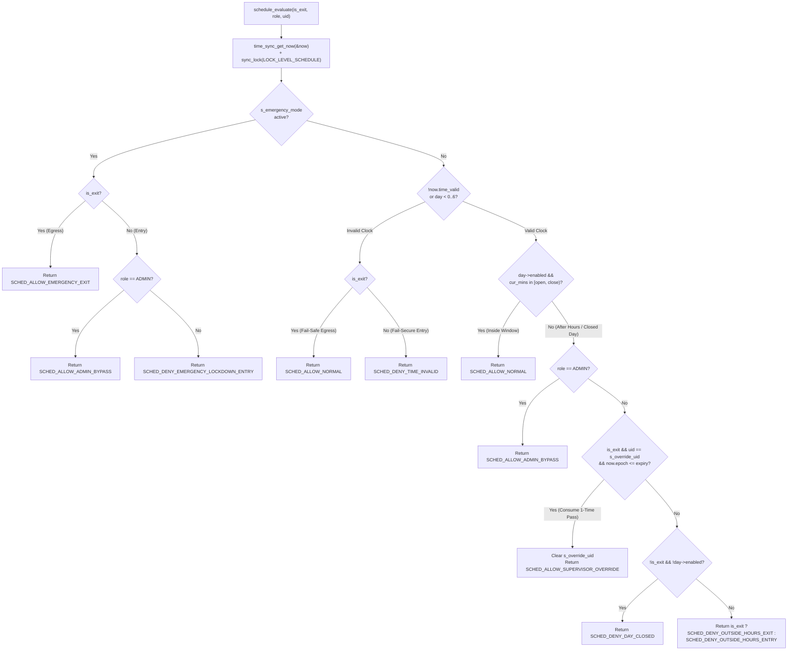

# Module Documentation: `schedule` — Weekly Building Access Schedule, Supervisor Override & Emergency Evacuation Policy Engine

**Coursework:** Embedded Systems (CoCIS Smart Control and Monitoring System, Makerere University)  
**Bundle / Student Assignment:** Bundle 3 (Student 3 — Security, Identity, Schedule & Occupancy Authority)  
**Header File:** `main/include/schedule.h`  
**Implementation File:** `main/src/schedule.c`  
**Synchronization Level:** `LOCK_LEVEL_SCHEDULE` (Level 3 in the hierarchical mutex order) + `SYS_EVT_EMERGENCY_MODE` (FreeRTOS Event Group bit)  
**Persistent Backing Store:** ESP32 NVS Flash (`namespace = "cocis_cfg"`, `key = "sched_v1"`)

---

## 1. Purpose & Architectural Role

The **`schedule`** module is the **Temporal Policy & Life-Safety Decision Engine** for the CoCIS building at Makerere University. In a real university faculty building, physical security and human life safety frequently pull in opposite directions:

* **Security Requirement (Coursework Specification):** Both **entry and exit** through the Main Entrance must be governed by the authorized CoCIS weekly schedule (e.g., Monday–Friday `07:00–21:00 EAT`, Saturday `08:00–17:00 EAT`, Sunday `CLOSED`). Unauthorized after-hours entry or unrecorded after-hours exit by students must be blocked and logged.
* **Human Life-Safety & Operational Requirement:** What happens if a student or staff member stays late in a lab past `21:00 EAT`, or if a fire breaks out at `23:00 EAT`, or if the RTC clock fails? A naive system that unconditionally locks people inside a building after hours is a severe fire-code violation and safety hazard.

To satisfy **both** strict coursework schedule enforcement on entry/exit **and** real-world life safety, `schedule` implements a **3-Tier After-Hours Exit & Emergency Policy**:

1. **Tier 1 — Admin Role Bypass (`SCHED_ALLOW_ADMIN_BYPASS`):** Users with `USER_ROLE_ADMIN` (`Prof. Tonny Oyana`) can enter and exit 24/7 (including closed days and emergency lockdowns).
2. **Tier 2 — One-Time 5-Minute Supervisor Safe-Exit Pass (`SCHED_ALLOW_SUPERVISOR_OVERRIDE`):** If a student or staff member is legitimately inside after closing time, a security supervisor can grant a 5-minute (`300 s`) single-use exit pass to their specific UID (`override_exit <uid>`). The pass is automatically consumed the moment they badge out.
3. **Tier 3 — Emergency Evacuation Mode (`SCHED_ALLOW_EMERGENCY_EXIT` / `SYS_EVT_EMERGENCY_MODE`):** Triggered via the physical Emergency Pushbutton (`GPIO 4`) or CLI (`emergency on`). Immediately allows **all exits** regardless of time or role, while blocking non-admin entries (`SCHED_DENY_EMERGENCY_LOCKDOWN_ENTRY`). Furthermore, if the system clock is ever invalid (`!now.time_valid`), `schedule_evaluate()` fails **closed for entry** (`SCHED_DENY_TIME_INVALID`) but **open for exit** (`SCHED_ALLOW_NORMAL`) so occupants are never trapped by an RTC fault.



---

## 2. Public API Reference (`main/include/schedule.h`)

### 2.1 Data Types: `day_schedule_t`, `weekly_schedule_t`, and `schedule_decision_t`

```c
typedef struct {
    bool    enabled;
    uint8_t open_hour;
    uint8_t open_min;
    uint8_t close_hour;
    uint8_t close_min;
} day_schedule_t;

typedef struct {
    day_schedule_t days[7]; /* 0 = Sun, 1 = Mon .. 6 = Sat */
} weekly_schedule_t;
```

* **`day_schedule_t`**: Represents a single day's operating window in East Africa Time (`EAT`, UTC+3).
  * `enabled`: `true` if the building is open during `[open_hour:open_min, close_hour:close_min)`; `false` if closed all day (like Sunday by default).
  * `open_hour`, `open_min`: Opening time (`0..23`, `0..59`). Inclusive (`cur_mins >= open_mins`).
  * `close_hour`, `close_min`: Closing time (`0..23`, `0..59`). Exclusive (`cur_mins < close_mins`), so a `21:00` close means `20:59` is open and `21:00` is after-hours.
* **`weekly_schedule_t`**: Wraps an array of 7 `day_schedule_t` structs indexed `0` (`Sunday`) through `6` (`Saturday`), matching standard C `<time.h>` `struct tm.tm_wday` convention.

```c
typedef enum {
    SCHED_ALLOW_NORMAL = 0,
    SCHED_ALLOW_ADMIN_BYPASS,
    SCHED_ALLOW_SUPERVISOR_OVERRIDE,
    SCHED_ALLOW_EMERGENCY_EXIT,
    SCHED_DENY_TIME_INVALID,
    SCHED_DENY_DAY_CLOSED,
    SCHED_DENY_OUTSIDE_HOURS_ENTRY,
    SCHED_DENY_OUTSIDE_HOURS_EXIT,
    SCHED_DENY_EMERGENCY_LOCKDOWN_ENTRY
} schedule_decision_t;
```

* **Allow Decisions (`0..3`)**: Tell `access_control.c` not only *that* access is permitted, but *why* (normal schedule vs. admin bypass vs. supervisor override vs. emergency evacuation) so the exact reason is recorded in the SHA-256 hash-chained SD log.
* **Deny Decisions (`4..8`)**: Distinguish between an invalid RTC clock, a full-day closure, after-hours entry, after-hours exit (prompting `"Need Supv. Pass"` on the LCD), and emergency lockdown entry.

---

### 2.2 Function Reference Table

| Function Signature | Parameters | Return Value | Side Effects | Who Calls It & Task Context | Blocking Behavior |
| :--- | :--- | :--- | :--- | :--- | :--- |
| `esp_err_t schedule_init(void)` | `void` | `ESP_OK` or `ESP_ERR_TIMEOUT`. | Loads `s_schedule` from NVS (`"sched_v1"`), or seeds default CoCIS hours (Mon–Fri `07:00–21:00`, Sat `08:00–17:00`, Sun `CLOSED`) and saves to NVS. | Called once by `app_main()` in `main/main.c` (`main` task). | Blocks up to `250 ms` on `LOCK_LEVEL_SCHEDULE` + NVS I/O. |
| `esp_err_t schedule_get_weekly(weekly_schedule_t *out_sched)` | `out_sched`: Output pointer for a copy of the 7-day schedule. | `ESP_OK`, `ESP_ERR_INVALID_ARG` (`NULL`), or `ESP_ERR_TIMEOUT`. | Copies `s_schedule` into `*out_sched`. | Called by `cmd_status()` and `cmd_schedule()` (`schedule show`) in `cli.c` (`cli_task`, Prio 4), and `net_protocol_broadcast_schedule_sync()`. | Blocks up to `250 ms` on `LOCK_LEVEL_SCHEDULE`. |
| `esp_err_t schedule_set_day(int day_of_week, bool enabled, uint8_t open_h, uint8_t open_m, uint8_t close_h, uint8_t close_m)` | `day_of_week`: `0..6`.<br>`enabled`: Open or closed all day.<br>`open_h`, `open_m`, `close_h`, `close_m`: `HH:MM` bounds. | `ESP_OK`;<br>`ESP_ERR_INVALID_ARG` if out-of-range or `close <= open` when `enabled`;<br>`ESP_ERR_TIMEOUT`. | Updates `s_schedule.days[day_of_week]` and commits `s_schedule` to NVS flash. | Called by `cmd_schedule()` (`schedule set` / `schedule close`) in `cli.c` (`cli_task`, Prio 4). | Blocks up to `250 ms` on mutex + synchronous NVS write. |
| `esp_err_t schedule_reset_defaults(void)` | `void` | `ESP_OK` or `ESP_ERR_TIMEOUT`. | Restores default CoCIS weekly hours and commits to NVS. | Called by `run_selftest_suite()` in `cli.c` (`cli_task`, Prio 4). | Blocks up to `250 ms` on mutex + NVS write. |
| `schedule_decision_t schedule_evaluate(bool is_exit, user_role_t role, const char *uid)` | `is_exit`: `true` for Exit reader, `false` for Entry.<br>`role`: User's role.<br>`uid`: User's RFID UID string. | One of the 9 `schedule_decision_t` enum values. | If a valid one-time supervisor exit pass matches `uid`, **consumes (clears) the pass** (`s_override_uid[0] = '\0'`). | Called by `process_scan_event()` in `access_control.c` (`access_task`, Prio 6, or `cli_task` during `sim selftest`). | Blocks up to `250 ms` on `LOCK_LEVEL_SCHEDULE`. |
| `bool schedule_is_open_now(void)` | `void` | `true` if clock is valid and current time is within today's enabled window; `false` otherwise. | None (read-only). | Called by `display_task()` in `display.c` (Prio 4) and `cmd_status()` in `cli.c` (`cli_task`, Prio 4). | Blocks up to `250 ms` on `LOCK_LEVEL_SCHEDULE`. |
| `esp_err_t schedule_grant_exit_override(const char *uid)` | `uid`: RFID UID to receive a 5-minute safe-exit pass. | `ESP_OK`, `ESP_ERR_INVALID_ARG`, or `ESP_ERR_TIMEOUT`. | Stores uppercase `uid` in `s_override_uid` and sets `s_override_expiry_epoch = now.epoch + 300`. | Called by `cli_execute_line()` (`override_exit <uid>`) and `run_selftest_suite()` in `cli.c` (`cli_task`, Prio 4). | Blocks up to `250 ms` on `LOCK_LEVEL_SCHEDULE`. |
| `bool schedule_has_exit_override(const char *uid, int64_t *out_expiry_epoch)` | `uid`: Optional UID to match (`NULL` checks if any pass is active).<br>`out_expiry_epoch`: Optional output for expiry timestamp. | `true` if an unexpired override pass matches; `false` otherwise. | Copies `s_override_expiry_epoch` if active and `out_expiry_epoch != NULL`. | Diagnostic/query helper for supervisor override state. | Blocks up to `250 ms` on `LOCK_LEVEL_SCHEDULE`. |
| `esp_err_t schedule_set_emergency_mode(bool active)` | `active`: `true` to activate emergency evacuation, `false` to clear. | `ESP_OK` or `ESP_ERR_TIMEOUT`. | Sets `s_emergency_mode = active` and sets/clears `SYS_EVT_EMERGENCY_MODE` in the FreeRTOS Event Group. | Called by `access_control_handle_emergency_btn()` (`rfid_task`), `cli_execute_line()` (`emergency on|off`), and `run_selftest_suite()`. | Blocks up to `250 ms` on `LOCK_LEVEL_SCHEDULE`. |
| `bool schedule_is_emergency_mode(void)` | `void` | `true` if `SYS_EVT_EMERGENCY_MODE` bit is set; `false` otherwise. | None. | Called by `process_scan_event()` (`access_task`), `display_task()` (`display.c`), and `cmd_status()` (`cli_task`). | **Non-blocking** (reads FreeRTOS event group bit atomically). |
| `int schedule_parse_day_name(const char *day_str)` | `day_str`: String like `"mon"`, `"Monday"`, `"sat"`. | `0..6` (`Sun..Sat`), or `-1` if invalid. | None (pure function). | Called by `cmd_schedule()` in `cli.c` (`cli_task`). | **Non-blocking**. |
| `const char *schedule_day_name(int day_of_week)` | `day_of_week`: `0..6`. | `"SUN"` .. `"SAT"`, or `"INVALID"`. | None (pure function). | Called by `cmd_status()`, `cmd_schedule()`, `cmd_time()` in `cli.c`. | **Non-blocking**. |
| `const char *schedule_decision_to_str(schedule_decision_t dec)` | `dec`: Enum value. | Static string literal (e.g. `"DENY_AFTER_HRS_EXIT"`). | None (pure function). | Called by `process_scan_event()` in `access_control.c` when logging denials. | **Non-blocking**. |

---

## 3. Line-by-Line / Block-by-Block Code Walkthrough (`main/src/schedule.c`)

### 3.1 Includes and Static Module State (Lines 1–16)

```c
#include "schedule.h"
#include <ctype.h>
#include <string.h>
#include "esp_log.h"
#include "nvs.h"
#include "sync.h"
#include "time_sync.h"

static const char *TAG = "SCHEDULE";
static const char *NVS_KEY_SCHED = "sched_v1";

static weekly_schedule_t s_schedule;
static bool              s_emergency_mode = false;
static char              s_override_uid[CFG_RFID_UID_MAX_LEN] = { 0 };
static int64_t           s_override_expiry_epoch = 0;
```

* **`s_schedule`**: Holds the 7-day configuration in RAM (`7 * sizeof(day_schedule_t)` = `35 bytes`), persisted to NVS under `"sched_v1"`.
* **`s_emergency_mode`**: Boolean flag mirrored into the system-wide FreeRTOS event bit `SYS_EVT_EMERGENCY_MODE`.
* **`s_override_uid` & `s_override_expiry_epoch`**: Store the single active 5-minute supervisor safe-exit pass in RAM. Intentionally **not** persisted to NVS because a short-lived 5-minute pass should not survive a power cycle.

---

### 3.2 Helpers: `load_default_schedule_unlocked()` and `save_schedule_nvs_unlocked()` (Lines 17–40)

```c
static void load_default_schedule_unlocked(void)
{
    /* Sunday (0): Closed by default */
    s_schedule.days[0] = (day_schedule_t){ .enabled = false, .open_hour = 0, .open_min = 0, .close_hour = 0, .close_min = 0 };

    /* Monday (1) through Friday (5): 07:00 - 21:00 EAT */
    for (int d = 1; d <= 5; d++) {
        s_schedule.days[d] = (day_schedule_t){ .enabled = true, .open_hour = 7, .open_min = 0, .close_hour = 21, .close_min = 0 };
    }

    /* Saturday (6): 08:00 - 17:00 EAT */
    s_schedule.days[6] = (day_schedule_t){ .enabled = true, .open_hour = 8, .open_min = 0, .close_hour = 17, .close_min = 0 };
}

static void save_schedule_nvs_unlocked(void)
{
    nvs_handle_t h;
    if (nvs_open(CFG_NVS_NAMESPACE, NVS_READWRITE, &h) == ESP_OK) {
        if (nvs_set_blob(h, NVS_KEY_SCHED, &s_schedule, sizeof(s_schedule)) == ESP_OK) {
            nvs_commit(h);
        }
        nvs_close(h);
    }
}
```

* **Compound Literals with Designated Initializers**: `(day_schedule_t){ .enabled = true, .open_hour = 7, ... }` constructs an unnamed `day_schedule_t` value and assigns all 5 fields atomically in one statement.
* **CoCIS Default Hours**:
  * **Sunday (`days[0]`)**: Closed all day (`enabled = false`).
  * **Monday–Friday (`days[1..5]`)**: `07:00` to `21:00 EAT` (7 AM to 9 PM).
  * **Saturday (`days[6]`)**: `08:00` to `17:00 EAT` (8 AM to 5 PM). Note that the system's default boot clock (`CFG_DEFAULT_BOOT_EPOCH`) is Saturday `2026-10-24 08:30:00 EAT`, which lands right inside Saturday's open window!

---

### 3.3 `schedule_init()`, `schedule_get_weekly()`, and `schedule_reset_defaults()` (Lines 42–85, 115–125)

```c
esp_err_t schedule_init(void)
{
    esp_err_t err = sync_lock(LOCK_LEVEL_SCHEDULE, CFG_LOCK_TIMEOUT_MS);
    if (err != ESP_OK) {
        return err;
    }

    bool loaded = false;
    nvs_handle_t h;
    if (nvs_open(CFG_NVS_NAMESPACE, NVS_READONLY, &h) == ESP_OK) {
        size_t sz = sizeof(s_schedule);
        if (nvs_get_blob(h, NVS_KEY_SCHED, &s_schedule, &sz) == ESP_OK && sz == sizeof(s_schedule)) {
            loaded = true;
        }
        nvs_close(h);
    }

    if (!loaded) {
        load_default_schedule_unlocked();
        save_schedule_nvs_unlocked();
        ESP_LOGI(TAG, "Initialized default CoCIS weekly access schedule");
    } else {
        ESP_LOGI(TAG, "Loaded weekly access schedule from NVS");
    }

    sync_unlock(LOCK_LEVEL_SCHEDULE);
    return ESP_OK;
}
```

* Just like `user_db_init()`, `schedule_init()` acquires `LOCK_LEVEL_SCHEDULE` (`L3_SCHEDULE`), attempts to load `"sched_v1"` from NVS, verifies `sz == sizeof(s_schedule)`, and falls back to `load_default_schedule_unlocked()` + `save_schedule_nvs_unlocked()` on first boot.
* `schedule_get_weekly()` copies `s_schedule` by value into `*out_sched` under `LOCK_LEVEL_SCHEDULE`.

---

### 3.4 `schedule_set_day()` (Lines 87–113)

```c
esp_err_t schedule_set_day(int day_of_week, bool enabled, uint8_t open_h, uint8_t open_m, uint8_t close_h, uint8_t close_m)
{
    if (day_of_week < 0 || day_of_week > 6 || open_h > 23 || open_m > 59 || close_h > 23 || close_m > 59) {
        return ESP_ERR_INVALID_ARG;
    }

    uint16_t open_total = (uint16_t)(open_h * 60 + open_m);
    uint16_t close_total = (uint16_t)(close_h * 60 + close_m);
    if (enabled && close_total <= open_total) {
        return ESP_ERR_INVALID_ARG;
    }

    esp_err_t err = sync_lock(LOCK_LEVEL_SCHEDULE, CFG_LOCK_TIMEOUT_MS);
    if (err != ESP_OK) {
        return err;
    }

    s_schedule.days[day_of_week].enabled = enabled;
    s_schedule.days[day_of_week].open_hour = open_h;
    s_schedule.days[day_of_week].open_min = open_m;
    s_schedule.days[day_of_week].close_hour = close_h;
    s_schedule.days[day_of_week].close_min = close_m;

    save_schedule_nvs_unlocked();
    sync_unlock(LOCK_LEVEL_SCHEDULE);
    return ESP_OK;
}
```

* **Minutes-since-Midnight Arithmetic (`open_h * 60 + open_m`)**: Converting hours and minutes into total minutes since `00:00` (range `0 .. 1439`, which easily fits in `uint16_t` or `int`) turns a complex two-field `(hour, minute)` comparison into a single integer comparison (`close_total <= open_total`).
* **Input Validation**: Rejects invalid day indices (`< 0` or `> 6`), invalid clock values (`open_h > 23`, `open_m > 59`), and inverted windows where closing time is earlier than or equal to opening time (`close_total <= open_total`) when the day is enabled.

---

### 3.5 Core Policy Engine: `schedule_evaluate()` (Lines 127–182)

```c
schedule_decision_t schedule_evaluate(bool is_exit, user_role_t role, const char *uid)
{
    time_snapshot_t now;
    time_sync_get_now(&now);

    if (sync_lock(LOCK_LEVEL_SCHEDULE, CFG_LOCK_TIMEOUT_MS) != ESP_OK) {
        return SCHED_DENY_TIME_INVALID;
    }

    if (s_emergency_mode) {
        sync_unlock(LOCK_LEVEL_SCHEDULE);
        if (is_exit) {
            return SCHED_ALLOW_EMERGENCY_EXIT;
        }
        return (role == USER_ROLE_ADMIN) ? SCHED_ALLOW_ADMIN_BYPASS : SCHED_DENY_EMERGENCY_LOCKDOWN_ENTRY;
    }

    if (!now.time_valid || now.day_of_week < 0 || now.day_of_week > 6) {
        sync_unlock(LOCK_LEVEL_SCHEDULE);
        return is_exit ? SCHED_ALLOW_NORMAL : SCHED_DENY_TIME_INVALID;
    }

    const day_schedule_t *day = &s_schedule.days[now.day_of_week];
    int cur_mins = now.hour * 60 + now.minute;
    int open_mins = day->open_hour * 60 + day->open_min;
    int close_mins = day->close_hour * 60 + day->close_min;
    bool in_window = day->enabled && (cur_mins >= open_mins) && (cur_mins < close_mins);

    if (in_window) {
        sync_unlock(LOCK_LEVEL_SCHEDULE);
        return SCHED_ALLOW_NORMAL;
    }

    /* Outside authorized schedule window */
    if (role == USER_ROLE_ADMIN) {
        sync_unlock(LOCK_LEVEL_SCHEDULE);
        return SCHED_ALLOW_ADMIN_BYPASS;
    }

    if (is_exit && uid != NULL && s_override_uid[0] != '\0' &&
        strcasecmp(uid, s_override_uid) == 0 && now.epoch <= s_override_expiry_epoch) {
        /* Consume the one-time supervisor safe-exit pass */
        s_override_uid[0] = '\0';
        s_override_expiry_epoch = 0;
        sync_unlock(LOCK_LEVEL_SCHEDULE);
        return SCHED_ALLOW_SUPERVISOR_OVERRIDE;
    }

    bool day_enabled = day->enabled;
    sync_unlock(LOCK_LEVEL_SCHEDULE);

    if (!is_exit && !day_enabled) {
        return SCHED_DENY_DAY_CLOSED;
    }
    return is_exit ? SCHED_DENY_OUTSIDE_HOURS_EXIT : SCHED_DENY_OUTSIDE_HOURS_ENTRY;
}
```

Let's trace the 6 priority-ordered checks inside `schedule_evaluate()`:
1. **Priority 1 — Emergency Mode (`s_emergency_mode`)**:
   * Checked first because life safety overrides normal schedules.
   * If `is_exit == true`, returns `SCHED_ALLOW_EMERGENCY_EXIT`.
   * If `is_exit == false` (attempting to enter the building during an active fire alarm), only `USER_ROLE_ADMIN` (first responders / system admins) are allowed in (`SCHED_ALLOW_ADMIN_BYPASS`); everyone else is blocked with `SCHED_DENY_EMERGENCY_LOCKDOWN_ENTRY`.
2. **Priority 2 — Clock Validity Check (`!now.time_valid`)**:
   * If the RTC clock is not valid, **entry** is denied (`SCHED_DENY_TIME_INVALID` — fail-secure), whereas **exit** is permitted (`SCHED_ALLOW_NORMAL` — fail-safe) so people inside are not trapped by a dead RTC battery.
3. **Priority 3 — Standard Open Window (`in_window`)**:
   * Computes `cur_mins = now.hour * 60 + now.minute`. If `day->enabled && cur_mins >= open_mins && cur_mins < close_mins`, unlocks and returns `SCHED_ALLOW_NORMAL`.
4. **Priority 4 — Admin Role Bypass (`role == USER_ROLE_ADMIN`)**:
   * Outside open hours, administrators can still enter and exit freely (`SCHED_ALLOW_ADMIN_BYPASS`).
5. **Priority 5 — One-Time Supervisor Exit Override**:
   * If a non-admin is trying to **exit** (`is_exit == true`) after hours, checks whether `s_override_uid` matches `uid` (case-insensitively via `strcasecmp`) and has not expired (`now.epoch <= s_override_expiry_epoch`).
   * If valid, it **immediately clears** `s_override_uid[0] = '\0'` and `s_override_expiry_epoch = 0` so the pass cannot be reused a second time, unlocks, and returns `SCHED_ALLOW_SUPERVISOR_OVERRIDE`.
6. **Priority 6 — Default Denial**:
   * Copies `day->enabled` into local variable `day_enabled` *before* calling `sync_unlock(LOCK_LEVEL_SCHEDULE)` (avoiding reading `day->enabled` after releasing the mutex!).
   * Returns `SCHED_DENY_DAY_CLOSED` (if attempting entry on a closed day like Sunday), `SCHED_DENY_OUTSIDE_HOURS_EXIT` (after-hours exit without supervisor pass), or `SCHED_DENY_OUTSIDE_HOURS_ENTRY` (after-hours entry).

---

### 3.6 `schedule_is_open_now()` (Lines 184–204)

```c
bool schedule_is_open_now(void)
{
    time_snapshot_t now;
    time_sync_get_now(&now);
    if (!now.time_valid || now.day_of_week < 0 || now.day_of_week > 6) {
        return false;
    }

    if (sync_lock(LOCK_LEVEL_SCHEDULE, CFG_LOCK_TIMEOUT_MS) != ESP_OK) {
        return false;
    }

    const day_schedule_t *day = &s_schedule.days[now.day_of_week];
    int cur_mins = now.hour * 60 + now.minute;
    int open_mins = day->open_hour * 60 + day->open_min;
    int close_mins = day->close_hour * 60 + day->close_min;
    bool open = day->enabled && (cur_mins >= open_mins) && (cur_mins < close_mins);

    sync_unlock(LOCK_LEVEL_SCHEDULE);
    return open;
}
```

* Used by the 16x2 I2C LCD (`display_task` shows `SCHED:OPN` or `SCHED:CLS`) and the CLI `status` dashboard.

---

### 3.7 Supervisor Override Management: `schedule_grant_exit_override()` & `schedule_has_exit_override()` (Lines 206–252)

```c
esp_err_t schedule_grant_exit_override(const char *uid)
{
    if (uid == NULL || uid[0] == '\0') {
        return ESP_ERR_INVALID_ARG;
    }

    time_snapshot_t now;
    time_sync_get_now(&now);

    esp_err_t err = sync_lock(LOCK_LEVEL_SCHEDULE, CFG_LOCK_TIMEOUT_MS);
    if (err != ESP_OK) {
        return err;
    }

    size_t i = 0;
    while (uid[i] != '\0' && i + 1 < sizeof(s_override_uid)) {
        s_override_uid[i] = (char)toupper((unsigned char)uid[i]);
        i++;
    }
    s_override_uid[i] = '\0';
    s_override_expiry_epoch = now.epoch + CFG_SUPERVISOR_OVERRIDE_TTL_SEC;

    sync_unlock(LOCK_LEVEL_SCHEDULE);
    ESP_LOGW(TAG, "Granted 5-min supervisor exit override to %s", s_override_uid);
    return ESP_OK;
}
```

* Normalizes `uid` to uppercase and sets `s_override_expiry_epoch = now.epoch + CFG_SUPERVISOR_OVERRIDE_TTL_SEC` (`+ 300` seconds = 5 minutes).
* `schedule_has_exit_override()` (Lines 233–252) checks whether `s_override_uid[0] != '\0' && now.epoch <= s_override_expiry_epoch` (and optionally whether it matches a specific `uid`).

---

### 3.8 Emergency Mode & String Helpers (Lines 254–314)

```c
esp_err_t schedule_set_emergency_mode(bool active)
{
    esp_err_t err = sync_lock(LOCK_LEVEL_SCHEDULE, CFG_LOCK_TIMEOUT_MS);
    if (err != ESP_OK) {
        return err;
    }

    s_emergency_mode = active;
    if (active) {
        sync_event_set(SYS_EVT_EMERGENCY_MODE);
    } else {
        sync_event_clear(SYS_EVT_EMERGENCY_MODE);
    }

    sync_unlock(LOCK_LEVEL_SCHEDULE);
    return ESP_OK;
}

bool schedule_is_emergency_mode(void)
{
    return sync_event_is_set(SYS_EVT_EMERGENCY_MODE);
}
```

* **`schedule_set_emergency_mode()`**: Updates both the mutex-protected boolean `s_emergency_mode` and the FreeRTOS Event Group bit `SYS_EVT_EMERGENCY_MODE`.
* **`schedule_is_emergency_mode()`**: Reads `SYS_EVT_EMERGENCY_MODE` via `sync_event_is_set()` without needing to acquire `LOCK_LEVEL_SCHEDULE`, allowing `display_task` and `access_task` to poll emergency status with zero lock contention.
* **`schedule_parse_day_name()`** (Lines 277–289): Uses `strncasecmp(day_str, names[i], 3) == 0` so both 3-letter abbreviations (`"mon"`, `"SAT"`) and full day names (`"Monday"`, `"Saturday"`) parse cleanly to `0..6`.

---

## 4. C Language Constructs Explained

1. **C99 Compound Literals & Designated Initializers**:
   * `(day_schedule_t){ .enabled = true, .open_hour = 7, .open_min = 0, .close_hour = 21, .close_min = 0 }` in `load_default_schedule_unlocked()`.
   * Creates an anonymous struct instance in-place with named fields (`.enabled = ...`). Named fields are self-documenting and immune to field-reordering bugs.
2. **Pointer-to-Const (`const day_schedule_t *day = &s_schedule.days[now.day_of_week]`)**:
   * Avoids copying the struct while preventing accidental modification of `s_schedule` inside `schedule_evaluate()` and `schedule_is_open_now()`.
3. **Array of Const Pointers to Const Char (`static const char *const names[7]`)**:
   * Used in `schedule_parse_day_name()` and `schedule_day_name()`. Both the strings themselves (`const char *`) and the array of pointers (`*const names`) are immutable, allowing the compiler to place the entire table in `.rodata` flash.
4. **Bounded Case-Insensitive Comparison (`strncasecmp(day_str, names[i], 3)`)**:
   * Compares at most the first 3 characters ignoring case, so `"wed"` and `"Wednesday"` both match `"wed"`.
5. **Copying State Before Unlocking (`bool day_enabled = day->enabled; sync_unlock(...);`)**:
   * On line 175 of `schedule_evaluate()`, `day` points into `s_schedule.days[...]`. Reading `day->enabled` *after* `sync_unlock(LOCK_LEVEL_SCHEDULE)` would be a lock-order violation (reading shared memory outside the critical section). Saving it into a local stack `bool day_enabled` before unlocking is a textbook concurrent C pattern.

---

## 5. ESP-IDF & FreeRTOS Constructs Explained

1. **Lock Hierarchy (`LOCK_LEVEL_SCHEDULE` = Level 3)**:
   * Notice in `schedule_evaluate()` (lines 129–132) that `time_sync_get_now(&now)` is called **before** `sync_lock(LOCK_LEVEL_SCHEDULE, ...)`. The mutex is only held while reading/modifying `s_schedule`, `s_emergency_mode`, and `s_override_uid`.
2. **FreeRTOS Event Group Integration (`sync_event_set(SYS_EVT_EMERGENCY_MODE)` / `sync_event_clear` / `sync_event_is_set`)**:
   * Under the hood in `sync.c`, `SYS_EVT_EMERGENCY_MODE` is bit `(1 << 3)` in `s_sys_events` (`EventGroupHandle_t`).
   * Setting this bit broadcasts emergency state globally across all tasks (`display_task`, `access_task`, `health_task`) with atomic bit operations (`xEventGroupSetBits` / `xEventGroupGetBits`).
3. **NVS Blob Persistence (`nvs_get_blob` / `nvs_set_blob`)**:
   * Persists the 7-day `weekly_schedule_t` struct (`"sched_v1"`) across power cycles so custom schedules configured via `schedule set` survive reboots.

---

## 6. Alternatives & "What If You Change This?"

| Design Aspect | Current Implementation in `schedule` | Alternative Approach | What Happens If You Change It? (Trade-offs) |
| :--- | :--- | :--- | :--- |
| **After-Hours Exit Policy** | 3-Tier Policy: Denies regular student exit after hours (`SCHED_DENY_OUTSIDE_HOURS_EXIT`), **but** allows Admin bypass, 5-min Supervisor Override (`override_exit`), and Emergency Evacuation (`emergency on`). | **Option A:** Allow all exits 24/7 unconditionally.<br>**Option B:** Block all exits after hours with no override mechanism. | **Option A** violates the coursework requirement that exit is controlled by the schedule. **Option B** traps students in the building after 21:00 EAT with no way for security to let them out without changing the global schedule. The 3-tier design satisfies both the coursework prompt and life-safety engineering. |
| **Invalid Clock Behavior (`!now.time_valid`)** | Fail-Closed for Entry (`SCHED_DENY_TIME_INVALID`), Fail-Open for Exit (`SCHED_ALLOW_NORMAL`). | Fail-Closed for both Entry and Exit, or Fail-Open for both. | Failing open on entry lets intruders walk in if the RTC fails. Failing closed on exit traps occupants inside during a clock fault. Asymmetric fail-secure (entry) / fail-safe (exit) is industry standard in physical access control. |
| **Supervisor Override Consumption** | One-time pass (`s_override_uid[0] = '\0'` on first exit scan) + 5-minute TTL (`300 s`). | Reusable pass for 5 minutes, or permanent per-user flag. | If the pass were not cleared on exit, a student could exit, re-enter (if someone held a door), or repeatedly trigger exit relays for 5 minutes. One-time consumption ensures strict single-egress authorization. |
| **Time Representation** | `cur_mins = hour * 60 + minute` (`0..1439`). | Nested `if (hour > open_h || (hour == open_h && min >= open_m))` comparisons. | Nested `if/else` comparisons on hours and minutes are error-prone (especially around boundary minutes like `07:30` to `21:15`). Converting to total minutes since midnight reduces the check to `cur_mins >= open_mins && cur_mins < close_mins`. |

---

## 7. Design Rationale

1. **Why Enforce Schedule on Exit at All?**
   * In high-security university labs and examination stores at CoCIS, if a student remains inside after closing time (`21:00 EAT`), the system should not silently let them slip out unchallenged; it flags `DENY_AFTER_HRS_EXIT` ("Need Supv. Pass") so campus security can verify who was in the lab late, inspect equipment, and issue an audited `override_exit <uid>` pass.
2. **Why Combine Mutex State (`s_emergency_mode`) with an Event Group Bit (`SYS_EVT_EMERGENCY_MODE`)?**
   * Inside `schedule_evaluate()`, we are already acquiring `LOCK_LEVEL_SCHEDULE`, so checking `s_emergency_mode` under the lock is natural. Outside `schedule.c` (such as `display_task` refreshing the LCD every 250 ms), calling `schedule_is_emergency_mode()` via `sync_event_is_set(SYS_EVT_EMERGENCY_MODE)` avoids acquiring `LOCK_LEVEL_SCHEDULE` 4 times per second just to check a single bit.

---

## 8. Failure Modes, Edge Cases & Recovery

1. **Student Caught Inside After Closing Time (`21:00 EAT` or `17:00 EAT` Saturday)**:
   * **Symptom**: Student badges at Exit reader at `22:00 EAT`. System plays deny tone, LCD shows `"DENY EXIT: SCHED / Need Supv. Pass"`, and logs `DENY_AFTER_HRS_EXIT`. Notice the student remains marked `INSIDE` in `occupancy_ledger`.
   * **Recovery**: Admin/Supervisor logs into CLI (`login admin Cocis@2026`) and runs `override_exit <uid>`. Student badges out within 5 minutes; system logs `GRANT_SUPERVISOR_EXIT` + audit event `OVERRIDE_EXIT_USED`, unlocks the exit door, and decrements occupancy.
2. **Fire / Emergency After Hours**:
   * **Symptom**: Emergency occurs at `23:00 EAT` while occupants are inside.
   * **Recovery**: Pressing the Emergency hardware button (`GPIO 4`) or running `emergency on` unlocks all doors immediately, prints a live roll-call of everyone inside (`cmd_inside()`), and allows any occupant to badge out (`GRANT_EMERGENCY_EVAC`) while blocking non-admin entries (`DENY_EMERGENCY_ENTRY`).
3. **Expired Supervisor Override Pass**:
   * **Symptom**: Supervisor grants `override_exit 04C3D4E5`, but the student waits 6 minutes (`> 300 s`) before badging at the exit.
   * **Behavior**: `now.epoch <= s_override_expiry_epoch` evaluates to `false`. Exit is denied (`SCHED_DENY_OUTSIDE_HOURS_EXIT`) and a fresh override must be issued.

---

## 9. How to Test This Module in Isolation

Run the following commands in the serial CLI (`115200 8N1`):

### Test 1: View the Weekly Schedule
```text
cocis> schedule show
```
**Expected Output:**
```text
+-----+-----------+---------------+---------------+------------------+
| Day | Status    | Open Time EAT | Close Time    | Policy           |
+-----+-----------+---------------+---------------+------------------+
| SUN | CLOSED    |     00:00     |     00:00     | Admin/Evac Only  |
| MON | ENABLED   |     07:00     |     21:00     | Entry/Exit Enfc. |
| TUE | ENABLED   |     07:00     |     21:00     | Entry/Exit Enfc. |
| WED | ENABLED   |     07:00     |     21:00     | Entry/Exit Enfc. |
| THU | ENABLED   |     07:00     |     21:00     | Entry/Exit Enfc. |
| FRI | ENABLED   |     07:00     |     21:00     | Entry/Exit Enfc. |
| SAT | ENABLED   |     08:00     |     17:00     | Entry/Exit Enfc. |
+-----+-----------+---------------+---------------+------------------+
```

### Test 2: Test After-Hours Entry/Exit Block & Supervisor Safe-Exit Override
```text
cocis> login admin Cocis@2026
OK: Authenticated as 'admin'. Admin commands unlocked.

cocis(admin)# time set 2026-10-24 09:00:00
OK: System clock updated to 2026-10-24 09:00:00 EAT.

cocis(admin)# sim scan entry 04C3D4E5
I (...) ACCESS_CTRL: [ENTRY] GRANT_NORMAL for 04C3D4E5 (Sarah Namukasa) -> Building Occupancy: 1

cocis(admin)# time set 2026-10-24 22:00:00
OK: System clock updated to 2026-10-24 22:00:00 EAT.

cocis(admin)# sim scan entry 04D4E5F6
W (...) ACCESS_CTRL: [ENTRY] DENIED outside schedule for 04D4E5F6 (David Okello)

cocis(admin)# sim scan exit 04C3D4E5
W (...) ACCESS_CTRL: [EXIT] DENIED after-hours exit for 04C3D4E5 (Sarah Namukasa) - supervisor override required

cocis(admin)# override_exit 04C3D4E5
OK: Granted 5-minute supervisor safe-exit override for UID 04C3D4E5.

cocis(admin)# sim scan exit 04C3D4E5
I (...) ACCESS_CTRL: [EXIT] GRANT_SUPERVISOR_EXIT for 04C3D4E5 (Sarah Namukasa) -> Building Occupancy: 0
```

### Test 3: Modify Schedule & Test Emergency Evacuation Mode
```text
cocis(admin)# schedule set mon 08:00 20:00
OK: Updated MON schedule to 08:00 - 20:00 EAT.

cocis(admin)# schedule close sat
OK: Marked SAT as CLOSED all day.

cocis(admin)# emergency on
!! EMERGENCY EVACUATION MODE ACTIVATED (ALL DOORS UNLOCKED) !!
Roll-Call of Occupants Currently Inside Building:
...
cocis(admin)# emergency off
!! EMERGENCY EVACUATION MODE CLEARED !!
```

---

## 10. Likely Examiner Questions & Model Answers

### Q1: Why does `schedule_set_day()` convert hours and minutes into `open_total = open_h * 60 + open_m` and `close_total = close_h * 60 + close_m`?
**Model Answer:**  
A time of day `(hour, minute)` is a two-component tuple. Comparing two `(hour, minute)` pairs directly requires compound conditionals (`if (close_h < open_h || (close_h == open_h && close_m <= open_m))`), which is verbose and easy to get wrong. Since every day has `24 * 60 = 1440` minutes, mapping `(h, m) -> h * 60 + m` projects the 2D tuple onto a linear 1D integer scale `[0, 1439]`. Then validating that closing time is strictly after opening time is simply `if (enabled && close_total <= open_total)`, and checking if the current time is within the window in `schedule_evaluate()` is simply `(cur_mins >= open_mins) && (cur_mins < close_mins)`.

### Q2: Why is the schedule window check `cur_mins >= open_mins && cur_mins < close_mins` (inclusive on open, exclusive on close)?
**Model Answer:**  
Because schedules are specified at minute resolution (`HH:MM`). If a building opens at `07:00` and closes at `21:00`, at `07:00:00` (`cur_mins == 420`) the building should already be open (`>=`). At `21:00:00` (`cur_mins == 1260`), the clock has struck 9:00 PM and the building is now closed (`<`). If we used `<= close_mins`, the building would remain open until `21:00:59`.

### Q3: In `schedule_evaluate()`, why do we check Anti-Passback *before* `schedule_evaluate()` in `access_control.c`?
**Model Answer:**  
In `access_control.c`, Step 5 checks anti-passback (`occupancy_ledger_is_inside`) before Step 6 calls `schedule_evaluate()`. This is critical for two reasons:
1. If someone is already inside and taps at the Entry reader after hours, or is outside and taps at the Exit reader after hours, the primary security violation is **Anti-Passback**, which must be counted in `s_stats.denied_antipassback`.
2. Even more importantly, `schedule_evaluate()` **consumes** the one-time supervisor exit override (`s_override_uid[0] = '\0'`) when it returns `SCHED_ALLOW_SUPERVISOR_OVERRIDE`. By checking anti-passback first, a user who is not even inside the building cannot accidentally burn their supervisor exit pass!

### Q4: What happens in `schedule_evaluate()` if the system clock is invalid (`!now.time_valid`), and why did you design it that way?
**Model Answer:**  
On lines 144–147, if `!now.time_valid || now.day_of_week < 0 || now.day_of_week > 6`, the function returns `is_exit ? SCHED_ALLOW_NORMAL : SCHED_DENY_TIME_INVALID`.  
We designed this asymmetrically to balance **fail-secure** and **fail-safe** principles:
* For **Entry (`!is_exit`)**, if the system does not know what time it is, it cannot verify that the building is open, so it **fails closed** (`SCHED_DENY_TIME_INVALID`) to keep unauthorized people out.
* For **Exit (`is_exit`)**, refusing to let occupants leave because the microcontroller lost its clock would trap people inside the building, so it **fails open** (`SCHED_ALLOW_NORMAL`).

### Q5: How does the 5-minute Supervisor Safe-Exit Override work, and how do you prevent a student from reusing it?
**Model Answer:**  
When an admin executes `override_exit <uid>`, `schedule_grant_exit_override()` stores the uppercase UID in `s_override_uid` and sets `s_override_expiry_epoch = now.epoch + 300` (5 minutes). When the student taps their badge at the Exit reader after hours, `schedule_evaluate()` checks `is_exit && strcasecmp(uid, s_override_uid) == 0 && now.epoch <= s_override_expiry_epoch`. Immediately inside that `if` block (lines 169–170), it zeroes `s_override_uid[0] = '\0'` and `s_override_expiry_epoch = 0` before unlocking the mutex and returning `SCHED_ALLOW_SUPERVISOR_OVERRIDE`. Because the state is wiped atomically under `LOCK_LEVEL_SCHEDULE`, the pass is strictly single-use.

### Q6: Why is `s_schedule` saved to NVS flash, whereas `s_override_uid` and `s_emergency_mode` are kept only in RAM?
**Model Answer:**  
The weekly operating hours (`s_schedule`) are long-term building configuration that administrators expect to persist across power outages. By contrast, a 5-minute supervisor exit pass (`s_override_uid`) is ephemeral — writing it to NVS flash on every grant and clearing it on every exit would cause unnecessary flash wear and could leave stale passes active if power failed mid-window. Similarly, booting up into a normal fail-secure state (`s_emergency_mode = false`) unless the emergency button is pressed ensures deterministic startup behavior.

### Q7: Explain line 282 in `schedule_parse_day_name()`: `static const char *const names[7] = { ... };`. Why are there two `const` keywords?
**Model Answer:**  
In C pointer declarations, reading from right to left:
* The second `const` (`*const names[7]`) means the **array elements (the pointers themselves) are constant** — you cannot reassign `names[0] = "xyz"`.
* The first `const` (`const char *`) means the **characters pointed to are constant** — you cannot modify `names[0][0] = 'X'`.
Using both `const` keywords allows the compiler and linker to place both the character strings and the 7-element pointer array entirely in read-only flash (`.rodata`), consuming zero bytes of precious SRAM.

### Q8: During Emergency Evacuation Mode (`s_emergency_mode == true`), what happens when someone badges at the Entry reader versus the Exit reader?
**Model Answer:**  
In `schedule_evaluate()` (lines 136–142):
* At the **Exit reader (`is_exit == true`)**, it immediately returns `SCHED_ALLOW_EMERGENCY_EXIT` for **all roles** (Students, Visitors, Staff, Admins) so everyone can evacuate and have their exit recorded in the occupancy ledger.
* At the **Entry reader (`is_exit == false`)**, it checks `(role == USER_ROLE_ADMIN) ? SCHED_ALLOW_ADMIN_BYPASS : SCHED_DENY_EMERGENCY_LOCKDOWN_ENTRY`. Regular students, staff, and visitors are blocked from entering a building that is being evacuated, while administrators/first-responders can still badge in.
