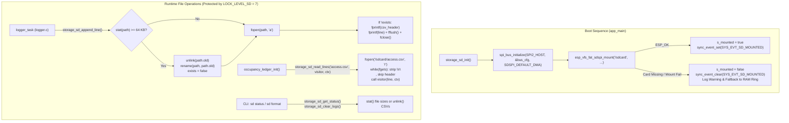

# Module Documentation: `storage_sd` — SPI2 MicroSD FATFS Driver, Log Rotation & Boot Replay

**Coursework Bundle:** Bundle 1 (Student 1 — Core Infrastructure, Hardware Abstraction & Tamper-Evident Persistence)  
**Header File:** `main/include/storage_sd.h` (27 lines)  
**Implementation File:** `main/src/storage_sd.c` (224 lines)  

---

## 1. Purpose & Architectural Role

The `storage_sd` module provides a thread-safe, fault-tolerant **FAT32 filesystem persistence layer over SPI2 (`SDSPI`)** mounted at `/sdcard`. It serves three critical architectural responsibilities in the CoCIS Smart Control and Monitoring System:

1. **Non-Volatile CSV Log Storage (`access.csv`, `lighting.csv`, `audit.csv`):** Whenever the asynchronous `logger` task processes an event, it calls `storage_sd_append_line()` to append a comma-separated values (CSV) row to `/sdcard/access.csv`, `/sdcard/lighting.csv`, or `/sdcard/audit.csv`. If a file does not yet exist on the MicroSD card, `storage_sd_append_line()` automatically writes the CSV column header line first so the file can be opened directly in Microsoft Excel, pandas, or LibreOffice Calc.
2. **Automatic Log Size Bounding & Rotation (`CFG_SD_MAX_FILE_BYTES = 64 KB`):** Embedded SD cards can suffer slow directory lookups or exhaustion if a single log file grows unbounded over months. Before every append, `storage_sd_append_line()` checks the file's size via POSIX `stat()`. If the file has reached or exceeded `65,536` bytes (`64 KB`), it atomically rotates `<file>.csv` to `<file>.csv.old` (`unlink` + `rename`) and starts a fresh `<file>.csv` with a new CSV header.
3. **Cold-Boot Occupancy State Recovery (`storage_sd_read_lines()`):** If the building loses mains power while students and staff are inside CoCIS, RAM is wiped. On reboot, `occupancy_ledger_init()` calls `storage_sd_read_lines("access.csv", boot_recovery_visitor, NULL)` to stream every historical `ENTRY` and `EXIT` record through a visitor callback function pointer (`sd_line_visitor_t`), reconstructing the exact set of people currently inside the building!
4. **Graceful RAM-Only Fallback:** If the MicroSD card is missing or unformatted at boot, `storage_sd_init()` clears the `SYS_EVT_SD_MOUNTED` event bit and returns without crashing (`(void)storage_sd_init()` in `app_main()`), allowing `logger.c` to continue operating seamlessly in its 48-entry RAM ring buffer (`s_ring`).

### Architectural Data & Control Flow Diagram



---

## 2. Public API Reference (`main/include/storage_sd.h`)

### 2.1 Data Types & Callback Signatures

#### `sd_status_t` (Struct)
```c
typedef struct {
    bool     mounted;             /* true if FATFS is mounted at /sdcard; false if in RAM fallback mode */
    uint32_t access_log_bytes;    /* Current size in bytes of /sdcard/access.csv (0 if missing/unmounted) */
    uint32_t lighting_log_bytes;  /* Current size in bytes of /sdcard/lighting.csv */
    uint32_t audit_log_bytes;     /* Current size in bytes of /sdcard/audit.csv */
    uint32_t write_ok_count;      /* Cumulative successful CSV line appends since boot */
    uint32_t write_err_count;     /* Cumulative failed fopen/write attempts since boot */
} sd_status_t;
```

#### `sd_line_visitor_t` (Function Pointer Typedef)
```c
typedef void (*sd_line_visitor_t)(const char *line, void *ctx);
```
- **Purpose:** Callback signature passed to `storage_sd_read_lines()`. For every non-empty data row in a CSV file (after stripping trailing `\r\n` and skipping the `seq,...` header line), `storage_sd_read_lines()` invokes `visitor(line, ctx)`.
- **Parameters:**
  - `line`: NUL-terminated string containing one CSV row (up to 255 characters) without newline characters.
  - `ctx`: Opaque user-supplied context pointer forwarded unchanged from `storage_sd_read_lines()`.

---

### 2.2 Public Functions

#### `esp_err_t storage_sd_init(void)`
- **Parameters:** `void` (none).
- **Return Value:**
  - `ESP_OK` if already mounted or if SPI2 bus initialization and FATFS mount succeed.
  - `esp_err_t` error code if `spi_bus_initialize()` or `esp_vfs_fat_sdspi_mount()` fails (e.g., `ESP_ERR_TIMEOUT` or `ESP_FAIL` when no MicroSD card is inserted).
- **Side Effects:**
  1. Configures `SPI2_HOST` (`MOSI=23`, `MISO=19`, `SCK=18`) with DMA.
  2. Mounts the FAT filesystem on `PIN_SD_CS` (`GPIO 5`) at VFS path `"/sdcard"` (`CFG_SD_MOUNT_POINT`), formatting the card if mount fails (`format_if_mount_failed = true`).
  3. Sets `s_mounted = true` and sets event bit `SYS_EVT_SD_MOUNTED` in `sync.c` on success (or clears `SYS_EVT_SD_MOUNTED` on failure).
- **Who Calls It:** `app_main()` in `main/main.c` at step 2 of boot (`(void)storage_sd_init();`). Notice the `(void)` cast in `main.c`—unlike `ESP_ERROR_CHECK()`, a missing SD card intentionally does *not* halt system boot.
- **Task Context:** FreeRTOS `main` task during startup.
- **Blocking Behavior:** Blocks for ~20–200 ms during SPI SD card CMD0/CMD8/ACMD41 initialization and FAT table scan.

#### `bool storage_sd_is_mounted(void)`
- **Parameters:** `void` (none).
- **Return Value:** `true` if the MicroSD card is currently mounted at `/sdcard`; `false` otherwise.
- **Side Effects:** None (reads `static bool s_mounted`).
- **Who Calls It:** `process_log_entry()` and `logger_reset_chain()` in `logger.c`; `occupancy_ledger_init()` in `occupancy_ledger.c`; `health.c`.
- **Task Context:** Safe from any task context.
- **Blocking Behavior:** Non-blocking (single boolean memory read).

#### `esp_err_t storage_sd_append_line(const char *rel_filename, const char *csv_header, const char *line)`
- **Parameters:**
  - `rel_filename`: Relative filename inside `/sdcard` (e.g., `"access.csv"`, `"lighting.csv"`, or `"audit.csv"`). Must not be `NULL`.
  - `csv_header`: Optional CSV column header string (written only when creating a new file or immediately after rotating a 64 KB file). May be `NULL`.
  - `line`: NUL-terminated CSV row string (without trailing `\n`) to append. Must not be `NULL`.
- **Return Value:**
  - `ESP_OK` on successful write, `fflush()`, and `fclose()`.
  - `ESP_ERR_INVALID_ARG` if `rel_filename == NULL` or `line == NULL`.
  - `ESP_ERR_INVALID_STATE` if `!s_mounted`.
  - `ESP_ERR_TIMEOUT` if `LOCK_LEVEL_SD` cannot be acquired within 500 ms.
  - `ESP_FAIL` if `fopen(path, "a")` returns `NULL` (increments `s_write_err`).
- **Side Effects:** Acquires `LOCK_LEVEL_SD`, rotates `<file>.csv` to `<file>.csv.old` if size $\ge 64\text{ KB}$, appends `csv_header` (if file is new) and `line` to `<file>.csv`, flushes FAT buffers to SD card, and increments `s_write_ok` (or `s_write_err`).
- **Who Calls It:** `process_log_entry()` in `logger.c`.
- **Task Context:** Runs in `logger_task` (or caller task if `s_log_queue` overflowed).
- **Blocking Behavior:** Blocks during mutex acquisition (up to 500 ms) and SPI FATFS sector writes (`fopen`/`fprintf`/`fflush`/`fclose`, typically 2–25 ms).

#### `esp_err_t storage_sd_read_lines(const char *rel_filename, sd_line_visitor_t visitor, void *ctx)`
- **Parameters:**
  - `rel_filename`: Relative CSV filename inside `/sdcard` (e.g., `"access.csv"`).
  - `visitor`: Function pointer invoked for each non-header line read from the file.
  - `ctx`: User context pointer passed through to `visitor(line, ctx)`.
- **Return Value:**
  - `ESP_OK` after reading all lines up to `EOF`.
  - `ESP_ERR_INVALID_ARG` if `rel_filename == NULL` or `visitor == NULL`.
  - `ESP_ERR_INVALID_STATE` if `!s_mounted`.
  - `ESP_ERR_NOT_FOUND` if the file does not exist on the SD card (`fopen` returns `NULL`).
  - `ESP_ERR_TIMEOUT` if `LOCK_LEVEL_SD` cannot be acquired within 500 ms.
- **Side Effects:** Opens the file in read-only mode (`"r"`), streams each line into a 256-byte stack buffer while holding `LOCK_LEVEL_SD`, strips `\r` and `\n`, skips the first line if it starts with `"seq,"`, and calls `visitor(line, ctx)`.
- **Who Calls It:** `occupancy_ledger_init()` in `occupancy_ledger.c` during boot recovery.
- **Task Context:** Runs in `main` task during boot (or any caller task).
- **Blocking Behavior:** Blocks for the duration of reading the file over SPI2.

#### `esp_err_t storage_sd_clear_logs(void)`
- **Parameters:** `void` (none).
- **Return Value:**
  - `ESP_OK` if `access.csv`, `lighting.csv`, and `audit.csv` were unlinked.
  - `ESP_ERR_INVALID_STATE` if `!s_mounted`.
  - `ESP_ERR_TIMEOUT` if `LOCK_LEVEL_SD` cannot be acquired within 500 ms.
- **Side Effects:** Deletes `/sdcard/access.csv`, `/sdcard/lighting.csv`, and `/sdcard/audit.csv` from the FAT filesystem via `unlink()`.
- **Who Calls It:** `logger_reset_chain()` in `logger.c` (triggered by the privileged CLI command `sd format`).
- **Task Context:** `cli_task`.
- **Blocking Behavior:** Blocks for a few milliseconds while updating FAT directory entries under `LOCK_LEVEL_SD`.

#### `esp_err_t storage_sd_get_status(sd_status_t *out_status)`
- **Parameters:** `out_status` — pointer to caller's `sd_status_t` struct.
- **Return Value:**
  - `ESP_OK` on success.
  - `ESP_ERR_INVALID_ARG` if `out_status == NULL`.
  - `ESP_ERR_TIMEOUT` if `LOCK_LEVEL_SD` cannot be acquired within `CFG_LOCK_TIMEOUT_MS` (250 ms).
- **Side Effects:** Queries the byte sizes of `access.csv`, `lighting.csv`, and `audit.csv` using `stat()` under `LOCK_LEVEL_SD` and copies counters into `*out_status`.
- **Who Calls It:** `cmd_status()` and `cmd_sd()` (`sd status`) in `cli.c`.
- **Task Context:** `cli_task`.
- **Blocking Behavior:** Blocks briefly (< 5 ms) for three `stat()` metadata lookups.

---

## 3. Line-by-Line / Block-by-Block Code Walkthrough (`main/src/storage_sd.c`)

### 3.1 Includes & Module State Variables (Lines 1–20)

```c
#include "storage_sd.h"
#include <stdio.h>
#include <string.h>
#include <sys/stat.h>
#include <sys/unistd.h>
#include "board_pins.h"
#include "config.h"
#include "driver/sdspi_host.h"
#include "driver/spi_common.h"
#include "esp_log.h"
#include "esp_vfs_fat.h"
#include "sdmmc_cmd.h"
#include "sync.h"

static const char *TAG = "STORAGE_SD";

static bool s_mounted = false;
static sdmmc_card_t *s_card = NULL;
static uint32_t s_write_ok = 0;
static uint32_t s_write_err = 0;
```

- **Lines 2–5:** Standard C and POSIX headers: `<stdio.h>` (`FILE`, `fopen`, `fgets`, `fprintf`, `fflush`, `fclose`, `snprintf`, `rename`), `<string.h>` (`strlen`, `strncmp`), `<sys/stat.h>` (`struct stat`, `stat()`), and `<sys/unistd.h>` (`unlink()`).
- **Lines 8–12:** ESP-IDF SD-over-SPI driver (`driver/sdspi_host.h`), SPI bus driver (`driver/spi_common.h`), FAT Virtual File System integration (`esp_vfs_fat.h`), and SD/MMC card structure definitions (`sdmmc_cmd.h`).
- **Lines 17–20:** File-scope state:
  - `s_mounted`: Tracks whether `/sdcard` is currently mounted.
  - `s_card`: Pointer to the heap-allocated `sdmmc_card_t` descriptor populated by `esp_vfs_fat_sdspi_mount()` (contains card capacity, CID name, CSD speed).
  - `s_write_ok` / `s_write_err`: Diagnostic counters reported by `storage_sd_get_status()`.

---

### 3.2 Static Helper: `build_path` (Lines 22–25)

```c
static void build_path(const char *rel, char *out, size_t out_len)
{
    snprintf(out, out_len, "%s/%s", CFG_SD_MOUNT_POINT, rel);
}
```

- Concatenates `CFG_SD_MOUNT_POINT` (`"/sdcard"`) and the relative filename `rel` (e.g., `"access.csv"`) into `out` (`"/sdcard/access.csv"`), bounded by `out_len` so buffer overflow is impossible.

---

### 3.3 Static Helper: `get_file_size_unlocked` (Lines 27–36)

```c
static uint32_t get_file_size_unlocked(const char *rel_filename)
{
    char path[64];
    build_path(rel_filename, path, sizeof(path));
    struct stat st;
    if (stat(path, &st) == 0 && st.st_size > 0) {
        return (uint32_t)st.st_size;
    }
    return 0;
}
```

- **Why is it suffixed `_unlocked`?** Naming an internal function `*_unlocked` is a classic systems-programming convention signaling that the **caller must already hold `LOCK_LEVEL_SD`** before calling this helper. If `get_file_size_unlocked()` tried to call `sync_lock(LOCK_LEVEL_SD)` itself when called from `storage_sd_get_status()`, the task would deadlock against itself (since standard FreeRTOS mutexes are non-recursive).
- Calls POSIX `stat(path, &st)`: if the file exists (`stat() == 0`) and has positive size (`st.st_size > 0`), it returns `(uint32_t)st.st_size`; otherwise it returns `0`.

---

### 3.4 Public Function: `storage_sd_init` (Lines 38–84)

```c
esp_err_t storage_sd_init(void)
{
    if (s_mounted) {
        return ESP_OK;
    }

    spi_bus_config_t bus_cfg = {
        .mosi_io_num = PIN_SD_MOSI,
        .miso_io_num = PIN_SD_MISO,
        .sclk_io_num = PIN_SD_SCK,
        .quadwp_io_num = -1,
        .quadhd_io_num = -1,
        .max_transfer_sz = 4000,
    };

    esp_err_t err = spi_bus_initialize(BOARD_SD_SPI_HOST, &bus_cfg, SDSPI_DEFAULT_DMA);
    if (err != ESP_OK && err != ESP_ERR_INVALID_STATE) {
        ESP_LOGW(TAG, "SPI bus init returned %s (continuing with RAM fallback)", esp_err_to_name(err));
        return err;
    }

    esp_vfs_fat_sdmmc_mount_config_t mount_cfg = {
        .format_if_mount_failed = true,
        .max_files = 5,
        .allocation_unit_size = 16 * 1024
    };

    sdmmc_host_t host = SDSPI_HOST_DEFAULT();
    host.slot = BOARD_SD_SPI_HOST;

    sdspi_device_config_t slot_cfg = SDSPI_DEVICE_CONFIG_DEFAULT();
    slot_cfg.gpio_cs = PIN_SD_CS;
    slot_cfg.host_id = BOARD_SD_SPI_HOST;

    err = esp_vfs_fat_sdspi_mount(CFG_SD_MOUNT_POINT, &host, &slot_cfg, &mount_cfg, &s_card);
    if (err != ESP_OK) {
        s_mounted = false;
        sync_event_clear(SYS_EVT_SD_MOUNTED);
        ESP_LOGW(TAG, "MicroSD not detected (%s) - operating in RAM ring-buffer mode", esp_err_to_name(err));
        return err;
    }

    s_mounted = true;
    sync_event_set(SYS_EVT_SD_MOUNTED);
    ESP_LOGI(TAG, "MicroSD mounted at %s (Card: %s)", CFG_SD_MOUNT_POINT, s_card ? s_card->cid.name : "SDSPI");
    return ESP_OK;
}
```

- **Lines 40–42:** Guard ensuring idempotency if `storage_sd_init()` is called when already mounted.
- **Lines 44–57:** Configures the SPI2 peripheral pins (`MOSI=23`, `MISO=19`, `SCK=18`). Setting `quadwp_io_num = -1` and `quadhd_io_num = -1` disables Quad-SPI Write Protect and Hold pins (since SD cards over SPI use standard 1-bit MOSI/MISO). `max_transfer_sz = 4000` sets the maximum single DMA transfer buffer size (4,000 bytes, comfortably fitting 512-byte SD sectors). `spi_bus_initialize()` is called with `SDSPI_DEFAULT_DMA` (`SPI_DMA_CH_AUTO`).
- **Lines 59–63 (`mount_cfg`):**
  - `.format_if_mount_failed = true`: If a blank/unformatted virtual or physical MicroSD card is inserted, ESP-IDF automatically partitions and formats it with FAT.
  - `.max_files = 5`: Pre-allocates 5 open file descriptors in the FATFS driver (we only open 1 file at a time under `LOCK_LEVEL_SD`, so 5 is plenty without wasting heap).
  - `.allocation_unit_size = 16 * 1024`: Sets a 16 KB FAT cluster size if formatting is needed.
- **Lines 65–70 (`host` and `slot_cfg`):** Initializes default SDSPI host parameters via `SDSPI_HOST_DEFAULT()`, binds `host.slot = BOARD_SD_SPI_HOST` (`SPI2_HOST`), and configures the Chip Select pin `slot_cfg.gpio_cs = PIN_SD_CS` (`GPIO_NUM_5`).
- **Lines 72–83:** Calls `esp_vfs_fat_sdspi_mount()`.
  - If mounting fails (e.g., no card present), it sets `s_mounted = false`, clears `SYS_EVT_SD_MOUNTED`, logs a clear warning that the system is operating in RAM ring-buffer mode, and returns `err`.
  - If mounting succeeds, it sets `s_mounted = true`, sets `SYS_EVT_SD_MOUNTED`, and logs the card's 5-character manufacturer/product name from its Card Identification (`s_card->cid.name`) register.

---

### 3.5 Public Function: `storage_sd_is_mounted` (Lines 86–89)

```c
bool storage_sd_is_mounted(void)
{
    return s_mounted;
}
```

- Returns the current boolean state of `s_mounted`.

---

### 3.6 Public Function: `storage_sd_append_line` (Lines 91–135)

```c
esp_err_t storage_sd_append_line(const char *rel_filename, const char *csv_header, const char *line)
{
    if (rel_filename == NULL || line == NULL) {
        return ESP_ERR_INVALID_ARG;
    }
    if (!s_mounted) {
        return ESP_ERR_INVALID_STATE;
    }

    esp_err_t err = sync_lock(LOCK_LEVEL_SD, 500);
    if (err != ESP_OK) {
        return err;
    }

    char path[64];
    build_path(rel_filename, path, sizeof(path));

    struct stat st;
    bool exists = (stat(path, &st) == 0);
    if (exists && st.st_size >= CFG_SD_MAX_FILE_BYTES) {
        char bak_path[72];
        snprintf(bak_path, sizeof(bak_path), "%s.old", path);
        unlink(bak_path);
        rename(path, bak_path);
        exists = false;
    }

    FILE *f = fopen(path, "a");
    if (f == NULL) {
        s_write_err++;
        sync_unlock(LOCK_LEVEL_SD);
        return ESP_FAIL;
    }

    if (!exists && csv_header != NULL) {
        fprintf(f, "%s\n", csv_header);
    }
    fprintf(f, "%s\n", line);
    fflush(f);
    fclose(f);

    s_write_ok++;
    sync_unlock(LOCK_LEVEL_SD);
    return ESP_OK;
}
```

- **Lines 93–98:** Rejects `NULL` arguments and returns `ESP_ERR_INVALID_STATE` if the SD card is not mounted.
- **Lines 100–103:** Acquires `LOCK_LEVEL_SD` (Level 7, the highest leaf lock level in `sync.h`) with a 500 ms timeout so two tasks (e.g., `logger_task` and `cli_task` running `sd status`) never access the FATFS driver or SPI2 bus simultaneously.
- **Lines 108–116 (Automatic 64 KB Log Rotation):**
  - Checks if `path` exists via `stat(path, &st) == 0`.
  - If the file exists and its size `st.st_size` is at least `CFG_SD_MAX_FILE_BYTES` (`65,536` bytes), it constructs `bak_path` (`"/sdcard/access.csv.old"`), deletes any older `.old` backup via `unlink(bak_path)`, renames the full file to `.old` via `rename(path, bak_path)`, and sets `exists = false` so the new file will receive a fresh CSV header on line 125!
- **Lines 118–123:** Opens `path` in `"a"` (append) mode, which creates the file if it doesn't exist and positions the file write cursor at the end of the file. If `fopen` fails, increments `s_write_err`, releases `LOCK_LEVEL_SD`, and returns `ESP_FAIL`.
- **Lines 125–130:** If the file was just created (`!exists`) and `csv_header` was provided, writes the CSV column header first. Then writes `line` followed by `\n`, calls `fflush(f)` to push stdio buffers to VFS/FATFS, and calls `fclose(f)` to commit the directory entry and FAT cluster chain to the MicroSD card.
- **Lines 132–134:** Increments `s_write_ok`, unlocks `LOCK_LEVEL_SD`, and returns `ESP_OK`.

---

### 3.7 Public Function: `storage_sd_read_lines` (Lines 137–180)

```c
esp_err_t storage_sd_read_lines(const char *rel_filename, sd_line_visitor_t visitor, void *ctx)
{
    if (rel_filename == NULL || visitor == NULL) {
        return ESP_ERR_INVALID_ARG;
    }
    if (!s_mounted) {
        return ESP_ERR_INVALID_STATE;
    }

    esp_err_t err = sync_lock(LOCK_LEVEL_SD, 500);
    if (err != ESP_OK) {
        return err;
    }

    char path[64];
    build_path(rel_filename, path, sizeof(path));

    FILE *f = fopen(path, "r");
    if (f == NULL) {
        sync_unlock(LOCK_LEVEL_SD);
        return ESP_ERR_NOT_FOUND;
    }

    char line[256];
    bool first = true;
    while (fgets(line, sizeof(line), f) != NULL) {
        size_t len = strlen(line);
        while (len > 0 && (line[len - 1] == '\n' || line[len - 1] == '\r')) {
            line[--len] = '\0';
        }
        if (first && strncmp(line, "seq,", 4) == 0) {
            first = false;
            continue;
        }
        first = false;
        if (len > 0) {
            visitor(line, ctx);
        }
    }

    fclose(f);
    sync_unlock(LOCK_LEVEL_SD);
    return ESP_OK;
}
```

- **Lines 139–158:** Validates parameters, checks `s_mounted`, acquires `LOCK_LEVEL_SD`, builds the full VFS path, and opens the file with `fopen(path, "r")`. If the file doesn't exist yet (e.g., first boot before any access scan), unlocks `LOCK_LEVEL_SD` and returns `ESP_ERR_NOT_FOUND`.
- **Lines 160–175 (Streaming Line Reader & Header Filter):**
  - Uses a 256-byte stack buffer `char line[256]`—so even if a CSV file is 64 KB long, only 256 bytes of RAM are used!
  - `fgets(line, sizeof(line), f)` reads up to 255 characters or until a newline `\n` is encountered.
  - Lines 164–166 strip both Unix (`\n`) and Windows/DOS (`\r\n`) line endings by walking backward from the end of the string and replacing `\n` and `\r` with NUL terminators `'\0'`.
  - Lines 167–170 check if this is the very first line of the file (`first == true`) and begins with `"seq,"`. If so, it is the CSV column header (`seq,datetime_eat,epoch,...`), so it sets `first = false` and `continue`s without invoking `visitor`.
  - Lines 172–174 invoke the caller's callback function pointer `visitor(line, ctx)` for every non-empty data row.
- **Lines 177–179:** Closes the file, unlocks `LOCK_LEVEL_SD`, and returns `ESP_OK`.

---

### 3.8 Public Function: `storage_sd_clear_logs` (Lines 182–202)

```c
esp_err_t storage_sd_clear_logs(void)
{
    if (!s_mounted) {
        return ESP_ERR_INVALID_STATE;
    }

    esp_err_t err = sync_lock(LOCK_LEVEL_SD, 500);
    if (err != ESP_OK) {
        return err;
    }

    static const char *const files[] = { "access.csv", "lighting.csv", "audit.csv" };
    for (size_t i = 0; i < sizeof(files) / sizeof(files[0]); i++) {
        char path[64];
        build_path(files[i], path, sizeof(path));
        unlink(path);
    }

    sync_unlock(LOCK_LEVEL_SD);
    return ESP_OK;
}
```

- Acquires `LOCK_LEVEL_SD`, loops over the 3 canonical CSV filenames using the compile-time array length idiom `sizeof(files) / sizeof(files[0])`, builds each full VFS path, and deletes each file with POSIX `unlink(path)`.

---

### 3.9 Public Function: `storage_sd_get_status` (Lines 204–224)

```c
esp_err_t storage_sd_get_status(sd_status_t *out_status)
{
    if (out_status == NULL) {
        return ESP_ERR_INVALID_ARG;
    }

    esp_err_t err = sync_lock(LOCK_LEVEL_SD, CFG_LOCK_TIMEOUT_MS);
    if (err != ESP_OK) {
        return err;
    }

    out_status->mounted = s_mounted;
    out_status->access_log_bytes = s_mounted ? get_file_size_unlocked("access.csv") : 0;
    out_status->lighting_log_bytes = s_mounted ? get_file_size_unlocked("lighting.csv") : 0;
    out_status->audit_log_bytes = s_mounted ? get_file_size_unlocked("audit.csv") : 0;
    out_status->write_ok_count = s_write_ok;
    out_status->write_err_count = s_write_err;

    sync_unlock(LOCK_LEVEL_SD);
    return ESP_OK;
}
```

- Acquires `LOCK_LEVEL_SD` once and calls `get_file_size_unlocked()` for each of the 3 log files (only if `s_mounted` is true via the ternary operator `? :`), populating `*out_status` atomically.

---

## 4. C Language Constructs Explained

1. **Function Pointer Typedef (`typedef void (*sd_line_visitor_t)(const char *line, void *ctx);`):**
   - Declared on line 18 of `storage_sd.h`. A function pointer stores the memory address of executable code rather than data. By accepting `sd_line_visitor_t visitor`, `storage_sd_read_lines()` implements the **Visitor / Callback Pattern**: `storage_sd.c` handles all the low-level file locking, `fopen`, `fgets`, CR/LF stripping, and `fclose`, while `occupancy_ledger.c` (`boot_recovery_visitor`) supplies the domain logic to parse each line.
2. **Opaque Context Pointer (`void *ctx`):**
   - Paired with `sd_line_visitor_t`. Because C does not have closures or lambdas, callbacks often need access to caller state (such as a counter or struct pointer) without using global variables. A `void *` ("pointer to anything") can hold the address of any data type and is passed directly through `storage_sd_read_lines()` to `visitor(line, ctx)`.
3. **Double `const` Array Declaration (`static const char *const files[] = { ... };`):**
   - Used on line 193 of `storage_sd.c`:
     - The first `const` (`const char *`) means the characters pointed to (e.g., `"access.csv"`) are read-only string literals in flash (`.rodata`).
     - The second `const` (`*const files[]`) means the array of pointers itself is also read-only and can be placed entirely in flash memory rather than consuming SRAM!
   - `sizeof(files) / sizeof(files[0])` divides the total byte size of the array (`3 * 4 = 12` bytes) by the size of one pointer element (`4` bytes) to yield `3` at compile time.
4. **POSIX File Metadata & Manipulation (`struct stat`, `stat()`, `unlink()`, `rename()`):**
   - `stat(path, &st)` queries filesystem metadata (inode/directory entry) without opening the file, filling `st.st_size` with the file size in bytes.
   - `unlink(bak_path)` removes a directory entry and frees its FAT clusters.
   - `rename(path, bak_path)` updates the FAT directory entry name in place without copying the 64 KB file contents byte-by-byte.
5. **Standard C Buffered I/O (`FILE *`, `fopen`, `fprintf`, `fgets`, `fflush`, `fclose`):**
   - ESP-IDF's Virtual File System (`esp_vfs`) maps standard C `<stdio.h>` calls beginning with `"/sdcard/"` to the underlying FatFs (`f_open`, `f_write`, `f_sync`, `f_close`) driver.

---

## 5. ESP-IDF & FreeRTOS Constructs Explained

| API / Construct | Header | How It Works & Role in `storage_sd.c` |
| :--- | :--- | :--- |
| `spi_bus_config_t`, `spi_bus_initialize(host, &bus_cfg, dma_chan)` | `driver/spi_common.h` | Initializes the ESP32 `SPI2_HOST` controller, routes MOSI/MISO/SCK through the GPIO Matrix, and allocates a DMA channel (`SDSPI_DEFAULT_DMA`) so 512-byte SD card sector transfers occur in hardware without CPU byte-by-byte polling. |
| `SDSPI_HOST_DEFAULT()` | `driver/sdspi_host.h` | Macro returning a default `sdmmc_host_t` struct configured for the SDSPI driver (default 20 MHz max clock, SPI mode 0, function pointers for SDSPI transactions). |
| `SDSPI_DEVICE_CONFIG_DEFAULT()` | `driver/sdspi_host.h` | Macro initializing an `sdspi_device_config_t` struct (default CS, CD, WP pins). We override `.gpio_cs = PIN_SD_CS` (`GPIO 5`) and `.host_id = BOARD_SD_SPI_HOST` (`SPI2_HOST`). |
| `esp_vfs_fat_sdmmc_mount_config_t` | `esp_vfs_fat.h` | Configures FatFs mount behavior (`format_if_mount_failed`, `max_files`, `allocation_unit_size`). |
| `esp_vfs_fat_sdspi_mount(base_path, &host, &slot_cfg, &mount_cfg, &s_card)` | `esp_vfs_fat.h` | All-in-one helper that attaches the SD card device to the SPI bus, initializes the card via SD SPI protocol (`CMD0`, `CMD8`, `ACMD41`, `CMD58`), mounts the FAT partition into the FatFs library, and registers `"/sdcard"` in ESP-IDF's POSIX VFS table. |
| `sync_event_set(SYS_EVT_SD_MOUNTED)` / `sync_event_clear(...)` | `sync.h` | Sets or clears bit 2 (`1 << 2`) in the system-wide FreeRTOS `EventGroupHandle_t` so other modules can check SD availability with zero lock contention. |
| `sync_lock(LOCK_LEVEL_SD, 500)` | `sync.h` | Acquires the Level-7 mutex protecting all VFS/FatFs file operations on `/sdcard`. |

---

## 6. Alternatives & "What If You Change This?"

1. **Why use SPI mode (`SDSPI`) instead of 4-bit SDMMC mode (`driver/sdmmc_host.h`)?**
   - *4-Bit SDMMC Mode:* Requires 6 dedicated fixed pins (`GPIO 2, 4, 12, 13, 14, 15`) on the ESP32 IO_MUX—which directly collide with our Entry/Exit servos (`GPIO 12, 13`), buzzer (`GPIO 14`), and gate status LEDs (`GPIO 2, 4, 15`)! Furthermore, GPIO 12 (`MTDI`) is a boot strapping pin that breaks boot if pulled high by an SD card pull-up resistor.
   - *SPI Mode (`SDSPI` on `SPI2_HOST`):* Needs only 4 pins (`CS=5, SCK=18, MISO=19, MOSI=23`), can be routed to any GPIO via the GPIO Matrix, avoids all boot strapping hazards, and provides more than enough throughput (~1–2 MB/s) for CSV text logging.
2. **What if you change `SDSPI_DEFAULT_DMA` to `SPI_DMA_DISABLED` (`0`) in `spi_bus_initialize()`?**
   - Without DMA, the ESP32 SPI hardware buffer is limited to 64 bytes (`16 x 32-bit` registers) per transfer. Since SD card sectors are **512 bytes**, the SDSPI driver requires DMA to transfer whole 512-byte sectors cleanly; disabling DMA will cause `esp_vfs_fat_sdspi_mount()` or multi-byte sector reads/writes to fail with `ESP_ERR_INVALID_SIZE`.
3. **What if you keep the CSV file permanently open (`FILE *s_access_file` kept open forever) instead of `fopen` -> `fprintf` -> `fflush` -> `fclose` on every append?**
   - On a FAT32 filesystem without journaling, the file's directory entry (file size and starting cluster) and FAT cluster chain are only guaranteed to be fully synchronized when `fflush()` and `fclose()` (`f_close()`) complete. If you leave `FILE *` open indefinitely and unplug the ESP32's power cord, the FAT directory entry will still show a file size of `0` bytes (or orphan clusters), losing all logged records since boot! Opening, appending, flushing, and closing inside `storage_sd_append_line()` guarantees every single log entry is safely committed to non-volatile flash sectors immediately.
4. **What if you set `.format_if_mount_failed = false` in `mount_cfg`?**
   - In simulation (Wokwi) or when inserting a brand-new unformatted flash image, the FAT boot sector signature (`0x55AA`) may be blank. With `.format_if_mount_failed = false`, mounting would fail and fall back to RAM. Setting `.format_if_mount_failed = true` automatically formats a blank image on first boot so `/sdcard` mounts out-of-the-box.

---

## 7. Design Rationale

- **Leaf Lock Hierarchy (`LOCK_LEVEL_SD = 7`):** `LOCK_LEVEL_SD` is assigned the highest number (`7`) in `sync.h`. Because `storage_sd.c` never calls into any higher-level application module (`user_db`, `schedule`, `occupancy_ledger`, `light`), no lock ordering cycle can ever occur when holding `LOCK_LEVEL_SD`.
- **Two-Generation Log Rotation (`.csv` and `.csv.old`):** By rotating at `CFG_SD_MAX_FILE_BYTES` (`64 KB`), each of the three log categories consumes at most $2 \times 64\text{ KB} = 128\text{ KB}$ (384 KB total across `access`, `lighting`, and `audit`). This guarantees the MicroSD card can **never fill up** even if the system runs unattended for 10 years, while always preserving the most recent 64–128 KB (~700–1,400 events per category) on disk.
- **Constant-Memory `storage_sd_read_lines()` Visitor:** Allocating a 64 KB buffer on the heap (`malloc(65536)`) to read `access.csv` at boot would fragment or exhaust ESP32 SRAM. Streaming one 256-byte line at a time on the stack and passing it to `sd_line_visitor_t` uses **O(1) memory** (256 bytes of stack, 0 bytes of heap) regardless of file size.

---

## 8. Failure Modes, Edge Cases & Recovery

| Failure Scenario | What Happens in `storage_sd.c` | System Recovery Behavior |
| :--- | :--- | :--- |
| **MicroSD card not inserted or wiring fault at boot** | `esp_vfs_fat_sdspi_mount()` returns an error (e.g., `ESP_ERR_TIMEOUT` or `ESP_FAIL`). | `s_mounted` is set to `false`, `SYS_EVT_SD_MOUNTED` is cleared, and a warning is logged. `app_main()` ignores the return value `(void)storage_sd_init()` and continues booting in **RAM ring-buffer mode** (`s_ring` in `logger.c`). |
| **Log file reaches 64 KB (`CFG_SD_MAX_FILE_BYTES`)** | `stat(path, &st)` on line 110 sees `st.st_size >= 65536`. | Deletes `<file>.csv.old` via `unlink()`, renames `<file>.csv` to `<file>.csv.old` via `rename()`, sets `exists = false`, and starts a new `<file>.csv` beginning with `csv_header`. |
| **Both `\r\n` (CRLF) and `\n` (LF) line endings in CSV file** | Someone edits or inspects `access.csv` on a Windows PC and re-inserts the SD card. | Lines 164–166 strip both `\n` and `\r` from the end of `line`, and lines 167–170 skip the `"seq,"` header row before invoking `visitor(line, ctx)`. |
| **`fopen(path, "a")` fails mid-operation (card ejected or I/O error)** | `f == NULL` on line 119. | Increments `s_write_err` (visible in `sd status`), unlocks `LOCK_LEVEL_SD` so the mutex is never leaked, and returns `ESP_FAIL`. Meanwhile, `logger.c` has already saved the log entry in the RAM ring buffer `s_ring`. |

---

## 9. How to Test This Module in Isolation

You can test every function in `storage_sd` from the serial CLI:

### Test 1: Inspect Mount Status, File Sizes & Write Counters (`sd status`)
```text
cocis> sd status

[SD Card & Hash-Chain Storage Status]
  Mounted        : YES (/sdcard via SPI2 SDSPI)
  access.csv     : 0 bytes
  lighting.csv   : 0 bytes
  audit.csv      : 168 bytes
  Write Count    : 1 OK / 0 Errors
  SHA-256 Tip    : 7F3A9C12
```
Notice `audit.csv` already has `168 bytes` (`1 OK / 0 Errors`) from the `"BOOT_COMPLETE"` audit event logged at the end of `app_main()` (CSV header + 1 data row).

### Test 2: Trigger an Access Event & Verify `access.csv` Growth
```text
cocis> sim scan entry 04A1B2C3
cocis> sd status

[SD Card & Hash-Chain Storage Status]
  Mounted        : YES (/sdcard via SPI2 SDSPI)
  access.csv     : 162 bytes
  lighting.csv   : 0 bytes
  audit.csv      : 168 bytes
  Write Count    : 2 OK / 0 Errors
  SHA-256 Tip    : 4B91E08A
```

### Test 3: Format / Clear CSV Logs (`sd format` — Requires Admin Login)
```text
cocis> login admin Cocis@2026
OK: Authenticated as 'admin'. Admin commands unlocked.

cocis(admin)# sd format
OK: SD CSV logs formatted and SHA-256 chain reset to genesis.

cocis(admin)# sd status

[SD Card & Hash-Chain Storage Status]
  Mounted        : YES (/sdcard via SPI2 SDSPI)
  access.csv     : 0 bytes
  lighting.csv   : 0 bytes
  audit.csv      : 175 bytes
  Write Count    : 3 OK / 0 Errors
  SHA-256 Tip    : C108D4E2
```
Notice `access.csv` and `lighting.csv` were reset to `0 bytes` by `storage_sd_clear_logs()`, and `audit.csv` immediately recorded the new `"SD_FORMAT"` audit log event as sequence #1 from the new genesis chain!

---

## 10. Likely Examiner Questions & Model Answers

### Q1: In `main.c`, why is `storage_sd_init()` called with `(void)storage_sd_init();` instead of `ESP_ERROR_CHECK(storage_sd_init());`?
**Model Answer:**  
A MicroSD card is removable external media. If a user boots the ESP32 without an SD card inserted (or if the SD card socket is loose), wrapping `storage_sd_init()` in `ESP_ERROR_CHECK()` would trigger `abort()` and crash the entire building access and lighting control system into an endless reboot loop! Instead, we cast the return value to `(void)` so the system boots normally, clears the `SYS_EVT_SD_MOUNTED` flag, and falls back gracefully to the 48-entry in-RAM circular log buffer (`s_ring` in `logger.c`).

### Q2: Why is `get_file_size_unlocked()` private (`static`) and why does its name end with `_unlocked`?
**Model Answer:**  
`get_file_size_unlocked()` is called three times inside `storage_sd_get_status()` (lines 216–218) *while `LOCK_LEVEL_SD` is already held*. Because the FreeRTOS mutexes in `sync.c` are standard (non-recursive) mutexes, if a helper function attempted to call `sync_lock(LOCK_LEVEL_SD)` while its caller already held `LOCK_LEVEL_SD`, the task would block waiting for itself and time out after 250 ms. Making the helper `static` and naming it `_unlocked` documents that the caller is responsible for holding `LOCK_LEVEL_SD`.

### Q3: Walk through how log rotation works in `storage_sd_append_line()` (lines 108–116). Why set `exists = false` on line 115?
**Model Answer:**  
Before opening the CSV file, `storage_sd_append_line()` calls `stat(path, &st)` to check if the file exists and inspect its byte size `st.st_size`. If the file exists and `st.st_size >= CFG_SD_MAX_FILE_BYTES` (64 KB), it:
1. Builds the backup path `"/sdcard/<name>.csv.old"`.
2. Calls `unlink(bak_path)` to delete any previous `.old` file (because FAT `rename()` fails if the destination filename already exists).
3. Calls `rename(path, bak_path)` to move the full 64 KB file to `.csv.old`.
4. Sets `exists = false` because after renaming `path` away, the active file `"/sdcard/<name>.csv"` no longer exists! Setting `exists = false` causes line 125 (`if (!exists && csv_header != NULL)`) to write the CSV column header line at the top of the newly created `.csv` file.

### Q4: Why do you call `unlink(bak_path)` before `rename(path, bak_path)` on lines 113–114?
**Model Answer:**  
In ESP-IDF's FatFs implementation (`f_rename`), renaming a file to a destination path that already exists on the FAT filesystem fails with `FR_EXIST` (`EEXIST`). Therefore, once a log file rotates for the second time, `bak_path` (`access.csv.old`) already exists from the first rotation. Calling `unlink(bak_path)` first removes the old backup (which gracefully returns `-1`/`ENOENT` if no backup existed yet) so `rename(path, bak_path)` always succeeds.

### Q5: How does `storage_sd_read_lines()` work, and why does it use a function pointer (`sd_line_visitor_t`) instead of returning an array of strings?
**Model Answer:**  
A CSV file on the SD card can be up to 64 KB (`65,536` bytes) and contain over 700 lines. The ESP32 has limited internal SRAM (~320 KB total across all tasks, Wi-Fi, and TCP/IP stacks). Allocating a 64 KB array in RAM to return all lines at once would risk heap exhaustion (`ESP_ERR_NO_MEM`). By accepting a function pointer `sd_line_visitor_t visitor`, `storage_sd_read_lines()` reads the file one line at a time into a single 256-byte stack buffer (`char line[256]`) and invokes `visitor(line, ctx)` for each row, requiring **zero heap allocations**.

### Q6: In `storage_sd_read_lines()`, explain lines 163–166:
```c
size_t len = strlen(line);
while (len > 0 && (line[len - 1] == '\n' || line[len - 1] == '\r')) {
    line[--len] = '\0';
}
```
**Model Answer:**  
Standard C `fgets()` retains the trailing newline character (`'\n'`) in the buffer—and if the CSV file was created or edited on a Windows machine, lines end with carriage-return + newline (`"\r\n"`). This `while` loop inspects the last character `line[len - 1]`; as long as the string is non-empty (`len > 0`) and ends with either `'\n'` or `'\r'`, it decrements `len` (`--len`) and overwrites that character with a NUL terminator `'\0'`. This guarantees the `visitor` callback receives a clean string without trailing CR/LF characters.

### Q7: Why does `storage_sd_append_line()` call `fflush(f)` before `fclose(f)` on lines 129–130?
**Model Answer:**  
In C `<stdio.h>` on ESP-IDF, `fprintf()` writes into a user-space Newlib `FILE` stream buffer in RAM. Calling `fflush(f)` explicitly forces the C library stream buffer to flush down to the VFS/FatFs layer, and `fclose(f)` then invokes FatFs `f_close()`, which flushes dirty 512-byte sector buffers over SPI2 to the MicroSD card and updates the FAT directory entry. This ensures that even if power is lost milliseconds after `storage_sd_append_line()` returns, the log record is physically on the SD card.

### Q8: What happens if `fopen(path, "a")` fails on line 118, and why is `sync_unlock(LOCK_LEVEL_SD)` called inside the `if (f == NULL)` block?
**Model Answer:**  
If `fopen(path, "a")` returns `NULL` (for example, if the SD card was physically pulled out after boot or encountered a sector error), the function increments `s_write_err` and **must** call `sync_unlock(LOCK_LEVEL_SD)` before returning `ESP_FAIL` on line 122. If we forgot to call `sync_unlock(LOCK_LEVEL_SD)` on that early-return error path, the `LOCK_LEVEL_SD` mutex would remain permanently locked ("leaked"), causing every subsequent call to `storage_sd_*` from any task to time out forever!
