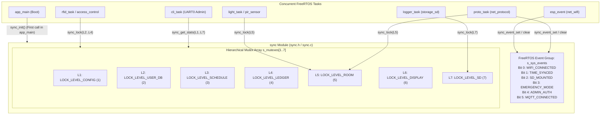

# Module Documentation: `sync` — Hierarchical Mutexes & System Event Group

**Files Covered:**
- Header: [`main/include/sync.h`](../../include/sync.h)
- Implementation: [`main/src/sync.c`](../../src/sync.c)

---

## 1. Purpose & Architectural Role

In a multi-tasking real-time operating system (FreeRTOS on the ESP32), multiple tasks execute concurrently and share in-memory data structures—such as the RFID user database, the building occupancy ledger, the weekly access schedule, the lecture room lighting state, the OLED display, and the MicroSD card SPI bus. If two tasks read and write the same structure simultaneously without coordination, **race conditions** and **data corruption** occur. Conversely, if tasks acquire multiple locks in inconsistent orders, the system can freeze permanently in a **deadlock** (Coffman's circular-wait condition).

The `sync` module solves both problems by providing:
1. **Seven Hierarchical Mutexes (`LOCK_LEVEL_CONFIG` = 1 through `LOCK_LEVEL_SD` = 7):** Every shared subsystem is assigned a strict numerical lock level. By enforcing a global rule that any task needing multiple locks must acquire them in strictly ascending numerical order ($L_1 \rightarrow L_2 \rightarrow \dots \rightarrow L_7$), circular wait becomes mathematically impossible. Furthermore, the module counts every successful lock acquisition and every lock timeout for live diagnostic reporting via the `stats` CLI command.
2. **A System-Wide Event Group (`s_sys_events`):** A single 24-bit FreeRTOS `EventGroupHandle_t` that broadcasts global boolean state flags (`SYS_EVT_WIFI_CONNECTED`, `SYS_EVT_TIME_SYNCED`, `SYS_EVT_SD_MOUNTED`, `SYS_EVT_EMERGENCY_MODE`, `SYS_EVT_ADMIN_AUTH`, `SYS_EVT_MQTT_CONNECTED`) across all 21 modules without requiring polling loops or lock contention.

### Architectural Diagram



---

## 2. Public API Reference (`include/sync.h`)

### 2.1 Enumerations

#### `sync_lock_level_t`
```c
typedef enum {
    LOCK_LEVEL_NONE = 0,
    LOCK_LEVEL_CONFIG = 1,
    LOCK_LEVEL_USER_DB = 2,
    LOCK_LEVEL_SCHEDULE = 3,
    LOCK_LEVEL_LEDGER = 4,
    LOCK_LEVEL_ROOM = 5,
    LOCK_LEVEL_DISPLAY = 6,
    LOCK_LEVEL_SD = 7,
    LOCK_LEVEL_COUNT = 8
} sync_lock_level_t;
```
- **Purpose:** Defines the 7 valid lock levels (`1` to `7`) plus sentinel boundaries (`LOCK_LEVEL_NONE = 0` as an invalid lower bound and `LOCK_LEVEL_COUNT = 8` for array sizing and upper-bound validation).
- **Hierarchy Rule:** Any task that holds lock level $a$ may only request another lock level $b$ if $b > a$.

### 2.2 Macros (System Event Group Bit Masks)

```c
#define SYS_EVT_WIFI_CONNECTED   (1 << 0)  /* 0x01 (Bit 0): Set by net_wifi on IP_EVENT_STA_GOT_IP */
#define SYS_EVT_TIME_SYNCED      (1 << 1)  /* 0x02 (Bit 1): Set by time_sync when RTC/SNTP is valid */
#define SYS_EVT_SD_MOUNTED       (1 << 2)  /* 0x04 (Bit 2): Set by storage_sd when /sdcard mounts */
#define SYS_EVT_EMERGENCY_MODE   (1 << 3)  /* 0x08 (Bit 3): Set by schedule on fire evacuation mode */
#define SYS_EVT_ADMIN_AUTH       (1 << 4)  /* 0x10 (Bit 4): Set by auth when CLI admin logs in */
#define SYS_EVT_MQTT_CONNECTED   (1 << 5)  /* 0x20 (Bit 5): Set by net_protocol on MQTT CONNACK */
```
- **Purpose:** Individual bit flags stored inside the FreeRTOS `EventGroupHandle_t`. Because each flag is a distinct power of two (`(1 << n)`), multiple flags can be combined with bitwise OR (`|`) and tested with bitwise AND (`&`).

### 2.3 Structures

#### `sync_lock_stats_t`
```c
typedef struct {
    const char *name;
    uint32_t acquire_count;
    uint32_t timeout_count;
} sync_lock_stats_t;
```
- **Fields:**
  - `name`: Pointer to a read-only string literal in flash (e.g., `"L1_CONFIG"`, `"L5_ROOM"`).
  - `acquire_count`: Total number of times `sync_lock()` succeeded for this lock level since boot.
  - `timeout_count`: Total number of times `sync_lock()` timed out waiting for this lock level since boot (a non-zero value warns of lock contention or a hung task).

### 2.4 Functions

| Function Prototype | Parameters | Return Value | Side Effects | Callers & Task Context | Blocking Behavior |
|---|---|---|---|---|---|
| `esp_err_t sync_init(void)` | `void` (none) | `ESP_OK` on success; `ESP_ERR_NO_MEM` if FreeRTOS heap allocation fails for the event group or any of the 7 mutexes. | Allocates 1 FreeRTOS Event Group (`s_sys_events`) and 7 FreeRTOS Mutexes (`s_mutexes[1..7]`) from heap; logs initialization status. | Called **first** in `app_main()` (`main.c` line 32) running in the `main` task before any other module initializes. | Non-blocking (heap allocation only). |
| `esp_err_t sync_lock(sync_lock_level_t level, uint32_t timeout_ms)` | `level`: Lock level (`1..7`).<br>`timeout_ms`: Max wait time in milliseconds (`CFG_LOCK_TIMEOUT_MS` = 250 ms typically, or `UINT32_MAX` to wait forever). | `ESP_OK` if mutex acquired;<br>`ESP_ERR_INVALID_ARG` if `level` out of range `[1..7]` or uninitialized;<br>`ESP_ERR_TIMEOUT` if mutex could not be acquired within `timeout_ms`. | Takes the FreeRTOS mutex at `s_mutexes[level]`. Increments `s_acquire_counts[level]` on success, or increments `s_timeout_counts[level]` and logs a warning on timeout. | Called by `config`, `user_db`, `schedule`, `occupancy_ledger`, `light`, `net_protocol`, `display`, `storage_sd` from `rfid_task`, `proto_task`, `cli_task`, `light_task`, `logger_task`, etc. **Never call from an ISR.** | **Blocks** the calling task up to `timeout_ms` (converted to RTOS ticks) if another task currently holds the mutex. |
| `esp_err_t sync_unlock(sync_lock_level_t level)` | `level`: Lock level (`1..7`) previously acquired by the same task. | `ESP_OK` if released;<br>`ESP_ERR_INVALID_ARG` if `level` invalid;<br>`ESP_ERR_INVALID_STATE` if `xSemaphoreGive` fails (e.g., calling task does not own the mutex). | Releases the mutex at `s_mutexes[level]`, waking the highest-priority waiting task (if any) and restoring any inherited priority. | Called by whichever task called `sync_lock(level, ...)` immediately after finishing its critical section. | Non-blocking. |
| `void sync_event_set(EventBits_t bits)` | `bits`: Bitmask of `SYS_EVT_*` flags to set (`1`s). | `void` | Atomically sets the specified bits in `s_sys_events` using `xEventGroupSetBits()`. | Called by `net_wifi` (`wifi_event_handler`), `time_sync`, `storage_sd`, `schedule`, `auth`, `net_protocol` (`proto_task`). Task context only. | Non-blocking. |
| `void sync_event_clear(EventBits_t bits)` | `bits`: Bitmask of `SYS_EVT_*` flags to clear (`0`s). | `void` | Atomically clears the specified bits in `s_sys_events` using `xEventGroupClearBits()`. | Called by `net_wifi`, `schedule`, `auth`, `net_protocol` when a subsystem disconnects or logs out. Task context only. | Non-blocking. |
| `bool sync_event_is_set(EventBits_t bit)` | `bit`: Bitmask of the flag(s) to check. | `true` if at least one specified bit is `1`; `false` if `0` or if `s_sys_events == NULL`. | Reads `s_sys_events` non-destructively via `xEventGroupGetBits()`. | Any task checking system state flags. | Non-blocking. |
| `EventBits_t sync_event_get_all(void)` | `void` | Current 24-bit `EventBits_t` value of `s_sys_events` (or `0` if uninitialized). | None (read-only). | Diagnostic / status modules. | Non-blocking. |
| `esp_err_t sync_get_stats(sync_lock_level_t level, sync_lock_stats_t *out_stats)` | `level`: Lock level (`1..7`).<br>`out_stats`: Non-null pointer to caller's `sync_lock_stats_t` struct. | `ESP_OK` on success; `ESP_ERR_INVALID_ARG` if `level` out of range or `out_stats == NULL`. | Copies lock name pointer, `s_acquire_counts[level]`, and `s_timeout_counts[level]` into `*out_stats`. | Called by `cmd_stats()` in `cli.c` (`cli_task` context) when user runs `stats`. | Non-blocking. |

---

## 3. Line-by-Line / Block-by-Block Code Walkthrough (`src/sync.c`)

### 3.1 Includes and Module-Private Static State (Lines 1–20)

```c
#include "sync.h"
#include "esp_log.h"

static const char *TAG = "SYNC";

static SemaphoreHandle_t s_mutexes[LOCK_LEVEL_COUNT] = { NULL };
static EventGroupHandle_t s_sys_events = NULL;
static uint32_t s_acquire_counts[LOCK_LEVEL_COUNT] = { 0 };
static uint32_t s_timeout_counts[LOCK_LEVEL_COUNT] = { 0 };

static const char *const s_lock_names[LOCK_LEVEL_COUNT] = {
    "NONE",
    "L1_CONFIG",
    "L2_USER_DB",
    "L3_SCHEDULE",
    "L4_LEDGER",
    "L5_ROOM",
    "L6_DISPLAY",
    "L7_SD"
};
```
- **Lines 1–4:** Includes the public header `sync.h` and ESP-IDF's logging library `esp_log.h`. Defines `TAG = "SYNC"` so all `ESP_LOGI`/`ESP_LOGW`/`ESP_LOGE` messages from this file are prefixed with `I (timestamp) SYNC: ...`.
- **Line 6 (`s_mutexes`):** An array of 8 (`LOCK_LEVEL_COUNT`) FreeRTOS `SemaphoreHandle_t` pointers, zero-initialized to `NULL`. Index `0` (`LOCK_LEVEL_NONE`) remains unused (`NULL`) so that enum values `1..7` map directly to array indices `1..7` without off-by-one arithmetic (`level - 1`).
- **Line 7 (`s_sys_events`):** Holds the handle to the system-wide FreeRTOS event group, initialized to `NULL` until `sync_init()` is called.
- **Lines 8–9 (`s_acquire_counts`, `s_timeout_counts`):** Parallel arrays of 32-bit unsigned counters tracking how many times each lock level `1..7` has been successfully locked or timed out.
- **Lines 11–20 (`s_lock_names`):** A lookup table mapping each `sync_lock_level_t` index (`0..7`) to a human-readable string for log messages and CLI `stats` output.

### 3.2 `sync_init()` — Creating the Event Group and Mutexes (Lines 22–44)

```c
esp_err_t sync_init(void)
{
    if (s_sys_events == NULL) {
        s_sys_events = xEventGroupCreate();
        if (s_sys_events == NULL) {
            ESP_LOGE(TAG, "Failed to create system event group");
            return ESP_ERR_NO_MEM;
        }
    }

    for (int i = LOCK_LEVEL_CONFIG; i < LOCK_LEVEL_COUNT; i++) {
        if (s_mutexes[i] == NULL) {
            s_mutexes[i] = xSemaphoreCreateMutex();
            if (s_mutexes[i] == NULL) {
                ESP_LOGE(TAG, "Failed to create mutex for %s", s_lock_names[i]);
                return ESP_ERR_NO_MEM;
            }
        }
    }

    ESP_LOGI(TAG, "Initialized %d hierarchical mutexes and event group", LOCK_LEVEL_COUNT - 1);
    return ESP_OK;
}
```
- **Lines 24–30:** Checks if `s_sys_events` is `NULL` (making `sync_init()` idempotent—safe even if accidentally called twice). Calls `xEventGroupCreate()`, which dynamically allocates an event group object on the FreeRTOS heap. If heap memory is exhausted, it returns `NULL`, logs an error, and returns `ESP_ERR_NO_MEM`.
- **Lines 32–40:** Loops `i` from `LOCK_LEVEL_CONFIG` (`1`) up to `LOCK_LEVEL_COUNT - 1` (`7`). Notice it intentionally skips index `0` (`LOCK_LEVEL_NONE`). For each level, if the mutex hasn't been created yet, it calls `xSemaphoreCreateMutex()`. If allocation fails, it logs which specific lock failed (`s_lock_names[i]`) and returns `ESP_ERR_NO_MEM`.
- **Lines 42–43:** Logs `"Initialized 7 hierarchical mutexes and event group"` and returns `ESP_OK`. In `main.c`, `ESP_ERROR_CHECK(sync_init())` asserts that this succeeds before any other subsystem starts.

### 3.3 `sync_lock()` — Acquiring a Hierarchical Mutex with Timeout (Lines 46–61)

```c
esp_err_t sync_lock(sync_lock_level_t level, uint32_t timeout_ms)
{
    if (level <= LOCK_LEVEL_NONE || level >= LOCK_LEVEL_COUNT || s_mutexes[level] == NULL) {
        return ESP_ERR_INVALID_ARG;
    }

    TickType_t ticks = (timeout_ms == UINT32_MAX) ? portMAX_DELAY : pdMS_TO_TICKS(timeout_ms);
    if (xSemaphoreTake(s_mutexes[level], ticks) != pdTRUE) {
        s_timeout_counts[level]++;
        ESP_LOGW(TAG, "Lock timeout on %s after %lu ms", s_lock_names[level], (unsigned long)timeout_ms);
        return ESP_ERR_TIMEOUT;
    }

    s_acquire_counts[level]++;
    return ESP_OK;
}
```
- **Lines 48–50:** Defensive bounds and state check. Rejects `level <= 0`, `level >= 8`, or an uninitialized mutex (`s_mutexes[level] == NULL`) with `ESP_ERR_INVALID_ARG`.
- **Line 52:** Converts the caller's millisecond timeout (`timeout_ms`) into FreeRTOS scheduler ticks. If the caller passes `UINT32_MAX` (`0xFFFFFFFF`), it maps to `portMAX_DELAY` (block indefinitely until the mutex becomes free). Otherwise, it uses the macro `pdMS_TO_TICKS(timeout_ms)`.
- **Lines 53–57:** Calls `xSemaphoreTake(s_mutexes[level], ticks)`.
  - If the mutex is free, the calling task immediately becomes its owner and `xSemaphoreTake` returns `pdTRUE`.
  - If another task holds the mutex, FreeRTOS places the calling task into the `Blocked` state for up to `ticks` ticks (and boosts the owning task's priority if the calling task has a higher priority—**priority inheritance**).
  - If `ticks` expire before the mutex is released, `xSemaphoreTake` returns `pdFALSE`. The code increments `s_timeout_counts[level]`, logs a warning with the lock's name and timeout duration, and returns `ESP_ERR_TIMEOUT`.
- **Lines 59–60:** On successful acquisition, increments `s_acquire_counts[level]` (now safely inside the mutex-protected critical section for that level!) and returns `ESP_OK`.

### 3.4 `sync_unlock()` — Releasing a Hierarchical Mutex (Lines 63–73)

```c
esp_err_t sync_unlock(sync_lock_level_t level)
{
    if (level <= LOCK_LEVEL_NONE || level >= LOCK_LEVEL_COUNT || s_mutexes[level] == NULL) {
        return ESP_ERR_INVALID_ARG;
    }

    if (xSemaphoreGive(s_mutexes[level]) != pdTRUE) {
        return ESP_ERR_INVALID_STATE;
    }
    return ESP_OK;
}
```
- **Lines 65–67:** Validates `level` is within `[1..7]` and the mutex exists.
- **Lines 69–71:** Calls `xSemaphoreGive(s_mutexes[level])`. Unlike binary semaphores, a FreeRTOS mutex tracks its owning task handle; if a task that does not currently hold the mutex tries to unlock it, `xSemaphoreGive` fails and returns `pdFALSE`, which this function translates into `ESP_ERR_INVALID_STATE`.
- **Line 72:** Returns `ESP_OK`.

### 3.5 Event Group Wrappers: `sync_event_set`, `sync_event_clear`, `sync_event_is_set`, `sync_event_get_all` (Lines 75–103)

```c
void sync_event_set(EventBits_t bits)
{
    if (s_sys_events != NULL) {
        xEventGroupSetBits(s_sys_events, bits);
    }
}

void sync_event_clear(EventBits_t bits)
{
    if (s_sys_events != NULL) {
        xEventGroupClearBits(s_sys_events, bits);
    }
}

bool sync_event_is_set(EventBits_t bit)
{
    if (s_sys_events == NULL) {
        return false;
    }
    return (xEventGroupGetBits(s_sys_events) & bit) != 0;
}

EventBits_t sync_event_get_all(void)
{
    if (s_sys_events == NULL) {
        return 0;
    }
    return xEventGroupGetBits(s_sys_events);
}
```
- **`sync_event_set` (Lines 75–80):** Null-guards `s_sys_events`, then performs a thread-safe bitwise OR of `bits` into the event group via `xEventGroupSetBits()`. Any task blocked in `xEventGroupWaitBits()` waiting for those bits would be woken up automatically.
- **`sync_event_clear` (Lines 82–87):** Null-guards `s_sys_events`, then atomically clears the specified `bits` via `xEventGroupClearBits()`.
- **`sync_event_is_set` (Lines 89–95):** Reads all current bits via `xEventGroupGetBits(s_sys_events)`, performs a bitwise AND (`& bit`), and compares `!= 0` to return a clean `bool` (`true` or `false`).
- **`sync_event_get_all` (Lines 97–103):** Returns the raw `EventBits_t` integer containing all active system flags, or `0` if `sync_init()` has not run.

### 3.6 `sync_get_stats()` — Reading Diagnostic Counters (Lines 105–115)

```c
esp_err_t sync_get_stats(sync_lock_level_t level, sync_lock_stats_t *out_stats)
{
    if (level <= LOCK_LEVEL_NONE || level >= LOCK_LEVEL_COUNT || out_stats == NULL) {
        return ESP_ERR_INVALID_ARG;
    }

    out_stats->name = s_lock_names[level];
    out_stats->acquire_count = s_acquire_counts[level];
    out_stats->timeout_count = s_timeout_counts[level];
    return ESP_OK;
}
```
- **Lines 107–109:** Validates that `level` is in `[1..7]` and that the output pointer `out_stats` is not `NULL`.
- **Lines 111–114:** Populates the caller's `sync_lock_stats_t` struct with the constant string pointer `s_lock_names[level]`, the total acquisitions `s_acquire_counts[level]`, and the total timeouts `s_timeout_counts[level]`, then returns `ESP_OK`.

---

## 4. C Language Constructs Explained

1. **Header Guards (`#ifndef SYNC_H` / `#define SYNC_H` / `#endif`):**
   In `sync.h` (lines 1–2, 47), these preprocessor directives prevent duplicate type definitions if `sync.h` is `#include`d multiple times in the same `.c` translation unit (directly or indirectly).
2. **`typedef enum { ... } sync_lock_level_t`:**
   Assigns explicit integer constants (`0` through `8`) to meaningful symbolic names and creates the type alias `sync_lock_level_t`. Using `LOCK_LEVEL_COUNT = 8` as the final enum entry automatically sizes arrays (`s_mutexes[LOCK_LEVEL_COUNT]`) and bounds `for` loops.
3. **Bit-Shift Masks (`(1 << n)`):**
   In `sync.h` (lines 23–28), `(1 << 0)` shifts the binary value `1` left by `0` positions (`0b000001` = 1), `(1 << 1)` produces `0b000010` = 2, `(1 << 5)` produces `0b100000` = 32. Testing a flag in `sync_event_is_set()` uses bitwise AND: `(xEventGroupGetBits(s_sys_events) & bit) != 0`.
4. **`static const char *const s_lock_names[LOCK_LEVEL_COUNT]`:**
   Let's read this declaration inside-out:
   - `static`: Internal linkage—only visible inside `sync.c`.
   - First `const` (`const char *`): The characters pointed to are immutable string literals stored in flash (`.rodata`).
   - Second `const` (`*const`): The array of pointers itself is immutable—no code can accidentally reassign `s_lock_names[1] = ...` at runtime, so the entire array lives in flash rather than consuming precious SRAM.
5. **Ternary Conditional Operator (`condition ? expr_if_true : expr_if_false`):**
   In line 52, `(timeout_ms == UINT32_MAX) ? portMAX_DELAY : pdMS_TO_TICKS(timeout_ms)` concisely selects infinite wait when `timeout_ms` is `UINT32_MAX`, or converts milliseconds to ticks otherwise.

---

## 5. ESP-IDF & FreeRTOS Constructs Explained

### 5.1 `xSemaphoreCreateMutex()` vs `xSemaphoreCreateBinary()` (Priority Inheritance)
A common beginner mistake in FreeRTOS is using a **Binary Semaphore** (`xSemaphoreCreateBinary()`) to protect shared data instead of a **Mutex** (`xSemaphoreCreateMutex()`). They differ fundamentally:
- **Ownership:** A Mutex has an owner (the task that called `xSemaphoreTake`). Only the owning task is permitted to call `xSemaphoreGive`. A Binary Semaphore has no concept of ownership—any task or ISR can give it, making it suited for *signaling/synchronization* between tasks or from an ISR to a task.
- **Priority Inheritance (Solving Priority Inversion):** Suppose low-priority Task $L$ (priority 2) holds a lock, high-priority Task $H$ (priority 6) tries to take the same lock and blocks, and medium-priority Task $M$ (priority 4) becomes ready and preempts Task $L$. Without priority inheritance, Task $M$ starves Task $L$, which indirectly starves high-priority Task $H$ (**unbounded priority inversion**). Because `sync.c` uses `xSemaphoreCreateMutex()`, FreeRTOS temporarily elevates Task $L$'s priority to match Task $H$'s priority (6) as soon as Task $H$ blocks on the mutex, allowing Task $L$ to finish its critical section quickly and hand the mutex to Task $H$.

### 5.2 FreeRTOS Event Groups (`xEventGroupCreate`, `SetBits`, `ClearBits`, `GetBits`)
An `EventGroupHandle_t` is a lightweight kernel object storing 24 usable event bits (on 32-bit architectures where `configUSE_16_BIT_TICKS` is 0; the top 8 bits are reserved by the FreeRTOS kernel for control flags).
- `xEventGroupSetBits()` and `xEventGroupClearBits()` use critical sections inside the FreeRTOS kernel so two tasks setting different bits simultaneously never overwrite each other (unlike a raw global `uint32_t` where `flags |= BIT` is a non-atomic Read-Modify-Write sequence unless atomic intrinsics or spinlocks are used).

### 5.3 Lock Hierarchy Levels 1–7
Why are there 7 distinct mutexes instead of 1 giant "Big Kernel Lock"?
1. **Concurrency & Throughput:** If a single mutex protected everything, a slow MicroSD card write in `logger_task` (`LOCK_LEVEL_SD`, taking 5–20 ms over SPI) would block `rfid_task` from checking `user_db` (`LOCK_LEVEL_USER_DB`) or `light_task` from toggling a lecture room relay (`LOCK_LEVEL_ROOM`). Separate mutexes allow unrelated subsystems to run in parallel across both Xtensa LX6 CPU cores.
2. **Deadlock Prevention via Total Ordering:**
   - `L1_CONFIG (1)` $\rightarrow$ `L2_USER_DB (2)` $\rightarrow$ `L3_SCHEDULE (3)` $\rightarrow$ `L4_LEDGER (4)` $\rightarrow$ `L5_ROOM (5)` $\rightarrow$ `L6_DISPLAY (6)` $\rightarrow$ `L7_SD (7)`.
   - Because locks are ordered from highest-level configuration/policy down to low-level I/O peripherals (display and SD card), any composite operation always acquires lower-numbered locks before higher-numbered locks.

---

## 6. Alternatives & "What If You Change This?"

| Aspect | Current Implementation in `sync.c` | Alternative Approach | What Happens If You Change It? |
|---|---|---|---|
| **Lock Primitive** | Standard FreeRTOS Mutex (`xSemaphoreCreateMutex`) | Recursive Mutex (`xSemaphoreCreateRecursiveMutex`) | With standard mutexes, if the *same* task calls `sync_lock(L5)` twice without unlocking in between, it **self-deadlocks** for `timeout_ms` (250 ms) and fails with `ESP_ERR_TIMEOUT`. Recursive mutexes allow the same task to lock $N$ times and unlock $N$ times, but can hide sloppy critical-section boundaries. |
| **Lock Primitive** | Standard FreeRTOS Mutex (`xSemaphoreCreateMutex`) | Binary Semaphore (`xSemaphoreCreateBinary`) | Disables **priority inheritance**, exposing the system to priority inversion if low-priority `cli_task` or `health_task` holds a lock needed by `rfid_task`. Also starts in the "empty" state after creation unless explicitly given once. |
| **Timeout Value** | Bounded timeout (`CFG_LOCK_TIMEOUT_MS = 250` ms) | Infinite timeout (`UINT32_MAX` / `portMAX_DELAY`) | If a bug causes one task to hang while holding a mutex, `portMAX_DELAY` causes every other task requesting that lock to freeze permanently, cascading the failure across the system. Bounded 250 ms timeouts allow callers to fail gracefully, increment `s_timeout_counts`, and keep the watchdog fed. |
| **Allocation Strategy** | Dynamic allocation (`xSemaphoreCreateMutex()`) | Static allocation (`xSemaphoreCreateMutexStatic(&buf)`) | Static allocation places the `StaticSemaphore_t` structs in `.bss` at compile time, guaranteeing `sync_init()` can never fail with `ESP_ERR_NO_MEM` and avoiding heap fragmentation. |

---

## 7. Design Rationale

1. **Why 1-based indexing (`LOCK_LEVEL_CONFIG = 1`) with `s_mutexes[LOCK_LEVEL_COUNT]`?**
   Reserving `LOCK_LEVEL_NONE = 0` catches uninitialized (`0`) enum variables passed by mistake (`level <= LOCK_LEVEL_NONE` returns `ESP_ERR_INVALID_ARG`). Keeping the array size at `8` (wasting just 4 bytes for `s_mutexes[0] = NULL`) eliminates `- 1` index adjustments on every `sync_lock`, `sync_unlock`, and `sync_get_stats` call.
2. **Why built-in telemetry (`s_acquire_counts` and `s_timeout_counts`)?**
   Concurrency bugs on embedded targets are notoriously hard to diagnose without a JTAG debugger. By recording acquisitions and timeouts per lock level directly inside `sync_lock()`, an examiner or administrator can type `stats` at the UART CLI and immediately verify that all 7 mutexes are active and have `0` timeouts.

---

## 8. Failure Modes, Edge Cases & Recovery

1. **Lock Acquisition Timeout (`ESP_ERR_TIMEOUT`):**
   - *Cause:* A task holds a lock longer than `timeout_ms` (250 ms), or a task tries to re-lock a mutex it already holds (non-recursive self-deadlock).
   - *Detection & Recovery:* `xSemaphoreTake()` returns `pdFALSE`. `sync_lock()` increments `s_timeout_counts[level]`, logs `W (...) SYNC: Lock timeout on Lx_... after 250 ms`, and returns `ESP_ERR_TIMEOUT`. All callers in the CoCIS firmware check `if (sync_lock(...) == ESP_OK)` before touching shared state, skipping the mutation safely rather than corrupting memory.
2. **Unlocking by Non-Owner (`ESP_ERR_INVALID_STATE`):**
   - *Cause:* A task calls `sync_unlock(level)` when `sync_lock(level)` actually timed out, or attempts to unlock another task's mutex.
   - *Recovery:* FreeRTOS's `xSemaphoreGive()` rejects the call and returns `pdFALSE`; `sync_unlock()` returns `ESP_ERR_INVALID_STATE` without corrupting the mutex state.
3. **Calling Before `sync_init()`:**
   - *Cause:* Another module calls `sync_lock()` or `sync_event_set()` before `sync_init()` runs.
   - *Recovery:* Null checks (`s_mutexes[level] == NULL` and `s_sys_events == NULL`) prevent null-pointer dereferences (`LoadProhibited` CPU panic). `main.c` prevents this by calling `sync_init()` on the very first executable line of `app_main()`.

---

## 9. How to Test This Module in Isolation

Connect to the ESP32 serial console (or Wokwi simulator terminal) at `115200` baud and run the following CLI commands:

### Test 1: Inspect Hierarchical Mutex Counters via `stats`
```text
cocis> stats
```
**Expected Output (Bottom Table):**
```text
[Hierarchical Mutex Lock Diagnostics]
+----+---------------+--------------+--------------+
| Lv | Lock Name     | Acquires     | Timeouts     |
+----+---------------+--------------+--------------+
|  1 | L1_CONFIG     |            2 |            0 |
|  2 | L2_USER_DB    |           14 |            0 |
|  3 | L3_SCHEDULE   |           18 |            0 |
|  4 | L4_LEDGER     |           12 |            0 |
|  5 | L5_ROOM       |          145 |            0 |
|  6 | L6_DISPLAY    |           68 |            0 |
|  7 | L7_SD         |           42 |            0 |
+----+---------------+--------------+--------------+
```
- **Verification:** Confirm all 7 lock levels (`1..7`) are listed, `Acquires` increases as you run commands (`status`, `rooms`, `sim scan entry 04A1B2C3`), and `Timeouts` remains `0` across all levels.

### Test 2: Stress-Test All Locks via `sim selftest`
```text
cocis> sim selftest
```
Then immediately run:
```text
cocis> stats
```
- **Verification:** `sim selftest` exercises RFID scans (`L2`, `L3`, `L4`), room lighting & network replay (`L5`), and audit logging (`L7`). Verify that `Acquires` increased across levels `L2..L7` while `Timeouts` is still `0`.

---

## 10. Likely Examiner Questions & Model Answers

### Q1: Why must `sync_init()` be the very first function called in `app_main()`?
**Model Answer:** Every other module (`config`, `time_sync`, `storage_sd`, `logger`, `user_db`, `schedule`, `occupancy_ledger`, `net_wifi`, `net_protocol`) calls `sync_lock()` or `sync_event_set()` during its own `*_init()` function or inside the tasks it spawns. If `sync_init()` were called later, `s_mutexes[level]` and `s_sys_events` would still be `NULL`, causing `sync_lock()` to fail with `ESP_ERR_INVALID_ARG` and `sync_event_set()` to silently drop boot events like `SYS_EVT_SD_MOUNTED`.

### Q2: Explain how your lock hierarchy (`LOCK_LEVEL_CONFIG = 1` to `LOCK_LEVEL_SD = 7`) mathematically prevents deadlocks.
**Model Answer:** A deadlock requires all four Coffman conditions to hold simultaneously: mutual exclusion, hold and wait, no preemption, and **circular wait**. By assigning each mutex a unique integer level $1 \dots 7$ and requiring any task that holds multiple mutexes at once to acquire them in strictly increasing order ($L_i$ before $L_j$ only if $i < j$), a cycle in the resource wait-for graph ($T_1 \rightarrow T_2 \rightarrow \dots \rightarrow T_1$) would require $L_a < L_b < \dots < L_a$, which is impossible for integers. Eliminating circular wait makes deadlock impossible.

### Q3: What happens if a task calls `sync_lock(LOCK_LEVEL_ROOM, 250)` twice in a row without calling `sync_unlock(LOCK_LEVEL_ROOM)` in between?
**Model Answer:** Because `s_mutexes` are created with `xSemaphoreCreateMutex()` (standard, non-recursive mutexes) rather than `xSemaphoreCreateRecursiveMutex()`, the second `sync_lock(LOCK_LEVEL_ROOM, 250)` call sees that the mutex is already taken and blocks the calling task waiting for itself to release the lock. After 250 ms (`CFG_LOCK_TIMEOUT_MS`), `xSemaphoreTake` times out, increments `s_timeout_counts[LOCK_LEVEL_ROOM]`, logs a warning, and returns `ESP_ERR_TIMEOUT`. That is why functions inside `net_protocol.c` (such as `push_store_fwd_unlocked` and `coordinator_process_packet_unlocked`) have the `_unlocked` suffix—to remind the developer that the caller already holds `LOCK_LEVEL_ROOM` and the helper must *not* call `sync_lock()` again.

### Q4: Why aren't `s_acquire_counts[level]++` and `s_timeout_counts[level]++` protected by another mutex? Is there a race condition?
**Model Answer:** Look closely at line 59 of `sync.c`: `s_acquire_counts[level]++` executes **after** `xSemaphoreTake(s_mutexes[level], ticks)` succeeds and **before** `sync_unlock()` can be called. Therefore, `s_acquire_counts[level]++` is protected by `s_mutexes[level]` itself—only the single task that currently owns `s_mutexes[level]` can increment `s_acquire_counts[level]`. Meanwhile, `s_timeout_counts[level]++` (line 54) only happens in the rare error path when a lock times out after 250 ms; on the 32-bit Xtensa LX6 architecture, reading a 32-bit aligned `uint32_t` in `sync_get_stats()` is atomic at the bus level.

### Q5: What is the difference between `xSemaphoreCreateMutex()` and `xSemaphoreCreateBinary()`, and why did you choose a Mutex here?
**Model Answer:** A Mutex supports **ownership** (only the task that took it can give it back) and **priority inheritance** (if a high-priority task blocks waiting for a mutex held by a low-priority task, FreeRTOS temporarily raises the low-priority task's priority to prevent medium-priority tasks from preempting it—solving unbounded priority inversion). A binary semaphore has neither ownership nor priority inheritance and is meant for task-to-task or ISR-to-task signaling, not mutual exclusion.

### Q6: Can `sync_lock()` or `sync_event_set()` be called from inside a GPIO Interrupt Service Routine (ISR)?
**Model Answer:** **No.** Neither `xSemaphoreTake()` nor `xEventGroupSetBits()` may be called from an ISR—doing so will trigger a FreeRTOS configASSERT / panic because an ISR has no task control block (TCB) to block on, and `xEventGroupSetBits` is not ISR-safe. In ESP-IDF FreeRTOS, ISRs must instead push events to a queue via `xQueueSendFromISR()` (as our `rfid` and `pir_sensor` GPIO ISRs do) or use `xEventGroupSetBitsFromISR()`, which defers the bit-setting operation to the FreeRTOS Timer Daemon task (`prvTimerTask`).

### Q7: In `sync.h`, why are the event flags defined as `(1 << 0)`, `(1 << 1)`, ..., `(1 << 5)` instead of `1, 2, 3, 4, 5, 6`?
**Model Answer:** `s_sys_events` is a single bitmask variable (`EventBits_t`) where each independent boolean state must occupy its own bit position. If we used `1, 2, 3`, then `3` (`0b0011`) would just be the bitwise combination of `1` (`0b0001`) and `2` (`0b0010`), so setting flag `3` would falsely make flags `1` and `2` appear set! Using `(1 << n)` produces powers of two (`1, 2, 4, 8, 16, 32`), ensuring every flag maps to a mutually exclusive bit.

### Q8: How many bits can a FreeRTOS Event Group hold on the ESP32, and why not all 32 bits?
**Model Answer:** Although `EventBits_t` is a 32-bit unsigned integer (`TickType_t` = `uint32_t`) on the ESP32 (`configUSE_16_BIT_TICKS == 0`), only the **lower 24 bits (bits 0 to 23)** are available to application code. The upper 8 bits (bits 24 to 31) are reserved by the FreeRTOS kernel (`eventEVENT_BITS_CONTROL_BYTES`) to store control flags (such as `eventCLEAR_EVENTS_ON_EXIT_BIT` and `eventWAIT_FOR_ALL_BITS`) inside each waiting task's event list item. Our system uses 6 of the 24 available bits (bits 0–5).
