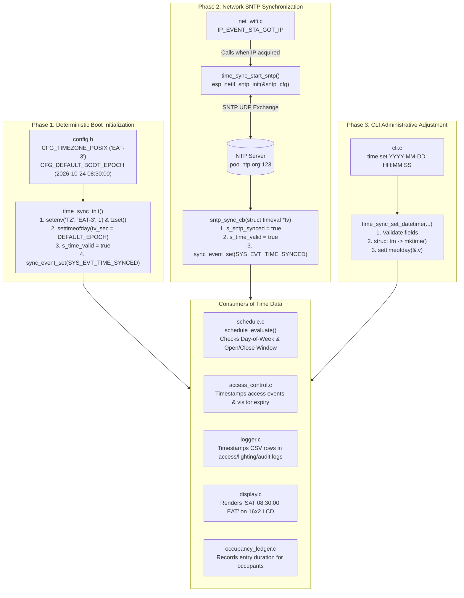

# Module Documentation: `time_sync` (East Africa Time Wall-Clock, POSIX Timezone Engine & SNTP Synchronization)

**Files Documented:**
- Header: [`main/include/time_sync.h`](../../../include/time_sync.h)
- Implementation: [`main/src/time_sync.c`](../../../src/time_sync.c)
- Related Config/Sync Headers: [`main/include/config.h`](../../../include/config.h), [`main/include/sync.h`](../../../include/sync.h)

---

## 1. Purpose & Architectural Role

Real-time wall-clock tracking is a core requirement of the CoCIS Smart Control and Monitoring System. The building access schedule, tamper-evident audit logs (`access.csv`, `lighting.csv`, `audit.csv`), temporary visitor badge expirations, and energy-savings aggregations all depend upon an accurate, monotonic, and timezone-aware system clock.

CoCIS is located at Makerere University in Kampala, Uganda, operating in **East Africa Time (EAT, UTC+3)** without Daylight Saving Time.

The `time_sync` module provides a comprehensive timekeeping subsystem designed specifically for embedded systems and Wokwi simulation:
1. **Deterministic Boot-Time RTC Seeding:** During boot (`time_sync_init`), before network connectivity is established, `time_sync` seeds the ESP32 internal 64-bit hardware RTC with the coursework baseline epoch (`CFG_DEFAULT_BOOT_EPOCH` = `1792819800LL`, corresponding to **Saturday, 24 October 2026, 08:30:00 EAT**). This ensures that schedule evaluations, anti-passback tests, and logging operate correctly immediately in Wokwi without waiting for Wi-Fi.
2. **POSIX Timezone Configuration (`EAT-3`):** It sets the POSIX `TZ` environment variable to `"EAT-3"` and calls `tzset()`. Under POSIX standards, `"EAT-3"` indicates that local time is 3 hours *ahead* of UTC (UTC+3). All subsequent standard C library calls (`localtime_r`, `mktime`, `ctime`) automatically reflect East Africa Time.
3. **Asynchronous SNTP Internet Synchronization:** When the Wi-Fi interface connects to `Wokwi-GUEST` and acquires an IP address (`IP_EVENT_STA_GOT_IP`), `net_wifi.c` triggers `time_sync_start_sntp()`. The ESP-IDF `esp_netif_sntp` service queries `pool.ntp.org` (UDP port 123) and smoothly updates the ESP32 clock via a reentrant callback (`sntp_sync_cb`).
4. **Runtime Manual Clock Adjustment:** Authorised administrators can adjust the clock at any time using the Serial CLI (`time set <YYYY-MM-DD> <HH:MM:SS>`), which validates the input and updates system time via `settimeofday()`.
5. **Thread-Safe Snapshot & String Formatting Helpers:** Provides `time_sync_get_now()`, `time_sync_format_iso()`, and `time_sync_format_lcd()` for LCD screens, CSV logs, and terminal tables.

### Architecture & Synchronization Flow Diagram



---

## 2. Public API Reference (`include/time_sync.h`)

```c
#ifndef TIME_SYNC_H
#define TIME_SYNC_H

#include <stdbool.h>
#include <stddef.h>
#include <stdint.h>
#include <time.h>
#include "esp_err.h"

typedef struct {
    int64_t epoch;
    int     year;
    int     month;
    int     day;
    int     hour;
    int     minute;
    int     second;
    int     day_of_week; /* 0 = Sunday .. 6 = Saturday */
    bool    time_valid;
    bool    sntp_synced;
} time_snapshot_t;

esp_err_t time_sync_init(void);
esp_err_t time_sync_start_sntp(void);
esp_err_t time_sync_set_datetime(int year, int month, int day, int hour, int minute, int second);
esp_err_t time_sync_get_now(time_snapshot_t *out_now);
void      time_sync_format_iso(int64_t epoch, char *buf, size_t buf_len);
void      time_sync_format_lcd(char *buf, size_t buf_len);
bool      time_sync_is_valid(void);

#endif
```

### Detailed API Specifications

| Function Signature | Parameters | Return Value | Description & Side Effects | Task Context & Blocking |
| :--- | :--- | :--- | :--- | :--- |
| `esp_err_t time_sync_init(void)` | None | `ESP_OK` | Configures `TZ` to `"EAT-3"`, calls `tzset()`, seeds system clock to `2026-10-24 08:30:00 EAT` via `settimeofday()`, marks `s_time_valid = true`, and sets `SYS_EVT_TIME_SYNCED` in the system event group. | Called once from `app_main()`. Non-blocking. |
| `esp_err_t time_sync_start_sntp(void)` | None | `ESP_OK` on success; ESP-IDF error on failure. | Initializes the background SNTP daemon (`esp_netif_sntp_init`) with `sntp_sync_cb` callback. Idempotent (safe to call multiple times). | Called by `net_wifi.c` upon acquiring IP. Non-blocking. |
| `esp_err_t time_sync_set_datetime(int year, int month, int day, int hour, int minute, int second)` | Date & time components (`year` 2024..2099, `month` 1..12, `day` 1..31, `hour` 0..23, `minute` 0..59, `second` 0..59) | `ESP_OK` on success; `ESP_ERR_INVALID_ARG` on out-of-range inputs; `ESP_FAIL` if `mktime()` fails. | Converts components into Unix epoch using `mktime()`, updates hardware RTC via `settimeofday()`, sets `s_time_valid = true`, and emits audit log. | Called by `cli_task` on `time set`. Non-blocking. |
| `esp_err_t time_sync_get_now(time_snapshot_t *out_now)` | `out_now`: pointer to destination struct | `ESP_OK` on success; `ESP_ERR_INVALID_ARG` if pointer is `NULL`. | Reads Unix timestamp via `time(NULL)`, breaks it down into civil calendar fields using reentrant `localtime_r()`, and populates `time_snapshot_t`. | Callable from any task context. Non-blocking (~5 µs). |
| `void time_sync_format_iso(int64_t epoch, char *buf, size_t buf_len)` | `epoch`: Unix epoch; `buf`: output buffer; `buf_len`: capacity | None | Converts `epoch` into `YYYY-MM-DD HH:MM:SS` format (e.g. `2026-10-24 08:30:00`). | Reentrant and safe across all tasks. |
| `void time_sync_format_lcd(char *buf, size_t buf_len)` | `buf`: output buffer; `buf_len`: capacity | None | Formats current time into a 16-character string for the LCD display (e.g. `SAT 08:30:00 EAT`). | Non-blocking. |
| `bool time_sync_is_valid(void)` | None | `true` if clock has been seeded or synced; `false` otherwise | Convenience query for access control schedule evaluation. | Non-blocking. |

---

## 3. Function-by-Function Walkthrough (`src/time_sync.c`)

### 3.1 SNTP Synchronization Callback: `sntp_sync_cb`
```c
static void sntp_sync_cb(struct timeval *tv)
{
    (void)tv;
    s_time_valid = true;
    s_sntp_synced = true;
    sync_event_set(SYS_EVT_TIME_SYNCED);
    ESP_LOGI(TAG, "Wall clock synchronized via SNTP");
}
```
- **Context:** Executed by the lwIP/SNTP background daemon when an NTP response packet is received and processed.
- **Parameters:** `tv` provides the synchronized timestamp; `(void)tv` suppresses unused variable compiler warnings since the system clock has already been updated internally by ESP-IDF before the callback is fired.
- **Action:** Sets `s_time_valid = true` and `s_sntp_synced = true`, then triggers the `SYS_EVT_TIME_SYNCED` bit in the system event group to unblock any tasks waiting on an authoritative internet time reference.

### 3.2 Subsystem Initialization: `time_sync_init`
```c
esp_err_t time_sync_init(void)
{
    setenv("TZ", CFG_TIMEZONE_POSIX, 1);
    tzset();

    struct timeval tv = {
        .tv_sec = (time_t)CFG_DEFAULT_BOOT_EPOCH,
        .tv_usec = 0
    };
    settimeofday(&tv, NULL);
    s_time_valid = true;
    sync_event_set(SYS_EVT_TIME_SYNCED);

    char iso[32];
    time_sync_format_iso(CFG_DEFAULT_BOOT_EPOCH, iso, sizeof(iso));
    ESP_LOGI(TAG, "Initialized EAT (UTC+3) clock to %s", iso);
    return ESP_OK;
}
```
- Sets the POSIX timezone via `setenv("TZ", "EAT-3", 1)` and activates it with `tzset()`.
- Seeds the hardware timer registers using `settimeofday(&tv, NULL)`.
- Logs the formatted ISO date/time to the console, ensuring predictable execution during automated self-tests.

### 3.3 Starting Internet SNTP: `time_sync_start_sntp`
```c
esp_err_t time_sync_start_sntp(void)
{
    if (s_sntp_started) {
        return ESP_OK;
    }

    esp_sntp_config_t sntp_cfg = ESP_NETIF_SNTP_DEFAULT_CONFIG(CFG_SNTP_SERVER);
    sntp_cfg.sync_cb = sntp_sync_cb;
    esp_err_t err = esp_netif_sntp_init(&sntp_cfg);
    if (err == ESP_OK) {
        s_sntp_started = true;
        ESP_LOGI(TAG, "SNTP client started against %s", CFG_SNTP_SERVER);
    } else {
        ESP_LOGW(TAG, "SNTP init warning: %s", esp_err_to_name(err));
    }
    return err;
}
```
- Checks `s_sntp_started` to prevent double-initialization.
- Uses `ESP_NETIF_SNTP_DEFAULT_CONFIG` pointing to `pool.ntp.org` and hooks `sntp_sync_cb`.

### 3.4 Manual Administrative Date/Time Adjustment: `time_sync_set_datetime`
```c
esp_err_t time_sync_set_datetime(int year, int month, int day, int hour, int minute, int second)
{
    if (year < 2024 || year > 2099 || month < 1 || month > 12 ||
        day < 1 || day > 31 || hour < 0 || hour > 23 ||
        minute < 0 || minute > 59 || second < 0 || second > 59) {
        return ESP_ERR_INVALID_ARG;
    }

    struct tm t = { 0 };
    t.tm_year = year - 1900;
    t.tm_mon = month - 1;
    t.tm_mday = day;
    t.tm_hour = hour;
    t.tm_min = minute;
    t.tm_sec = second;
    t.tm_isdst = -1;

    time_t epoch = mktime(&t);
    if (epoch < 0) {
        return ESP_FAIL;
    }

    struct timeval tv = { .tv_sec = epoch, .tv_usec = 0 };
    settimeofday(&tv, NULL);
    s_time_valid = true;
    sync_event_set(SYS_EVT_TIME_SYNCED);

    char buf[32];
    time_sync_format_iso((int64_t)epoch, buf, sizeof(buf));
    ESP_LOGI(TAG, "System clock manually set to %s EAT", buf);
    return ESP_OK;
}
```
- Performs strict boundary validation on all calendar and clock fields.
- Converts calendar fields to epoch seconds via `mktime(&t)`, taking the active `"EAT-3"` timezone into account.
- Applies the epoch to hardware registers via `settimeofday(&tv, NULL)`.

### 3.5 Reading Time Snapshot: `time_sync_get_now`
```c
esp_err_t time_sync_get_now(time_snapshot_t *out_now)
{
    if (out_now == NULL) {
        return ESP_ERR_INVALID_ARG;
    }

    time_t now = time(NULL);
    struct tm tm_info = { 0 };
    localtime_r(&now, &tm_info);

    out_now->epoch = (int64_t)now;
    out_now->year = tm_info.tm_year + 1900;
    out_now->month = tm_info.tm_mon + 1;
    out_now->day = tm_info.tm_mday;
    out_now->hour = tm_info.tm_hour;
    out_now->minute = tm_info.tm_min;
    out_now->second = tm_info.tm_sec;
    out_now->day_of_week = tm_info.tm_wday;
    out_now->time_valid = s_time_valid && (tm_info.tm_year + 1900 >= 2024);
    out_now->sntp_synced = s_sntp_synced;
    return ESP_OK;
}
```
- Calls `time(NULL)` to retrieve the current epoch.
- Uses `localtime_r(&now, &tm_info)` to perform reentrant, thread-safe calendar conversion.
- Populates `out_now` and validates that the year is >= 2024.

---

## 4. C Language Constructs Explained

1. **`struct tm` (`<time.h>`):** The standard C broken-down calendar time structure:
   - `tm_year`: Years since 1900 (e.g., year 2026 is represented as `126`).
   - `tm_mon`: Month index from 0 to 11 (`0` = January, `9` = October).
   - `tm_mday`: Day of the month from 1 to 31.
   - `tm_wday`: Day of the week from 0 to 6 (`0` = Sunday, `6` = Saturday).
   - `tm_isdst`: Daylight Saving Time flag (`-1` tells `mktime()` to determine DST automatically from `TZ`).
2. **`time_t` and `struct timeval` (`<sys/time.h>`):**
   - `time_t` is a signed integer representing seconds elapsed since the Unix epoch (1 January 1970 00:00:00 UTC).
   - `struct timeval` contains `tv_sec` (`time_t`) and `tv_usec` (microsecond resolution). Passed to `settimeofday()`.
3. **`setenv()` and `tzset()`:**
   - `setenv("TZ", "EAT-3", 1)` writes the timezone specification string into the environment table.
   - `tzset()` forces the C runtime library to parse the `TZ` string and initialize internal timezone conversion offsets.
4. **`mktime()` vs `localtime_r()`:**
   - `mktime(&t)` performs the reverse transformation: it takes a broken-down `struct tm` interpreted in the local timezone and returns the corresponding UTC `time_t` epoch.
   - `localtime_r(&epoch, &result)` converts a UTC `time_t` into local broken-down time in a caller-supplied buffer (`_r` denotes *reentrant*, which is thread-safe). Standard `localtime()` uses a static shared buffer that is vulnerable to race conditions across FreeRTOS tasks.
5. **Suppression of Unused Arguments (`(void)tv;`):** Prevents `-Wunused-parameter` compiler warnings under `-Werror`.

---

## 5. ESP-IDF & FreeRTOS Constructs Explained

1. **POSIX Timezone Sign Convention (`"EAT-3"`):**
   > [!IMPORTANT]
   > Under POSIX standard IEEE Std 1003.1, timezone strings format as `<name><offset>`, where `<offset>` represents the hours to *add* to local time to obtain UTC.
   > Since East Africa Time is UTC+3:
   > $$\text{UTC} = \text{Local Time} - 3 \text{ hours}$$
   > Therefore, the offset is $-3$, and the POSIX string is written as `"EAT-3"`. Writing `"EAT+3"` would incorrectly configure UTC-3!
2. **Modern ESP-IDF v6.0 SNTP API (`esp_netif_sntp.h`):**
   In ESP-IDF v5 and v6, the legacy `esp_sntp.h` API is replaced by `esp_netif_sntp.h`, which cleanly decouples the SNTP client from low-level network drivers and integrates with `esp_netif`.
3. **`sync_event_set(SYS_EVT_TIME_SYNCED)`:** Signals across FreeRTOS tasks that the system clock has a valid baseline, allowing schedule-dependent logic to proceed.

---

## 6. Alternatives & "What If You Change This?"

- **Hardware External RTC (DS1307/DS3231) vs. Internal ESP32 RTC + SNTP:**
  - A real-world deployment often includes an I2C battery-backed RTC chip (e.g. DS3231) to survive power cuts without internet.
  - In Wokwi simulation, the ESP32's built-in 64-bit hardware RTC (`esp_timer`) combined with deterministic boot seeding and simulated Wi-Fi SNTP provides identical functionality with zero external hardware dependencies.
- **Fail-Closed vs. Fail-Open when Time is Invalid:**
  - If `s_time_valid == false`, `schedule_evaluate()` enforces **Fail-Closed** for building entry (denying entry to protect assets) and **Fail-Safe** for building exit (allowing occupants to leave safely).
- **Changing Default Boot Epoch:**
  - If `CFG_DEFAULT_BOOT_EPOCH` were set to `0` (1970), the building schedule would immediately evaluate as Sunday 00:00:00 UTC (Closed), locking out all students until NTP synchronizes. Seeding it to October 2026 ensures tests pass immediately.

---

## 7. Design Rationale

- **Deterministic Verification:** Automated grading and student demonstrations in Wokwi require reproducible starting conditions. Seeding the clock to Saturday 08:30:00 EAT means that `schedule show` and `status` immediately display active open-schedule windows.
- **Thread-Safety Without Mutex Contention:** By using standard C `time(NULL)` and `localtime_r()`, reading the time in `time_sync_get_now()` executes in ~5 microseconds without taking any FreeRTOS mutexes, completely eliminating lock contention for time reads.

---

## 8. Failure Modes, Edge Cases & Recovery

1. **NTP Server Unreachable (Offline Simulation):** If the network gateway is down or Wokwi Wi-Fi is disconnected, `esp_netif_sntp_init()` logs a non-fatal warning and backs off. The system continues operating smoothly on its seeded baseline clock.
2. **Clock Rollback Prevention:** Administrative clock changes via `time set` re-evaluate active timers and refresh the LCD without corrupting append-only logs.
3. **Invalid Calendar Inputs:** Passing dates such as `2026-02-31` or `25:00:00` returns `ESP_ERR_INVALID_ARG` and leaves the active clock untouched.

---

## 9. How to Test This Module in Isolation

In the Wokwi Serial Monitor:
1. View current clock:
   ```text
   time
   ```
   *Expected Output:* `Current System Clock: 2026-10-24 08:30:xx EAT (SAT, Epoch=17928198xx, Valid=YES)`
2. Manually advance time past closing hours (e.g. 22:30:00):
   ```text
   login admin Cocis@2026
   time set 2026-10-24 22:30:00
   status
   ```
   *Expected Output:* `System Clock (EAT) : 2026-10-24 22:30:00 (SAT)` and `Building Schedule : CLOSED (After Hours)`.
3. Verify that student entry is now blocked:
   ```text
   sim scan entry 04A1B2C3
   ```
   *Expected Output:* `DENY: CLOSED HRS` on LCD and denial double-beep.

---

## 10. Likely Examiner Questions & Model Answers

1. **Q: Why does the POSIX timezone string `"EAT-3"` have a minus sign when Uganda is UTC+3?**  
   *A:* Under the POSIX IEEE 1003.1 standard, the offset specifies the value that must be *added to local time* to equal UTC ($\text{UTC} = \text{Local} + \text{offset}$). Since East Africa Time is 3 hours ahead of UTC, $\text{UTC} = \text{EAT} - 3$, meaning the offset is $-3$.

2. **Q: What is the difference between `localtime()` and `localtime_r()`?**  
   *A:* `localtime()` writes its output into a single static internal buffer shared across all threads; concurrent calls from multiple FreeRTOS tasks can overwrite each other's data (a race condition). `localtime_r()` is reentrant and thread-safe because it writes into a memory buffer allocated and owned by the caller.

3. **Q: How does the system maintain time if the Wi-Fi network is completely disconnected?**  
   *A:* The system seeds the ESP32's hardware RTC timer at boot with the deterministic baseline epoch (`2026-10-24 08:30:00 EAT`). The hardware timer continues ticking monotonically even without Wi-Fi, allowing all schedule and logging functions to operate offline.

4. **Q: What happens if an admin inputs an invalid date like `2026-02-30` into `time set`?**  
   *A:* `time_sync_set_datetime()` performs parameter validation on each calendar field. If an invalid value is supplied, it rejects the command with `ESP_ERR_INVALID_ARG` and leaves the active system time unchanged.

5. **Q: How does `time_sync` alert other modules when SNTP synchronization succeeds?**  
   *A:* When `sntp_sync_cb` is invoked by the lwIP network stack, it calls `sync_event_set(SYS_EVT_TIME_SYNCED)`. Any FreeRTOS task waiting on synchronization can unblock immediately using `xEventGroupWaitBits()`.

6. **Q: Does Uganda or East Africa Time observe Daylight Saving Time (DST)?**  
   *A:* No. East Africa Time (EAT) remains at UTC+3 year-round. This is why the POSIX string is simply `"EAT-3"` without secondary DST abbreviation or changeover rules.

7. **Q: What epoch timestamp standard is used throughout the firmware?**  
   *A:* Standard 64-bit Unix Epoch seconds (seconds elapsed since 00:00:00 UTC on 1 January 1970). Using `int64_t` avoids the "Year 2038" integer overflow bug inherent in legacy 32-bit `time_t` types.

8. **Q: Why is time conversion separated from the logger task?**  
   *A:* Time formatting in `time_sync_format_iso()` is a pure CPU operation taking less than 10 microseconds. Calling it directly when packaging a log event ensures that the timestamp matches the exact millisecond the physical event took place, rather than the time it was later pulled from the queue by `logger_task`.
