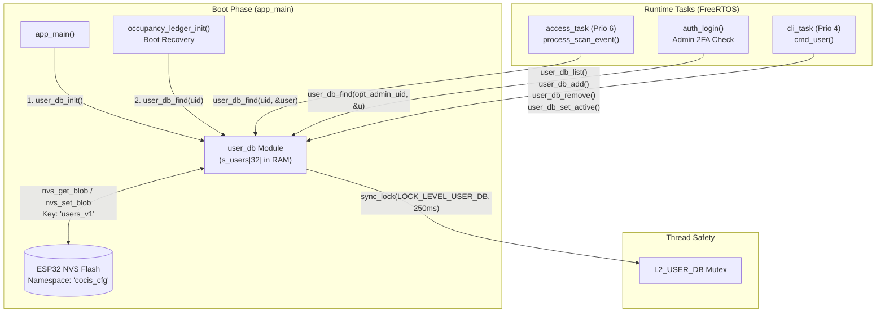

# Module Documentation: `user_db` — Enrolled RFID User Database & Role Management

**Coursework:** Embedded Systems (CoCIS Smart Control and Monitoring System, Makerere University)  
**Bundle / Student Assignment:** Bundle 3 (Student 3 — Security, Identity, Schedule & Occupancy Authority)  
**Header File:** `main/include/user_db.h`  
**Implementation File:** `main/src/user_db.c`  
**Synchronization Level:** `LOCK_LEVEL_USER_DB` (Level 2 in the hierarchical mutex order)  
**Persistent Backing Store:** ESP32 NVS Flash (`namespace = "cocis_cfg"`, `key = "users_v1"`)

---

## 1. Purpose & Architectural Role

The **`user_db`** module is the authoritative **Identity and Role Registry** for the CoCIS Smart Control and Monitoring System at Makerere University. Whenever a student, staff member, administrator, or visitor taps an RFID badge at the Main Entrance (Entry or Exit reader), or when an administrator logs into the CLI with Two-Factor Authentication (2FA), the system must answer four critical questions before opening any door:

1. **Is this RFID UID enrolled in the system?** (Unknown tags like `"DEADBEEF"` must be rejected immediately).
2. **Who owns this tag and what is their institutional role?** (`ADMIN`, `STAFF`, `STUDENT`, or `VISITOR`).
3. **Is their account currently active or suspended?** (e.g., suspended student tags must be blocked without deleting their historical audit trail).
4. **Has a temporary visitor badge expired?** (Visitors receive a time-bounded pass measured in Unix epoch seconds).

### Architectural Position in the System

`user_db` sits in Layer 3 (Authoritative Databases & Security Subsystems) of the firmware architecture. It is initialized during `app_main()` before the access control engine or CLI tasks start. Because both the real-time **Access Control Task** (`access_task`, priority 6) and the interactive **CLI Task** (`cli_task`, priority 4) — as well as the boot-time **Occupancy Ledger Recovery** (`occupancy_ledger_init`) — read and mutate user records, `user_db` protects its internal 32-slot table (`s_users`) using the Level 2 hierarchical mutex (`LOCK_LEVEL_USER_DB`) and persists every change as a binary blob in Non-Volatile Storage (NVS) flash.



---

## 2. Public API Reference (`main/include/user_db.h`)

### 2.1 Configuration Constants Used (from `main/include/config.h`)

| Macro | Value | Purpose in `user_db` |
| :--- | :--- | :--- |
| `CFG_RFID_UID_MAX_LEN` | `16` | Maximum character buffer length (including `'\0'`) for an RFID UID string (e.g., `"04A1B2C3"`). |
| `CFG_USER_NAME_MAX_LEN` | `28` | Maximum character buffer length (including `'\0'`) for a person's full name. |
| `CFG_USER_DB_MAX_USERS` | `32` | Total number of fixed slots in the `s_users` static array. |
| `CFG_VISITOR_DEFAULT_TTL_SEC` | `86400` (`24 * 3600`) | Default validity window (24 hours) added to boot/current epoch for `USER_ROLE_VISITOR` badges. |
| `CFG_DEFAULT_BOOT_EPOCH` | `1792819800LL` | Default initial Unix timestamp (`2026-10-24 08:30:00 EAT`) used when seeding the default visitor expiry. |
| `CFG_NVS_NAMESPACE` | `"cocis_cfg"` | NVS storage namespace shared across CoCIS persistent modules. |
| `CFG_LOCK_TIMEOUT_MS` | `250` | Maximum milliseconds a task will wait to acquire `LOCK_LEVEL_USER_DB` before timing out. |

---

### 2.2 Data Types: `user_role_t` and `user_record_t`

```c
typedef enum {
    USER_ROLE_ADMIN = 0,
    USER_ROLE_STAFF = 1,
    USER_ROLE_STUDENT = 2,
    USER_ROLE_VISITOR = 3
} user_role_t;
```

* **`USER_ROLE_ADMIN` (`0`)**: Full building privileges. Can bypass closed schedule windows (`SCHED_ALLOW_ADMIN_BYPASS`), enter during emergency lockdowns, and serve as the second factor (`opt_admin_uid`) for `auth_login()` when 2FA is enabled.
* **`USER_ROLE_STAFF` (`1`)**: Academic and administrative staff (e.g., `"Dr. Eng. Bainomugisha"`, `"Grace Atim"`). Bound by building open hours unless granted a supervisor exit override or emergency egress.
* **`USER_ROLE_STUDENT` (`2`)**: Regular enrolled students (e.g., `"Matthew Mumbere"`). Subject to standard schedule and anti-passback rules.
* **`USER_ROLE_VISITOR` (`3`)**: External guests or examiners (e.g., `"External Examiner"`). Subject to both schedule rules and an automatic expiration timestamp (`expiry_epoch`).

```c
typedef struct {
    bool        in_use;
    char        uid[CFG_RFID_UID_MAX_LEN];
    char        name[CFG_USER_NAME_MAX_LEN];
    user_role_t role;
    bool        active;
    int64_t     expiry_epoch; /* 0 = never expires; >0 = visitor expiry */
} user_record_t;
```

* **`in_use`**: Slot occupancy flag (`true` if this array slot holds an enrolled user, `false` if the slot is empty/free).
* **`uid`**: Null-terminated uppercase ASCII hexadecimal UID string (up to 15 chars + `'\0'`).
* **`name`**: Null-terminated full name string (up to 27 chars + `'\0'`).
* **`role`**: One of the four `user_role_t` enum values.
* **`active`**: Administrative enable flag (`true` = allowed to use doors; `false` = suspended/disabled).
* **`expiry_epoch`**: 64-bit Unix timestamp in seconds (`int64_t`). If `0`, the badge never expires. If `> 0`, `access_control` checks `now.epoch > user.expiry_epoch` and denies access with `ACCESS_RESULT_DENIED_VISITOR_EXPIRED` once that timestamp passes.

---

### 2.3 Function Reference Table

| Function Signature | Parameters | Return Value | Side Effects | Who Calls It & Task Context | Blocking Behavior |
| :--- | :--- | :--- | :--- | :--- | :--- |
| `esp_err_t user_db_init(void)` | `void` | `ESP_OK` on success, `ESP_ERR_TIMEOUT` if mutex acquisition fails. | Reads `s_users` blob from NVS (`"users_v1"`). If absent or size-mismatched, seeds 8 default CoCIS users into `s_users` and commits them to NVS. | Called once by `app_main()` in `main/main.c` (main startup task). | Blocks up to `250 ms` on `LOCK_LEVEL_USER_DB` + NVS flash I/O (~2–15 ms). |
| `esp_err_t user_db_find(const char *uid, user_record_t *out_user)` | `uid`: Input RFID string (case-insensitive).<br>`out_user`: Optional pointer to caller's `user_record_t` struct to receive a copy (may be `NULL` to just test existence). | `ESP_OK` if found;<br>`ESP_ERR_INVALID_ARG` if `uid` is `NULL` or `""`;<br>`ESP_ERR_NOT_FOUND` if not enrolled;<br>`ESP_ERR_TIMEOUT` on lock failure. | None (read-only). Copies matching struct to `*out_user` while holding lock. | 1. `process_scan_event()` in `access_control.c` (`access_task`, Prio 6).<br>2. `boot_recovery_visitor()` in `occupancy_ledger.c` (`main` task).<br>3. `auth_login()` in `auth.c` (`cli_task`, Prio 4). | Blocks up to `250 ms` acquiring `LOCK_LEVEL_USER_DB`. |
| `esp_err_t user_db_add(const char *uid, const char *name, user_role_t role, bool active, int64_t expiry_epoch)` | `uid`: Tag UID string.<br>`name`: Full name.<br>`role`: `user_role_t`.<br>`active`: Initial active state.<br>`expiry_epoch`: `0` or Unix expiry timestamp. | `ESP_OK` on insert or update;<br>`ESP_ERR_INVALID_ARG` if `uid` or `name` is `NULL`/empty;<br>`ESP_ERR_NO_MEM` if all 32 slots are full;<br>`ESP_ERR_TIMEOUT` on lock failure. | Updates existing record in-place if `uid` already exists, or allocates the first free slot (`!in_use`), then writes the entire `s_users` array to NVS flash. | Called by `cmd_user()` (`user add`) in `main/src/cli.c` (`cli_task`, Prio 4). | Blocks up to `250 ms` on mutex + synchronous NVS flash write/commit. |
| `esp_err_t user_db_remove(const char *uid)` | `uid`: Tag UID string to delete. | `ESP_OK` if found and zeroed;<br>`ESP_ERR_INVALID_ARG` if `uid` is `NULL`/empty;<br>`ESP_ERR_NOT_FOUND` if UID is not in database;<br>`ESP_ERR_TIMEOUT` on lock failure. | Zeroes the matching `s_users[i]` slot (`memset` to 0, setting `in_use = false`) and commits `s_users` to NVS. | Called by `cmd_user()` (`user del`) in `main/src/cli.c` (`cli_task`, Prio 4). | Blocks up to `250 ms` on mutex + NVS write/commit. |
| `esp_err_t user_db_set_active(const char *uid, bool active)` | `uid`: Tag UID string.<br>`active`: `true` to enable, `false` to suspend. | `ESP_OK` if updated;<br>`ESP_ERR_INVALID_ARG` if `uid` is `NULL`/empty;<br>`ESP_ERR_NOT_FOUND` if UID not found;<br>`ESP_ERR_TIMEOUT` on lock failure. | Sets `s_users[i].active = active` and persists `s_users` to NVS. | Called by `cmd_user()` (`user enable` / `user disable`) in `main/src/cli.c` (`cli_task`, Prio 4). | Blocks up to `250 ms` on mutex + NVS write/commit. |
| `size_t user_db_list(user_record_t *out_array, size_t max_items)` | `out_array`: Caller-allocated array of `user_record_t`.<br>`max_items`: Capacity of `out_array`. | Number of enrolled users copied (`0` to `max_items`). Returns `0` on invalid args or lock timeout. | Copies all slots with `in_use == true` into `out_array`. | Called by `cmd_user()` (`user list`) in `main/src/cli.c` (`cli_task`, Prio 4). | Blocks up to `250 ms` acquiring `LOCK_LEVEL_USER_DB`. |
| `esp_err_t user_db_reset_defaults(void)` | `void` | `ESP_OK` or `ESP_ERR_TIMEOUT`. | Wipes `s_users`, reloads the 8 default CoCIS records, and saves to NVS. | Utility API available for full factory reset. | Blocks up to `250 ms` on mutex + NVS write/commit. |
| `const char *user_db_role_to_str(user_role_t role)` | `role`: Enum value. | Pointer to static string literal (`"ADMIN"`, `"STAFF"`, `"STUDENT"`, `"VISITOR"`, or `"UNKNOWN"`). | None (pure function). | Called by `cmd_inside()` and `cmd_user()` in `main/src/cli.c` (`cli_task`). | **Non-blocking** (no mutex needed). |
| `bool user_db_parse_role(const char *str, user_role_t *out_role)` | `str`: Input role string (case-insensitive).<br>`out_role`: Output pointer for parsed enum. | `true` if valid role string; `false` otherwise. | Writes parsed enum to `*out_role`. | Called by `cmd_user()` (`user add`) in `main/src/cli.c` (`cli_task`). | **Non-blocking** (no mutex needed). |

---

## 3. Line-by-Line / Block-by-Block Code Walkthrough (`main/src/user_db.c`)

### 3.1 Includes, Module Tag, NVS Key, and Static Storage (Lines 1–11)

```c
#include "user_db.h"
#include <ctype.h>
#include <string.h>
#include "esp_log.h"
#include "nvs.h"
#include "sync.h"

static const char *TAG = "USER_DB";
static const char *NVS_KEY_USERS = "users_v1";

static user_record_t s_users[CFG_USER_DB_MAX_USERS];
```

* **`#include <ctype.h>`**: Provides `toupper()` for normalizing hexadecimal UID strings to uppercase.
* **`#include <string.h>`**: Provides `memset()`, `strncpy()`, `strcmp()`, and `strcasecmp()`.
* **`static const char *TAG = "USER_DB"`**: Logging prefix passed to `ESP_LOGI`.
* **`static const char *NVS_KEY_USERS = "users_v1"`**: The key name inside NVS namespace `"cocis_cfg"`. Notice the `_v1` suffix: versioning NVS blob keys is an embedded best practice so that if `user_record_t` changes in a future firmware version, old layouts won't be misinterpreted.
* **`static user_record_t s_users[CFG_USER_DB_MAX_USERS]`**: A file-scoped array of 32 `user_record_t` structures allocated in `.bss` (zero-initialized static RAM). Because there is no `malloc()`, memory usage is 100% deterministic at compile time (`32 * sizeof(user_record_t)` ≈ `32 * 64 = 2,048 bytes`), preventing heap fragmentation.

---

### 3.2 Helper: `normalize_uid()` (Lines 13–21)

```c
static void normalize_uid(const char *in, char *out, size_t out_len)
{
    size_t i = 0;
    while (in[i] != '\0' && i + 1 < out_len) {
        out[i] = (char)toupper((unsigned char)in[i]);
        i++;
    }
    out[i] = '\0';
}
```

* **What it does**: Copies the input string `in` into `out` (up to `out_len - 1` characters), converting every lowercase letter (`'a'`–`'f'`) to uppercase (`'A'`–`'F'`), and guarantees null-termination (`out[i] = '\0'`).
* **Why it exists**: RFID readers report UIDs in uppercase hex (e.g., `"04A1B2C3"`), whereas a human administrator typing a CLI command might type `user add 04a1b2c3 student John`. Normalizing at the boundary of `user_db_find`, `user_db_add`, `user_db_remove`, and `user_db_set_active` ensures all stored UIDs are canonical uppercase and comparisons with `strcmp()` always succeed regardless of how the user typed the UID.
* **Why `(unsigned char)in[i]`?**: In standard C, passing a plain `char` (which may be signed and negative for bytes `>= 0x80`) directly to `toupper(int c)` invokes **Undefined Behavior (UB)** unless its value is representable as `unsigned char` or `EOF`. Casting to `unsigned char` first is required by CERT-C coding standards.

---

### 3.3 Helper: `save_to_nvs_unlocked()` (Lines 23–32)

```c
static void save_to_nvs_unlocked(void)
{
    nvs_handle_t h;
    if (nvs_open(CFG_NVS_NAMESPACE, NVS_READWRITE, &h) == ESP_OK) {
        if (nvs_set_blob(h, NVS_KEY_USERS, s_users, sizeof(s_users)) == ESP_OK) {
            nvs_commit(h);
        }
        nvs_close(h);
    }
}
```

* **Naming convention (`_unlocked`)**: The suffix `_unlocked` tells any developer reading the file that **this function assumes the caller already holds `LOCK_LEVEL_USER_DB`**. If `save_to_nvs_unlocked()` tried to call `sync_lock(LOCK_LEVEL_USER_DB, ...)` itself while called from `user_db_add()`, the task would deadlock against itself (since standard FreeRTOS mutexes created with `xSemaphoreCreateMutex()` are non-recursive).
* **How it works**: Opens the `"cocis_cfg"` NVS namespace in `NVS_READWRITE` mode, writes the entire `s_users` array as a single binary blob under key `"users_v1"`, calls `nvs_commit(h)` to flush pending writes to physical flash, and closes the handle `h`.

---

### 3.4 Helper: `seed_default_users_unlocked()` (Lines 34–63)

```c
static void seed_default_users_unlocked(void)
{
    memset(s_users, 0, sizeof(s_users));

    static const struct {
        const char *uid;
        const char *name;
        user_role_t role;
        bool        active;
        int64_t     expiry;
    } defaults[] = {
        { "04A00001", "Prof. Tonny Oyana",      USER_ROLE_ADMIN,   true,  0 },
        { "04A1B2C3", "Matthew Mumbere",        USER_ROLE_STUDENT, true,  0 },
        { "04B2C3D4", "Dr. Eng. Bainomugisha",  USER_ROLE_STAFF,   true,  0 },
        { "04C3D4E5", "Sarah Namukasa",         USER_ROLE_STUDENT, true,  0 },
        { "04D4E5F6", "David Okello",           USER_ROLE_STUDENT, true,  0 },
        { "04E5F607", "Grace Atim",             USER_ROLE_STAFF,   true,  0 },
        { "04V10008", "External Examiner",      USER_ROLE_VISITOR, true,  CFG_DEFAULT_BOOT_EPOCH + CFG_VISITOR_DEFAULT_TTL_SEC },
        { "0499DEAD", "Suspended Account",      USER_ROLE_STUDENT, false, 0 }
    };

    for (size_t i = 0; i < sizeof(defaults) / sizeof(defaults[0]); i++) {
        s_users[i].in_use = true;
        strncpy(s_users[i].uid, defaults[i].uid, sizeof(s_users[i].uid) - 1);
        strncpy(s_users[i].name, defaults[i].name, sizeof(s_users[i].name) - 1);
        s_users[i].role = defaults[i].role;
        s_users[i].active = defaults[i].active;
        s_users[i].expiry_epoch = defaults[i].expiry;
    }
}
```

* **Zeroing first**: `memset(s_users, 0, sizeof(s_users))` clears all 32 slots, setting `in_use = false` and filling every `uid` and `name` buffer with `'\0'`.
* **Default CoCIS Dataset**: Pre-populates 8 realistic records covering every role and edge case needed for demonstration and self-testing:
  * `"04A00001"` (`Prof. Tonny Oyana`, `ADMIN`, active): Used for admin schedule bypass and 2FA tests.
  * `"04A1B2C3"` (`Matthew Mumbere`, `STUDENT`, active): Bound to the hardware Entry/Exit pushbuttons (`CFG_BTN_ENTRY_VALID_UID`).
  * `"04B2C3D4"` & `"04E5F607"`: Staff accounts.
  * `"04C3D4E5"` & `"04D4E5F6"`: Student accounts used in automated self-tests (`Test 06` and `Test 07`).
  * `"04V10008"` (`External Examiner`, `VISITOR`, active): Has `expiry_epoch = CFG_DEFAULT_BOOT_EPOCH + 86400`, allowing testing of visitor badge expiration (`ACCESS_RESULT_DENIED_VISITOR_EXPIRED`).
  * `"0499DEAD"` (`Suspended Account`, `STUDENT`, `active = false`): Used in `Test 05` to verify `ACCESS_RESULT_DENIED_USER_INACTIVE`.
* **Safe String Copy**: Because `memset` zeroed `s_users`, copying up to `sizeof(...) - 1` bytes with `strncpy` guarantees the final byte remains `'\0'`.

---

### 3.5 `user_db_init()` (Lines 65–92)

```c
esp_err_t user_db_init(void)
{
    esp_err_t err = sync_lock(LOCK_LEVEL_USER_DB, CFG_LOCK_TIMEOUT_MS);
    if (err != ESP_OK) {
        return err;
    }

    bool loaded = false;
    nvs_handle_t h;
    if (nvs_open(CFG_NVS_NAMESPACE, NVS_READONLY, &h) == ESP_OK) {
        size_t sz = sizeof(s_users);
        if (nvs_get_blob(h, NVS_KEY_USERS, s_users, &sz) == ESP_OK && sz == sizeof(s_users)) {
            loaded = true;
        }
        nvs_close(h);
    }

    if (!loaded) {
        seed_default_users_unlocked();
        save_to_nvs_unlocked();
        ESP_LOGI(TAG, "Seeded 8 default CoCIS RFID user records");
    } else {
        ESP_LOGI(TAG, "Loaded enrolled RFID user database from NVS");
    }

    sync_unlock(LOCK_LEVEL_USER_DB);
    return ESP_OK;
}
```

* **Step 1**: Acquires `LOCK_LEVEL_USER_DB`.
* **Step 2**: Attempts to open NVS namespace `"cocis_cfg"` in `NVS_READONLY` mode and read `"users_v1"` into `s_users`. Notice the defensive check `sz == sizeof(s_users)`: if the blob in flash has a different size (e.g., `CFG_USER_DB_MAX_USERS` was changed between builds), `loaded` remains `false`.
* **Step 3**: If `!loaded` (first boot after flash erase or struct size change), seeds the 8 default CoCIS users and immediately writes them to NVS so subsequent boots load from NVS.
* **Step 4**: Releases `LOCK_LEVEL_USER_DB` and returns `ESP_OK`.

---

### 3.6 `user_db_find()` (Lines 94–121)

```c
esp_err_t user_db_find(const char *uid, user_record_t *out_user)
{
    if (uid == NULL || uid[0] == '\0') {
        return ESP_ERR_INVALID_ARG;
    }

    char norm[CFG_RFID_UID_MAX_LEN];
    normalize_uid(uid, norm, sizeof(norm));

    esp_err_t err = sync_lock(LOCK_LEVEL_USER_DB, CFG_LOCK_TIMEOUT_MS);
    if (err != ESP_OK) {
        return err;
    }

    esp_err_t res = ESP_ERR_NOT_FOUND;
    for (size_t i = 0; i < CFG_USER_DB_MAX_USERS; i++) {
        if (s_users[i].in_use && strcmp(s_users[i].uid, norm) == 0) {
            if (out_user != NULL) {
                *out_user = s_users[i];
            }
            res = ESP_OK;
            break;
        }
    }

    sync_unlock(LOCK_LEVEL_USER_DB);
    return res;
}
```

* **Validation & Normalization outside the lock**: Checking `uid == NULL || uid[0] == '\0'` and normalizing `uid` into stack buffer `norm` happen *before* acquiring the mutex, minimizing mutex hold time (critical section duration).
* **Linear scan**: Iterates over `0 .. 31`. Checks `s_users[i].in_use` first (fast boolean check) before calling `strcmp(s_users[i].uid, norm)`.
* **Copy-out pattern (`*out_user = s_users[i]`)**: Instead of returning a `user_record_t *` pointer into `s_users[]` (which would be unsafe the moment `sync_unlock()` is called because another task could delete or modify that slot), `user_db_find` copies the struct by value into the caller's stack variable `*out_user`.

---

### 3.7 `user_db_add()` (Lines 123–170)

```c
esp_err_t user_db_add(const char *uid, const char *name, user_role_t role, bool active, int64_t expiry_epoch)
{
    if (uid == NULL || uid[0] == '\0' || name == NULL || name[0] == '\0') {
        return ESP_ERR_INVALID_ARG;
    }

    char norm[CFG_RFID_UID_MAX_LEN];
    normalize_uid(uid, norm, sizeof(norm));

    esp_err_t err = sync_lock(LOCK_LEVEL_USER_DB, CFG_LOCK_TIMEOUT_MS);
    if (err != ESP_OK) {
        return err;
    }

    int free_slot = -1;
    for (int i = 0; i < CFG_USER_DB_MAX_USERS; i++) {
        if (s_users[i].in_use && strcmp(s_users[i].uid, norm) == 0) {
            strncpy(s_users[i].name, name, sizeof(s_users[i].name) - 1);
            s_users[i].name[sizeof(s_users[i].name) - 1] = '\0';
            s_users[i].role = role;
            s_users[i].active = active;
            s_users[i].expiry_epoch = expiry_epoch;
            save_to_nvs_unlocked();
            sync_unlock(LOCK_LEVEL_USER_DB);
            return ESP_OK;
        }
        if (!s_users[i].in_use && free_slot < 0) {
            free_slot = i;
        }
    }

    if (free_slot < 0) {
        sync_unlock(LOCK_LEVEL_USER_DB);
        return ESP_ERR_NO_MEM;
    }

    memset(&s_users[free_slot], 0, sizeof(user_record_t));
    s_users[free_slot].in_use = true;
    strncpy(s_users[free_slot].uid, norm, sizeof(s_users[free_slot].uid) - 1);
    strncpy(s_users[free_slot].name, name, sizeof(s_users[free_slot].name) - 1);
    s_users[free_slot].role = role;
    s_users[free_slot].active = active;
    s_users[free_slot].expiry_epoch = expiry_epoch;

    save_to_nvs_unlocked();
    sync_unlock(LOCK_LEVEL_USER_DB);
    return ESP_OK;
}
```

* **Single-pass Upsert + Free-slot Discovery**: In a single loop over `0 .. 31`:
  1. If a record with the same normalized `uid` already exists (`s_users[i].in_use && strcmp(...) == 0`), it updates the existing record in place (**upsert** semantics), saves to NVS, unlocks the mutex, and returns `ESP_OK`. This prevents duplicate UIDs from ever existing in `s_users`.
  2. Simultaneously, it remembers the index of the *first* unused slot (`if (!s_users[i].in_use && free_slot < 0) free_slot = i;`).
* **Table Full Handling**: If the loop finishes without finding an existing UID and `free_slot < 0`, all 32 slots are occupied. It unlocks the mutex and returns `ESP_ERR_NO_MEM`.
* **Populating the New Slot**: Zeroes `s_users[free_slot]` with `memset`, sets `in_use = true`, copies `norm` and `name` with `strncpy(..., sizeof(...) - 1)`, sets `role`, `active`, and `expiry_epoch`, saves to NVS, and unlocks.

---

### 3.8 `user_db_remove()` and `user_db_set_active()` (Lines 172–226)

```c
esp_err_t user_db_remove(const char *uid)
{
    if (uid == NULL || uid[0] == '\0') {
        return ESP_ERR_INVALID_ARG;
    }

    char norm[CFG_RFID_UID_MAX_LEN];
    normalize_uid(uid, norm, sizeof(norm));

    esp_err_t err = sync_lock(LOCK_LEVEL_USER_DB, CFG_LOCK_TIMEOUT_MS);
    if (err != ESP_OK) {
        return err;
    }

    esp_err_t res = ESP_ERR_NOT_FOUND;
    for (size_t i = 0; i < CFG_USER_DB_MAX_USERS; i++) {
        if (s_users[i].in_use && strcmp(s_users[i].uid, norm) == 0) {
            memset(&s_users[i], 0, sizeof(user_record_t));
            save_to_nvs_unlocked();
            res = ESP_OK;
            break;
        }
    }

    sync_unlock(LOCK_LEVEL_USER_DB);
    return res;
}
```

* **`user_db_remove()`**: Finds the matching slot and calls `memset(&s_users[i], 0, sizeof(user_record_t))`, which both sets `in_use = false` and scrubs the old UID/name from RAM and NVS.
* **`user_db_set_active()`** (Lines 200–226): Follows the exact same pattern, except instead of deleting the slot, it sets `s_users[i].active = active` and calls `save_to_nvs_unlocked()`. This allows security staff to temporarily suspend a student's card (`user disable <uid>`) while preserving their name and role so that if they tap their card at the door, the LCD and audit log specifically report `"DENY: INACTIVE (Suspended Account)"` rather than `"DENY: UNKNOWN ID"`.

---

### 3.9 `user_db_list()` and `user_db_reset_defaults()` (Lines 228–259)

```c
size_t user_db_list(user_record_t *out_array, size_t max_items)
{
    if (out_array == NULL || max_items == 0) {
        return 0;
    }

    if (sync_lock(LOCK_LEVEL_USER_DB, CFG_LOCK_TIMEOUT_MS) != ESP_OK) {
        return 0;
    }

    size_t count = 0;
    for (size_t i = 0; i < CFG_USER_DB_MAX_USERS && count < max_items; i++) {
        if (s_users[i].in_use) {
            out_array[count++] = s_users[i];
        }
    }

    sync_unlock(LOCK_LEVEL_USER_DB);
    return count;
}
```

* **`user_db_list()`**: Compacts all active slots (`in_use == true`) into a contiguous array `out_array[0 .. count-1]`, guarded by `count < max_items` to prevent buffer overflow in the caller's array.
* **`user_db_reset_defaults()`** (Lines 249–259): Acquires `LOCK_LEVEL_USER_DB`, calls `seed_default_users_unlocked()`, persists with `save_to_nvs_unlocked()`, and unlocks.

---

### 3.10 String Conversion Helpers: `user_db_role_to_str()` and `user_db_parse_role()` (Lines 261–294)

```c
const char *user_db_role_to_str(user_role_t role)
{
    switch (role) {
        case USER_ROLE_ADMIN:   return "ADMIN";
        case USER_ROLE_STAFF:   return "STAFF";
        case USER_ROLE_STUDENT: return "STUDENT";
        case USER_ROLE_VISITOR: return "VISITOR";
        default:                return "UNKNOWN";
    }
}

bool user_db_parse_role(const char *str, user_role_t *out_role)
{
    if (str == NULL || out_role == NULL) {
        return false;
    }
    if (strcasecmp(str, "admin") == 0) {
        *out_role = USER_ROLE_ADMIN;
        return true;
    }
    if (strcasecmp(str, "staff") == 0) {
        *out_role = USER_ROLE_STAFF;
        return true;
    }
    if (strcasecmp(str, "student") == 0) {
        *out_role = USER_ROLE_STUDENT;
        return true;
    }
    if (strcasecmp(str, "visitor") == 0) {
        *out_role = USER_ROLE_VISITOR;
        return true;
    }
    return false;
}
```

* **`user_db_role_to_str()`**: Maps enum constants to read-only string literals stored in flash (`.rodata`). Safe to call from any task without locking or freeing.
* **`user_db_parse_role()`**: Uses POSIX `strcasecmp()` for case-insensitive matching (`"Admin"`, `"ADMIN"`, `"admin"` all map to `USER_ROLE_ADMIN`).

---

## 4. C Language Constructs Explained

1. **Header Guards (`#ifndef USER_DB_H` / `#define USER_DB_H` / `#endif`)**:
   * Prevents multiple-inclusion compilation errors when `user_db.h` is included both directly (e.g., in `access_control.c`) and indirectly via `schedule.h` or `occupancy_ledger.h`.
2. **`typedef enum { ... } user_role_t` & `typedef struct { ... } user_record_t`**:
   * `typedef enum` creates a strongly named integer type for roles instead of magic numbers (`0`, `1`, `2`, `3`).
   * `typedef struct` packages heterogeneous fields (`bool`, `char[]`, `user_role_t`, `int64_t`) into a single contiguous block of memory that can be copied by value (`*out_user = s_users[i]`) and serialized directly to NVS as a binary blob.
3. **`static` Storage Class Specifier**:
   * Applied to global variable `static user_record_t s_users[...]` and helper functions (`normalize_uid`, `save_to_nvs_unlocked`, `seed_default_users_unlocked`): restricts their linkage to `user_db.c` (**encapsulation**). No external module can bypass `LOCK_LEVEL_USER_DB` to touch `s_users` directly.
   * Applied to local array `static const struct { ... } defaults[]` inside `seed_default_users_unlocked()`: places the lookup table in read-only flash memory (`.rodata`) rather than constructing it on the FreeRTOS task stack on every call.
4. **`const` Correctness (`const char *uid`, `const char *user_db_role_to_str(...)`)**:
   * Promises the compiler and caller that `user_db_find()` will not modify the caller's `uid` string, and prevents callers of `user_db_role_to_str()` from modifying the returned string literal in flash.
5. **Character Classification & Safe Casting (`toupper((unsigned char)in[i])`)**:
   * Converts lowercase ASCII characters to uppercase while avoiding signed `char` sign-extension bugs.
6. **Case-Insensitive String Comparison (`strcasecmp`)**:
   * Compares two null-terminated strings character-by-character ignoring case, used in `user_db_parse_role()`.
7. **Array Element Count Idiom (`sizeof(defaults) / sizeof(defaults[0])`)**:
   * Computes the number of elements in `defaults[]` at compile time (`8`) without hardcoding a magic number that could go out of sync if another default user is added.
8. **Pass-by-Pointer for Output Parameters (`user_record_t *out_user`, `user_role_t *out_role`)**:
   * Since C functions only have a single return value (used for `esp_err_t` status codes or `bool`), data outputs are returned by dereferencing caller-provided pointers (`*out_user = s_users[i]`).

---

## 5. ESP-IDF & FreeRTOS Constructs Explained

1. **Hierarchical Mutex Locking (`sync_lock(LOCK_LEVEL_USER_DB, CFG_LOCK_TIMEOUT_MS)` / `sync_unlock(LOCK_LEVEL_USER_DB)`)**:
   * Wraps FreeRTOS `xSemaphoreTake()` and `xSemaphoreGive()` on the Level 2 mutex (`L2_USER_DB`).
   * Uses a bounded timeout (`CFG_LOCK_TIMEOUT_MS = 250 ms` converted via `pdMS_TO_TICKS(250)`) rather than `portMAX_DELAY` so that if a flash stall or bug occurs, callers fail gracefully with `ESP_ERR_TIMEOUT` and increment `timeout_count` diagnostics (visible in the CLI `stats` command).
2. **NVS Flash API (`nvs_open`, `nvs_get_blob`, `nvs_set_blob`, `nvs_commit`, `nvs_close`)**:
   * **`nvs_open(CFG_NVS_NAMESPACE, mode, &h)`**: Opens a handle to the `"cocis_cfg"` partition namespace. `user_db_init()` uses `NVS_READONLY` first so it doesn't unnecessarily dirty flash pages when reading.
   * **`nvs_get_blob(h, NVS_KEY_USERS, s_users, &sz)`**: Reads variable-length binary data from flash into `s_users`. `sz` is an **in-out parameter**: on input it tells NVS the buffer capacity (`sizeof(s_users)`), and on output NVS writes the actual blob size stored in flash.
   * **`nvs_set_blob(h, NVS_KEY_USERS, s_users, sizeof(s_users))`**: Stages the entire `s_users` array into NVS wear-leveled flash storage.
   * **`nvs_commit(h)`**: Ensures all staged writes are physically committed to flash before returning.
   * **`nvs_close(h)`**: Frees the internal NVS handle resources.
3. **`esp_err_t` Standard Error Codes**:
   * Uses standard ESP-IDF error codes (`ESP_OK`, `ESP_ERR_INVALID_ARG`, `ESP_ERR_NOT_FOUND`, `ESP_ERR_NO_MEM`, `ESP_ERR_TIMEOUT`) so callers can use `ESP_ERROR_CHECK()` at boot or branch cleanly on specific failure reasons.

---

## 6. Alternatives & "What If You Change This?"

| Design Aspect | Current Implementation in `user_db` | Alternative Approach | What Happens If You Change It? (Trade-offs) |
| :--- | :--- | :--- | :--- |
| **Lookup Data Structure** | Fixed 32-element static array (`s_users[32]`) with linear scan `O(N)`. | Hash table (e.g., FNV-1a hash of UID) or sorted array with binary search `O(log N)`. | Scanning 32 slots in RAM takes **< 2 microseconds** on the 240 MHz ESP32. A hash table adds bucket collision chains or open-addressing complexity for zero perceptible speedup at `N = 32`. However, if CoCIS scaled to `N = 10,000` students, linear scan would become slow and a sorted flash index or hash table would be required. |
| **NVS Persistence Granularity** | Single binary blob (`nvs_set_blob` of `s_users` = ~2 KB) under key `"users_v1"`. | One NVS key per user (e.g., `"user_00"` .. `"user_31"`). | Writing one key per user reduces bytes written on a single user update, **but** makes `user_db_init()` perform 32 separate NVS lookups at boot and complicates atomic reset. For 32 users (~2 KB), a single blob is simpler, atomic, and well within ESP-IDF NVS page limits. |
| **UID Case Sensitivity** | `normalize_uid()` converts all UIDs to uppercase before storing or searching. | Raw `strcmp()` without normalization. | If you remove `normalize_uid()`, an admin who runs `user add 04a1b2c3 student John` will store lowercase `"04a1b2c3"`, which will **never match** the hardware RFID reader's uppercase `"04A1B2C3"` scan! |
| **User Deletion vs. Suspension** | Both `user_db_remove()` (hard delete) and `user_db_set_active(uid, false)` (soft suspend) are supported. | Only supporting `user_db_remove()`. | If you only delete users instead of suspending them (`active = false`), a suspended student tapping their card triggers `"DENY: UNKNOWN ID"` instead of `"DENY: INACTIVE"`, losing forensic visibility that a known suspended student attempted entry. |
| **String Copy Termination** | `strncpy(dst, src, sizeof(dst) - 1)` into zeroed struct (`memset`) or explicit `dst[sizeof(dst) - 1] = '\0'`. | Using `strcpy(dst, src)` without length bounds. | **Buffer overflow vulnerability!** A long name passed via CLI would overwrite `role`, `active`, `expiry_epoch`, and adjacent array slots in `s_users`. |

---

## 7. Design Rationale

1. **Zero Dynamic Memory Allocation (`malloc`/`free` Prohibited)**:
   * Embedded access controllers must run continuously for months without rebooting. By allocating `s_users[CFG_USER_DB_MAX_USERS]` statically in `.bss`, `user_db` guarantees zero heap fragmentation and deterministic memory usage.
2. **Value-Copy Semantics for Thread Safety**:
   * `user_db_find()` and `user_db_list()` copy `user_record_t` structs into caller-supplied buffers while holding `LOCK_LEVEL_USER_DB`. Callers never hold raw pointers into `s_users[]`, eliminating use-after-free and data-race bugs between `access_task` and `cli_task`.
3. **Pre-Seeded Makerere CoCIS Personas**:
   * Seeding 8 representative CoCIS records (`Prof. Tonny Oyana`, `Dr. Eng. Bainomugisha`, `Matthew Mumbere`, `External Examiner`, `Suspended Account`, etc.) on first boot ensures that hardware pushbutton simulations and the 10-scenario automated verification suite (`sim selftest`) work immediately out-of-the-box in Wokwi or on physical ESP32 hardware.

---

## 8. Failure Modes, Edge Cases & Recovery

1. **Corrupted or Uninitialized NVS Flash at Boot**:
   * **Scenario**: First boot on a brand-new ESP32, or NVS partition was erased, or firmware upgraded with a new `CFG_USER_DB_MAX_USERS` size.
   * **Recovery**: `nvs_get_blob()` either returns `ESP_ERR_NVS_NOT_FOUND` or `sz != sizeof(s_users)`. `user_db_init()` detects `!loaded`, automatically calls `seed_default_users_unlocked()` and `save_to_nvs_unlocked()`, and logs `"Seeded 8 default CoCIS RFID user records"`.
2. **Expired Visitor Badge (`expiry_epoch > 0`)**:
   * **Scenario**: External Examiner (`"04V10008"`) attempts to enter CoCIS more than 24 hours after their badge was issued (`now.epoch > user.expiry_epoch`).
   * **Behavior**: `user_db_find()` returns the record with `expiry_epoch`, and `access_control.c` (Step 4) rejects the scan with `ACCESS_RESULT_DENIED_VISITOR_EXPIRED`, plays the deny buzzer tone, displays `"DENY: EXPIRED"` on the LCD, and logs `"DENY_VISITOR_EXPIRED"`.
3. **Database Full (`32 / 32` Users Enrolled)**:
   * **Scenario**: Admin attempts to add a 33rd distinct UID via `user add`.
   * **Behavior**: `user_db_add()` sees `free_slot == -1`, releases the mutex, and returns `ESP_ERR_NO_MEM`. The CLI prints `"ERROR: Failed to enroll user (database full or invalid UID)."` without corrupting existing records.
4. **Duplicate UID Re-Enrollment**:
   * **Scenario**: Admin runs `user add 04A1B2C3 staff Matthew Mumbere` for an already-enrolled UID.
   * **Behavior**: `user_db_add()` detects the matching UID during its scan and updates the existing slot in-place (promoting Matthew from `STUDENT` to `STAFF`) rather than creating a duplicate entry.

---

## 9. How to Test This Module in Isolation

Open the serial monitor (`115200 8N1`) and run the following CLI commands:

### Test 1: Inspect Default Enrolled Users (No Login Required)
```text
cocis> user list
```
**Expected Output:**
```text
+------------+--------------------------+---------+--------+----------+
| Tag UID    | Full Name                | Role    | Active | Location |
+------------+--------------------------+---------+--------+----------+
| 04A00001   | Prof. Tonny Oyana        | ADMIN   | YES    | OUTSIDE  |
| 04A1B2C3   | Matthew Mumbere          | STUDENT | YES    | OUTSIDE  |
| 04B2C3D4   | Dr. Eng. Bainomugisha    | STAFF   | YES    | OUTSIDE  |
| 04C3D4E5   | Sarah Namukasa           | STUDENT | YES    | OUTSIDE  |
| 04D4E5F6   | David Okello             | STUDENT | YES    | OUTSIDE  |
| 04E5F607   | Grace Atim               | STAFF   | YES    | OUTSIDE  |
| 04V10008   | External Examiner        | VISITOR | YES    | OUTSIDE  |
| 0499DEAD   | Suspended Account        | STUDENT | NO     | OUTSIDE  |
+------------+--------------------------+---------+--------+----------+
Total Enrolled Users: 8 / 32
```

### Test 2: Enroll a New User, Test Access, Suspend, and Delete (Requires Admin Login)
```text
cocis> login admin Cocis@2026
OK: Authenticated as 'admin'. Admin commands unlocked.

cocis(admin)# user add 04f00d99 student Jane Doe
OK: Enrolled 04f00d99 (Jane Doe) with role STUDENT.

cocis(admin)# sim scan entry 04F00D99
I (...) ACCESS_CTRL: [ENTRY] GRANT_NORMAL for 04F00D99 (Jane Doe) -> Building Occupancy: 1

cocis(admin)# user disable 04F00D99
OK: User 04F00D99 is now DISABLED.

cocis(admin)# sim scan exit 04F00D99
W (...) ACCESS_CTRL: [EXIT] DENIED inactive user 04F00D99 (Jane Doe)

cocis(admin)# user enable 04F00D99
OK: User 04F00D99 is now ACTIVE.

cocis(admin)# sim scan exit 04F00D99
I (...) ACCESS_CTRL: [EXIT] GRANT_NORMAL for 04F00D99 (Jane Doe) -> Building Occupancy: 0

cocis(admin)# user del 04F00D99
OK: Removed user 04F00D99.
```

---

## 10. Likely Examiner Questions & Model Answers

### Q1: Why does `user_db_find()` take a `user_record_t *out_user` pointer and copy the struct instead of returning a `const user_record_t *` pointer to `s_users[i]`?
**Model Answer:**  
Because `s_users` is shared between multiple FreeRTOS tasks (`access_task` at priority 6 and `cli_task` at priority 4). If `user_db_find()` unlocked `LOCK_LEVEL_USER_DB` and returned a pointer `&s_users[i]`, the `cli_task` could immediately preempt or run concurrently and call `user_db_remove()` or `user_db_add()` on that same slot while `access_task` is still reading the pointer. That would cause a **data race** (reading half-overwritten fields or a zeroed struct). Copying the 64-byte `user_record_t` by value onto the caller's stack while holding the mutex guarantees thread safety after `sync_unlock()`.

### Q2: In `user_db_add()`, why is there an explicit `s_users[i].name[sizeof(s_users[i].name) - 1] = '\0';` on line 141 when updating an existing user, whereas line 162 doesn't have that extra line when inserting a new user?
**Model Answer:**  
`strncpy(dst, src, n)` has a subtle quirk in C: if `strlen(src) >= n`, `strncpy` does **not** append a null terminator. When inserting a brand-new user on line 159, we first execute `memset(&s_users[free_slot], 0, sizeof(user_record_t))`, so every byte of `name` is already `'\0'`, and copying at most `sizeof(name) - 1` characters leaves the last byte as `'\0'`. When updating an existing user in-place (line 140), we do not `memset` the whole struct (to preserve `in_use` and `uid`), so explicitly setting the last byte to `'\0'` on line 141 guarantees null termination even if the previous name or new name was 27+ characters long.

### Q3: Why are helper functions like `save_to_nvs_unlocked()` and `seed_default_users_unlocked()` named with the `_unlocked` suffix?
**Model Answer:**  
The `_unlocked` suffix is a systems-programming convention (used in the Linux kernel and FreeRTOS drivers) indicating a precondition: **the caller must already hold `LOCK_LEVEL_USER_DB` before calling this function**. Since FreeRTOS standard mutexes (`xSemaphoreCreateMutex()`) are non-recursive, if `save_to_nvs_unlocked()` called `sync_lock(LOCK_LEVEL_USER_DB, ...)` while already inside `user_db_add()`, the task would block waiting for a lock it already holds and time out after 250 ms.

### Q4: Look at `normalize_uid()`. Why did you cast `in[i]` to `(unsigned char)` before passing it to `toupper()`?
**Model Answer:**  
According to the C99/C11 standard (`<ctype.h>`), the argument to `toupper(int c)` must either be `EOF` or have a value representable as an `unsigned char`. On architectures where `char` is signed by default (`-128` to `127`), any extended ASCII character (`>= 0x80`) is negative and gets sign-extended to a negative `int` (other than `EOF`), which causes undefined behavior (such as indexing before the start of the internal character lookup table in libc). Casting `(unsigned char)in[i]` prevents negative sign extension.

### Q5: What happens if an administrator tries to add a UID that is already in the database? Does it create two slots with the same UID?
**Model Answer:**  
No. In `user_db_add()`, the `for` loop checks `if (s_users[i].in_use && strcmp(s_users[i].uid, norm) == 0)` on every slot before allocating `free_slot`. If the normalized UID matches an existing record, it updates that slot's `name`, `role`, `active`, and `expiry_epoch` in-place, saves to NVS, and returns `ESP_OK`. Thus, `uid` acts as a unique primary key.

### Q6: How are Visitor badges (`USER_ROLE_VISITOR`) handled differently from Student or Staff badges?
**Model Answer:**  
When a `USER_ROLE_VISITOR` is enrolled via the CLI (`user add <uid> visitor <name>`) or seeded at boot (`04V10008`), their `expiry_epoch` is set to `now.epoch + CFG_VISITOR_DEFAULT_TTL_SEC` (24 hours in the future), whereas Staff, Students, and Admins have `expiry_epoch = 0` (never expires). During an RFID scan, `access_control.c` checks `if (user.expiry_epoch > 0 && now.epoch > user.expiry_epoch)` and denies access with `ACCESS_RESULT_DENIED_VISITOR_EXPIRED` once the 24-hour window elapses.

### Q7: In `user_db_init()`, why do you check `sz == sizeof(s_users)` after `nvs_get_blob()` succeeds?
**Model Answer:**  
If a developer changes `CFG_USER_DB_MAX_USERS` (for example from 16 to 32) or adds a field to `user_record_t` and flashes the new firmware without erasing NVS, `nvs_get_blob()` could read a smaller blob from an older firmware version, leaving part of `s_users` uninitialized or misaligned. Requiring `sz == sizeof(s_users)` ensures structural compatibility; if the sizes don't match, `loaded` stays `false` and the database cleanly re-seeds and overwrites the NVS blob with the new layout.

### Q8: Where does `LOCK_LEVEL_USER_DB` sit in the lock hierarchy, and why does that matter when `occupancy_ledger` or `auth` calls `user_db_find()`?
**Model Answer:**  
In `sync.h`, `LOCK_LEVEL_USER_DB` is Level 2 (`L2_USER_DB`), while `LOCK_LEVEL_SCHEDULE` is Level 3 (`L3_SCHEDULE`) and `LOCK_LEVEL_LEDGER` is Level 4 (`L4_LEDGER`). In `occupancy_ledger_init()`, `LOCK_LEVEL_LEDGER` is released **before** `storage_sd_read_lines()` invokes `boot_recovery_visitor()`, which calls `user_db_find()`. Similarly, in `access_control.c`, `user_db_find()` (Level 2), `occupancy_ledger_is_inside()` (Level 4), and `schedule_evaluate()` (Level 3) are called sequentially rather than nested. Because no module holds a higher-numbered lock (`L3` or `L4`) while acquiring `L2_USER_DB`, circular wait (deadlock) is mathematically impossible.
